# TÀI LIỆU THIẾT KẾ HỆ THỐNG (SDD)

## Hệ thống Quản lý Thư viện Trường Đại học: University Library System (ULS)

| | |
|---|---|
| Phiên bản | 2.0 |
| Ngày | 17/10/2026 |
| Bài thực hành | LAB 02, Thiết kế Kiến trúc Hệ thống & Mô hình hóa UML |
| Môn học | Công nghệ Phần mềm, Khoa CNTT, Trường ĐH Xây dựng Miền Trung |
| Giảng viên hướng dẫn | TS. Lê Tỷ Khánh |
| Đề tài | Đề tài 8: Phần mềm Quản lý Thư viện Trường Đại học |
| Nhóm thực hiện | Trần Đình Khôi, 23Q74802012006 (Nhóm trưởng); Nguyễn Như Quỳnh, 21DQ4802011003 |
| Tài liệu liên quan | SRS v2.0 (`docs/srs/SRS.md`), Prisma schema (`backend/prisma/schema.prisma`), hướng dẫn API (`docs/api/README.md`), hướng dẫn triển khai (`docs/deploy/DEPLOY.md`) |

### Lịch sử phiên bản

| Phiên bản | Ngày | Nội dung |
|---|---|---|
| 1.0 | 23/09/2026 | Kiến trúc, bộ UML (Use Case, Class, 3 Sequence, Activity), ERD 3NF + DDL, đặc tả API v1 |
| 2.0 | 17/10/2026 | Đồng bộ với mã nguồn: thêm module đặt trước, thông báo, thanh toán VNPay, email Resend, xuất dữ liệu, nhập file; ERD 16 bảng; sequence đặt trước và thanh toán; API mới và bảng mã lỗi đầy đủ; thiết kế bảo mật, khoá chống đua; ADR 9 đến 15 |

**Nguyên tắc của tài liệu:** mọi sơ đồ là mã nguồn PlantUML trong `docs/uml/`; ERD được **sinh tự động** từ `schema.prisma` (`docs/tools/prisma_to_erd.py`); DDL là file migration thật của Prisma. Sửa code → chạy lại script → tài liệu khớp code.

---

# 1. GIỚI THIỆU

## 1.1. Mục đích

Tài liệu mô tả kiến trúc và thiết kế chi tiết của ULS, làm cầu nối giữa yêu cầu (SRS) và mã nguồn (LAB 3). Người đọc: nhóm phát triển, giảng viên đánh giá.

## 1.2. Phạm vi

Bao gồm: kiến trúc tổng thể và lựa chọn công nghệ; mô hình UML (Use Case, Class, Sequence, Activity); thiết kế cơ sở dữ liệu (ERD chuẩn 3NF, DDL); đặc tả REST API giữa Frontend và Backend, Backend và AI Service, VNPay và Backend; thiết kế xử lý lỗi, bảo mật và xử lý đồng thời.

## 1.3. Truy vết yêu cầu

| Thành phần thiết kế | Đáp ứng yêu cầu SRS |
|---|---|
| Kiến trúc 3 dịch vụ + gateway | NFR-PORT-01, NFR-AVAIL-03, NFR-MAINT-01 |
| Module Loans/Fines/Policies | FR-LOAN-01…08, FR-FINE-01/02, FR-POLICY-01/02, BR-01…BR-10 |
| Module Books/Copies/Authors/Categories | FR-BOOK-01…05, FR-COPY-01…03, FR-SEARCH-01…04 |
| Module Users/Auth | FR-AUTH-01…07, FR-USER-01…07, FR-ACC-01…08, NFR-SEC-01…14 |
| Module Reports, Ratings | FR-REPORT-01…07, FR-RATE-01/02 |
| Module Reservations, Notifications, bộ lập lịch | FR-RES-01…09, FR-NOTI-01…07, BR-13…BR-17 |
| Module Mail (Resend), email nhắc hạn, đặt lại mật khẩu | FR-NOTI-05/06, FR-ACC-03/04, NFR-SEC-09 |
| Module Payments (VNPay) | FR-PAY-01…09, BR-22…BR-24, NFR-SEC-10 |
| Module Exports, nhập sách từ file, nhãn bản sao | FR-EXP-01…07, FR-IMP-01…06, BR-25, BR-26, NFR-SEC-11/12 |
| Khoá hàng, giao dịch, chỉ mục | FR-LOAN-10, FR-RES-09, NFR-AVAIL-05, NFR-PERF-05…07 |
| Frontend: hệ thiết kế, khả năng tiếp cận | NFR-USE-01, NFR-USE-05, NFR-USE-06, NFR-PERF-08 |
| AI Service + Recommendations | FR-AI-01…07 |
| Global exception filter | FR-LOAN-08, checklist "Exception Handling" |

---

# 2. KIẾN TRÚC HỆ THỐNG

## 2.1. Tổng quan

ULS dùng kiến trúc **Modular Monolith cho Backend + AI Service tách riêng**, giao tiếp REST/JSON. Lựa chọn này thay vì microservices đầy đủ vì: nghiệp vụ thư viện gắn kết chặt (mượn ↔ bản sao ↔ phạt cần transaction chung), nhóm 1 đến 2 người, hạ tầng miễn phí. Phần AI tách riêng vì khác ngôn ngữ (Python/scikit-learn), có chu kỳ huấn luyện riêng và được phép lỗi mà không ảnh hưởng nghiệp vụ.

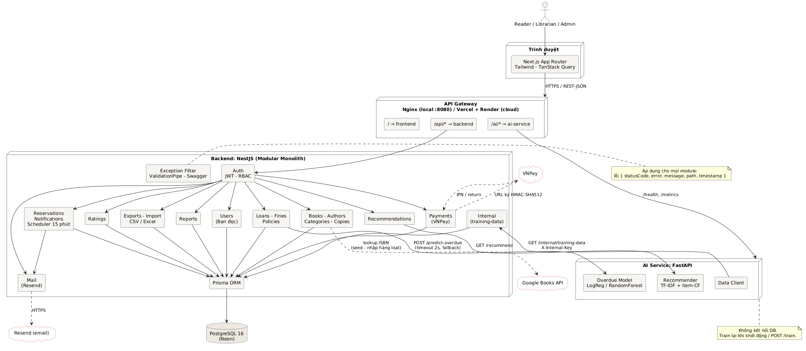

| Thành phần | Vai trò | Công nghệ | Triển khai |
|---|---|---|---|
| **API Gateway** | Một cổng vào duy nhất; định tuyến `/` tới frontend, `/api/*` tới backend, `/ai/*` tới AI service | Nginx (cục bộ, cổng 8080, thân yêu cầu tối đa 6 MB cho `/api/`) | Trên cloud: Vercel (rewrite `/api/*`, `/ai/*`) + Render đóng vai trò gateway |
| **Frontend** | Giao diện cho 3 vai trò, gọi Backend qua REST; trang công khai dựng phía máy chủ | Next.js 15 App Router, TypeScript, TailwindCSS 4, TanStack Query, recharts (nạp lười), uqr (mã QR) | Vercel, https://muce-library.vercel.app |
| **Backend API** | Nguồn sự thật duy nhất; toàn bộ quy tắc nghiệp vụ; xác thực/phân quyền; Swagger; bộ lập lịch 15 phút | NestJS 10, Prisma 6, Passport-JWT, class-validator, exceljs | Render |
| **AI Service** | Gợi ý sách, dự báo trả trễ; lấy dữ liệu huấn luyện từ Backend | FastAPI, scikit-learn, pandas | Render |
| **Database** | Lưu trữ quan hệ, 16 bảng, 3NF; extension `pg_trgm` | PostgreSQL 16 | Neon |
| **Tích hợp ngoài** | Thông tin sách theo ISBN (mô tả, NXB, thể loại, bìa) | Google Books API | không có |
| **Resend** | Gửi email: đặt lại mật khẩu, chào mừng, nhắc hạn | HTTP API `POST https://api.resend.com/emails` | không có |
| **VNPay** | Cổng thanh toán phạt trực tuyến (sandbox) | Chuyển hướng URL ký HMAC-SHA512, IPN và return | không có |

## 2.2. Kiến trúc phân tầng Backend

Mỗi module NestJS tuân theo **Controller → Service → Repository (Prisma)**:

| Tầng | Trách nhiệm | Không được làm |
|---|---|---|
| Controller | Nhận HTTP, validate DTO, kiểm tra JWT/role (Guard), gọi Service, trả DTO | Chứa logic nghiệp vụ, truy vấn DB |
| Service | Toàn bộ quy tắc nghiệp vụ (BR-01…BR-12), transaction, gọi AI/Google Books qua client | Biết về HTTP (request/response) |
| Repository | Truy vấn qua Prisma Client; mỗi Service dùng `PrismaService` | Chứa quy tắc nghiệp vụ |

Thành phần cắt ngang (cross-cutting), thứ tự guard toàn cục: `ThrottlerGuard` (100 yêu cầu/phút/IP, siết riêng từng route), `JwtAuthGuard`, `MustChangePasswordGuard` (tài khoản dùng mật khẩu tạm chỉ được xem hồ sơ và đổi mật khẩu), `RolesGuard` (ADMIN bao hàm LIBRARIAN; route chỉ ghi READER là dành riêng cho bạn đọc). Pipe toàn cục: `ValidationPipe` (whitelist, forbidNonWhitelisted, transform) và `RejectNullBytePipe` (từ chối ký tự NUL). `HttpExceptionFilter` thống nhất định dạng lỗi và đổi lỗi cơ sở dữ liệu đã biết sang 4xx. Swagger (`/api/docs`), `ConfigModule` (biến môi trường), `CirculationScheduler` (việc định kỳ).

## 2.3. Danh sách module Backend

| Module | Đường dẫn | Chức năng SRS |
|---|---|---|
| `auth` (kèm `password-reset`) | `/api/auth` | F1, F13 |
| `users` | `/api/users` | F3, F13 |
| `books` (kèm `import/` nhập từ file), `authors`, `categories`, `copies` (kèm nhãn) | `/api/books`, `/api/authors`, `/api/categories`, `/api/copies` | F2, F5, F15, F16 |
| `loans` | `/api/loans` | F4 |
| `fines` | `/api/fines` | F4 |
| `reservations` | `/api/reservations` | F11 |
| `notifications` (kèm `CirculationScheduler`, `ReminderEmailService`) | `/api/notifications` | F12 |
| `mail` (Resend, mẫu thư) | không có route, dùng nội bộ | F12, F13 |
| `payments` | `/api/payments` | F14 |
| `exports` | `/api/exports` | F15 |
| `policies` | `/api/policies` | F8 |
| `ratings` | `/api/books/:id/ratings` | F7 |
| `reports` | `/api/reports` | F6 |
| `recommendations`, `ai` (`AiClient`) | `/api/recommendations` | F9, F10 |
| `internal` | `/api/internal` | Cấp dữ liệu huấn luyện cho AI |
| `health` | `/api/health` | Giám sát |

## 2.4. Giao tiếp giữa các dịch vụ

| Từ → Đến | Giao thức | Bảo vệ | Timeout / Fallback |
|---|---|---|---|
| Frontend → Backend | REST/JSON, HTTPS | Bearer JWT, CORS whitelist | không có |
| Backend → AI Service | REST/JSON nội bộ | Mạng nội bộ | `predict-overdue` 2 s → `risk = null`; `recommend` 3 s → danh sách rỗng |
| AI Service → Backend | REST/JSON | Header `X-Internal-Key` | Không có dữ liệu → giữ model cũ |
| Backend → Google Books | HTTPS | API key | Không tìm thấy → bỏ qua ISBN đó, báo cáo lại |
| Backend → Resend | HTTPS, Bearer `RESEND_API_KEY`, header `Idempotency-Key` | Khoá API trong biến môi trường; không ghi nội dung thư, token, địa chỉ nhận vào log | Không có khoá: bỏ qua có ghi log. Lỗi nhà cung cấp: trả FAILED, email nhắc hạn thử lại tối đa 5 lần; gửi nền không chờ cho luồng quên mật khẩu |
| Trình duyệt → VNPay | Chuyển hướng tới `paymentUrl` | Tham số `vnp_*` ký HMAC-SHA512 với `VNPAY_HASH_SECRET` | Không đủ cấu hình: 503 `PAYMENT_NOT_CONFIGURED`, giao diện ẩn nút |
| VNPay → Backend | `GET /api/payments/vnpay/ipn`, `GET /api/payments/vnpay/return` | Công khai, xác thực bằng chữ ký và đối chiếu số tiền; không giới hạn tần suất | IPN lặp lại an toàn (idempotent), trả `RspCode` 00, 01, 02, 04, 97, 99 |
| Backend → PostgreSQL | Prisma | Chuỗi kết nối trong biến môi trường | Transaction cho mượn/trả/phạt |

---

# 3. MÔ HÌNH UML

## 3.1. Use Case tổng quan

Ba actor chính với quyền lồng nhau (Admin bao hàm Librarian; các chức năng cá nhân của bạn đọc chỉ dành cho tài khoản Reader), bốn actor phụ là AI Service, Google Books API, Resend và VNPay. Chi tiết mô tả actor và use case ở SRS mục 2.3.

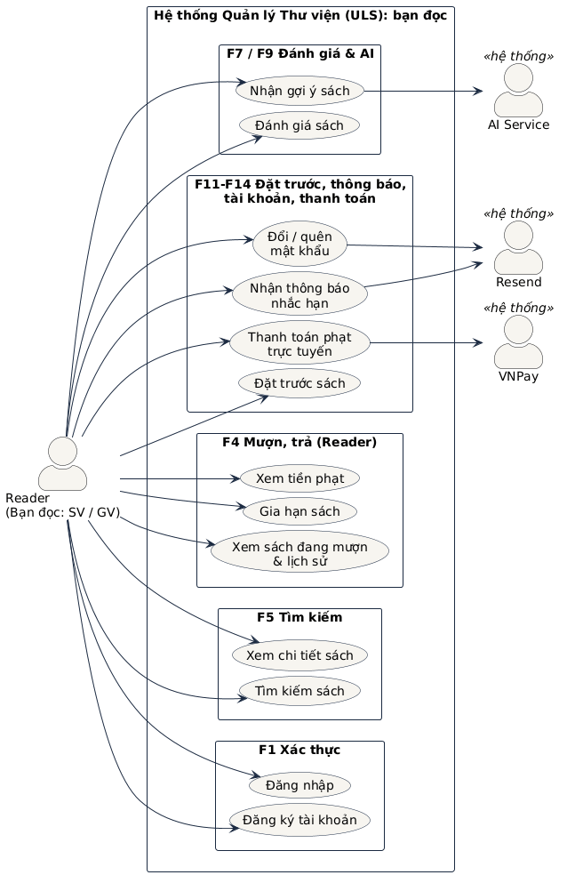

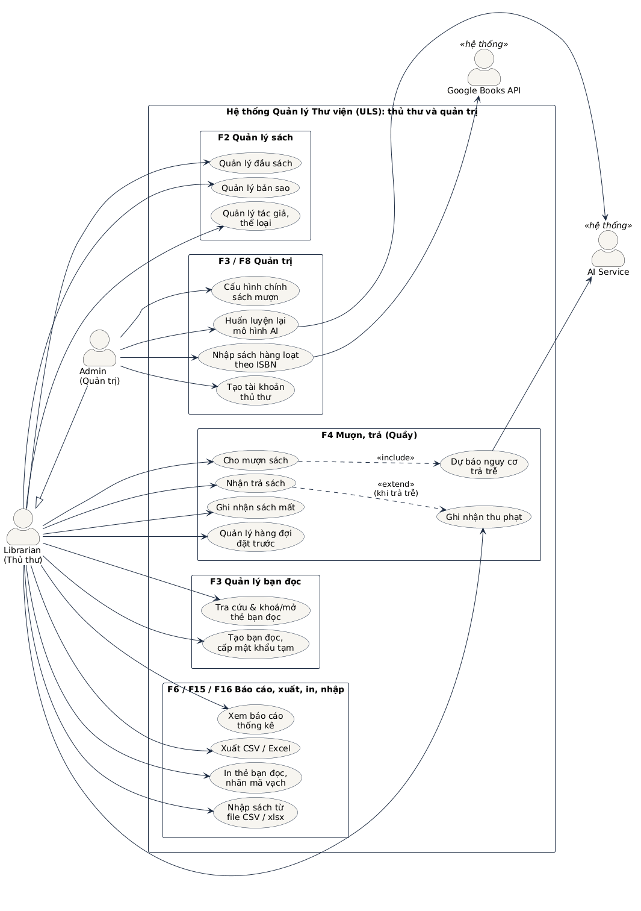

## 3.2. Class Diagram

Sơ đồ lớp gồm hai gói: **Domain** (entity ánh xạ 1-1 với Prisma schema, có phương thức dẫn xuất `isOverdue`, `overdueDays`) và **Application** (các Service của NestJS và hai client ra ngoài `AiClient`, `GoogleBooksClient`). `LoansService` là lớp trung tâm của nghiệp vụ: phụ thuộc `PoliciesService` (lấy chính sách), `FinesService` (tính/tạo phạt), `CopiesService` (đổi trạng thái bản sao) và `AiClient` (dự báo), và từ bản 2.0 còn `ReservationsService` (giữ bản sao cho người đặt trước khi trả sách). Các service thêm sau MVP (`ReservationsService`, `NotificationsService`, `PaymentsService`, `ExportsService`, `BookImportService`, `MailService`, `PasswordResetService`) cùng theo mẫu Controller, Service, Prisma nhưng chưa được vẽ trong Hình 3.2; quan hệ giữa chúng được mô tả ở các hình 3.6 và 3.7 và ở bảng module mục 2.3.

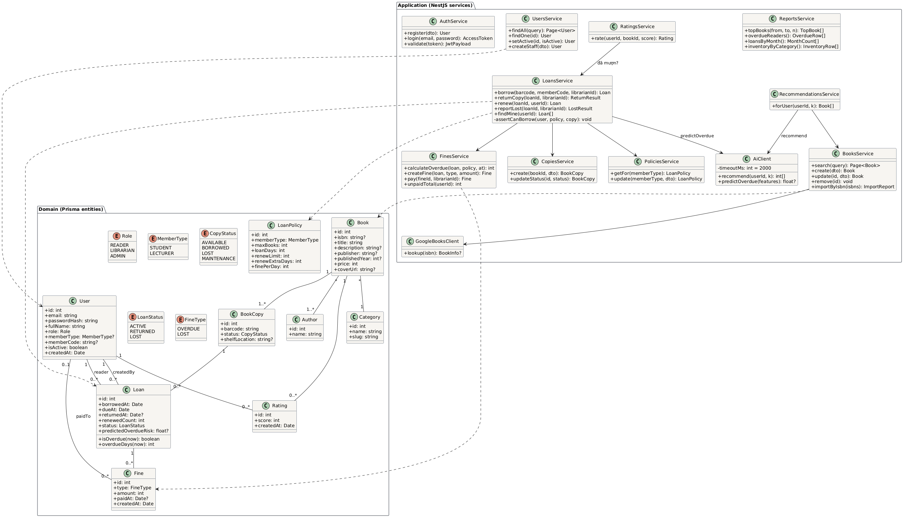

## 3.3. Sequence Diagram

### 3.3.1. Cho mượn sách tại quầy kèm dự báo trả trễ (US07, US19)

Luồng phức tạp nhất của hệ thống: 5 điều kiện chặn (BR-01…BR-05), gọi AI có timeout, và transaction gồm tạo phiếu + đổi trạng thái bản sao.

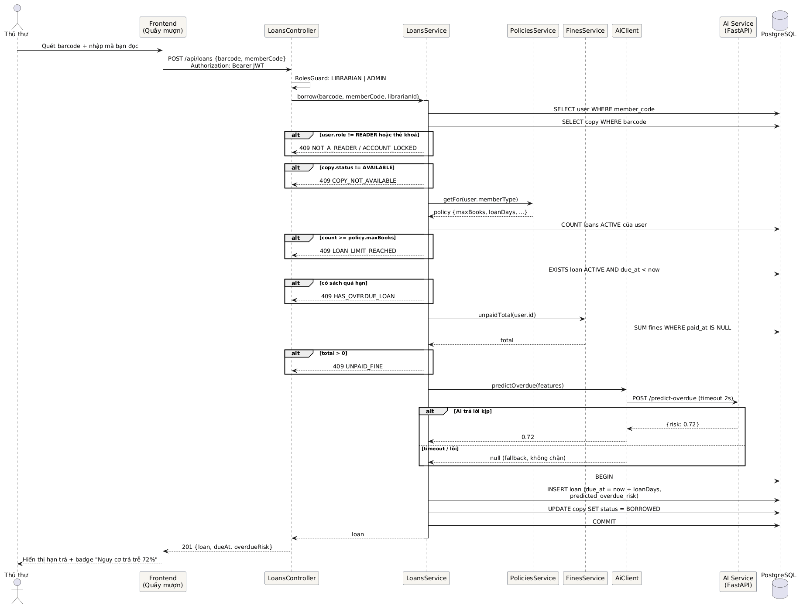

### 3.3.2. Nhận trả sách, tính phạt, thu tiền (US08, US12)

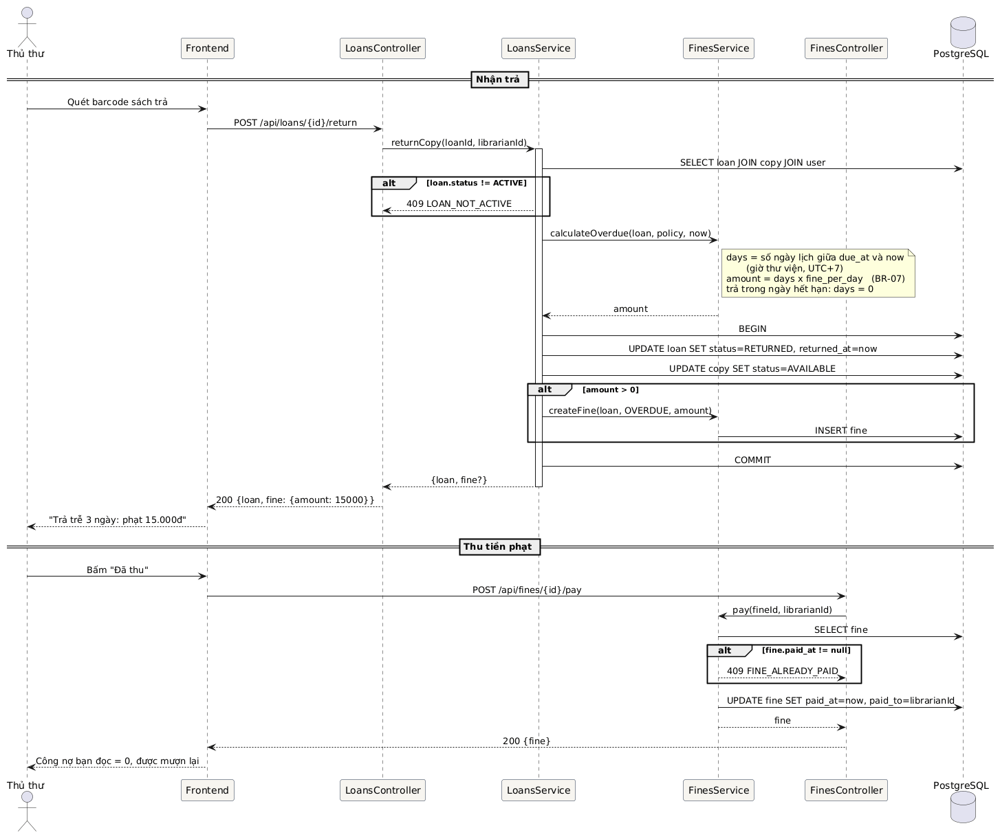

### 3.3.3. Gợi ý sách cá nhân hoá (US18)

Gồm hai pha: huấn luyện (AI Service kéo dữ liệu từ Backend) và phục vụ gợi ý (Backend gọi AI, làm giàu kết quả bằng dữ liệu sách thật, fallback khi AI lỗi).

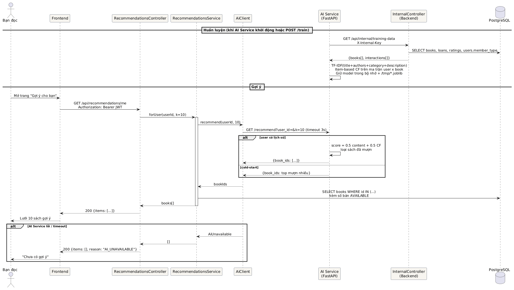

### 3.3.4. Đặt trước, giữ sách và nhận sách (US21, US22, US24)

Bốn pha: bạn đọc đặt trước (khoá hàng bạn đọc để kiểm hạn mức an toàn), bản sao được trả về và giữ cho người đứng đầu hàng đợi (`FOR UPDATE SKIP LOCKED`), nhận sách tại quầy (chỉ đúng người đặt mượn được), và hết hạn giữ do bộ lập lịch hoặc do có người chạm vào bản sao HELD.

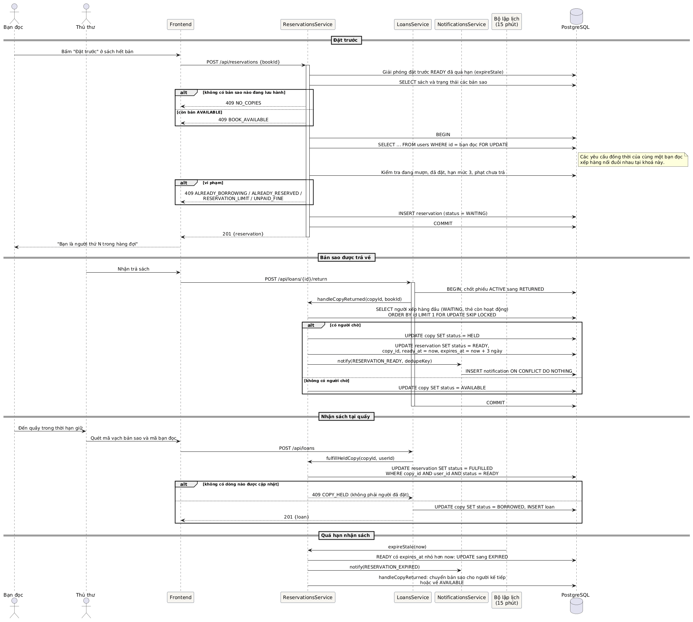

### 3.3.5. Thanh toán phạt qua VNPay (US30, US31)

Số tiền tính ở máy chủ trong giao dịch có khoá dòng; IPN và return cùng đi qua một hàm chốt giao dịch idempotent; tiền về muộn được gắn cờ hoàn tiền thay vì thu hai lần.

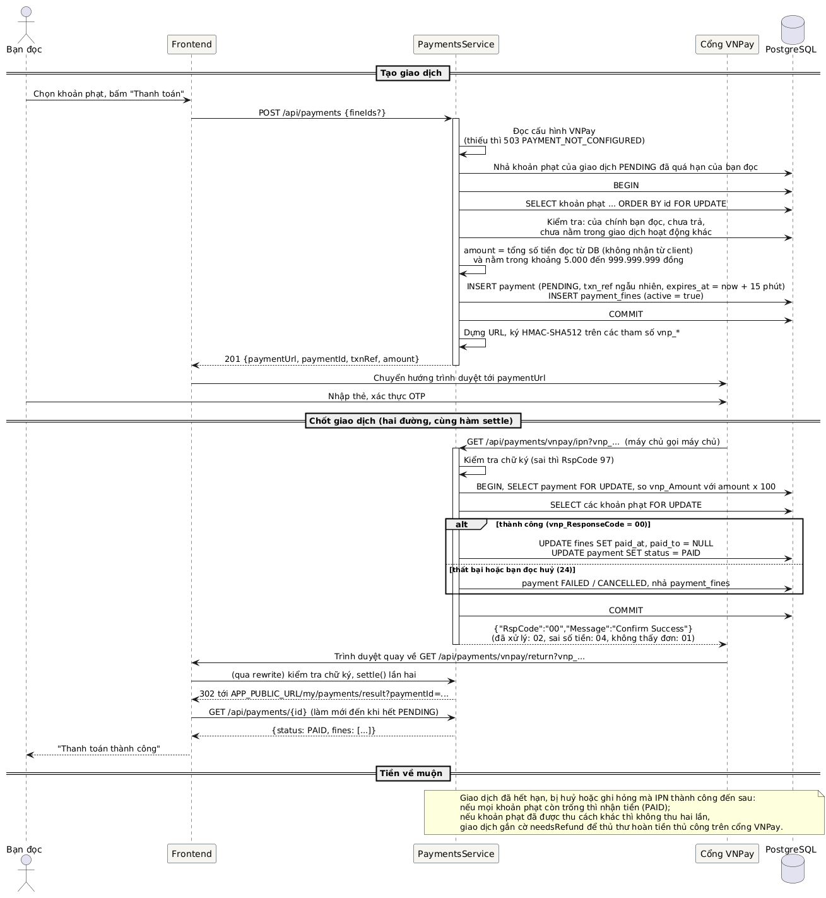

## 3.4. Activity Diagram: quy trình cho mượn

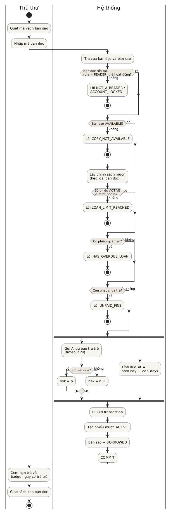

---

# 4. THIẾT KẾ CƠ SỞ DỮ LIỆU

## 4.1. ERD (sinh từ Prisma schema)

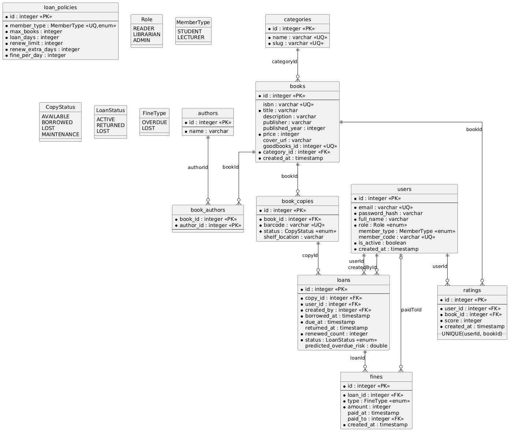

## 4.2. Mô tả bảng

| Bảng | Mục đích | Khoá chính | Khoá ngoại | Ràng buộc |
|---|---|---|---|---|
| `users` | Mọi tài khoản: bạn đọc, thủ thư, admin. Cột bổ sung: `email_reminders` (nhận email nhắc hạn, mặc định true), `must_change_password` (đang dùng mật khẩu tạm), `password_changed_at`, `sessions_revoked_at` (JWT cấp trước mốc này bị từ chối), `last_login_at`, `previous_login_at` | `id` | không có | `email` UNIQUE (lưu chữ thường), `member_code` UNIQUE, `role` enum, `member_type` enum (chỉ READER có); 3 chỉ mục GIN pg_trgm trên `full_name`, `email`, `member_code` cho tìm bạn đọc |
| `loan_policies` | Chính sách mượn theo loại bạn đọc (BR-10) | `id` | không có | `member_type` UNIQUE |
| `authors` | Tác giả | `id` | không có | chỉ mục GIN pg_trgm trên `name` |
| `categories` | Thể loại | `id` | không có | `name`, `slug` UNIQUE |
| `books` | Đầu sách | `id` | `category_id → categories` | `isbn` UNIQUE, `goodbooks_id` UNIQUE, `price` cho phạt mất; chỉ mục GIN pg_trgm trên `title`, `isbn`; btree `category_id` |
| `book_authors` | Quan hệ **n-n** sách, tác giả | (`book_id`, `author_id`) | cả hai, ON DELETE CASCADE | chỉ mục `author_id` |
| `book_copies` | Bản sao vật lý | `id` | `book_id → books` | `barcode` UNIQUE, `status` enum {AVAILABLE, BORROWED, LOST, MAINTENANCE, **HELD**}; HELD là bản đang giữ cho bạn đọc đã đặt trước; chỉ mục (`book_id`, `status`) |
| `loans` | Phiếu mượn | `id` | `copy_id`, `user_id`, `created_by → users` | `status` enum; chỉ mục (`user_id`, `status`), (`copy_id`), (`status`, `due_at`) cho quá hạn và nhắc hạn, (`borrowed_at`) cho báo cáo theo ngày |
| `fines` | Khoản phạt | `id` | `loan_id → loans`, `paid_to → users` (SET NULL) | `type` enum; chỉ mục (`paid_at`), (`loan_id`). `paid_to` rỗng khi khoản phạt được thu qua VNPay |
| `ratings` | Đánh giá sách | `id` | `user_id`, `book_id` | UNIQUE (`user_id`,`book_id`), `score` 1 đến 5; chỉ mục `book_id` |
| `reservations` | Đặt trước sách: `status` {WAITING, READY, FULFILLED, CANCELLED, EXPIRED}, `copy_id` (bản sao đang giữ khi READY), `ready_at`, `expires_at` (hạn nhận, +3 ngày) | `id` | `user_id → users`, `book_id → books`, `copy_id → book_copies` (SET NULL) | chỉ mục (`book_id`, `status`, `created_at`) cho hàng đợi, (`user_id`, `status`) cho hạn mức |
| `notifications` | Thông báo trong web: `type`, `title`, `body`, `link`, `read_at` | `id` | `user_id → users` (CASCADE) | `dedupe_key` UNIQUE (ví dụ `loan:12:due`) chống gửi trùng; chỉ mục (`user_id`, `read_at`, `created_at`) |
| `password_reset_tokens` | Token đặt lại mật khẩu: chỉ lưu `token_hash` (SHA-256), `expires_at` (+1 giờ), `used_at` | `id` | `user_id → users` (CASCADE) | `token_hash` UNIQUE; chỉ mục (`user_id`, `created_at`) |
| `reminder_emails` | Trạng thái email nhắc hạn theo từng phiếu và loại (`kind`: due hoặc overdue): `status` {PENDING, SENT, FAILED, SKIPPED}, `attempts`, `claimed_at`, `sent_at`, `last_error` | `id` | `user_id → users` (CASCADE); `loan_id` không có khoá ngoại | UNIQUE (`loan_id`, `kind`): mỗi phiếu và loại chỉ gửi thành công một lần; chỉ mục (`status`, `id`) |
| `payments` | Giao dịch thanh toán phạt VNPay: `txn_ref`, `amount` (VND, tính ở máy chủ), `status` {PENDING, PAID, FAILED, EXPIRED, CANCELLED}, `vnp_transaction_no`, `bank_code`, `response_code`, `note` (`REFUND_REQUIRED` khi cần hoàn tiền), `expires_at` | `id` | `user_id → users` | `txn_ref` UNIQUE (ngẫu nhiên, khó đoán); CHECK `amount > 0`; chỉ mục (`user_id`, `created_at`), (`status`, `expires_at`) |
| `payment_fines` | Quan hệ **n-n** giao dịch, khoản phạt; `active` = giao dịch đang chờ hoặc đã trả | (`payment_id`, `fine_id`) | `payment_id → payments` (CASCADE), `fine_id → fines` | chỉ mục duy nhất từng phần `payment_fines_active_fine_key` trên `fine_id` WHERE `active`: một khoản phạt thuộc tối đa một giao dịch hoạt động |

**Khoá:** mọi bảng đều có khoá chính (`id` tự tăng, riêng `book_authors` dùng khoá phức `(book_id, author_id)`); mọi liên kết đều khai báo khoá ngoại có ràng buộc tham chiếu, xem phần DDL ở mục 4.4.

**Quan hệ:** 1-n: categories và books, books và book_copies, book_copies và loans, users và loans (2 vai: reader, created_by), loans và fines, users và ratings, books và ratings, users và reservations, books và reservations, book_copies và reservations (tuỳ chọn), users và notifications, users và password_reset_tokens, users và reminder_emails, users và payments. n-n: books và authors qua `book_authors`, payments và fines qua `payment_fines`.

## 4.3. Chuẩn hoá 3NF

- **1NF:** mọi cột nguyên tử; danh sách tác giả không lưu chuỗi "A, B" mà tách bảng `book_authors`.
- **2NF:** bảng có khoá phức `book_authors` không có cột phụ thuộc một phần khoá.
- **3NF:** không có phụ thuộc bắc cầu: thông tin thể loại tách `categories`; chính sách mượn tách `loan_policies` thay vì lặp trong `users`; tiền phạt tách `fines` thay vì cột trong `loans` (một phiếu có thể vừa phạt trễ vừa phạt mất).
- **Dẫn xuất không lưu:** trạng thái "quá hạn" tính từ `due_at`, `returned_at` (BR-09); số bản còn tính từ `book_copies.status`; vị trí trong hàng đợi đặt trước tính từ thứ tự `id` của các đặt trước WAITING cùng đầu sách.
- **Dư thừa có chủ đích:** `reservations.copy_id` và `book_copies.status = HELD` cùng mô tả việc một bản sao đang được giữ. Hai giá trị luôn được đổi trong cùng một giao dịch và cùng thứ tự khoá (đặt trước trước, bản sao sau) để không lệch và không bế tắc. Tương tự `payment_fines.active` với `payments.status`, được đổi cùng giao dịch để chỉ mục duy nhất từng phần diễn đạt được ràng buộc "một khoản phạt, một giao dịch hoạt động".
- `notifications.type` và `reminder_emails.kind` là chuỗi thay vì enum để thêm loại nhắc mới không cần migration; tập giá trị được kiểm trong mã.

## 4.4. DDL minh hoạ

Toàn bộ DDL là `docs/erd/ddl.sql`, gom năm file migration Prisma theo thứ tự thời gian (16 bảng, 8 enum, 14 unique index trong đó một chỉ mục từng phần, 20 foreign key, 1 ràng buộc CHECK, 6 chỉ mục GIN pg_trgm, extension `pg_trgm` được tạo ở migration thứ ba). Trích các bảng trung tâm:

```sql
CREATE TYPE "LoanStatus" AS ENUM ('ACTIVE', 'RETURNED', 'LOST');
CREATE TYPE "FineType"   AS ENUM ('OVERDUE', 'LOST');
ALTER TYPE "CopyStatus" ADD VALUE 'HELD';   -- migration đặt trước

CREATE TABLE "loans" (
    "id"                     SERIAL NOT NULL,
    "copy_id"                INTEGER NOT NULL,
    "user_id"                INTEGER NOT NULL,
    "created_by"             INTEGER NOT NULL,
    "borrowed_at"            TIMESTAMP(3) NOT NULL DEFAULT CURRENT_TIMESTAMP,
    "due_at"                 TIMESTAMP(3) NOT NULL,
    "returned_at"            TIMESTAMP(3),
    "renewed_count"          INTEGER NOT NULL DEFAULT 0,
    "status"                 "LoanStatus" NOT NULL DEFAULT 'ACTIVE',
    "predicted_overdue_risk" DOUBLE PRECISION,
    CONSTRAINT "loans_pkey" PRIMARY KEY ("id")
);
CREATE INDEX "loans_user_id_status_idx" ON "loans"("user_id", "status");
CREATE INDEX "loans_status_due_at_idx" ON "loans"("status", "due_at");
ALTER TABLE "loans" ADD CONSTRAINT "loans_copy_id_fkey"
  FOREIGN KEY ("copy_id") REFERENCES "book_copies"("id") ON DELETE RESTRICT ON UPDATE CASCADE;
ALTER TABLE "loans" ADD CONSTRAINT "loans_user_id_fkey"
  FOREIGN KEY ("user_id") REFERENCES "users"("id") ON DELETE RESTRICT ON UPDATE CASCADE;

CREATE TABLE "fines" (
    "id"         SERIAL NOT NULL,
    "loan_id"    INTEGER NOT NULL,
    "type"       "FineType" NOT NULL,
    "amount"     INTEGER NOT NULL,
    "paid_at"    TIMESTAMP(3),
    "paid_to"    INTEGER,
    "created_at" TIMESTAMP(3) NOT NULL DEFAULT CURRENT_TIMESTAMP,
    CONSTRAINT "fines_pkey" PRIMARY KEY ("id")
);

CREATE TABLE "book_authors" (
    "book_id"   INTEGER NOT NULL,
    "author_id" INTEGER NOT NULL,
    CONSTRAINT "book_authors_pkey" PRIMARY KEY ("book_id","author_id")
);

-- Đặt trước (migration 20261014100000)
CREATE TYPE "ReservationStatus" AS ENUM ('WAITING', 'READY', 'FULFILLED', 'CANCELLED', 'EXPIRED');
CREATE TABLE "reservations" (
    "id"         SERIAL NOT NULL,
    "user_id"    INTEGER NOT NULL,
    "book_id"    INTEGER NOT NULL,
    "copy_id"    INTEGER,
    "status"     "ReservationStatus" NOT NULL DEFAULT 'WAITING',
    "created_at" TIMESTAMP(3) NOT NULL DEFAULT CURRENT_TIMESTAMP,
    "ready_at"   TIMESTAMP(3),
    "expires_at" TIMESTAMP(3),
    CONSTRAINT "reservations_pkey" PRIMARY KEY ("id")
);
CREATE INDEX "reservations_book_id_status_created_at_idx"
  ON "reservations"("book_id", "status", "created_at");

-- Thanh toán VNPay (migration 20261016200000)
CREATE TABLE "payment_fines" (
    "payment_id" INTEGER NOT NULL,
    "fine_id"    INTEGER NOT NULL,
    "active"     BOOLEAN NOT NULL DEFAULT true,
    CONSTRAINT "payment_fines_pkey" PRIMARY KEY ("payment_id","fine_id")
);
ALTER TABLE "payments" ADD CONSTRAINT "payments_amount_positive" CHECK ("amount" > 0);
-- Một khoản phạt chỉ thuộc tối đa MỘT giao dịch đang chờ hoặc đã thanh toán
CREATE UNIQUE INDEX "payment_fines_active_fine_key" ON "payment_fines"("fine_id") WHERE "active";

-- Tìm kiếm ILIKE '%...%' (migration 20261015120000)
CREATE EXTENSION IF NOT EXISTS "pg_trgm";
CREATE INDEX "books_title_trgm_idx" ON "books" USING GIN ("title" gin_trgm_ops);
```

---

# 5. ĐẶC TẢ API

## 5.1. Quy ước chung

- Base URL: `/api` (cục bộ `http://localhost:8080/api`). Swagger UI: `/api/docs`, OpenAPI JSON: `/api/docs-json`.
- Định dạng: JSON, UTF-8. Ngày giờ ISO 8601 (UTC). Tiền: số nguyên VND. Tham số lọc theo ngày dạng `YYYY-MM-DD` được hiểu theo giờ thư viện (UTC+7) và bao trọn ngày cuối.
- Xác thực: `Authorization: Bearer <JWT>`; JWT hạn 24 h, payload `{sub, role, memberType}`. Ở mọi yêu cầu, backend đọc lại tài khoản từ cơ sở dữ liệu (tài khoản khoá hoặc đã xoá: 401; token cấp trước `sessions_revoked_at`: 401; vai trò lấy từ cơ sở dữ liệu).
- Phân trang: `?page=1&limit=20` (limit từ 1 đến 100, mặc định 20) trả `{items, total, page, limit}`.
- Header đặc biệt: `X-Total-Count` (tổng số dòng, ở báo cáo quá hạn và ở các tệp xuất), `X-Export-Truncated` (tệp xuất bị cắt vì vượt trần), `Content-Disposition` (tên tệp tải về). Cả ba được CORS cho phép đọc. Danh mục công khai có `Cache-Control: public, max-age=0, s-maxage=30, stale-while-revalidate=60`; thể loại và chính sách mượn cache lâu hơn (`max-age=60, s-maxage=300`).
- Giới hạn tần suất theo IP, mỗi phút: chung 100; `/auth/login` 10; `/auth/change-password` 5; `/auth/forgot-password` 5; `/auth/reset-password` 10; `POST /users/readers` 30; `POST /users/:id/reset-password` 30; `POST /payments` 30. IPN và return của VNPay không giới hạn. Vượt giới hạn: 429 `TOO_MANY_REQUESTS`.
- Tài khoản dùng mật khẩu tạm (`mustChangePassword`) chỉ gọi được `GET /auth/me` và `POST /auth/change-password`, các API khác trả 403 `PASSWORD_CHANGE_REQUIRED`.
- Các nhóm API bổ sung sau MVP được mô tả ở mục 5.11 (đặt trước), 5.12 (thông báo), 5.13 (thanh toán), 5.14 (xuất dữ liệu); bảng mã lỗi đầy đủ ở mục 5.10.
- Vai trò trong bảng: **Pub** = không cần đăng nhập, **Any** = mọi người dùng đã đăng nhập, **R** = chỉ Reader (Librarian và Admin không gọi được các route này), **L** = Librarian, **A** = Admin (A luôn có quyền của L, nhưng không có quyền của R).

**Mã phản hồi chung:**

| Mã | Ý nghĩa |
|---|---|
| 200 / 201 | Thành công / tạo mới |
| 400 | Dữ liệu vào không hợp lệ (`error: "Bad Request"`, `message` là mảng lỗi từng trường) |
| 401 | Thiếu, sai, hết hạn hoặc bị thu hồi JWT; tài khoản đã khoá |
| 403 | Đúng JWT nhưng sai vai trò, hoặc truy cập dữ liệu người khác |
| 404 | Không tìm thấy tài nguyên |
| 409 | Vi phạm quy tắc nghiệp vụ hoặc trùng dữ liệu, `error` là mã nghiệp vụ (bảng 5.10) |
| 413 | Thân yêu cầu hoặc tệp tải lên quá lớn |
| 415 | Loại tệp không được chấp nhận |
| 422 | Tệp nhập sách sai cấu trúc, hoặc yêu cầu vượt trần cho phép (`TOO_MANY_LABELS`) |
| 429 | Vượt giới hạn tần suất (`TOO_MANY_REQUESTS`) |
| 500 | Lỗi hệ thống |
| 503 | Dịch vụ phụ thuộc không khả dụng (`AI_UNAVAILABLE`, `PAYMENT_NOT_CONFIGURED`) |

**Format lỗi thống nhất (global exception filter):**

```json
{
  "statusCode": 409,
  "error": "UNPAID_FINE",
  "message": "Bạn đọc còn 15.000đ phạt chưa thanh toán",
  "path": "/api/loans",
  "timestamp": "2026-10-01T08:30:00.000Z"
}
```

## 5.2. Auth: `/api/auth`

| Method | URL | Vai trò | Request body | Response |
|---|---|---|---|---|
| POST | `/auth/register` | Pub | `{email, password (8 ký tự đến 72 byte), fullName, memberType: STUDENT\|LECTURER, memberCode}` | 201 `{id, email, fullName, role: READER, memberType, memberCode}` · 400 · 409 `EMAIL_EXISTS` / `MEMBER_CODE_EXISTS` |
| POST | `/auth/login` | Pub | `{email, password}` | 200 `{accessToken, user}` · 400 · 401 `INVALID_CREDENTIALS` · 403 `ACCOUNT_LOCKED` |
| GET | `/auth/me` | Any | không có | 200 `{id, email, fullName, role, memberType, memberCode, isActive, emailReminders, mustChangePassword, lastLoginAt, previousLoginAt}` · 401 |
| PATCH | `/auth/me` | Any | `{fullName?, emailReminders?}` (ít nhất một trường) | 200 User · 400 (gửi email, role, memberCode cũng bị 400) |
| POST | `/auth/change-password` | Any | `{currentPassword, newPassword}` | 200 User · 400 `WRONG_CURRENT_PASSWORD` / `PASSWORD_UNCHANGED` · 409 `PASSWORD_CHANGED_CONCURRENTLY` · 429 (5/phút) |
| POST | `/auth/forgot-password` | Pub | `{email}` | 200 `{message}` luôn cùng nội dung · 429 (5/phút) |
| POST | `/auth/reset-password` | Pub | `{token, newPassword}` | 200 `{ok: true}` · 400 `INVALID_RESET_TOKEN` · 429 (10/phút) |

## 5.3. Users: `/api/users` (quản lý bạn đọc)

| Method | URL | Vai trò | Request | Response |
|---|---|---|---|---|
| GET | `/users?q=&role=&isActive=&page=&limit=` | L | query | 200 `{items: [User], total, page, limit}` · 403 |
| GET | `/users/:id` | L | không có | 200 `{...User, activeLoans, overdueLoans, unpaidFines}` · 404 |
| GET | `/users/:id/loans?status=&page=` | L | query | 200 `{items: [Loan], total}` · 404 |
| PATCH | `/users/:id` | L | `{isActive?, memberType?, fullName?}` | 200 User · 400 · 403 `STAFF_ACCOUNT_PROTECTED` (thủ thư sửa nhân sự) · 404 · 409 `CANNOT_LOCK_SELF` / `NOT_A_READER` |
| POST | `/users` | A | `{email, password, fullName, role: LIBRARIAN\|ADMIN}` | 201 User · 400 · 403 · 409 `EMAIL_EXISTS` |
| POST | `/users/readers` | L | `{email, fullName, memberType, memberCode?}` | 201 `{user, temporaryPassword, welcomeEmailQueued}` (mật khẩu tạm chỉ trả một lần, `Cache-Control: no-store`) · 400 · 409 `EMAIL_EXISTS` / `MEMBER_CODE_EXISTS` / `MEMBER_CODE_GENERATION_FAILED` · 429 (30/phút) |
| POST | `/users/:id/reset-password` | L | không có | 200 `{user, temporaryPassword}` · 403 `STAFF_ACCOUNT_PROTECTED` (thủ thư với nhân sự; Admin được) · 404 · 409 `CANNOT_RESET_SELF` · 429 (30/phút) |

## 5.4. Books, Authors, Categories, Copies

| Method | URL | Vai trò | Request | Response |
|---|---|---|---|---|
| GET | `/books?q=&categoryId=&authorId=&available=&page=&limit=` | Pub | query (`q` khớp một phần tiêu đề, tác giả, ISBN; không phân biệt hoa thường) | 200 `{items: [BookSummary], total, page, limit}` |
| GET | `/books/:id` | Pub | không có | 200 `{...Book, authors[], category, copiesTotal, copiesAvailable, ratingAvg, ratingCount}` · 404 |
| POST | `/books` | L | `{title, isbn?, description?, publisher?, publishedYear?, price, coverUrl?, categoryId, authorIds[]}` | 201 Book · 400 · 409 `ISBN_EXISTS` |
| PATCH | `/books/:id` | L | các trường trên (tuỳ chọn) | 200 Book · 400 · 404 · 409 |
| DELETE | `/books/:id` | L | không có | 204 · 404 · 409 `BOOK_HAS_ACTIVE_LOANS` / `BOOK_HAS_LOAN_HISTORY` |
| POST | `/books/import` | A | `{isbns: string[] (≤100)}` | 200 `{created: [Book], skipped: [{isbn, reason: EXISTS\|NOT_FOUND}]}` · 400 |
| GET | `/books/import-template?format=csv\|xlsx` | L | query | 200 tệp mẫu có dòng ví dụ (CSV UTF-8 có BOM hoặc xlsx) |
| POST | `/books/import-file?dryRun=&onDuplicate=skip\|update` | L | multipart, trường `file` (CSV hoặc xlsx, tối đa 5 MB, 5.000 dòng) | 200 xem trước `{dryRun: true, fileType, totalRows, counts{ok, warning, error, create, update, skip}, newCategories, unknownColumns, notes, rows[{row, status, action, title, isbn, category, copies, errors, warnings, raw?}]}` khi `dryRun=true`; 200 `{dryRun: false, fileType, totalRows, created, updated, skipped, failed[{row, reason, raw}], createdCopies, newCategories, notes}` khi ghi thật · 400 `IMPORT_NO_FILE` · 413 `IMPORT_FILE_TOO_LARGE` · 415 `IMPORT_FILE_TYPE_INVALID` / `IMPORT_MACRO_NOT_ALLOWED` · 422 `IMPORT_TOO_MANY_ROWS` / `IMPORT_MALFORMED` / `IMPORT_MISSING_COLUMN` / `IMPORT_EMPTY` / `IMPORT_ENCODING` |
| GET | `/books/:id/copies` | L | không có | 200 `[BookCopy]` · 404 |
| POST | `/books/:id/copies` | L | `{barcode, shelfLocation?}` | 201 BookCopy · 400 · 404 · 409 `BARCODE_EXISTS` |
| PATCH | `/copies/:id` | L | `{status?, shelfLocation?}` | 200 BookCopy · 400 · 404 · 409 `COPY_HAS_ACTIVE_LOAN` / `COPY_HELD` |
| GET | `/copies/labels?bookIds=1,2&copyIds=3,4` | L | query (bookIds tối đa 200, copyIds tối đa 500) | 200 `[{id, barcode, shelfLocation, status, book: {id, title, isbn}}]` tối đa 2.000 bản · 400 (thiếu cả hai tham số) · 422 `TOO_MANY_LABELS` |
| GET | `/authors?q=&page=` | Pub | query | 200 `{items, total}` |
| POST / PATCH / DELETE | `/authors`, `/authors/:id` | L | `{name}` | 201 / 200 / 204 · 400 · 404 · 409 `AUTHOR_IN_USE` (xoá) |
| GET | `/categories` | Pub | không có | 200 `[Category]` |
| POST / PATCH / DELETE | `/categories`, `/categories/:id` | L | `{name, slug?}` | 201 / 200 / 204 · 400 · 404 · 409 `CATEGORY_EXISTS` / `CATEGORY_IN_USE` |

## 5.5. Loans: `/api/loans`

| Method | URL | Vai trò | Request | Response |
|---|---|---|---|---|
| POST | `/loans` | L | `{barcode, memberCode}` | 201 `{loan: Loan, overdueRisk: number\|null}` · 400 · 404 `USER_NOT_FOUND` / `COPY_NOT_FOUND` · 409 `NOT_A_READER`, `ACCOUNT_LOCKED`, `COPY_NOT_AVAILABLE`, `COPY_HELD` (bản đang giữ cho người khác), `LOAN_LIMIT_REACHED`, `HAS_OVERDUE_LOAN`, `UNPAID_FINE` |
| POST | `/loans/:id/return` | L | không có | 200 `{loan, fine: Fine\|null, overdueDays}` · 404 · 409 `LOAN_NOT_ACTIVE` |
| POST | `/loans/:id/report-lost` | L | không có | 200 `{loan, fine}` · 404 · 409 `LOAN_NOT_ACTIVE` |
| POST | `/loans/:id/renew` | R | không có | 200 Loan · 404 (phiếu không phải của mình) · 409 `LOAN_NOT_ACTIVE`, `RENEW_LIMIT_REACHED`, `LOAN_OVERDUE_CANNOT_RENEW`, `UNPAID_FINE`, `LOAN_CHANGED` |
| GET | `/loans/me?status=&page=` | R | query | 200 `{items: [LoanWithBook], total}` |
| GET | `/loans?status=&overdue=true&userId=&page=` | L | query | 200 `{items: [LoanWithBookUser], total}` |
| GET | `/loans/:id` | L | không có | 200 Loan · 404 |

Đối tượng `Loan`: `{id, copy: {id, barcode, book: {id, title, coverUrl}}, user: {id, fullName, memberCode}, borrowedAt, dueAt, returnedAt, renewedCount, status, predictedOverdueRisk, isOverdue, overdueDays}`.

## 5.6. Fines: `/api/fines`

| Method | URL | Vai trò | Request | Response |
|---|---|---|---|---|
| GET | `/fines/me` | R | không có | 200 `{items: [Fine], unpaidTotal}` |
| GET | `/fines?paid=&userId=&page=` | L | query (`paid` bỏ trống là cả đã và chưa thu) | 200 `{items: [FineWithLoanUser], total}` |
| POST | `/fines/:id/pay` | L | không có | 200 Fine · 404 · 409 `FINE_ALREADY_PAID` / `FINE_PAYMENT_PENDING` (đang nằm trong giao dịch VNPay còn hiệu lực) |

`Fine`: `{id, loanId, type: OVERDUE|LOST, amount, paidAt, paidTo (rỗng khi thu qua VNPay), createdAt, loan: {book: {title}, dueAt, returnedAt}, onlinePayment}`; `onlinePayment` là giao dịch VNPay đang gắn với khoản phạt (nếu có).

## 5.7. Policies, Ratings, Reports

| Method | URL | Vai trò | Request | Response |
|---|---|---|---|---|
| GET | `/policies` | Pub | không có | 200 `[{memberType, maxBooks, loanDays, renewLimit, renewExtraDays, finePerDay}]` |
| PATCH | `/policies/:memberType` | A | `{maxBooks?, loanDays?, renewLimit?, renewExtraDays?, finePerDay?}` (nguyên dương) | 200 Policy · 400 · 403 · 404 |
| POST | `/books/:id/ratings` | R | `{score: 1..5}` | 200 `{id, score}` (tạo hoặc ghi đè) · 400 · 403 `NOT_BORROWED` · 404 |
| GET | `/books/:id/ratings/summary` | Pub | không có | 200 `{avg, count}` |
| GET | `/reports/top-books?from=&to=&limit=10` | L | query (`limit` 1 đến 50) | 200 `[{book, loanCount}]` · 400 (ngày không có thật) |
| GET | `/reports/overdue?limit=5000` | L | query (`limit` 1 đến 5.000) | 200 `[{loanId, user, book, dueAt, overdueDays, estimatedFine}]`, header `X-Total-Count` là tổng số phiếu quá hạn |
| GET | `/reports/loans-by-month?months=12` | L | query (`months` 1 đến 36) | 200 `[{month: "2026-09", count}]`, tháng theo giờ UTC+7 |
| GET | `/reports/inventory` | L | không có | 200 `[{category, total, available, borrowed, lost, maintenance, held}]` |

## 5.8. Recommendations & Internal

| Method | URL | Vai trò | Request | Response |
|---|---|---|---|---|
| GET | `/recommendations/me?k=10` | R | query | 200 `{items: [BookSummary], source: MODEL\|POPULAR\|NONE, reason?}` |
| POST | `/recommendations/train` | A | không có | 202 `{status: "started"}` · 503 `AI_UNAVAILABLE` |
| GET | `/recommendations/metrics` | L | không có | 200 số đo hai mô hình (chuyển tiếp từ AI `/metrics`) · 503 `AI_UNAVAILABLE` |
| GET | `/recommendations/overdue-accuracy` | L | không có | 200 `{sampled, predictedHigh, actuallyLate, hitRate}`, đối chiếu dự báo đã lưu với kết quả thật |
| GET | `/internal/training-data` | AI (header `X-Internal-Key`) | không có | 200 `{books: [{id, title, authors, category, description}], interactions: [{userId, bookId, type: LOAN\|RATING, score?, borrowedAt?, dueAt?, returnedAt?}], users: [{id, memberType}]}` · 401 |
| GET | `/health` | Pub | không có | 200 `{status, service, database, timestamp}` |

## 5.9. AI Service (nội bộ, cổng 8000, qua gateway `/ai`)

| Method | URL | Request | Response |
|---|---|---|---|
| GET | `/health` | không có | 200 `{status, service, models: {recommender, overdue}}` |
| GET | `/recommend?user_id=&k=10` | query | 200 `{user_id, book_ids: [int], source: "model"\|"popular"}` · 503 model chưa sẵn sàng |
| POST | `/predict-overdue` | `{member_type, prior_loans, prior_overdue, active_loans, category_id, loan_days, month}` | 200 `{risk: 0.0 đến 1.0, model: "rf"\|"logreg"}` · 503 |
| POST | `/train` | không có | 202 `{status: "training"}` |
| GET | `/metrics` | không có | 200 `{recommender: {books, users, interactions, precision_at_5, recall_at_5, evaluated_users, trained_at}, overdue: {samples, positive_rate, chosen, logistic_regression: {...}, random_forest: {...}, trained_at}, lastTraining, note}` |

## 5.10. Bảng mã lỗi nghiệp vụ

Bảng đối chiếu từ mọi chỗ `BusinessException` trong mã nguồn. Cột HTTP là mã mặc định; mã khác ghi rõ.

| Mã (`error`) | HTTP | Khi nào | Quy tắc |
|---|---|---|---|
| `EMAIL_EXISTS`, `MEMBER_CODE_EXISTS` | 409 | Đăng ký, tạo bạn đọc, tạo nhân sự trùng (kể cả hai yêu cầu đồng thời) | FR-AUTH-01, FR-ACC-05 |
| `MEMBER_CODE_GENERATION_FAILED` | 409 | Không sinh được mã thẻ duy nhất sau 5 lần thử | FR-ACC-05 |
| `INVALID_CREDENTIALS` | 401 | Sai email hoặc mật khẩu | FR-AUTH-02 |
| `ACCOUNT_LOCKED` | 403 (đăng nhập) / 409 (mượn, đặt trước) | Thẻ bị khoá | FR-AUTH-05, BR-05 |
| `PASSWORD_CHANGE_REQUIRED` | 403 | Đang dùng mật khẩu tạm mà gọi API khác ngoài `/auth/me`, `/auth/change-password` | FR-ACC-07, BR-19 |
| `WRONG_CURRENT_PASSWORD`, `PASSWORD_UNCHANGED` | 400 | Đổi mật khẩu sai mật khẩu hiện tại, hoặc mật khẩu mới trùng cũ | FR-ACC-02, BR-18 |
| `PASSWORD_CHANGED_CONCURRENTLY` | 409 | Mật khẩu vừa được đổi ở nơi khác giữa hai bước | FR-ACC-02 |
| `INVALID_RESET_TOKEN` | 400 | Token đặt lại sai, hết hạn, đã dùng, hoặc của tài khoản khoá | FR-ACC-04, BR-20 |
| `STAFF_ACCOUNT_PROTECTED` | 403 | Thủ thư sửa hoặc cấp lại mật khẩu cho tài khoản nhân sự | FR-USER-06, BR-21 |
| `CANNOT_LOCK_SELF`, `CANNOT_RESET_SELF` | 409 | Tự khoá, tự cấp lại mật khẩu tạm | BR-21 |
| `NOT_A_READER` | 409 | Cho mượn, đặt trước, sửa loại bạn đọc với tài khoản không phải READER | BR-01 |
| `COPY_NOT_AVAILABLE` | 409 | Bản sao không AVAILABLE (hoặc vừa bị người khác mượn) | BR-05 |
| `COPY_HELD` | 409 | Mượn bản HELD của người khác; đặt hoặc gỡ HELD bằng tay | FR-LOAN-09, BR-16 |
| `LOAN_LIMIT_REACHED` | 409 | Đủ số cuốn theo chính sách (kiểm lại trong giao dịch) | BR-02 |
| `HAS_OVERDUE_LOAN` | 409 | Đang có phiếu quá hạn | BR-03 |
| `UNPAID_FINE` | 409 | Còn phạt chưa trả (mượn, gia hạn, đặt trước) | BR-04, BR-06, BR-14 |
| `LOAN_NOT_ACTIVE` | 409 | Trả, gia hạn, báo mất phiếu đã đóng (kể cả trả đồng thời) | FR-LOAN-03 |
| `RENEW_LIMIT_REACHED` | 409 | Hết lượt gia hạn | BR-06 |
| `LOAN_OVERDUE_CANNOT_RENEW` | 409 | Gia hạn khi đã quá hạn | BR-06 |
| `LOAN_CHANGED` | 409 | Phiếu vừa bị thay đổi bởi yêu cầu khác khi gia hạn, thử lại | FR-LOAN-10 |
| `FINE_ALREADY_PAID` | 409 | Thu lại khoản đã thu, hoặc đưa khoản đã trả vào giao dịch | FR-FINE-02 |
| `FINE_PAYMENT_PENDING` | 409 | Thu tiền mặt hoặc tạo giao dịch cho khoản phạt đang nằm trong giao dịch chờ | FR-PAY-02, FR-PAY-08, BR-23 |
| `NOT_BORROWED` | 403 | Chấm sao sách chưa từng mượn và trả | BR-11 |
| `NO_COPIES` | 409 | Đặt trước sách không có bản sao lưu hành | BR-13 |
| `BOOK_AVAILABLE` | 409 | Đặt trước sách đang còn bản trên kệ | BR-13 |
| `ALREADY_BORROWING`, `ALREADY_RESERVED` | 409 | Đặt trước sách đang mượn, hoặc đã đặt | BR-14 |
| `RESERVATION_LIMIT` | 409 | Đã có 3 đặt trước hiệu lực | BR-14 |
| `RESERVATION_NOT_ACTIVE` | 409 | Huỷ đặt trước đã kết thúc | FR-RES-07 |
| `PAYMENT_NOT_CONFIGURED` | 503 | Thiếu `VNPAY_TMN_CODE`, `VNPAY_HASH_SECRET` hoặc địa chỉ return | FR-PAY-01 |
| `NO_UNPAID_FINES` | 409 | Tạo giao dịch khi không có khoản phạt cần trả | FR-PAY-02 |
| `PAYMENT_AMOUNT_TOO_SMALL`, `PAYMENT_AMOUNT_TOO_LARGE` | 409 | Tổng tiền dưới 5.000 hoặc trên 999.999.999 đồng | BR-22 |
| `PAYMENT_NOT_PENDING` | 409 | Huỷ giao dịch không còn ở trạng thái chờ | FR-PAY-08 |
| `ISBN_EXISTS`, `BARCODE_EXISTS`, `CATEGORY_EXISTS` | 409 | Trùng khoá duy nhất (kể cả đua) | FR-BOOK-01, FR-COPY-01 |
| `BOOK_HAS_ACTIVE_LOANS`, `BOOK_HAS_LOAN_HISTORY` | 409 | Xoá sách còn bản đang mượn, hoặc đã có lịch sử mượn | BR-12 |
| `COPY_HAS_ACTIVE_LOAN` | 409 | Đổi trạng thái bản sao đang có phiếu ACTIVE, hoặc đặt BORROWED bằng tay | FR-COPY-02 |
| `CATEGORY_IN_USE`, `AUTHOR_IN_USE` | 409 | Xoá thể loại hoặc tác giả còn sách | BR-12 |
| `TOO_MANY_LABELS` | 422 | Chọn quá 2.000 nhãn | FR-EXP-07 |
| `IMPORT_NO_FILE` | 400 | Không có trường multipart `file` | FR-IMP-06 |
| `IMPORT_FILE_TOO_LARGE` | 413 | Tệp quá 5 MB, hoặc giải nén quá lớn | FR-IMP-05 |
| `IMPORT_FILE_TYPE_INVALID`, `IMPORT_MACRO_NOT_ALLOWED` | 415 | Không phải CSV hoặc xlsx; tệp có macro | FR-IMP-05 |
| `IMPORT_TOO_MANY_ROWS`, `IMPORT_MALFORMED`, `IMPORT_MISSING_COLUMN`, `IMPORT_EMPTY`, `IMPORT_ENCODING` | 422 | Quá 5.000 dòng, tệp hỏng, thiếu cột, rỗng, không phải UTF-8 | FR-IMP-05 |
| `AI_UNAVAILABLE` | 503 (train, metrics) / fallback | AI Service không phản hồi | NFR-AVAIL-03 |
| `TOO_MANY_REQUESTS` | 429 | Vượt giới hạn tần suất | NFR-SEC-05 |
| `NOT_FOUND`, `CONFLICT`, `REFERENCE_CONFLICT` | 404, 409, 409 | Lỗi cơ sở dữ liệu đã biết (không thấy bản ghi, trùng không rõ khoá, vi phạm tham chiếu) được đổi từ lỗi 500 | NFR-SEC-13 |

Mã trả về cho lỗi kiểm tra đầu vào (400) không có mã nghiệp vụ: `error` là `Bad Request` và `message` là mảng lỗi từng trường.

## 5.11. Reservations: `/api/reservations`

| Method | URL | Vai trò | Request | Response |
|---|---|---|---|---|
| POST | `/reservations` | R | `{bookId}` | 201 Reservation `{id, status: WAITING, book, copy, user, createdAt, readyAt, expiresAt}` · 404 · 409 `NO_COPIES`, `BOOK_AVAILABLE`, `ALREADY_BORROWING`, `ALREADY_RESERVED`, `RESERVATION_LIMIT`, `UNPAID_FINE`, `ACCOUNT_LOCKED`, `NOT_A_READER` |
| GET | `/reservations/me` | R | không có | 200 `[Reservation + queuePosition]` (WAITING và READY, mới nhất trước; `queuePosition` từ 1 với WAITING, 0 với READY) |
| GET | `/reservations?status=&bookId=&page=&limit=` | L | query (mặc định WAITING và READY) | 200 `{items: [Reservation], total, page, limit}` xếp theo `id` tăng dần |
| DELETE | `/reservations/:id` | Any | không có | 200 Reservation (CANCELLED) · 404 (Reader huỷ đặt trước của người khác) · 409 `RESERVATION_NOT_ACTIVE` |

Các lời gọi đọc và tạo đều chạy `expireStale` trước để giải phóng bản sao HELD đã quá hạn nhận.

## 5.12. Notifications: `/api/notifications`

| Method | URL | Vai trò | Request | Response |
|---|---|---|---|---|
| GET | `/notifications/me` | Any | không có | 200 `{items: [{id, type, title, body, link, readAt, createdAt}], unread}` (30 thông báo mới nhất) |
| POST | `/notifications/read-all` | Any | không có | 200 `{updated: n}` |
| POST | `/notifications/:id/read` | Any | không có | 200 `{ok: true}` · 404 (không phải của mình) |

Loại thông báo (`type`): `LOAN_DUE_SOON`, `LOAN_OVERDUE`, `RESERVATION_READY`, `RESERVATION_EXPIRED`. `dedupe_key` có dạng `loan:<id>:due`, `loan:<id>:overdue`, `reservation:<id>:ready`, `reservation:<id>:expired`.

## 5.13. Payments: `/api/payments`

| Method | URL | Vai trò | Request | Response |
|---|---|---|---|---|
| POST | `/payments` | R | `{fineIds?: number[] (1 đến 100)}` | 201 `{paymentUrl, paymentId, txnRef, amount, expiresAt}` · 404 (khoản phạt không phải của mình) · 409 `NO_UNPAID_FINES`, `FINE_ALREADY_PAID`, `FINE_PAYMENT_PENDING`, `PAYMENT_AMOUNT_TOO_SMALL`, `PAYMENT_AMOUNT_TOO_LARGE` · 429 (30/phút) · 503 `PAYMENT_NOT_CONFIGURED` |
| GET | `/payments/config` | Any | không có | 200 `{online, minAmount, maxAmount, ttlMinutes}` |
| GET | `/payments/me?page=&limit=` | R | query | 200 `{items: [Payment], total, page, limit}` mới nhất trước |
| GET | `/payments/:id` | R, L | không có | 200 Payment (chủ giao dịch hoặc thủ thư) · 404 |
| POST | `/payments/:id/cancel` | R, L | không có | 200 Payment (CANCELLED) · 404 · 409 `PAYMENT_NOT_PENDING` |
| GET | `/payments/vnpay/ipn` | Pub | tham số `vnp_*` (VNPay gọi) | 200 `{RspCode, Message}`: 00 xác nhận, 01 không thấy đơn, 02 đã xác nhận, 04 sai số tiền, 97 sai chữ ký, 99 lỗi khác |
| GET | `/payments/vnpay/return` | Pub | tham số `vnp_*` (trình duyệt) | 302 tới `${APP_PUBLIC_URL}/my/payments/result?paymentId=...` hoặc `?error=not_configured\|invalid_signature\|not_found\|invalid_amount\|unknown` |

`Payment`: `{id, txnRef, amount, status: PENDING|PAID|FAILED|EXPIRED|CANCELLED, vnpTransactionNo, bankCode, responseCode, needsRefund, createdAt, paidAt, expiresAt, user, fines: [{id, type, amount, loanId, bookTitle}]}`. `needsRefund = true` khi tiền về sau khi khoản phạt đã được xử lý cách khác.

## 5.14. Exports: `/api/exports`

Tất cả là `GET`, vai trò L, tham số `format=csv|xlsx` (mặc định csv). Phản hồi là tệp phát trực tiếp, header `Content-Disposition`, `X-Total-Count`, `X-Export-Truncated`, `Cache-Control: no-store`.

| URL | Bộ lọc | Nội dung |
|---|---|---|
| `/exports/overdue-loans` | không có | Phiếu đang quá hạn kèm số ngày trễ, phạt ước tính |
| `/exports/loans` | `from`, `to`, `status`, `overdue`, `userId` | Phiếu mượn theo ngày mượn |
| `/exports/top-books` | `from`, `to`, `limit` (1 đến 1.000, mặc định 50) | Sách mượn nhiều nhất |
| `/exports/inventory` | không có | Tồn kho theo thể loại (kèm số bản đang giữ) |
| `/exports/fines` | `from`, `to`, `paid`, `userId` | Khoản phạt |
| `/exports/readers` | `q`, `isActive`, `memberType` | Bạn đọc kèm số sách đang mượn |
| `/exports/books` | `q`, `categoryId`, `authorId`, `available` | Danh mục sách kèm số bản sao |

Trần 100.000 dòng mỗi lần (biến `EXPORT_MAX_ROWS`), lô 1.000 dòng, CSV UTF-8 có BOM chống formula injection, Excel dùng kiểu thật.

---

# 6. THIẾT KẾ BẢO MẬT VÀ XỬ LÝ LỖI

| Mối đe doạ | Biện pháp | Yêu cầu |
|---|---|---|
| Lộ mật khẩu | bcrypt cost 10; không bao giờ trả `passwordHash` (DTO response tách riêng) | NFR-SEC-01 |
| Giả mạo token | JWT HS256, secret từ biến môi trường, hạn 24 h; `JwtAuthGuard` toàn cục, route công khai đánh dấu `@Public()` | NFR-SEC-02 |
| Dùng lại JWT của tài khoản đã khoá, hạ quyền chưa có hiệu lực, phiên cũ sau khi đặt lại mật khẩu | `JwtStrategy.validate` đọc người dùng từ cơ sở dữ liệu ở mọi yêu cầu: từ chối khi không còn, đã khoá, hoặc `iat` nhỏ hơn `sessions_revoked_at`; vai trò lấy từ cơ sở dữ liệu | NFR-SEC-02, FR-AUTH-06/07 |
| Leo thang quyền | `RolesGuard` đọc `@Roles()`; Reader chỉ truy cập `/me`; service kiểm tra `loan.userId === req.user.id` khi gia hạn | NFR-SEC-03 |
| Dữ liệu vào độc hại | `ValidationPipe` whitelist + forbidNonWhitelisted; Prisma tham số hoá | NFR-SEC-04, 06 |
| Brute-force, dội thư, lạm dụng API | `@nestjs/throttler`: chung 100 yêu cầu/phút/IP; `/auth/login` 10; `/auth/change-password` 5; `/auth/forgot-password` 5; `/auth/reset-password` 10; tạo bạn đọc và cấp lại mật khẩu tạm 30; tạo giao dịch thanh toán 30. IPN và return của VNPay bỏ giới hạn (`@SkipThrottle`) vì chỉ xác thực bằng chữ ký và đến từ vài IP cố định | NFR-SEC-05 |
| Dò email đã đăng ký | Quên mật khẩu luôn trả 200 cùng nội dung, gửi thư nền và san phẳng thời gian phản hồi (tối thiểu 400 ms, cấu hình `FORGOT_PASSWORD_MIN_MS`); đăng nhập chạy bcrypt với băm giả khi email không tồn tại; lỗi đăng nhập không nói sai email hay sai mật khẩu | NFR-SEC-09, FR-AUTH-02 |
| Lộ hoặc đoán token đặt lại mật khẩu | Token 32 byte ngẫu nhiên, chỉ lưu SHA-256, dùng một lần (câu `UPDATE ... WHERE used_at IS NULL AND expires_at > now` chỉ một giao dịch thắng), hạn 1 giờ, yêu cầu mới vô hiệu token cũ, cách nhau 60 giây; mọi lỗi token trả cùng một mã; API mật khẩu có `Cache-Control: no-store`; nên tắt theo dõi bấm liên kết (click tracking) của Resend để token không đi qua trang chuyển hướng của bên thứ ba | NFR-SEC-09, BR-20 |
| Mật khẩu tạm bị dùng lâu dài | Sinh bằng `crypto.randomInt`, 12 ký tự, trả một lần, cờ `must_change_password` được ép ở backend bằng `MustChangePasswordGuard`, không phụ thuộc giao diện | FR-ACC-07, BR-19 |
| Thủ thư leo thang lên nhân sự, tự khoá mình | `STAFF_ACCOUNT_PROTECTED`, `CANNOT_LOCK_SELF`, `CANNOT_RESET_SELF` | FR-USER-06, BR-21 |
| Gọi trộm endpoint nội bộ | `InternalKeyGuard` so sánh `X-Internal-Key` | NFR-SEC-08 |
| Lỗi không đồng nhất | `HttpExceptionFilter` bắt mọi exception → format mục 5.1; lỗi 500 được log, không lộ stack | FR-LOAN-08 |
| Mất nhất quán dữ liệu | `prisma.$transaction` cho mượn/trả/báo mất/thu phạt/đặt trước/thanh toán | NFR-AVAIL-02 |
| Chạy đua (mượn trùng bản sao, vượt hạn mức, trả hoặc gia hạn hoặc thu phạt song song, đặt trước vượt hạn mức, hai IPN cùng lúc) | Khoá hàng bạn đọc `SELECT ... FOR UPDATE` rồi kiểm tra lại trong giao dịch; chiếm bản sao bằng `UPDATE ... WHERE status = <giá trị đã đọc>`; chốt chuyển trạng thái phiếu bằng `updateMany` có điều kiện; gia hạn có điều kiện theo `renewed_count`; thu phạt có điều kiện `paid_at IS NULL`; `FOR UPDATE SKIP LOCKED` chọn người đứng đầu hàng đợi; khoá dòng giao dịch rồi các dòng phạt theo thứ tự `id`; khoá advisory khi nhập sách; thứ tự khoá thống nhất (đặt trước trước, bản sao sau) để không bế tắc; chỉ mục duy nhất từng phần là chốt cuối | NFR-AVAIL-05, FR-LOAN-10 |
| Giả mạo kết quả thanh toán, thu hai lần | Chữ ký HMAC-SHA512 trên toàn bộ tham số `vnp_*` kiểm ở IPN và return; số tiền tính lại ở máy chủ và so với `vnp_Amount`; `txnRef` ngẫu nhiên; một hàm `settle()` idempotent dùng chung; chuyển hướng chỉ dưới `APP_PUBLIC_URL`; khoá bí mật chỉ ở biến môi trường và không vào log; tiền về muộn gắn `needsRefund` | NFR-SEC-10, BR-22…24 |
| Formula injection khi mở CSV bằng Excel | Ô văn bản bắt đầu bằng `=`, `+`, `-`, `@`, tab, CR được thêm dấu `'` phía trước | NFR-SEC-11 |
| Tệp tải lên độc hại (macro, zip bomb, công thức, giả đuôi) | Xác định loại bằng magic bytes; trần 5 MB, 5.000 dòng, 25 MB giải nén mỗi phần (đếm byte thật); từ chối `.xlsm` và `vbaProject.bin`; chỉ đọc giá trị đã tính của ô, không thực thi công thức; URL ảnh bìa chỉ `http` và `https`; multer khai báo giới hạn `files`, `fields`, `parts` | NFR-SEC-12 |
| Đầu vào gây lỗi 500 | `RejectNullBytePipe` (ký tự NUL), `ParseIdPipe` và `@IsEntityId` (id ngoài miền INT4), thoát `%`, `_`, `\` trong tìm kiếm, bộ lọc lỗi đổi P2002, P2025, P2003 sang 409, 404, 409 có mã nghiệp vụ | NFR-SEC-13 |
| Chuyển hướng mở sau đăng nhập, nhúng khung, đoán loại nội dung | Giao diện chặn open redirect ở tham số `next`; header `X-Frame-Options: SAMEORIGIN`, `X-Content-Type-Options: nosniff`, `Referrer-Policy: strict-origin-when-cross-origin` | NFR-SEC-14 |
| Lộ bí mật qua log hoặc mã nguồn | `RESEND_API_KEY`, `VNPAY_HASH_SECRET`, `JWT_SECRET`, `INTERNAL_API_KEY` chỉ ở biến môi trường (`sync: false` hoặc `generateValue` trong `render.yaml`); log không chứa nội dung thư, token, địa chỉ nhận, khoá | NFR-SEC-13, NFR-SEC-14 |

---

# 7. QUYẾT ĐỊNH THIẾT KẾ (ADR rút gọn)

| # | Quyết định | Lý do | Hệ quả |
|---|---|---|---|
| 1 | Modular monolith + AI tách riêng thay vì 4 đến 5 microservices | Nghiệp vụ cần transaction chung; nhóm nhỏ; hạ tầng free | Sơ đồ kiến trúc vẫn có gateway, 3 dịch vụ, DB, tích hợp ngoài; dễ tách thêm sau |
| 2 | "Quá hạn" là trạng thái dẫn xuất, đếm theo ngày lịch | Tránh cron và trạng thái lệch; phạt theo ngày lịch đúng cách thư viện tính | Truy vấn dùng `due_at < overdueCutoff(now)` (nửa đêm đầu ngày hôm nay, giờ thư viện); có index `due_at`; hàm chung `src/common/date.util.ts` để API và báo cáo không lệch nhau |
| 3 | Chính sách mượn trong bảng, chụp vào phiếu lúc tạo | Admin đổi qua UI; phiếu cũ không bị ảnh hưởng | `due_at` tính tại thời điểm mượn (BR-10) |
| 4 | AI không chạm DB, lấy dữ liệu qua `/internal/training-data` | Một nơi sở hữu schema; AI thay được | Backend thêm 1 endpoint; AI cần key |
| 7 | Mô hình giữ trong bộ nhớ, huấn luyện lại khi khởi động và khi gọi `/train` | 1.000 sách × 2.000 bạn đọc train hết ~1,5 s nên không cần lưu `.joblib` lên đĩa ephemeral của Render | Khởi động lại là mất model vài giây rồi có lại; `/health` báo `not_loaded` trong lúc đó, API gọi vào nhận 503 và Backend tự fallback |
| 8 | Phiếu `LOST` không được coi là lần trả | Nếu tính là trả thì mô hình học nhầm là trả đúng hạn | `/internal/training-data` trả `returnedAt = null` cho phiếu LOST |
| 5 | Gọi AI có timeout + fallback | Render free cold start ~50 s không được chặn quầy | `overdueRisk` có thể null; UI hiển thị "không có dự báo" |
| 6 | Google Books chỉ ở seed và nhập hàng loạt, không gọi khi tra cứu | Giới hạn 1.000 req/ngày; tra cứu phải < 1 s | Dữ liệu sách lưu cục bộ, có `goodbooks_id`/`isbn` để đối chiếu |
| 9 | Gửi email qua Resend (HTTP API) thay vì SMTP | Render gói miễn phí chặn cổng SMTP; HTTP API có `Idempotency-Key` nên gửi lại không phát hai thư; cấu hình bằng một khoá | Thiếu `RESEND_API_KEY` thì mọi việc gửi bị bỏ qua có ghi log, ứng dụng vẫn chạy; thủ thư dùng mật khẩu tạm làm đường thay thế; Resend giới hạn 2 thư/giây nên nhắc hạn nghỉ 600 ms giữa hai thư; tên miền gửi cần xác minh SPF/DKIM khi chạy thật |
| 10 | VNPay: return và IPN đều chốt giao dịch qua một hàm `settle()` idempotent | Sandbox thường không gọi được IPN (cần URL công khai) và bạn đọc có thể đóng tab trước khi quay về; hai đường phải cho cùng kết quả dù đến lần lượt hay đồng thời | Khoá dòng giao dịch rồi dòng phạt trước khi đổi gì; IPN lặp trả 02; tiền về muộn vào trạng thái `needsRefund` thay vì thu hai lần; số tiền được so bằng chuỗi nguyên văn (`vnp_Amount` = tiền x 100) để tránh lỗi làm tròn |
| 11 | Chống đua bằng khoá hàng, cập nhật có điều kiện, khoá advisory và chỉ mục duy nhất từng phần, không dùng khoá trong bộ nhớ ứng dụng hay mức cô lập SERIALIZABLE | Backend có thể chạy nhiều instance; PostgreSQL là nơi duy nhất phân xử; SERIALIZABLE phải thử lại giao dịch và khó kiểm thử | Mọi đường ghi quan trọng có ca đua trong e2e trên PostgreSQL thật; thứ tự khoá thống nhất để không bế tắc; chỉ mục từng phần `payment_fines_active_fine_key` làm chốt cuối cho khoản phạt |
| 12 | Tìm kiếm dùng GIN pg_trgm và truy vấn UNION ba chỉ mục | Điều kiện `title ILIKE OR isbn LIKE OR id IN (tác giả)` do Prisma sinh ra buộc quét tuần tự dù có chỉ mục trigram; btree trên `title` không phục vụ được `ILIKE '%...%'` | Viết SQL thô cho tìm sách; từ khoá hiếm trên 50.000 sách giảm từ 258 ms xuống 9,6 ms (đo HTTP); cần extension `pg_trgm` (Neon và Render cho phép); không bỏ dấu tiếng Việt khi so khớp |
| 13 | Việc định kỳ chạy trong tiến trình API mỗi 15 phút, kèm giải phóng lười khi truy cập, thay vì cron ngoài | Một instance miễn phí đủ dùng; Render free ngủ nên lượt quét có thể không chạy | Mọi việc phải idempotent (`dedupe_key`, `ON CONFLICT DO NOTHING`, cập nhật có điều kiện); các thao tác chạm tới bản sao HELD hoặc giao dịch quá hạn tự giải phóng trước khi xét; chạy nhiều instance vẫn an toàn nhờ tính idempotent nhưng mỗi instance lặp lại lượt quét |
| 14 | Bản sao đặt trước có trạng thái riêng `HELD` và đặt trước `READY` mang `copy_id`, thay vì tính toán khi truy vấn | Cần đếm nhanh số bản còn mượn được, chặn người khác mượn bản đang giữ, và hiện hạn nhận sách | Hai giá trị luôn đổi cùng giao dịch và cùng thứ tự khoá; báo cáo tồn kho có thêm cột `held` |
| 15 | Giao diện tối ưu cho trình duyệt: nạp lười biểu đồ và hộp thoại nặng, `content-visibility: auto` cho danh sách dài, hoạt ảnh chỉ `transform` và `opacity`, tắt khi giảm chuyển động | Biểu đồ recharts nặng nhưng chỉ cần ở vài trang quản trị; hoạt ảnh chạy trên compositor giữ được tốc độ khung hình | JavaScript trang `/admin` từ 255 kB xuống 147 kB, `/reports` từ 263 kB xuống 144 kB; mã vạch Code 128 tự viết (khoảng 2 KB) và QR (`uqr`) chỉ nạp ở trang in |
