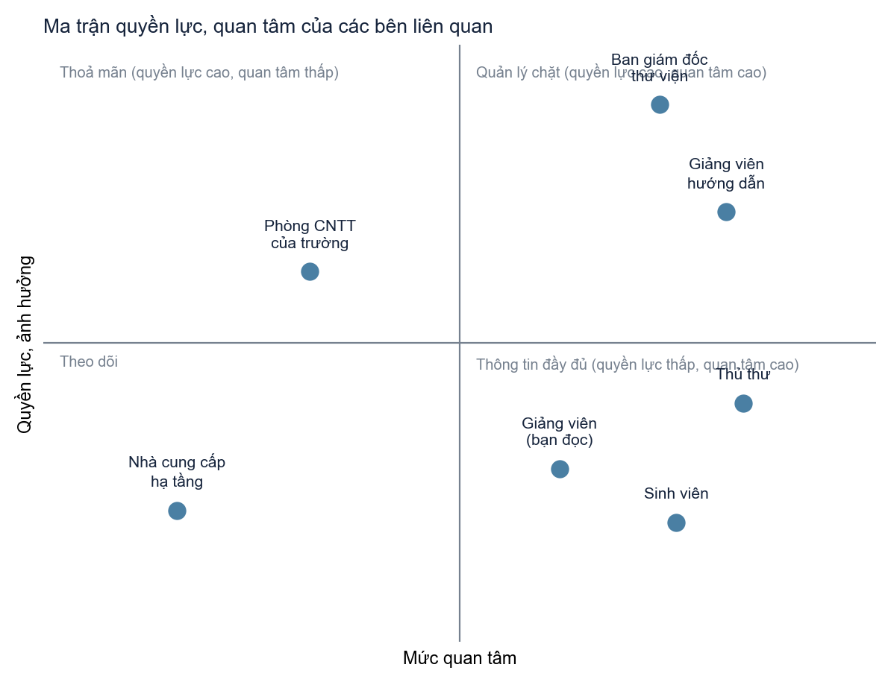
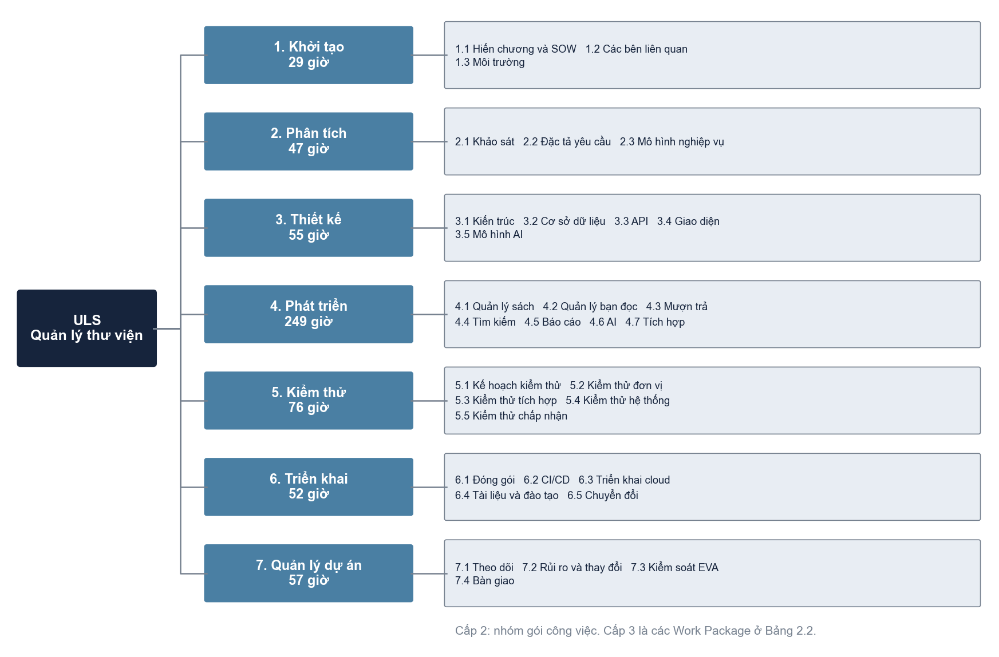
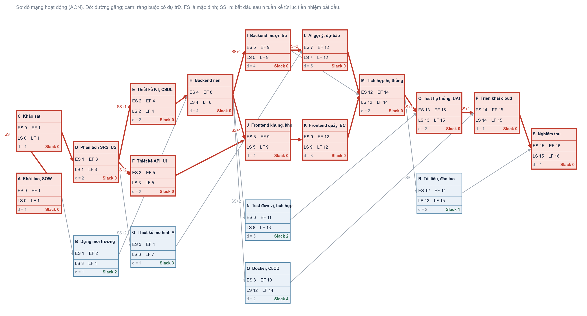
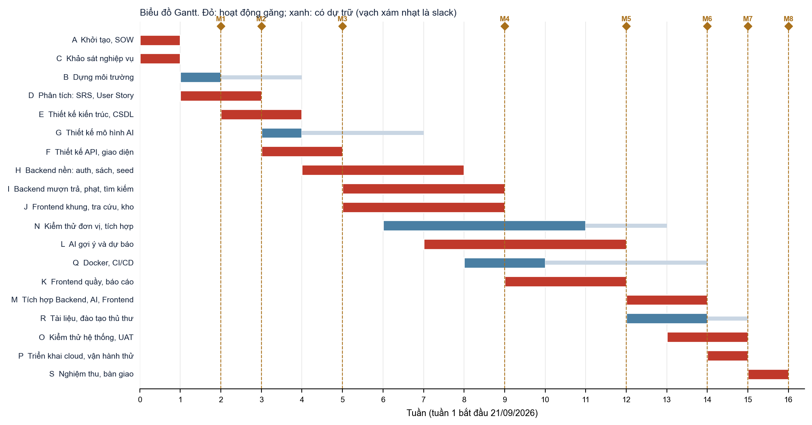
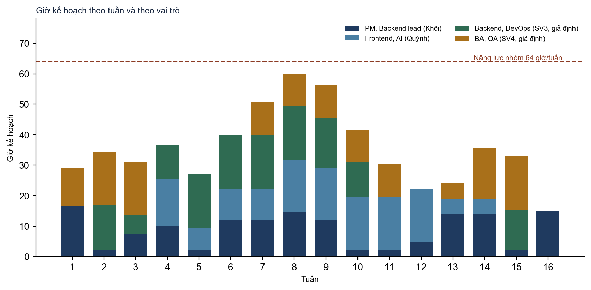
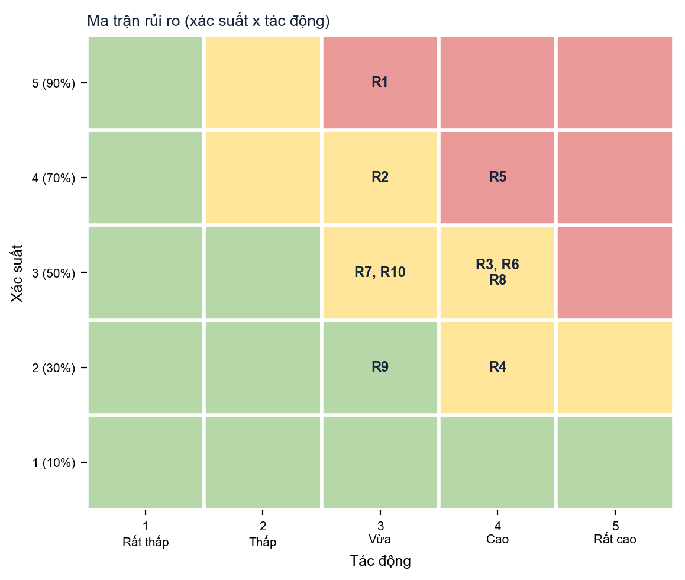
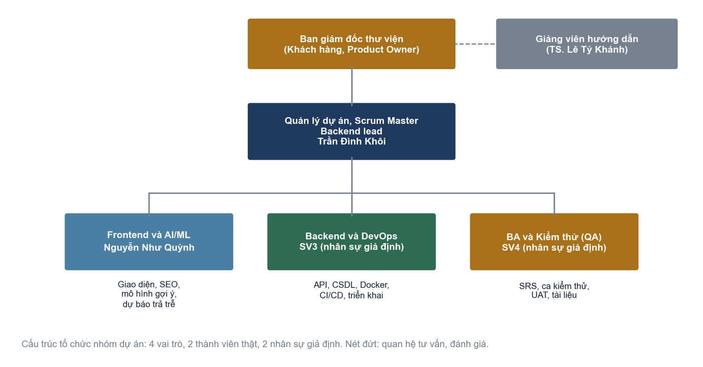
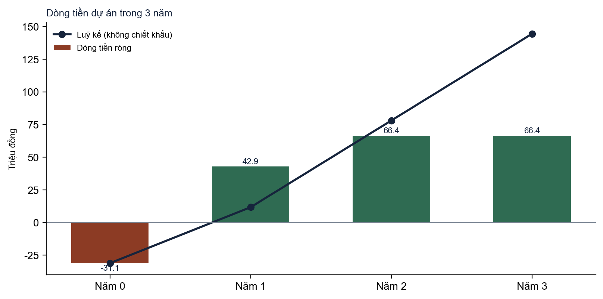
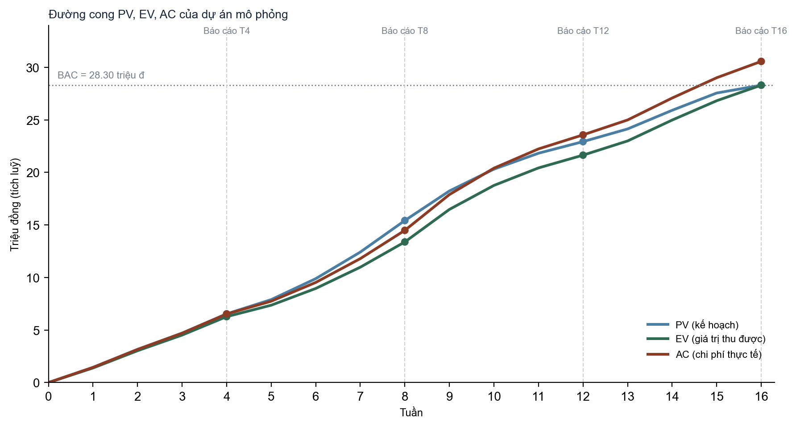
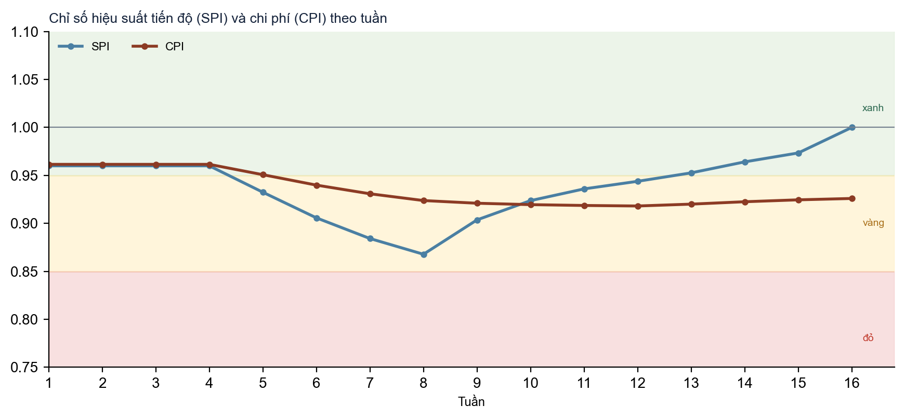

# TÀI LIỆU KẾ HOẠCH QUẢN LÝ DỰ ÁN

**Đề tài 8: Phần mềm Quản lý Thư viện Trường Đại học (ULS)**

Môn: Công nghệ Phần mềm. Trường Đại học Xây dựng Miền Trung. Giảng viên hướng dẫn: TS. Lê Tỷ Khánh

Nhóm 3, lớp D23CTC2

| Thông tin | Nội dung |
|---|---|
| Thành viên | Trần Đình Khôi (23Q74802012006, nhóm trưởng); Nguyễn Như Quỳnh (21DQ4802011003) |
| Loại tài liệu | Project Management Plan (sản phẩm bàn giao của bài tập lớn) |
| Phiên bản | 1.0 |
| Mã nguồn | https://github.com/khoidev2001/university-library-system |
| Tệp kèm theo | ULS_PM_Plan.xlsx (WBS, lịch, rủi ro, RACI, tài chính, EVA); hướng dẫn slide PM_slides_brief.md |

**Lưu ý đọc báo cáo.** Dự án được mô phỏng với 16 tuần, 4 vai trò và đơn giá 50.000 đồng/giờ để phục vụ các bài toán lập kế hoạch, đường găng, rủi ro, tài chính và EVA. Sản phẩm phần mềm đi kèm là có thật, đã chạy trên cloud, và được dùng để lấy số liệu kiểm thử, kiến trúc và quy mô thật. Mọi chỗ là số mô phỏng đều được ghi rõ là giả định.

\pagebreak

**MỤC LỤC**

[[TOC]]

\pagebreak
# 1. GIỚI THIỆU DỰ ÁN VÀ TUYÊN BỐ CÔNG VIỆC (SOW)

## 1.1. Bối cảnh và mô tả tổng quan

Thư viện của một trường đại học vẫn thường quản lý sách, bạn đọc và phiếu mượn bằng sổ tay hoặc bảng tính rời rạc. Thủ thư mất nhiều thời gian ghi chép, tra cứu hộ và lập báo cáo; bạn đọc không biết sách còn trên kệ hay không; tiền phạt trả trễ tính thủ công dễ sai. Dự án ULS xây dựng một hệ thống web quản lý sách, bạn đọc, mượn trả, tìm kiếm và thống kê cho thư viện, kèm hai tính năng thông minh là gợi ý sách theo hành vi mượn và dự báo nguy cơ trả trễ.

Hệ thống gồm ba dịch vụ độc lập: **Backend** NestJS (48 API REST, JWT, phân quyền theo vai trò, PostgreSQL qua Prisma), **Frontend** Next.js (12 trang, chuẩn SEO, thích ứng mọi màn hình) và **AI Service** FastAPI (hai mô hình học máy). Bản chạy thật nằm trên Vercel, Render và Neon (xem LAB 4 trong báo cáo thực hành).

## 1.2. Mục tiêu dự án (SMART)

| Mã | Mục tiêu | Đo lường | Thời hạn |
|---|---|---|---|
| G1 | Số hoá toàn bộ nghiệp vụ mượn, trả, gia hạn, báo mất và tính phạt | 100% luồng nghiệp vụ trong SRS chạy được; quy tắc BR-01 đến BR-08 có kiểm thử | Tuần 14 |
| G2 | Giảm thời gian xử lý một lượt mượn trả của thủ thư từ 3 phút xuống 1 phút | Đo trong UAT bằng kịch bản mượn trả bằng mã vạch; trung bình dưới 60 giây | Tuần 15 |
| G3 | Cho bạn đọc tra cứu sách và xem còn trên kệ hay không | Tìm kiếm p95 dưới 1 giây với 1.000 đầu sách; trang đầu dưới 3 giây trên 4G | Tuần 12 |
| G4 | Gợi ý sách và dự báo trả trễ đạt ngưỡng nghiệm thu | Precision@5 từ 0,15; ROC-AUC từ 0,70 | Tuần 12 |
| G5 | Bảo đảm chất lượng mã nguồn | Coverage dòng từ 80% trên lớp nghiệp vụ; CI xanh trên mọi Pull Request | Tuần 14 |
| G6 | Đưa hệ thống lên môi trường thật | Địa chỉ trực tuyến truy cập được; docker compose up dựng đủ 5 dịch vụ | Tuần 15 |
| G7 | Hoàn thành đúng hạn, trong ngân sách | Kết thúc tuần 16; chi phí không vượt BAC cộng dự phòng (31,13 triệu đồng) | Tuần 16 |

## 1.3. Phạm vi dự án

**Trong phạm vi (In scope):**

- Quản lý sách: đầu sách, tác giả, thể loại, bản sao (mã vạch, trạng thái, vị trí kệ), nhập sách theo ISBN.
- Quản lý bạn đọc: đăng ký, đăng nhập, hai nhóm bạn đọc (sinh viên, giảng viên) với chính sách mượn riêng, khoá và mở thẻ.
- Mượn, trả, gia hạn, báo mất sách; tính và thu phạt trả trễ, mất sách.
- Tìm kiếm theo tiêu đề, tác giả, ISBN, thể loại, tình trạng còn trên kệ.
- Báo cáo: sách mượn nhiều, bạn đọc quá hạn, lượt mượn theo tháng, tồn kho theo thể loại.
- Gợi ý sách cho bạn đọc và dự báo nguy cơ trả trễ (kèm cơ chế dự phòng khi dịch vụ AI không sẵn sàng).
- Quản trị: tài khoản nhân viên, chính sách mượn, kho sách, theo dõi mô hình.
- Đóng gói Docker, CI/CD, triển khai cloud, tài liệu và đào tạo thủ thư.

**Ngoài phạm vi (Out of scope):** đặt trước sách, gửi email nhắc hạn, thanh toán phạt trực tuyến, ứng dụng di động, tích hợp hệ thống quản lý sinh viên của trường, quản lý tài liệu số.

**Sản phẩm bàn giao:** mã nguồn và Docker; hệ thống chạy trực tuyến; SRS, SDD, đặc tả API; báo cáo kiểm thử; hướng dẫn sử dụng; kế hoạch quản lý dự án này.

## 1.4. Các bên liên quan (Stakeholders)

| Bên liên quan | Vai trò | Mối quan tâm chính | Quyền lực | Quan tâm | Cách làm việc |
|---|---|---|---|---|---|
| Ban giám đốc thư viện | Khách hàng, Product Owner | Nghiệp vụ đúng, tiết kiệm công sức, chi phí vận hành thấp | Cao | Cao | Duyệt SOW, backlog, nghiệm thu; họp đầu ra mỗi sprint |
| Thủ thư | Người dùng chính | Mượn trả nhanh, ít sai, báo cáo sẵn | Trung bình | Cao | Phỏng vấn, UAT, đào tạo |
| Sinh viên | Bạn đọc | Tra cứu nhanh, biết hạn trả, ít bị phạt | Thấp | Cao | Khảo sát ngắn, thu phản hồi sau UAT |
| Giảng viên (bạn đọc) | Bạn đọc | Mượn nhiều hơn, gia hạn dễ | Thấp | Trung bình | Chính sách riêng cho giảng viên |
| Giảng viên hướng dẫn | Đánh giá, tư vấn | Đủ nội dung, hợp lý, trình bày rõ | Cao | Cao | Báo cáo tiến độ, bảo vệ cuối kỳ |
| Phòng CNTT của trường | Hỗ trợ hạ tầng, bảo mật | Tuân thủ an toàn thông tin | Trung bình | Trung bình | Tham vấn khi triển khai thật |
| Nhà cung cấp hạ tầng | Vercel, Render, Neon | Gói miễn phí, giới hạn sử dụng | Thấp | Thấp | Theo dõi điều khoản và giới hạn |

## 1.5. Giả định

1. Dự án kéo dài 16 tuần bắt đầu ngày 21/09/2026, gồm 4 vai trò, mỗi người làm bán thời gian khoảng 16 giờ/tuần (năng lực nhóm 64 giờ/tuần).
2. Đơn giá giờ công 50.000 đồng/giờ (mức giả định cho sinh viên thực tập).
3. Dùng hạ tầng gói miễn phí (Vercel, Render, Neon) trong giai đoạn phát triển và demo; chi phí vận hành thật được tính ở mục 7.
4. Dữ liệu sách mẫu lấy từ bộ goodbooks-10k (có ISBN); thông tin bổ sung từ Google Books chỉ dùng khi có khoá API.
5. Lịch sử mượn trả để huấn luyện mô hình là dữ liệu mô phỏng (chưa có dữ liệu thật vì thư viện chưa dùng hệ thống).
6. Thủ thư đại diện của thư viện tham gia phỏng vấn và UAT đủ thời gian đã thoả thuận.
7. Năng suất giả định khoảng 2,1 giờ cho mỗi điểm chức năng nhờ dùng khung phát triển có sẵn (NestJS, Prisma, Next.js); đây là giả định rủi ro, xem R6 ở mục 4.

## 1.6. Ràng buộc

- **Thời gian:** hạn nộp cuối kỳ, không thể lùi (cứng).
- **Chi phí:** BAC 28,30 triệu đồng; dự phòng quản lý 2,83 triệu đồng (10% BAC). Không có thẻ thanh toán nên không dùng dịch vụ trả phí trong dự án.
- **Nhân lực:** 4 người bán thời gian, kỹ năng chưa đồng đều.
- **Kỹ thuật:** hạ tầng miễn phí tự ngủ khi không dùng (Render sau 15 phút, Neon sau 5 phút); Google Books API giới hạn tần suất nếu không có khoá.
- **Chất lượng:** coverage từ 80%, mọi API ghi dữ liệu phải có kiểm tra quyền và kiểm tra dữ liệu đầu vào.

## 1.7. Phương pháp và vòng đời

Dự án dùng mô hình **lai**: khung pha của WBS (Khởi tạo, Phân tích, Thiết kế, Phát triển, Kiểm thử, Triển khai) để lập kế hoạch và kiểm soát, còn bên trong pha Phát triển làm theo **Scrum** với sprint 2 tuần (8 sprint trong 16 tuần). Backlog gồm 20 User Story có điểm ước lượng và tiêu chí chấp nhận; mỗi User Story gắn với một mã WBS, nhờ vậy tiến độ kế hoạch (PV) và giá trị thu được (EV) quy chiếu được về cùng một cấu trúc công việc.

Các nghi thức: họp hằng ngày ngắn (15 phút, qua tin nhắn), lập kế hoạch sprint, rà soát và hồi cứu cuối sprint; theo dõi bằng bảng Kanban trên GitHub Projects. Mã nguồn quản lý bằng Git với nhánh `main` được bảo vệ, mọi thay đổi đi qua Pull Request có CI xanh (xem mục 6.6).

\pagebreak
# 2. CẤU TRÚC PHÂN RÃ CÔNG VIỆC (WBS) VÀ ƯỚC LƯỢNG

## 2.1. Nguyên tắc xây dựng WBS

WBS được xây dựng theo **pha vòng đời** ở cấp 1 và **chức năng** ở cấp 2 của pha Phát triển, đúng với năm module mà đề bài nêu (Quản lý sách, Quản lý bạn đọc, Mượn/trả, Tìm kiếm, Báo cáo) cộng thêm AI và Tích hợp. Cấp 3 là **gói công việc (Work Package)**: đủ nhỏ để giao cho một người, ước lượng được trong vài chục giờ, có sản phẩm bàn giao kiểm tra được. WBS có 42 gói công việc, theo quy tắc 8/80 (mỗi gói khoảng 6 đến 34 giờ).

Công việc quản lý dự án (mục 7 của WBS: theo dõi, rủi ro, kiểm soát EVA) được coi là **công việc duy trì (Level of Effort)**: trải đều suốt dự án và không nằm trên đường găng.

## 2.2. Phương pháp ước lượng

Mỗi gói công việc được ước lượng bằng **kỹ thuật 3 điểm (PERT)**: giờ lạc quan O, giờ khả dĩ nhất M, giờ bi quan P. Giờ kỳ vọng E = (O + 4M + P) / 6 và độ lệch chuẩn σ = (P − O) / 6. O và P suy ra từ M theo mức bất định của gói (Thấp: 0,85 và 1,25; Vừa: 0,80 và 1,40; Cao: 0,70 và 1,80), trong đó mức Cao dành cho các gói mới mẻ hoặc phụ thuộc bên ngoài (nhập ISBN từ Google Books, quy tắc mượn trả, hai mô hình AI, tích hợp AI, triển khai cloud).

**Kiểm tra chéo bằng điểm chức năng (Function Point).** Từ kết quả thiết kế thật: 10 bảng dữ liệu (ILF), 2 nguồn ngoài (EIF: goodbooks-10k, Google Books) và 48 API. Phân loại gần đúng: 24 API ghi dữ liệu (EI), 18 API truy vấn (EQ), 6 báo cáo và gợi ý (EO). Với trọng số trung bình, tổng điểm chưa hiệu chỉnh khoảng 288 FP. Với năng suất giả định 2,1 giờ/FP, công sức khoảng 605 giờ, sai lệch dưới 10% so với 566,0 giờ của WBS. Năng suất này thấp hơn nhiều so với mức tham khảo của ngành (6 đến 10 giờ/FP) vì dự án dùng khung có sẵn và sinh mã từ lược đồ; vì vậy nó được ghi thành rủi ro R6 và được bù bằng dự phòng quản lý 10%.

## 2.3. Bảng WBS và ước lượng chi tiết

Cột Vai trò: PM (quản lý dự án, Backend lead), FE (Frontend và AI), BE (Backend và DevOps), QA (phân tích nghiệp vụ và kiểm thử). Đơn vị: giờ công.

| Mã | Gói công việc | Vai trò | Bất định | O | M | P | E |
|---|---|---|---|---|---|---|---|
| 1.1 | Lập hiến chương dự án và SOW | PM | Thấp | 6,8 | 8,0 | 10,0 | 8,1 |
| 1.2 | Phân tích bên liên quan, kế hoạch truyền thông | PM | Thấp | 5,1 | 6,0 | 7,5 | 6,1 |
| 1.3 | Dựng môi trường: repo, nhánh bảo vệ, Neon, khung 3 dịch vụ | BE | Vừa | 11,2 | 14,0 | 19,6 | 14,5 |
| 2.1 | Khảo sát nghiệp vụ thư viện, phỏng vấn thủ thư (giả định) | QA | Vừa | 9,6 | 12,0 | 16,8 | 12,4 |
| 2.2 | Đặc tả SRS IEEE 830 và 20 User Story | QA | Vừa | 20,8 | 26,0 | 36,4 | 26,9 |
| 2.3 | Mô hình use case, quy tắc nghiệp vụ BR | QA | Thấp | 6,8 | 8,0 | 10,0 | 8,1 |
| 3.1 | Thiết kế kiến trúc 3 dịch vụ và gateway | PM | Thấp | 8,5 | 10,0 | 12,5 | 10,2 |
| 3.2 | Thiết kế cơ sở dữ liệu: ERD 3NF, DDL | BE | Thấp | 10,2 | 12,0 | 15,0 | 12,2 |
| 3.3 | Thiết kế API, đặc tả OpenAPI | BE | Thấp | 8,5 | 10,0 | 12,5 | 10,2 |
| 3.4 | Thiết kế giao diện, hệ thống thiết kế | FE | Vừa | 11,2 | 14,0 | 19,6 | 14,5 |
| 3.5 | Thiết kế mô hình AI: đặc trưng, chỉ số | FE | Vừa | 6,4 | 8,0 | 11,2 | 8,3 |
| 4.1.1 | Backend sách, tác giả, thể loại, bản sao | BE | Vừa | 14,4 | 18,0 | 25,2 | 18,6 |
| 4.1.2 | Frontend quản lý kho sách | FE | Vừa | 11,2 | 14,0 | 19,6 | 14,5 |
| 4.1.3 | Nhập ISBN Google Books và seed dữ liệu | BE | Cao | 8,4 | 12,0 | 21,6 | 13,0 |
| 4.2.1 | Backend xác thực JWT, phân quyền, bạn đọc, chính sách | BE | Vừa | 14,4 | 18,0 | 25,2 | 18,6 |
| 4.2.2 | Frontend đăng nhập, đăng ký, hồ sơ, khoá thẻ | FE | Thấp | 10,2 | 12,0 | 15,0 | 12,2 |
| 4.3.1 | Backend mượn, trả, gia hạn, báo mất theo BR | PM | Cao | 19,6 | 28,0 | 50,4 | 30,3 |
| 4.3.2 | Backend tính phạt và thu phạt | BE | Vừa | 9,6 | 12,0 | 16,8 | 12,4 |
| 4.3.3 | Frontend quầy mượn trả, sách của tôi | FE | Vừa | 14,4 | 18,0 | 25,2 | 18,6 |
| 4.4.1 | Backend tìm kiếm, lọc, phân trang | BE | Thấp | 6,8 | 8,0 | 10,0 | 8,1 |
| 4.4.2 | Frontend tra cứu sách, SEO | FE | Vừa | 11,2 | 14,0 | 19,6 | 14,5 |
| 4.5.1 | Backend bốn báo cáo thống kê | PM | Thấp | 6,8 | 8,0 | 10,0 | 8,1 |
| 4.5.2 | Frontend bảng điều khiển biểu đồ | FE | Vừa | 9,6 | 12,0 | 16,8 | 12,4 |
| 4.6.1 | AI gợi ý sách (TF-IDF, item-CF) | FE | Cao | 12,6 | 18,0 | 32,4 | 19,5 |
| 4.6.2 | AI dự báo nguy cơ trả trễ | FE | Cao | 9,8 | 14,0 | 25,2 | 15,2 |
| 4.6.3 | Tích hợp Backend-AI, fallback, hiển thị | PM | Cao | 8,4 | 12,0 | 21,6 | 13,0 |
| 4.7.1 | Tích hợp Frontend-Backend-gateway, xử lý lỗi | PM | Vừa | 8,0 | 10,0 | 14,0 | 10,3 |
| 4.7.2 | Hoàn thiện giao diện, responsive | FE | Thấp | 8,5 | 10,0 | 12,5 | 10,2 |
| 5.1 | Kế hoạch kiểm thử, thiết kế ca kiểm thử | QA | Thấp | 8,5 | 10,0 | 12,5 | 10,2 |
| 5.2 | Kiểm thử đơn vị Backend và AI | QA | Vừa | 20,8 | 26,0 | 36,4 | 26,9 |
| 5.3 | Kiểm thử tích hợp, e2e trên DB thật | QA | Vừa | 12,8 | 16,0 | 22,4 | 16,5 |
| 5.4 | Kiểm thử hệ thống, smoke API, hiệu năng | QA | Vừa | 9,6 | 12,0 | 16,8 | 12,4 |
| 5.5 | Kiểm thử chấp nhận (UAT) | QA | Vừa | 8,0 | 10,0 | 14,0 | 10,3 |
| 6.1 | Đóng gói Docker, docker-compose | BE | Thấp | 8,5 | 10,0 | 12,5 | 10,2 |
| 6.2 | CI/CD GitHub Actions | BE | Vừa | 9,6 | 12,0 | 16,8 | 12,4 |
| 6.3 | Triển khai cloud (Vercel, Render, Neon) | BE | Cao | 8,4 | 12,0 | 21,6 | 13,0 |
| 6.4 | Tài liệu hướng dẫn, đào tạo thủ thư | QA | Thấp | 8,5 | 10,0 | 12,5 | 10,2 |
| 6.5 | Chuyển đổi dữ liệu, vận hành thử | QA | Vừa | 4,8 | 6,0 | 8,4 | 6,2 |
| 7.1 | Họp tuần, theo dõi tiến độ | PM | Thấp | 22,1 | 26,0 | 32,5 | 26,4 |
| 7.2 | Quản lý rủi ro và thay đổi | PM | Thấp | 8,5 | 10,0 | 12,5 | 10,2 |
| 7.3 | Báo cáo EVA và kiểm soát | PM | Thấp | 8,5 | 10,0 | 12,5 | 10,2 |
| 7.4 | Nghiệm thu, báo cáo cuối, bàn giao | PM | Thấp | 8,5 | 10,0 | 12,5 | 10,2 |

**Bảng 2.2.** Work Package, ước lượng 3 điểm và giờ kỳ vọng. Tổng giờ kỳ vọng: **566,0 giờ**.

## 2.4. Tổng hợp theo pha và vai trò

| Pha | Tên | Số gói | Giờ kỳ vọng | Tỉ lệ | Chi phí (đồng) |
|---|---|---|---|---|---|
| 1 | Khởi tạo | 3 | 28,7 | 5,1% | 1.435.000 |
| 2 | Phân tích | 3 | 47,4 | 8,4% | 2.370.000 |
| 3 | Thiết kế | 5 | 55,3 | 9,8% | 2.763.333 |
| 4 | Phát triển | 17 | 249,5 | 44,1% | 12.475.000 |
| 5 | Kiểm thử | 5 | 76,3 | 13,5% | 3.815.000 |
| 6 | Triển khai | 5 | 51,9 | 9,2% | 2.596.667 |
| 7 | Quản lý dự án | 4 | 56,9 | 10,1% | 2.846.667 |
|  | **Tổng (BAC)** | 42 | **566,0** | 100,0% | **28.301.667** |

**Bảng 2.3.** Tổng hợp theo pha WBS cấp 1.

Phát triển chiếm 44% công sức, kiểm thử 13%, phân tích và thiết kế 18%; tỉ lệ kiểm thử trên phát triển (31%) hợp lý với yêu cầu coverage 80% và kiểm thử trên cơ sở dữ liệu thật.

| Vai trò | Mô tả | Người | Giờ kỳ vọng | Mức sử dụng so với năng lực 16 tuần |
|---|---|---|---|---|
| PM | Quản lý dự án, Scrum Master, Backend lead | Trần Đình Khôi | 143,1 | 55,9% |
| FE | Frontend và AI/ML | Nguyễn Như Quỳnh | 139,7 | 54,6% |
| BE | Backend và DevOps | Nhân sự giả định SV3 | 143,1 | 55,9% |
| QA | Phân tích nghiệp vụ và Kiểm thử (QA) | Nhân sự giả định SV4 | 140,1 | 54,7% |

**Bảng 2.4.** Phân bổ giờ công theo vai trò. Mức sử dụng khoảng 85% để chừa chỗ cho họp, sửa lỗi và dự phòng.

## 2.5. Ngân sách

- **BAC (ngân sách theo kế hoạch):** 566,0 giờ x 50.000 đồng = **28.301.667 đồng**.
- **Dự phòng quản lý (10%):** 2.830.167 đồng, chỉ dùng cho thay đổi đã được duyệt và rủi ro đã nhận diện (mục 4 và 9).
- **Ngân sách đề xuất:** 31.131.833 đồng.
- **Hạ tầng:** 0 đồng trong dự án (gói miễn phí); phương án trả phí khi vận hành thật nằm ở mục 7.

\pagebreak
# 3. LẬP LỊCH VÀ ĐƯỜNG GĂNG

## 3.1. Danh sách hoạt động và quan hệ phụ thuộc

Các gói công việc được gom thành **19 hoạt động** để dựng mạng. Phụ thuộc gồm **FS** (kết thúc rồi mới bắt đầu), **SS** (bắt đầu sau khi tiền nhiệm bắt đầu n tuần, ví dụ SS+1), **FF** (kết thúc sau khi tiền nhiệm kết thúc n tuần; Kiểm thử đơn vị, tích hợp theo Backend mượn trả, FF+2) và **SF** (kết thúc khi tiền nhiệm bắt đầu; Tài liệu, đào tạo theo Triển khai cloud). Thời lượng tính bằng tuần theo năng lực của vai trò đảm nhiệm: số giờ của hoạt động chia cho 16 giờ/tuần/người, làm tròn để mỗi vai trò không quá khoảng 110% năng lực.

| Mã | Hoạt động | Gói công việc (WBS) | Thời lượng (tuần) | Phụ thuộc (tiền nhiệm) |
|---|---|---|---|---|
| A | Khởi tạo, SOW | 1.1, 1.2 | 1 | - |
| C | Khảo sát nghiệp vụ | 2.1 | 1 | A (SS) |
| B | Dựng môi trường | 1.3 | 1 | A (FS) |
| D | Phân tích: SRS, User Story | 2.2, 2.3 | 2 | C (FS) |
| E | Thiết kế kiến trúc, CSDL | 3.1, 3.2 | 2 | D (SS+1) |
| F | Thiết kế API, giao diện | 3.3, 3.4 | 2 | D (SS+2) |
| G | Thiết kế mô hình AI | 3.5 | 1 | D (SS+2) |
| H | Backend nền: auth, sách, seed | 4.1.1, 4.1.3, 4.2.1 | 4 | E (FS), B (FS) |
| I | Backend mượn trả, phạt, tìm kiếm | 4.3.1, 4.3.2, 4.4.1, 4.5.1 | 4 | H (SS+1) |
| J | Frontend khung, tra cứu, kho | 4.1.2, 4.2.2, 4.4.2 | 4 | F (FS), H (SS+1) |
| K | Frontend quầy, báo cáo | 4.3.3, 4.5.2 | 3 | J (FS) |
| L | AI gợi ý và dự báo | 4.6.1, 4.6.2 | 5 | G (FS), I (SS+2) |
| M | Tích hợp Backend, AI, Frontend | 4.6.3, 4.7.1, 4.7.2 | 2 | I (FS), K (FS), L (FS) |
| N | Kiểm thử đơn vị, tích hợp | 5.1, 5.2, 5.3 | 5 | H (SS+2), I (FF+2) |
| O | Kiểm thử hệ thống, UAT | 5.4, 5.5 | 2 | M (SS+1), N (FS) |
| Q | Docker, CI/CD | 6.1, 6.2 | 2 | H (FS) |
| P | Triển khai cloud, vận hành thử | 6.3, 6.5 | 1 | O (SS+1), Q (FS) |
| R | Tài liệu, đào tạo thủ thư | 6.4 | 2 | M (SS), P (SF) |
| S | Nghiệm thu, bàn giao | 7.4 | 1 | P (FS), R (FS) |

**Bảng 3.1.** Hoạt động, thời lượng và phụ thuộc.

Một số quan hệ đáng chú ý: Thiết kế kiến trúc (E) và Thiết kế API, giao diện (F) bắt đầu sớm theo SS để chồng lấn với Phân tích (D); Backend mượn trả (I) và Frontend (J) bắt đầu khi Backend nền (H) đã chạy được một tuần (SS+1); AI (L) cần dữ liệu mượn trả nên bắt đầu sau Backend mượn trả hai tuần (SS+2); Triển khai cloud (P) bắt đầu khi UAT (O) đã chạy một tuần (SS+1) vì có thể dựng môi trường trong lúc kiểm thử.

## 3.2. Sơ đồ mạng PERT/CPM

Sơ đồ mạng nằm ở trang ngang kế tiếp để đọc rõ các thông số ES, EF, LS, LF, Slack.

\landscape

\portrait

## 3.3. Tính ES, EF, LS, LF và độ dự trữ

**Lượt tính xuôi:** ES(hoạt động) = lớn nhất theo mọi tiền nhiệm của [FS: EF + lag], [SS: ES + lag], [FF: EF + lag − thời lượng], [SF: ES + lag − thời lượng]; EF = ES + thời lượng. **Lượt tính ngược:** LF(hoạt động) = nhỏ nhất theo mọi hậu nhiệm của [FS: LS − lag], [SS: LS − lag + thời lượng], [FF: LF − lag], [SF: LF − lag + thời lượng], bị chặn bởi thời hạn dự án; LS = LF − thời lượng. **Slack = LS − ES.** Hoạt động có Slack bằng 0 là hoạt động găng. Các bảng tính đầy đủ nằm ở sheet CPM của file Excel, dùng công thức nên đổi thời lượng thì kết quả tự cập nhật.

| Mã | Hoạt động | Thời lượng | ES | EF | LS | LF | Slack | Găng? |
|---|---|---|---|---|---|---|---|---|
| A | Khởi tạo, SOW | 1 | 0 | 1 | 0 | 1 | 0 | Găng |
| C | Khảo sát nghiệp vụ | 1 | 0 | 1 | 0 | 1 | 0 | Găng |
| B | Dựng môi trường | 1 | 1 | 2 | 3 | 4 | 2 |  |
| D | Phân tích: SRS, User Story | 2 | 1 | 3 | 1 | 3 | 0 | Găng |
| E | Thiết kế kiến trúc, CSDL | 2 | 2 | 4 | 2 | 4 | 0 | Găng |
| F | Thiết kế API, giao diện | 2 | 3 | 5 | 3 | 5 | 0 | Găng |
| G | Thiết kế mô hình AI | 1 | 3 | 4 | 6 | 7 | 3 |  |
| H | Backend nền: auth, sách, seed | 4 | 4 | 8 | 4 | 8 | 0 | Găng |
| I | Backend mượn trả, phạt, tìm kiếm | 4 | 5 | 9 | 5 | 9 | 0 | Găng |
| J | Frontend khung, tra cứu, kho | 4 | 5 | 9 | 5 | 9 | 0 | Găng |
| K | Frontend quầy, báo cáo | 3 | 9 | 12 | 9 | 12 | 0 | Găng |
| L | AI gợi ý và dự báo | 5 | 7 | 12 | 7 | 12 | 0 | Găng |
| M | Tích hợp Backend, AI, Frontend | 2 | 12 | 14 | 12 | 14 | 0 | Găng |
| N | Kiểm thử đơn vị, tích hợp | 5 | 6 | 11 | 8 | 13 | 2 |  |
| O | Kiểm thử hệ thống, UAT | 2 | 13 | 15 | 13 | 15 | 0 | Găng |
| Q | Docker, CI/CD | 2 | 8 | 10 | 12 | 14 | 4 |  |
| P | Triển khai cloud, vận hành thử | 1 | 14 | 15 | 14 | 15 | 0 | Găng |
| R | Tài liệu, đào tạo thủ thư | 2 | 12 | 14 | 13 | 15 | 1 |  |
| S | Nghiệm thu, bàn giao | 1 | 15 | 16 | 15 | 16 | 0 | Găng |

**Bảng 3.2.** Kết quả CPM (đơn vị: tuần, mốc đếm từ cuối tuần 0).

**Kết quả.** Thời gian hoàn thành dự án là **16 tuần**, bằng đúng hạn cứng. Có **14 trên 19 hoạt động** là găng và có **3 đường găng song song**:

- Đường 1: A → C → D → E → H → I → L → M → O → P → S
- Đường 2: A → C → D → E → H → J → K → M → O → P → S
- Đường 3: A → C → D → F → J → K → M → O → P → S

Các hoạt động có dự trữ: B (Slack 2), G (Slack 3), N (Slack 2), Q (Slack 4), R (Slack 1). Mạng "chặt" như vậy là hệ quả của việc nhóm nhỏ làm song song nhiều luồng; nó có nghĩa mọi trễ trên nhóm hoạt động găng đều đẩy ngày hoàn thành, nên phải theo dõi sát bằng EVA (mục 8).

## 3.4. Ước lượng thời gian bằng PERT và xác suất đúng hạn

Mỗi hoạt động có ba giá trị thời lượng (a lạc quan, m khả dĩ, b bi quan) suy ra từ thời lượng m theo mức bất định của hoạt động. Thời gian kỳ vọng E = (a + 4m + b) / 6 và phương sai ((b − a) / 6)².

| Mã | Hoạt động | Bất định | a | m | b | E | Phương sai | Đường găng chính |
|---|---|---|---|---|---|---|---|---|
| A | Khởi tạo, SOW | Thấp | 0,80 | 1,00 | 1,30 | 1,02 | 0,007 | x |
| C | Khảo sát nghiệp vụ | Thấp | 0,80 | 1,00 | 1,30 | 1,02 | 0,007 | x |
| B | Dựng môi trường | Thấp | 0,80 | 1,00 | 1,30 | 1,02 | 0,007 |  |
| D | Phân tích: SRS, User Story | Vừa | 1,50 | 2,00 | 2,80 | 2,05 | 0,047 | x |
| E | Thiết kế kiến trúc, CSDL | Thấp | 1,60 | 2,00 | 2,60 | 2,03 | 0,028 | x |
| F | Thiết kế API, giao diện | Thấp | 1,60 | 2,00 | 2,60 | 2,03 | 0,028 |  |
| G | Thiết kế mô hình AI | Thấp | 0,80 | 1,00 | 1,30 | 1,02 | 0,007 |  |
| H | Backend nền: auth, sách, seed | Cao | 2,80 | 4,00 | 6,40 | 4,20 | 0,360 | x |
| I | Backend mượn trả, phạt, tìm kiếm | Cao | 2,80 | 4,00 | 6,40 | 4,20 | 0,360 | x |
| J | Frontend khung, tra cứu, kho | Vừa | 3,00 | 4,00 | 5,60 | 4,10 | 0,188 |  |
| K | Frontend quầy, báo cáo | Vừa | 2,25 | 3,00 | 4,20 | 3,07 | 0,106 |  |
| L | AI gợi ý và dự báo | Cao | 3,50 | 5,00 | 8,00 | 5,25 | 0,562 | x |
| M | Tích hợp Backend, AI, Frontend | Cao | 1,40 | 2,00 | 3,20 | 2,10 | 0,090 | x |
| N | Kiểm thử đơn vị, tích hợp | Vừa | 3,75 | 5,00 | 7,00 | 5,12 | 0,293 |  |
| O | Kiểm thử hệ thống, UAT | Vừa | 1,50 | 2,00 | 2,80 | 2,05 | 0,047 | x |
| Q | Docker, CI/CD | Thấp | 1,60 | 2,00 | 2,60 | 2,03 | 0,028 |  |
| P | Triển khai cloud, vận hành thử | Vừa | 0,75 | 1,00 | 1,40 | 1,03 | 0,012 | x |
| R | Tài liệu, đào tạo thủ thư | Thấp | 1,60 | 2,00 | 2,60 | 2,03 | 0,028 |  |
| S | Nghiệm thu, bàn giao | Thấp | 0,80 | 1,00 | 1,30 | 1,02 | 0,007 | x |

**Bảng 3.3.** Ước lượng 3 điểm cho hoạt động (tuần).

Đường găng chính được chọn là đường có phương sai lớn nhất (bất định cao nhất): **A → C → D → E → H → I → L → M → O → P → S**. Thời gian lịch kỳ vọng của dự án = thời gian CPM + tổng (E − m) trên đường này = **16,96 tuần**, độ lệch chuẩn **1,24 tuần**. Theo xấp xỉ chuẩn:

| Hoàn thành trong | Xác suất |
|---|---|
| 16 tuần (kế hoạch) | 22% |
| 17 tuần | 51% |
| 18 tuần | 80% |

**Nhận xét quan trọng.** Xác suất hoàn thành đúng 16 tuần chỉ khoảng 22% nếu không có biện pháp bù. Vì hạn nộp là cứng nên kế hoạch dùng ba biện pháp: (1) làm thêm giờ có kiểm soát ở các tuần 9 đến 15 (mục 8), (2) chạy song song Frontend với Backend (đã nằm trong quan hệ SS), (3) giữ sẵn danh sách tính năng có thể cắt giảm nếu SPI dưới 0,85 (mục 4, R5 và R6). Đây là lý do dự phòng tiền và khả năng làm thêm giờ được đặt trước.

## 3.5. Biểu đồ Gantt và mốc quan trọng

\landscape

\portrait

| Mốc | Tuần | Nội dung | Sản phẩm kiểm tra |
|---|---|---|---|
| M1 | 2 | Hiến chương, SOW được duyệt | Biên bản duyệt của khách hàng |
| M2 | 3 | SRS và 20 User Story được duyệt | SRS v1.0, backlog |
| M3 | 5 | Thiết kế được duyệt | ERD, kiến trúc, API, giao diện |
| M4 | 9 | Backend và Frontend lõi chạy đầu-cuối | Demo mượn trả |
| M5 | 12 | AI hoàn chỉnh, đạt ngưỡng chỉ số | Báo cáo chỉ số mô hình |
| M6 | 14 | Tích hợp xong, vào kiểm thử hệ thống | Bản dựng ổn định |
| M7 | 15 | Qua UAT, triển khai cloud | Biên bản UAT, địa chỉ trực tuyến |
| M8 | 16 | Nghiệm thu, bàn giao | Biên bản nghiệm thu |

**Bảng 3.4.** Các mốc quan trọng (milestone). Bản Gantt có công thức nằm ở sheet Gantt của file Excel.

## 3.6. Tải nguồn lực và cân bằng

Giờ kế hoạch mỗi tuần suy ra từ lịch sớm: gói công việc trải đều trong khoảng [ES, EF] của hoạt động. Tải đỉnh của nhóm là **60.1 giờ** ở tuần 8, bằng 94% năng lực 64 giờ/tuần. Tải đỉnh của từng vai trò: PM 16.5, FE 17.3, BE 17.7, QA 17.6 giờ/tuần so với năng lực mỗi người 16 giờ. Đỉnh vượt năng lực tối đa khoảng 11%; mức này chấp nhận được trong vài tuần bằng làm thêm giờ, nhưng là cơ sở để giả định "làm thêm giờ" trong EVA.

| Tuần | Tổng giờ | Mức dùng | PM | FE | BE | QA |
|---|---|---|---|---|---|---|
| 1 | 28,9 | 45% | 16,5 | 0,0 | 0,0 | 12,4 |
| 2 | 34,3 | 54% | 2,3 | 0,0 | 14,5 | 17,5 |
| 3 | 31,0 | 48% | 7,4 | 0,0 | 6,1 | 17,5 |
| 4 | 36,6 | 57% | 9,9 | 15,5 | 11,2 | 0,0 |
| 5 | 27,2 | 42% | 2,3 | 7,2 | 17,6 | 0,0 |
| 6 | 39,9 | 62% | 11,9 | 10,3 | 17,7 | 0,0 |
| 7 | 50,6 | 79% | 11,9 | 10,3 | 17,7 | 10,7 |
| 8 | 60,1 | 94% | 14,4 | 17,2 | 17,7 | 10,7 |
| 9 | 56,3 | 88% | 11,9 | 17,2 | 16,4 | 10,7 |
| 10 | 41,6 | 65% | 2,3 | 17,3 | 11,3 | 10,7 |
| 11 | 30,3 | 47% | 2,3 | 17,3 | 0,0 | 10,7 |
| 12 | 22,1 | 35% | 4,8 | 17,3 | 0,0 | 0,0 |
| 13 | 24,1 | 38% | 14,0 | 5,1 | 0,0 | 5,1 |
| 14 | 35,5 | 55% | 14,0 | 5,1 | 0,0 | 16,4 |
| 15 | 32,9 | 51% | 2,3 | 0,0 | 13,0 | 17,6 |
| 16 | 15,0 | 23% | 15,0 | 0,0 | 0,0 | 0,0 |

**Bảng 3.5.** Giờ kế hoạch theo tuần (nền tính PV).

\pagebreak
# 4. QUẢN LÝ RỦI RO

## 4.1. Quy trình

Quản lý rủi ro gồm 5 bước, lặp lại mỗi sprint và rà soát chính thức ở các mốc EVA (tuần 4, 8, 12, 16): (1) **nhận diện** bằng brainstorming và rà soát bài học từ dự án tương tự; (2) **phân tích định tính** bằng xác suất và tác động theo thang 1 đến 5; (3) **phân tích định lượng** bằng giá trị tiền tệ kỳ vọng EMV; (4) **lên kế hoạch ứng phó** theo bốn chiến lược (né tránh, giảm thiểu, chuyển giao, chấp nhận); (5) **theo dõi và kiểm soát** qua sổ rủi ro, dấu hiệu kích hoạt và dự phòng.

**Thang đánh giá.** Xác suất: 1 = 10%, 2 = 30%, 3 = 50%, 4 = 70%, 5 = 90%. Tác động: 1 (không đáng kể), 2 (nhỏ, dưới 5 giờ), 3 (vừa, 5 đến 15 giờ hoặc ảnh hưởng một tính năng), 4 (lớn, 15 đến 40 giờ hoặc ảnh hưởng mốc), 5 (rất lớn, ảnh hưởng hạn nộp). Điểm = xác suất x tác động; Cao từ 15, Trung bình từ 8 đến 14, Thấp dưới 8.

## 4.2. Sổ rủi ro

Dự án nhận diện **11 rủi ro** (yêu cầu của đề là 5 đến 7), chia thành bốn nhóm: Con người, Tiến trình, Sản phẩm, Công nghệ (sheet RuiRo của Excel có cột Nhóm).

| Mã | Rủi ro | Nhóm | P | I | Điểm | Mức | Chiến lược |
|---|---|---|---|---|---|---|---|
| R1 | Hạ tầng miễn phí ngủ khi demo | Kỹ thuật | 5 | 3 | 15 | Cao | Giảm thiểu |
| R2 | Google Books giới hạn tần suất, thiếu mô tả | Kỹ thuật | 4 | 3 | 12 | Trung bình | Né tránh |
| R3 | Độ chính xác mô hình AI thấp | Kỹ thuật | 3 | 4 | 12 | Trung bình | Giảm thiểu |
| R4 | Độ bao phủ kiểm thử không đạt 80% | Chất lượng | 2 | 4 | 8 | Trung bình | Giảm thiểu |
| R5 | Phình phạm vi (scope creep) | Phạm vi | 4 | 4 | 16 | Cao | Giảm thiểu |
| R6 | Ước lượng thấp hơn thực tế | Lịch và chi phí | 3 | 4 | 12 | Trung bình | Chấp nhận có dự phòng |
| R7 | Dữ liệu sách nhập sai hoặc thiếu ISBN | Nghiệp vụ | 3 | 3 | 9 | Trung bình | Giảm thiểu |
| R8 | Thủ thư không muốn chuyển sang hệ thống mới | Nghiệp vụ | 3 | 4 | 12 | Trung bình | Giảm thiểu |
| R9 | Mất dữ liệu seed hoặc lỗi migration | Kỹ thuật | 2 | 3 | 6 | Thấp | Chuyển giao |
| R10 | Lỗi quy tắc phạt (làm tròn theo giờ, không theo ngày lịch) | Chất lượng | 3 | 3 | 9 | Trung bình | Giảm thiểu |
| R11 | Thành viên chủ chốt vắng hoặc quá tải | Nhân sự | 3 | 4 | 12 | Trung bình | Giảm thiểu |

**Bảng 4.1.** Đánh giá rủi ro.

Có **2 rủi ro mức Cao** (R1, R5): hạ tầng miễn phí ngủ khi demo và phình phạm vi. Các rủi ro kỹ thuật khác ở mức Trung bình do đã có biện pháp giảm thiểu từ đầu.

\landscape

## 4.3. Kế hoạch ứng phó

**Bảng 4.2.** Kế hoạch ứng phó và theo dõi. "Đã xảy ra" nghĩa là rủi ro đã xuất hiện trong quá trình làm dự án thật.

<!--font:7.8-->
| Mã | Nguyên nhân | Hậu quả | Ứng phó | Dấu hiệu kích hoạt | Chủ sở hữu | Trạng thái |
|---|---|---|---|---|---|---|
| R1 | Render free ngủ sau 15 phút, Neon tạm dừng sau 5 phút | Lần mở đầu chậm khoảng 1 phút, demo kém ấn tượng | Đánh thức dịch vụ trước demo 5 phút; backend có fallback khi AI chưa nạp; nêu rõ hạn chế; sẵn phương án trả phí | Phản hồi /health > 10 giây | Quản lý dự án | Đã xảy ra, đã kiểm soát |
| R2 | Gọi API không khoá, giới hạn theo IP | Không nhập được mô tả sách, tính năng nhập ISBN chưa kiểm thử với dữ liệu thật | Dùng goodbooks-10k làm nguồn chính; Google Books chỉ bổ sung khi có khoá; nhập ISBN có unit test dữ liệu giả | Tỉ lệ 429 > 20% | Backend lead | Đã xảy ra |
| R3 | Dữ liệu mượn trả mô phỏng, ít đặc trưng | Gợi ý và dự báo trễ không đạt ngưỡng nghiệm thu | Đặt ngưỡng từ đầu (Precision@5 ≥ 0,15; ROC-AUC ≥ 0,70); so hai mô hình; fallback sách mượn nhiều | Chỉ số dưới ngưỡng sau lần huấn luyện đầu | Frontend và AI | Đã đạt (0,309 và 0,76) |
| R4 | Quy tắc nghiệp vụ phức tạp, mock khác thực tế | Không qua cổng chất lượng, phải viết bù cuối dự án | Ép ngưỡng 80% trong CI; viết test song song khi code; e2e trên PostgreSQL thật | Coverage nhánh < 82% ở sprint giữa | QA | Đã đạt (98,75% dòng) |
| R5 | Người dùng yêu cầu thêm tính năng ngoài MVP (đặt trước, email, thanh toán) | Trễ tiến độ, vượt ngân sách | Chốt danh sách ngoài MVP trong SOW; mọi thay đổi qua Change Request, Product Owner duyệt | Số CR mở > 2 cùng lúc | Quản lý dự án | Đang theo dõi |
| R6 | Năng suất giả định cao (2,1 giờ/FP), ít dữ liệu lịch sử | Vượt giờ công, SPI/CPI dưới 0,9 | Ước lượng 3 điểm; dự phòng 10% BAC; theo dõi EVA mỗi 4 tuần; cắt phạm vi khi CPI < 0,85 | SPI hoặc CPI < 0,85 | Quản lý dự án | Đã xảy ra, trong dự phòng |
| R7 | Nguồn dữ liệu mở không đồng nhất | Tra cứu sai, trùng đầu sách | ISBN duy nhất (409 nếu trùng); kiểm tra định dạng; báo cáo bản ghi bị bỏ qua; rà soát mẫu 50 cuốn | Tỉ lệ bản ghi thiếu ISBN > 10% | Backend | Đang theo dõi |
| R8 | Quen sổ sách, ngại thay đổi quy trình | Hệ thống không được dùng, mất lợi ích | Quầy mượn trả đơn giản (nhập mã vạch); đào tạo 2 buổi; chạy song song 2 tuần; thủ thư đại diện dự UAT | Dưới 60% phiếu mượn nhập qua hệ thống sau 2 tuần | QA | Chưa xảy ra |
| R9 | Thao tác nhầm trên cơ sở dữ liệu dùng chung | Phải dựng lại dữ liệu mẫu, mất vài giờ | Neon sao lưu hằng ngày; seed lặp lại được; migration có phiên bản | Lỗi migration trên CI | Backend | Chưa xảy ra |
| R10 | Quy tắc nghiệp vụ hiểu chưa đủ chặt | Tính sai tiền phạt, khiếu nại của bạn đọc | Test biên (23:59 và 00:01); chạy thử luồng thật trên DB; đã sửa theo ngày lịch | Ca test biên đỏ | QA | Đã xảy ra, đã sửa |
| R11 | Nhóm nhỏ làm bán thời gian, trùng kỳ thi và việc khác | Một vai trò đứng yên, hoạt động găng bị trễ | Rà soát chéo mỗi Pull Request; tài liệu sinh từ mã; mỗi vai trò có người thay thế; né mốc lớn vào tuần thi | Một vai trò vắng quá 1 tuần | Quản lý dự án | Đang theo dõi |

\portrait

## 4.4. Phân tích định lượng và dự phòng

Tổn thất nếu xảy ra tính bằng giờ công bổ sung x 50.000 đồng; EMV = xác suất x tổn thất.

| Mã | Rủi ro | Xác suất | Tổn thất nếu xảy ra (đồng) | EMV (đồng) |
|---|---|---|---|---|
| R1 | Hạ tầng miễn phí ngủ khi demo | 90% | 300.000 | 270.000 |
| R2 | Google Books giới hạn tần suất, thiếu mô tả | 70% | 500.000 | 350.000 |
| R3 | Độ chính xác mô hình AI thấp | 50% | 800.000 | 400.000 |
| R4 | Độ bao phủ kiểm thử không đạt 80% | 30% | 500.000 | 150.000 |
| R5 | Phình phạm vi (scope creep) | 70% | 700.000 | 490.000 |
| R6 | Ước lượng thấp hơn thực tế | 50% | 600.000 | 300.000 |
| R7 | Dữ liệu sách nhập sai hoặc thiếu ISBN | 50% | 300.000 | 150.000 |
| R8 | Thủ thư không muốn chuyển sang hệ thống mới | 50% | 500.000 | 250.000 |
| R9 | Mất dữ liệu seed hoặc lỗi migration | 30% | 200.000 | 60.000 |
| R10 | Lỗi quy tắc phạt (làm tròn theo giờ, không theo ngày lịch) | 50% | 300.000 | 150.000 |
| R11 | Thành viên chủ chốt vắng hoặc quá tải | 50% | 500.000 | 250.000 |
|  | **Tổng EMV** |  |  | **2.820.000** |

**Bảng 4.3.** Giá trị tiền tệ kỳ vọng.

Tổng EMV là **2.820.000 đồng**, bằng 100% dự phòng quản lý 2.830.167 đồng. Tức là dự phòng 10% BAC vừa đủ che EMV của các rủi ro đã nhận diện; phần còn lại rất mỏng nên mọi thay đổi phạm vi phải đi qua kiểm soát thay đổi (mục 9).

## 4.5. Bài học từ các rủi ro đã xảy ra trong dự án thật

Dự án thật (phần mềm đã làm xong) cung cấp bằng chứng cho sổ rủi ro:

- **R1 (hạ tầng ngủ):** quan sát thật khi triển khai: sau thời gian không dùng, dịch vụ gợi ý trên Render khởi động lại và phải huấn luyện lại mô hình; trong lúc đó backend tự rơi về danh sách sách mượn nhiều và người dùng không thấy lỗi. Biện pháp "đánh thức trước demo" và "fallback" đã chứng tỏ hiệu quả.
- **R2 (Google Books):** nhập ISBN bị giới hạn tần suất nên bộ dữ liệu mẫu không có mô tả sách; chức năng nhập ISBN có mã nguồn và unit test nhưng chưa thử với dữ liệu thật. Đây là phần còn mở được ghi trung thực trong báo cáo LAB.
- **R10 (quy tắc phạt):** khi kiểm thử luồng thật phát hiện tính phạt theo giờ thay vì theo ngày lịch; đã sửa theo múi giờ thư viện và thêm test biên. Bài học: chạy thật luồng liên quan tiền, không chỉ test có mock.
- **R3 và R4:** chỉ số mô hình đạt ngưỡng (Precision@5 = 0,309; ROC-AUC = 0,76) và coverage đạt 98,75% dòng, nhờ đặt ngưỡng từ đầu trong CI.

\pagebreak
# 5. QUẢN LÝ NGUỒN LỰC

## 5.1. Cơ cấu tổ chức nhóm dự án

Nhóm có 4 vai trò, trong đó hai vai trò do hai thành viên thật đảm nhiệm và hai vai trò là nhân sự giả định của dự án mô phỏng (để đủ quy mô 4 người như đề bài). Ban giám đốc thư viện là khách hàng và Product Owner; giảng viên hướng dẫn tư vấn và đánh giá.

## 5.2. Vai trò và trách nhiệm

| Vai trò | Người | Trách nhiệm chính | Quyền ra quyết định |
|---|---|---|---|
| Quản lý dự án, Scrum Master, Backend lead | Trần Đình Khôi | Lập kế hoạch, theo dõi tiến độ, rủi ro, EVA; thiết kế kiến trúc; xây dựng xác thực, mượn trả, báo cáo; tích hợp, triển khai cloud | Phạm vi trong dự phòng, thứ tự ưu tiên sprint, nhận bàn giao |
| Frontend và AI/ML | Nguyễn Như Quỳnh | Thiết kế giao diện, toàn bộ trang web, SEO; hai mô hình gợi ý và dự báo trả trễ | Chuẩn giao diện, lựa chọn mô hình theo chỉ số |
| Backend và DevOps (giả định) | SV3 | Cơ sở dữ liệu, API kho sách, phạt, tìm kiếm; Docker, CI/CD, môi trường cloud | Cấu trúc dữ liệu, cấu hình pipeline |
| BA và Kiểm thử (giả định) | SV4 | Khảo sát, SRS, ca kiểm thử, kiểm thử tích hợp và hệ thống, UAT, tài liệu hướng dẫn | Tiêu chí chấp nhận, kết luận đạt hoặc không đạt |
| Khách hàng (thư viện) | Ban giám đốc, thủ thư đại diện | Cung cấp nghiệp vụ, duyệt SOW và backlog, tham gia UAT, nghiệm thu | Duyệt thay đổi phạm vi, nghiệm thu |

## 5.3. Ma trận RACI

R: thực hiện, A: chịu trách nhiệm cuối (đúng một người cho mỗi hạng mục), C: được tham vấn, I: được thông báo, A/R: vừa chịu trách nhiệm vừa thực hiện. Sheet RACI của file Excel kiểm tra tự động mỗi hạng mục có đúng một A (25 trên 25 hạng mục đạt).

| Mã | Hạng mục | Quản lý dự án | Frontend, AI | Backend, DevOps | BA, Kiểm thử | Khách hàng (thư viện) | Giảng viên hướng dẫn |
|---|---|---|---|---|---|---|---|
| 1 | Khởi tạo, SOW, hiến chương | A/R | C | C | C | C | I |
| 2.1 | Khảo sát nghiệp vụ | A | I | I | R | C | I |
| 2.2 | Đặc tả SRS, User Story | A | C | C | R | C | I |
| 2.3 | Mô hình use case, quy tắc BR | A | C | C | R | C | I |
| 3.1 | Kiến trúc hệ thống | A/R | C | C | I | I | C |
| 3.2 | Cơ sở dữ liệu | A | I | R | C | I | C |
| 3.3 | Thiết kế API | A | C | R | C | I | I |
| 3.4 | Thiết kế giao diện | A | R | I | C | C | I |
| 3.5 | Thiết kế mô hình AI | A | R | C | I | I | C |
| 4.1 | Quản lý sách (BE và FE) | A | R | R | C | C | I |
| 4.2 | Quản lý bạn đọc, xác thực | A/R | R | C | C | C | I |
| 4.3 | Mượn, trả, phạt | A/R | R | R | C | C | I |
| 4.4 | Tìm kiếm | A | R | R | C | I | I |
| 4.5 | Báo cáo thống kê | A | R | R | C | C | I |
| 4.6 | AI gợi ý, dự báo trễ | A | R | C | C | I | C |
| 4.7 | Tích hợp hệ thống | A/R | R | R | C | I | I |
| 5.1-5.3 | Kiểm thử đơn vị, tích hợp | A | C | C | R | I | I |
| 5.4 | Kiểm thử hệ thống | A | C | C | R | I | I |
| 5.5 | Kiểm thử chấp nhận (UAT) | R | I | I | R | A | C |
| 6.1-6.2 | Docker, CI/CD | A | C | R | C | I | I |
| 6.3 | Triển khai cloud | A/R | C | R | C | I | I |
| 6.4 | Tài liệu, đào tạo thủ thư | A | C | C | R | C | I |
| 6.5 | Chuyển đổi dữ liệu, vận hành thử | A | I | R | C | C | I |
| 7.1-7.3 | Theo dõi, rủi ro, EVA | A/R | C | C | C | I | I |
| 7.4 | Nghiệm thu, bàn giao | R | C | C | C | A | I |

**Bảng 5.1.** Ma trận trách nhiệm RACI.

## 5.4. Kế hoạch nhân sự và nâng cao năng lực

Nhân sự có mặt từ tuần 1 đến tuần 16 với cường độ khoảng 16 giờ mỗi người mỗi tuần. Tải theo vai trò xem hình 3.3. Bảo đảm kiến thức dùng chung bằng hai biện pháp: mỗi Pull Request có ít nhất một người khác rà soát, và tài liệu thiết kế (SRS, SDD, đặc tả API) được sinh từ mã nguồn để không phụ thuộc vào trí nhớ của một người. Khi một vai trò quá tải ở tuần cao điểm (tuần 7 đến 10), Quản lý dự án nhận thêm việc rà soát và tích hợp vì tải của vai trò này thấp ở các tuần 2 đến 5.

## 5.5. Kế hoạch truyền thông

| Thông tin | Đối tượng | Tần suất | Hình thức | Người phụ trách |
|---|---|---|---|---|
| Tiến độ ngắn | Cả nhóm | Hằng ngày | Tin nhắn 15 phút | Scrum Master |
| Demo sprint, backlog | Khách hàng, nhóm | Mỗi 2 tuần | Buổi demo 45 phút | Quản lý dự án |
| Báo cáo EVA, rủi ro | Giảng viên hướng dẫn | Tuần 4, 8, 12, 16 | Báo cáo ngắn, biểu đồ | Quản lý dự án |
| Thay đổi phạm vi | Khách hàng | Khi phát sinh | Phiếu Change Request | Quản lý dự án |
| Lỗi nghiêm trọng | Cả nhóm, khách hàng | Ngay khi phát hiện | Issue trên GitHub, tin nhắn | QA |

## 5.6. Phân công thực hiện bài tập

Theo yêu cầu của đề, mỗi thành viên phụ trách ít nhất một phần của kế hoạch và được nêu rõ:

| Thành viên | Phần phụ trách | Mục trong báo cáo |
|---|---|---|
| Trần Đình Khôi | SOW, WBS và ước lượng; lập lịch và đường găng (CPM, PERT, Gantt); EVA và kiểm soát | Mục 1, 2, 3, 8 |
| Nguyễn Như Quỳnh | Quản lý rủi ro; nguồn lực và RACI; quản lý chất lượng, kiểm thử; phân tích tài chính | Mục 4, 5, 6, 7 |

\pagebreak
# 6. QUẢN LÝ CHẤT LƯỢNG VÀ KIỂM THỬ

## 6.1. Chiến lược chất lượng

Chất lượng được đảm bảo bằng **ngăn ngừa** (tiêu chí chấp nhận cho từng User Story, thiết kế quy tắc nghiệp vụ trước khi lập trình, kiểm tra dữ liệu đầu vào ở biên) và **phát hiện** (kiểm thử nhiều tầng chạy tự động trên CI). Nguyên tắc chính: mọi thay đổi chỉ được gộp vào nhánh `main` khi CI xanh; phần liên quan tiền phạt, quyền và cơ sở dữ liệu bắt buộc có bằng chứng chạy thật, không chỉ test có mock.

## 6.2. Các loại kiểm thử

| Loại | Mục đích | Phạm vi | Công cụ | Khi nào chạy | Phụ trách |
|---|---|---|---|---|---|
| Kiểm thử đơn vị | Kiểm tra logic từng service, guard, client | Backend (119 test), AI (26 test) | Jest, pytest | Mỗi lần push, trên CI | Lập trình viên, QA |
| Kiểm thử tích hợp (e2e) | Kiểm tra API cùng cơ sở dữ liệu thật | Luồng mượn, trả, phạt, xác thực (15 test, 3 suite) | Jest, Supertest, PostgreSQL thật | Mỗi Pull Request | QA |
| Kiểm thử hệ thống | Kiểm tra toàn hệ thống qua gateway | 100 lượt gọi API trong 3 kịch bản smoke; docker compose up trên máy sạch | Script Python, GitHub Actions | Cuối sprint, trước phát hành | QA |
| Kiểm thử chấp nhận (UAT) | Khách hàng xác nhận đáp ứng nghiệp vụ | Kịch bản của thủ thư và bạn đọc trên bản chạy thật | Kịch bản thủ công | Tuần 13 đến 15 | Khách hàng, QA |
| Kiểm thử phi chức năng | Hiệu năng, bảo mật, khả năng truy cập | NFR-PERF, NFR-SEC, NFR-USE trong SRS | Lighthouse, kiểm tra thủ công | Trước UAT | QA, PM |

**Bảng 6.1.** Các loại kiểm thử.

## 6.3. Tiêu chí chất lượng và kết quả thật

Tiêu chí chấp nhận đo được lấy từ SRS và từ file hướng dẫn thực hành; kết quả dưới đây lấy từ pipeline CI thật của dự án.

| Tiêu chí | Ngưỡng | Kết quả thật | Đạt |
|---|---|---|---|
| Coverage dòng, câu lệnh, hàm (Backend, lớp nghiệp vụ) | Từ 80% | 98,75%, 97,51%, 98,49% | Đạt |
| Coverage nhánh (Backend) | Từ 80% | 81,9% | Đạt |
| Coverage AI Service | Từ 80% | 93,6% | Đạt |
| Số test | Tất cả đạt | 160 test (119 đơn vị, 15 e2e, 26 AI), đạt 100% | Đạt |
| CI trên mọi Pull Request | Xanh | 4 job xanh (backend, ai-service, frontend, compose-smoke) | Đạt |
| Precision@5 (gợi ý) | Từ 0,15 | 0,309 | Đạt |
| ROC-AUC (dự báo trả trễ) | Từ 0,70 | 0,76 | Đạt |
| Mật khẩu băm, JWT, RBAC, giới hạn đăng nhập | Theo NFR-SEC-01 đến 05 | Có kiểm thử cho phân quyền và đăng nhập | Đạt |
| Tìm kiếm p95 | Dưới 1 giây (1.000 đầu sách) | Chưa đo bằng công cụ tải; truy vấn có chỉ mục | Chưa kiểm |

**Bảng 6.2.** Tiêu chí chất lượng và kết quả. Hai chỉ tiêu hiệu năng p95 trong SRS chưa được đo bằng công cụ tải nên ghi là "chưa kiểm", không suy diễn.

## 6.4. Mốc chất lượng (quality gates)

Mỗi mốc ở bảng 3.4 có một cổng chất lượng: M3 (thiết kế) cần SRS và thiết kế được rà soát; M4 cần luồng mượn trả chạy đầu-cuối và test xanh; M5 cần chỉ số mô hình đạt ngưỡng; M6 cần coverage từ 80% và CI xanh; M7 cần UAT đạt 100% kịch bản, không còn lỗi nghiêm trọng; M8 cần bản chạy thật và tài liệu bàn giao. Không qua cổng thì không sang mốc kế tiếp, trừ khi Quản lý dự án và khách hàng chấp nhận bằng văn bản.

## 6.5. Quản lý lỗi

Lỗi được ghi trên GitHub Issues với mức độ: **Nghiêm trọng** (sai tiền phạt, lộ dữ liệu, mất dữ liệu, hệ thống không chạy), **Cao** (một luồng chính hỏng), **Trung bình** (sai giao diện, thông báo), **Thấp** (câu chữ). Quy tắc xử lý: lỗi Nghiêm trọng sửa trong ngày và thêm test chặn tái diễn; lỗi Cao sửa trong sprint; chỉ số theo dõi là số lỗi mở theo mức độ và thời gian sửa trung bình. Ví dụ thật: lỗi tính phạt theo giờ thay vì ngày lịch được xếp Nghiêm trọng, sửa cùng ngày và thêm bài test biên.

## 6.6. Quản lý cấu hình và quy trình phát hành

- **Kho mã:** monorepo trên GitHub gồm backend, frontend, ai-service, gateway; nhánh `main` được bảo vệ.
- **Nhánh:** mỗi công việc làm trên nhánh riêng (ví dụ `feat/...`, `docs/...`), gộp qua Pull Request, bắt buộc CI xanh.
- **Rà soát:** mỗi Pull Request được một người khác xem lại trước khi gộp.
- **Phát hành:** mỗi mốc từ M4 trở đi gắn một phiên bản (v0.x đến v1.0.0); bản trên `main` được triển khai lên cloud sau khi mọi job CI xanh; cấu hình bí mật (khoá, mật khẩu) chỉ nằm trong biến môi trường, không có trong mã nguồn.
- **Truy vết:** mỗi commit, Issue và User Story gắn với mã WBS, nhờ đó tính được giờ và tiến độ theo WBS.

## 6.7. Chi phí chất lượng

Giờ kiểm thử trong kế hoạch là 76,3 giờ (13% BAC), cộng thêm viết test song song với lập trình trong các gói Phát triển. Chi phí phòng ngừa (rà soát, tiêu chí chấp nhận, CI) được coi là rẻ hơn chi phí sửa lỗi ở giai đoạn muộn, đặc biệt với tiền phạt và dữ liệu bạn đọc.

\pagebreak
# 7. PHÂN TÍCH TÀI CHÍNH

## 7.1. Phương pháp và giả định

Phân tích dùng NPV (giá trị hiện tại ròng), ROI và thời gian hoàn vốn trong 3 năm vận hành, tỉ lệ chiết khấu 10%. Chi phí đầu tư là ngân sách đề xuất ở mục 2.5 (31.131.833 đồng, gồm BAC và dự phòng). Lợi ích đến từ tiết kiệm thời gian thủ thư và giảm thất thoát sách; **tiền phạt thu được không tính là lợi ích** vì mục đích của phạt là răn đe, không phải nguồn thu.

| Giả định | Giá trị | Cơ sở |
|---|---|---|
| Số bạn đọc | 5.000 | Quy mô trường giả định khoảng 5.000 sinh viên và giảng viên |
| Lượt mượn mỗi bạn đọc mỗi năm | 8 | Giả định |
| Phút thủ thư tiết kiệm mỗi lượt | 2.0 | Ghi sổ tay khoảng 3 phút, quét mã vạch khoảng 1 phút |
| Lượt tra cứu hộ mỗi năm, phút tiết kiệm | 20.000 lượt, 2.0 phút | Bạn đọc tự tra cứu trực tuyến |
| Đơn giá giờ thủ thư | 35.000 đồng/giờ | Giả định |
| Giờ báo cáo tiết kiệm mỗi năm | 96 | 12 báo cáo x 8 giờ, nay chạy tự động |
| Thất thoát sách hiện nay, mức giảm | 20.000.000 đồng/năm, giảm 25% | Nhờ theo dõi quá hạn và báo mất |
| Mức áp dụng | 70%, 100%, 100% | Năm 1 còn làm quen, chạy song song với sổ tay |
| Chi phí vận hành mỗi năm | 12.000.000 đồng | Hạ tầng trả phí tối thiểu 6.000.000, bảo trì 60 giờ x 50.000, đào tạo 3.000.000 |

**Bảng 7.1.** Giả định tài chính (đều là giả định, ghi rõ để giảng viên kiểm tra và thay đổi ở sheet GiaDinh).

## 7.2. Chi phí

- **Chi phí phát triển (một lần):** 28.301.667 đồng (566,0 giờ x 50.000).
- **Dự phòng quản lý:** 2.830.167 đồng.
- **Hạ tầng trong dự án:** 0 đồng nhờ gói miễn phí. Khi vận hành thật nên dùng gói trả phí tối thiểu (giả định 6.000.000 đồng/năm) để tránh dịch vụ ngủ và có sao lưu; đây là phương án đã tính vào chi phí vận hành.
- **Chi phí vận hành mỗi năm:** 12.000.000 đồng.

## 7.3. Lợi ích hằng năm (khi áp dụng đầy đủ)

| Khoản lợi ích | Cách tính | Giá trị (đồng/năm) |
|---|---|---|
| Giờ thủ thư khi mượn trả | 40.000 lượt x 2.0 phút / 60 x 35.000 | 46.666.667 |
| Giờ tra cứu hộ | 20.000 lượt x 2.0 phút / 60 x 35.000 | 23.333.333 |
| Giờ làm báo cáo | 96 giờ x 35.000 | 3.360.000 |
| Giảm thất thoát sách | 20.000.000 x 25% | 5.000.000 |
| **Tổng** |  | **78.360.000** |

\pagebreak

## 7.4. Dòng tiền, NPV, ROI và thời gian hoàn vốn

| Năm | Lợi ích | Chi phí | Dòng tiền ròng | Hệ số chiết khấu | Giá trị hiện tại | Luỹ kế |
|---|---|---|---|---|---|---|
| Năm 0 | 0 | 31.131.833 | -31.131.833 | 1,0000 | -31.131.833 | -31.131.833 |
| Năm 1 | 54.852.000 | 12.000.000 | 42.852.000 | 0,9091 | 38.956.364 | 11.720.167 |
| Năm 2 | 78.360.000 | 12.000.000 | 66.360.000 | 0,8264 | 54.842.975 | 78.080.167 |
| Năm 3 | 78.360.000 | 12.000.000 | 66.360.000 | 0,7513 | 49.857.250 | 144.440.167 |

**Bảng 7.2.** Dòng tiền (đồng).

- **NPV (3 năm, r = 10%):** **112.524.756 đồng**, dương nên dự án đáng đầu tư.
- **ROI (3 năm):** (tổng dòng tiền ròng các năm 1 đến 3 − vốn) / vốn = **464%**.
- **Thời gian hoàn vốn (không chiết khấu):** khoảng **0,73 năm** (khoảng 9 tháng).
- **Điểm hoà vốn của lợi ích:** NPV bằng 0 khi lợi ích chỉ đạt khoảng **35%** so với kế hoạch.

## 7.5. Phân tích độ nhạy

| Lợi ích so với kế hoạch | r = 8% | r = 10% | r = 12% | r = 15% |
|---|---|---|---|---|
| 100% | 118.117.656 | 112.524.756 | 107.264.404 | 99.941.246 |
| 70% | 64.065.260 | 60.475.112 | 57.098.940 | 52.399.712 |
| 50% | 28.030.329 | 25.775.349 | 23.655.298 | 20.705.356 |
| 30% | -8.004.601 | -8.924.413 | -9.788.345 | -10.989.000 |

**Bảng 7.3.** NPV (đồng) theo mức lợi ích và tỉ lệ chiết khấu.

Ngay cả khi lợi ích chỉ đạt 30% kế hoạch, NPV vẫn âm ở r = 15% nhưng âm; kết quả nhạy nhất với mức lợi ích và mức áp dụng chứ không nhạy với tỉ lệ chiết khấu. Rủi ro chính của bài toán tài chính là lợi ích không xảy ra do thủ thư không dùng hệ thống (R8), nên kế hoạch đào tạo và chạy song song là điều kiện để tạo ra giá trị. Cần nhắc rằng các số trên dựa vào giả định, không phải số đo thật vì thư viện chưa vận hành hệ thống; phần xác thực bằng số thật nên làm sau 3 tháng đầu vận hành.

\pagebreak
# 8. PHÂN TÍCH GIÁ TRỊ THU ĐƯỢC (EVA)

## 8.1. Mục đích và phương pháp

Đề tài 8 yêu cầu mô phỏng quá trình thực hiện 3 đến 4 tháng bằng EVA. Dự án mô phỏng 16 tuần (khoảng 4 tháng) được báo cáo tại **4 mốc: tuần 4, 8, 12, 16**. Các đại lượng:

- **BAC** = 28.301.667 đồng: ngân sách theo kế hoạch.
- **PV (Planned Value):** giá trị kế hoạch luỹ kế đến tuần báo cáo; lấy từ lịch ở mục 3 (giờ kế hoạch từng tuần x 50.000).
- **EV (Earned Value):** giá trị công việc thực tế hoàn thành luỹ kế = giờ kế hoạch của tuần x hiệu suất tiến độ của tuần; chặn ở BAC.
- **AC (Actual Cost):** chi phí thực tế luỹ kế = EV của tuần x hệ số chi phí (giờ thực tế trên giờ thu được).
- **SV = EV − PV; CV = EV − AC; SPI = EV / PV; CPI = EV / AC.**
- **Dự báo:** EAC = BAC / CPI (xu hướng chi phí giữ nguyên); EAC' = AC + (BAC − EV) / (CPI x SPI) (cả tiến độ và chi phí cùng ảnh hưởng); ETC = EAC − AC; VAC = BAC − EAC; TCPI = (BAC − EV) / (BAC − AC).
- **Ngưỡng:** SPI, CPI từ 0,95 là xanh; 0,85 đến dưới 0,95 là vàng; dưới 0,85 là đỏ.

## 8.2. Giả định mô phỏng

**EV và AC ở đây là số mô phỏng có kiểm soát, không phải số đo thật.** Lý do: file giờ công thật của nhóm (docs/pm/timelog.csv) ghi 24 lượt việc với khoảng 63 giờ cho một dự án phần mềm hoàn chỉnh do 1 đến 2 người làm trong khoảng 8 tuần thật; con số đó không cùng quy mô với dự án mô phỏng 16 tuần x 4 người (566,0 giờ kế hoạch), nên nếu lấy làm AC thì CPI vô nghĩa (hàng chục lần). Vì vậy EVA dùng các giả định có kiểm soát dưới đây, **gắn với các sự kiện có thật** của dự án (giới hạn Google Books, sửa lỗi tính phạt, làm song song Frontend và Backend). File timelog thật vẫn được giữ trong Excel (sheet Timelog) để minh hoạ quy trình ghi giờ theo mã WBS.

| Giai đoạn | Hiệu suất tiến độ (EV/PV mỗi tuần) | Hệ số chi phí (giờ thực/giờ thu được) | Lý do |
|---|---|---|---|
| Tuần 1 đến 4 | 0,96 | 1,04 | Khảo sát và SRS cần làm rõ thêm nghiệp vụ gia hạn, phạt trả trễ, nên tiến độ chậm nhẹ. |
| Tuần 5 đến 8 | 0,80 | 1,12 | Nhập dữ liệu Google Books bị giới hạn tần suất, phải chuyển sang bộ goodbooks-10k và dựng lại seed; chi phí sửa lỗi cao. |
| Tuần 9 đến 12 | 1,10 | 1,10 | Làm thêm giờ và chạy song song Frontend với Backend để bù trễ; phát sinh sửa lỗi tính phạt theo ngày lịch. |
| Tuần 13 đến 16 | 1,12 | 1,05 | Tích hợp, kiểm thử hệ thống và triển khai chạy nhanh nhờ khung CI/CD dựng sẵn; hoàn thành đúng hạn. |

**Bảng 8.1.** Giả định EVA. Riêng tuần 16 lấy phần còn lại để EV đạt 100% BAC (dự án hoàn thành đúng hạn). Công việc thay đổi đã duyệt (mục 9) tính vào dự phòng, không tính vào AC của EVA để EVA đo đúng theo phạm vi gốc.

## 8.3. Kết quả tại 4 mốc báo cáo

| Mốc | PV (đồng) | EV (đồng) | AC (đồng) | SV (đồng) | CV (đồng) | SPI | CPI |
|---|---|---|---|---|---|---|---|
| Tuần 4 | 6.537.083 | 6.275.600 | 6.526.624 | -261.483 | -251.024 | 0,960 | 0,962 |
| Tuần 8 | 15.420.500 | 13.382.333 | 14.486.165 | -2.038.167 | -1.103.832 | 0,868 | 0,924 |
| Tuần 12 | 22.928.750 | 21.641.408 | 23.571.148 | -1.287.342 | -1.929.740 | 0,944 | 0,918 |
| Tuần 16 | 28.301.667 | 28.301.667 | 30.564.419 | -0 | -2.262.752 | 1,000 | 0,926 |

**Bảng 8.2.** PV, EV, AC và các chỉ số.

| Mốc | EAC = BAC/CPI | EAC' (SPI x CPI) | ETC | VAC | TCPI | Trạng thái (tiến độ / chi phí) |
|---|---|---|---|---|---|---|
| Tuần 4 | 29.433.733 | 30.388.196 | 22.907.109 | -1.132.067 | 1,012 | xanh / xanh |
| Tuần 8 | 30.636.109 | 33.095.790 | 16.149.944 | -2.334.442 | 1,080 | vàng / vàng |
| Tuần 12 | 30.825.294 | 31.256.807 | 7.254.146 | -2.523.627 | 1,408 | vàng / vàng |
| Tuần 16 | 30.564.419 | 30.564.419 | 0 | -2.262.752 | -0,000 | xanh / vàng |

**Bảng 8.3.** Dự báo khi hoàn thành (đồng).

## 8.4. Giải thích tình trạng dự án

**Tuần 4 (xanh, xanh).** SPI = 0,960, CPI = 0,962: dự án chậm nhẹ (261.483 đồng giá trị chưa thu được) và chi phí vượt khoảng 4,0%. Nguyên nhân là phải làm rõ thêm nghiệp vụ gia hạn và phạt trả trễ trong SRS. Chưa cần hành động, chỉ ghi nhận và theo dõi.

**Tuần 8 (vàng, vàng).** SPI = 0,868, CPI = 0,924: đây là điểm xấu nhất của dự án. Chậm 2.038.167 đồng giá trị và vượt chi phí 1.103.832 đồng. Nguyên nhân: nhập dữ liệu từ Google Books bị giới hạn tần suất nên phải chuyển sang bộ goodbooks-10k và dựng lại phần seed (R2), đồng thời Backend nền mất thêm giờ. Dự báo lúc này: EAC = 30,64 triệu đồng, vượt BAC khoảng 2,33 triệu đồng, vẫn nằm trong dự phòng 2,83 triệu đồng. TCPI = 1,080, nghĩa là từ đây phải làm hiệu quả hơn kế hoạch khoảng 8% mới giữ được BAC, điều khó đạt nên ta chấp nhận dùng dự phòng. **Hành động khắc phục đã quyết:** (1) chạy song song Frontend với Backend (đã nằm trong quan hệ SS); (2) làm thêm giờ có kiểm soát ở các tuần 9 đến 12; (3) hoãn phần "nhập ISBN từ Google Books" xuống ưu tiên thấp; (4) chốt không nhận thêm tính năng ngoài MVP.

**Tuần 12 (vàng, vàng).** SPI = 0,944, CPI = 0,918: tiến độ đã hồi phục về gần kế hoạch nhờ làm song song và làm thêm giờ, nhưng chi phí vẫn vượt vì tăng ca và sửa lỗi tính phạt theo ngày lịch (R10). EAC = 30,83 triệu đồng, vượt BAC 2,52 triệu đồng.

**Tuần 16 (xanh, vàng).** Dự án hoàn thành đúng hạn (EV = BAC, SPI = 1,00), chi phí thực tế 30,56 triệu đồng, vượt BAC 2,26 triệu đồng (8,0%), **dùng 80% dự phòng quản lý**. CPI cuối = 0,926.

## 8.5. Bài học và kiến nghị

1. Điểm nghẽn là phụ thuộc vào nguồn dữ liệu bên ngoài (Google Books); nên có nguồn dữ liệu dự phòng ngay từ sprint đầu.
2. Mạng dự án có nhiều đường găng song song nên mọi chậm trễ đều làm trễ ngày kết thúc; theo dõi SPI mỗi tuần thay vì mỗi 4 tuần sẽ phát hiện chậm ở tuần 6 thay vì tuần 8.
3. Ngưỡng hành động nên gắn với số: khi SPI hoặc CPI dưới 0,90 thì họp khẩn; dưới 0,85 thì cắt giảm phạm vi theo danh sách ưu tiên đã chốt.
4. Dự phòng 10% là vừa đủ; với dự án có rủi ro ước lượng cao hơn nên dùng 15%.

Bảng theo dõi theo tuần (cho đồ thị và để đối chiếu với file Excel):

| Tuần | PV | EV | AC | SPI | CPI |
|---|---|---|---|---|---|
| 1 | 1.446.042 | 1.388.200 | 1.443.728 | 0,960 | 0,962 |
| 2 | 3.158.750 | 3.032.400 | 3.153.696 | 0,960 | 0,962 |
| 3 | 4.707.292 | 4.519.000 | 4.699.760 | 0,960 | 0,962 |
| 4 | 6.537.083 | 6.275.600 | 6.526.624 | 0,960 | 0,962 |
| 5 | 7.894.792 | 7.361.767 | 7.743.131 | 0,932 | 0,951 |
| 6 | 9.888.333 | 8.956.600 | 9.529.344 | 0,906 | 0,940 |
| 7 | 12.417.542 | 10.979.967 | 11.795.515 | 0,884 | 0,931 |
| 8 | 15.420.500 | 13.382.333 | 14.486.165 | 0,868 | 0,924 |
| 9 | 18.233.042 | 16.476.129 | 17.889.341 | 0,904 | 0,921 |
| 10 | 20.310.583 | 18.761.425 | 20.403.166 | 0,924 | 0,920 |
| 11 | 21.823.958 | 20.426.138 | 22.234.350 | 0,936 | 0,919 |
| 12 | 22.928.750 | 21.641.408 | 23.571.148 | 0,944 | 0,918 |
| 13 | 24.134.792 | 22.992.175 | 24.989.453 | 0,953 | 0,920 |
| 14 | 25.909.167 | 24.979.475 | 27.076.118 | 0,964 | 0,923 |
| 15 | 27.551.875 | 26.819.308 | 29.007.943 | 0,973 | 0,925 |
| 16 | 28.301.667 | 28.301.667 | 30.564.419 | 1,000 | 0,926 |

**Bảng 8.4.** PV, EV, AC luỹ kế theo tuần (đồng).

\pagebreak
# 9. QUẢN LÝ THAY ĐỔI, TRUYỀN THÔNG VÀ KẾT LUẬN

## 9.1. Quy trình kiểm soát thay đổi (Change Control)

1. **Đề xuất:** bất kỳ ai cũng lập phiếu Change Request (CR) nêu lý do, tác động phạm vi, giờ, chi phí và rủi ro.
2. **Đánh giá:** Quản lý dự án ước lượng giờ và tác động lên đường găng trong vòng 1 ngày làm việc.
3. **Phê duyệt:** thay đổi dưới 8 giờ và không ảnh hưởng đường găng do Quản lý dự án duyệt; từ 8 giờ hoặc ảnh hưởng đường găng cần khách hàng (Product Owner) duyệt; vượt dự phòng cần giảng viên hướng dẫn thông báo.
4. **Thực hiện và cập nhật:** cập nhật WBS, lịch, sổ rủi ro; thông báo cả nhóm; ghi vào nhật ký CR.
5. **Đóng:** kiểm tra kết quả, ghi giờ thực tế để cập nhật dự phòng.

| Mã | Nội dung | Lý do | Tác động | Quyết định | Nguồn chi phí |
|---|---|---|---|---|---|
| CR-01 | Tính phạt trả trễ theo số ngày lịch theo múi giờ thư viện thay vì theo mỗi 24 giờ | Phát hiện khi kiểm thử luồng thật: mượn lúc 23:59 và trả 00:01 bị tính sai | Khoảng 6 giờ (sửa, thêm test biên); không ảnh hưởng đường găng | Quản lý dự án duyệt, làm ngay | Nằm trong mức vượt chi phí của EVA |
| CR-02 | Bổ sung trang quản trị đầy đủ (kho sách, tài khoản nhân viên, phiếu mượn, khoản phạt, theo dõi mô hình) | Khách hàng cần một nơi quản trị tập trung | Khoảng 30 giờ Frontend; chồng lấn thời gian nên không đẩy ngày kết thúc | Khách hàng duyệt | Ngân sách riêng do khách hàng cấp, ghi vào đường cơ sở 1.1 |
| CR-03 | Chuyển nguồn dữ liệu chính sang goodbooks-10k, Google Books chỉ bổ sung có khoá | Google Books giới hạn tần suất (R2) | Khoảng 8 giờ dựng lại seed | Quản lý dự án duyệt, thông báo khách hàng | Nằm trong mức vượt chi phí của EVA |

**Bảng 9.1.** Nhật ký thay đổi (ba CR tiêu biểu của dự án). CR-01 và CR-03 (700.000 đồng, 14 giờ) đã nằm trong chi phí thực tế của mô phỏng EVA nên không cộng thêm vào dự phòng (tránh tính hai lần). CR-02 (1.500.000 đồng, 30 giờ) được khách hàng cấp ngân sách riêng và ghi vào đường cơ sở phiên bản 1.1; EVA ở mục 8 đo trên đường cơ sở 1.0.

## 9.2. Quản lý bên liên quan và báo cáo

Khách hàng được tham gia ở các điểm quyết định (duyệt SOW, backlog, UAT, nghiệm thu), không phải mọi lúc, để không làm phình phạm vi. Giảng viên hướng dẫn nhận báo cáo ngắn tại 4 mốc EVA. Phản hồi của thủ thư sau UAT được ghi vào backlog cải tiến chứ không đưa thẳng vào sprint đang chạy.

## 9.3. Kết luận

Kế hoạch này mô tả một dự án 16 tuần, 4 người, ngân sách 28,30 triệu đồng cộng dự phòng 2,83 triệu đồng, với 42 gói công việc, 19 hoạt động, 3 đường găng song song và thời gian hoàn thành 16 tuần. Phân tích PERT cho thấy xác suất đúng hạn thấp nếu không có biện pháp bù (22%), điều này giải thích vì sao kế hoạch giữ dự phòng tiền, cho phép làm thêm giờ có kiểm soát và giữ danh sách cắt giảm phạm vi. Về tài chính, NPV 3 năm 112,52 triệu đồng, ROI 464% và hoàn vốn khoảng 9 tháng cho thấy dự án đáng đầu tư, với điều kiện thủ thư thực sự dùng hệ thống. EVA mô phỏng cho thấy dự án đi qua một giai đoạn chậm ở tuần 8 (SPI 0,87) rồi hồi phục, kết thúc đúng hạn và dùng 80% dự phòng.

**Hạn chế của báo cáo.** (1) EV và AC là số mô phỏng có kiểm soát, không phải số đo thật (giải thích ở mục 8.2). (2) Các giả định tài chính (quy mô trường, đơn giá, mức tiết kiệm thời gian) chưa được kiểm chứng ở một thư viện thật. (3) Hai nhân sự trong 4 vai trò là giả định. (4) Chỉ tiêu hiệu năng p95 chưa đo bằng công cụ tải.

**Hướng hoàn thiện.** Đo thật giờ công và hiệu suất ở dự án kế tiếp bằng cách ghi giờ theo mã WBS ngay từ ngày đầu (đã có khung `docs/pm/timelog.csv`); chạy thử với thư viện thật trong 3 tháng để thay giả định tài chính bằng số đo; thêm kiểm thử tải để đo p95.

## 9.4. Tài liệu tham khảo và công cụ

- PMI, *A Guide to the Project Management Body of Knowledge (PMBOK Guide)*, các chương về phạm vi, lịch, chi phí, rủi ro, nguồn lực.
- IEEE Std 830-1998, *Recommended Practice for Software Requirements Specifications*.
- Schwaber, K., Sutherland, J., *The Scrum Guide*.
- Tài liệu môn Công nghệ Phần mềm, các chương 6 đến 8 và 10 (quản lý rủi ro, thay đổi, EVA).
- Công cụ: Excel (WBS, CPM, EVA), GitHub (Issues, Projects, Actions), PlantUML, Python (openpyxl, matplotlib).
- Mã nguồn và tài liệu kỹ thuật: https://github.com/khoidev2001/university-library-system.

## 9.5. Phụ lục: file Excel kèm theo

File `ULS_PM_Plan.xlsx` có 13 sheet và đều dùng công thức sống: README, GiaDinh (tham số, giả định), WBS (3 điểm, BAC), CPM (ES, EF, LS, LF, Slack), PERT (xác suất đúng hạn), Gantt, NguonLuc (giờ theo tuần và vai trò, PV), RuiRo (sổ rủi ro, EMV, ma trận), RACI (kiểm tra mỗi hạng mục có một A), TaiChinh (NPV, ROI, hoàn vốn, độ nhạy), EVA (PV, EV, AC, chỉ số, dự báo, đồ thị), Timelog (giờ thật), ChatLuong (tiêu chí và kết quả). Các ô vàng là dữ liệu nhập, đổi giá trị thì mọi kết quả tự cập nhật. Các con số trong báo cáo này được đối chiếu với file Excel bằng một bộ tính công thức độc lập (kết quả khớp tuyệt đối).
