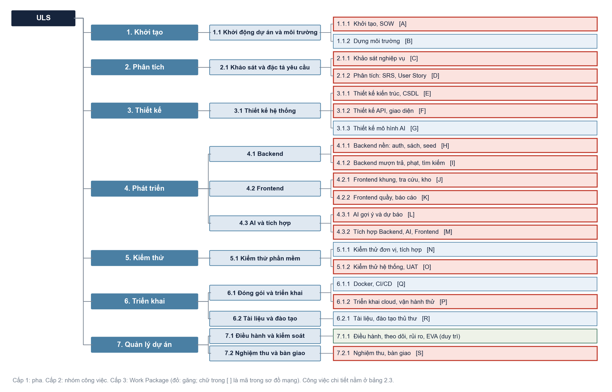
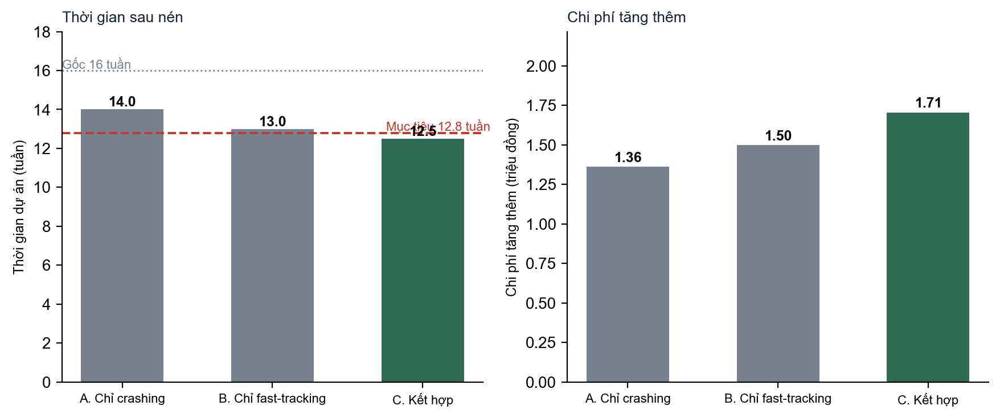
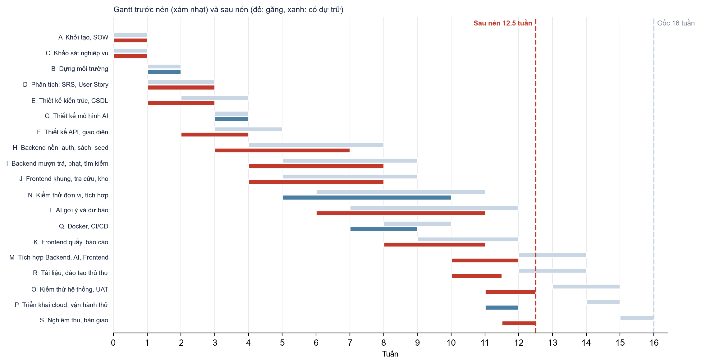
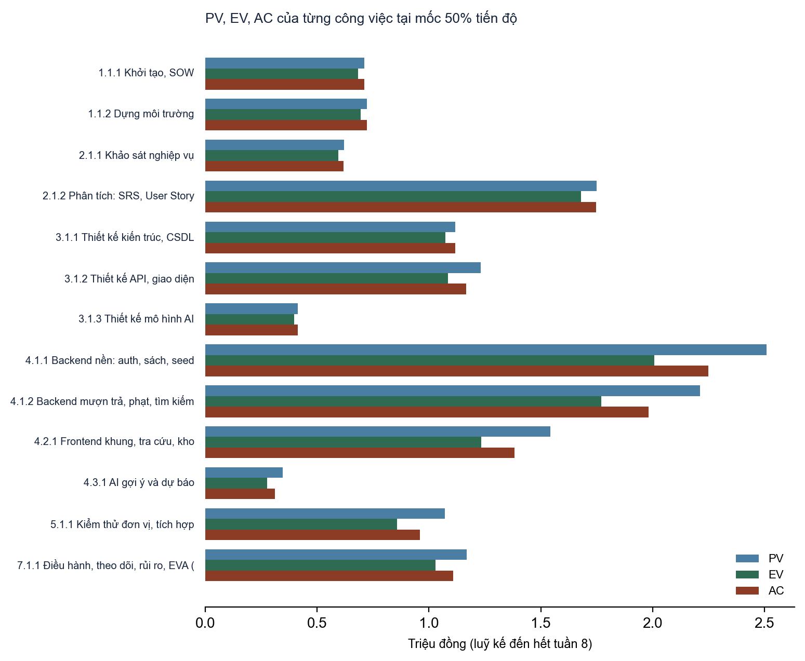
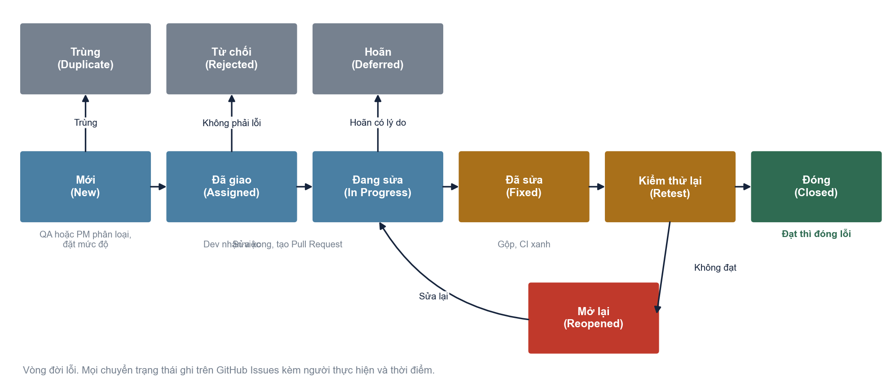

@@CB|13|TRƯỜNG ĐẠI HỌC XÂY DỰNG MIỀN TRUNG
@@CB|13|KHOA CÔNG NGHỆ THÔNG TIN
@@C|-----------------------------
@@CB|16|BÁO CÁO THỰC HÀNH TỔNG HỢP
@@CB|16|MÔN QUẢN LÝ DỰ ÁN PHẦN MỀM (LAB 1, LAB 2, LAB 3)
@@C|
@@CB|15|ĐỀ TÀI: PHẦN MỀM QUẢN LÝ THƯ VIỆN TRƯỜNG ĐẠI HỌC (ULS)
@@C|
@@C|Giảng viên hướng dẫn: Ts. Lê Tỷ Khánh
@@C|Nhóm 3, lớp D23CTC2
@@C|

| Họ và tên | MSSV | Vai trò | Phần phụ trách chính trong báo cáo | Đóng góp |
|---|---|---|---|---|
| Trần Đình Khôi (nhóm trưởng) | 23Q74802012006 | Quản lý dự án, Backend và DevOps | Charter, WBS và từ điển WBS; ước lượng, sơ đồ mạng, đường găng, nén tiến độ; EVA; kế hoạch kiểm thử; phần mềm ULS (Backend, hạ tầng) | 65% |
| Nguyễn Như Quỳnh | 21DQ4802011003 | Frontend và AI/ML | SOW, kế hoạch truyền thông, RACI; chọn sơ đồ tổ chức; phân tích tài chính; rủi ro; kiểm soát thay đổi; Test Script, vòng đời lỗi; phần mềm ULS (giao diện, mô hình) | 35% |

**Bảng phân công và đánh giá đóng góp.** Tỉ lệ đóng góp tính trên toàn bộ công việc của nhóm, gồm cả sản phẩm phần mềm ULS dùng làm đề tài xuyên suốt và các phần của báo cáo này.

@@C|
@@C|Mã nguồn: https://github.com/khoidev2001/university-library-system
@@C|Hệ thống chạy thật: https://uls-library.vercel.app
@@C|Năm 2026

\pagebreak

@@CB|14|MỤC LỤC

[[TOC]]

\pagebreak

@@CB|14|DANH MỤC BẢNG

@@LIST|Bảng 1.1. Tôn chỉ dự án (Project Charter).|7
@@LIST|Bảng 1.2. Mục tiêu SMART của dự án.|7
@@LIST|Bảng 1.3. Danh sách các bên liên quan.|8
@@LIST|Bảng 1.4. Phê duyệt Tôn chỉ dự án (chữ ký là giả định phục vụ bài thực hành).|8
@@LIST|Bảng 1.5. Phát biểu bài toán (SOW).|9
@@LIST|Bảng 1.6. Sản phẩm bàn giao và tiêu chí chấp nhận.|9
@@LIST|Bảng 1.7. Kế hoạch truyền thông.|10
@@LIST|Bảng 1.8. Ma trận RACI (đã kiểm tra tự động trong Excel: mỗi hạng mục có đúng một A).|11
@@LIST|Bảng 1.9. So sánh các loại cấu trúc tổ chức dự án.|11
@@LIST|Bảng 1.10. Phân tích bốn góc nhìn tổ chức và mức phù hợp với dự án ULS.|12
@@LIST|Bảng 1.11. WBS dạng danh sách đến cấp 3 (20 gói công việc), tổng 566,0 giờ, BAC 28.301.667 đồng.|15
@@LIST|Bảng 1.12. Công việc chi tiết cấp 4 và ước lượng giờ công.|16
@@LIST|Bảng 1.9. Từ điển WBS cho gói công việc 4.1.1.|11
@@LIST|Bảng 1.10. Từ điển WBS cho gói công việc 4.1.2.|12
@@LIST|Bảng 1.11. Từ điển WBS cho gói công việc 4.3.1.|15
@@LIST|Bảng 2.1. Giả định tài chính (đều là giả định, có thể thay ở sheet GiaDinh của Excel).|19
@@LIST|Bảng 2.2. Lợi ích hằng năm khi áp dụng đầy đủ.|19
@@LIST|Bảng 2.3. Dòng tiền dự án trong 3 năm.|19
@@LIST|Bảng 2.4. Dòng tiền phương án 5 năm.|20
@@LIST|Bảng 2.5. Độ nhạy: NPV 3 năm (đồng) theo mức lợi ích và tỉ lệ chiết khấu.|20
@@LIST|Bảng 2.6. Danh sách công việc, ước lượng thời gian, chi phí và phụ thuộc.|21
@@LIST|Bảng 2.7. Các loại quan hệ phụ thuộc và ví dụ trong dự án.|22
@@LIST|Bảng 2.8. Các bước tính ES, EF, LF, LS, Slack cho từng gói công việc (có thế số).|26
@@LIST|Bảng 2.9. Tổng hợp kết quả CPM.|27
@@LIST|Bảng 2.10. Hệ số nén của các gói găng.|29
@@LIST|Bảng 2.11. So sánh ba phương án nén.|30
@@LIST|Bảng 2.12. Các thay đổi fast-tracking và dự phòng làm lại.|30
@@LIST|Bảng 2.13. Các bước crashing.|31
@@LIST|Bảng 2.14. CPM sau nén: dự án còn 12,5 tuần.|32
@@LIST|Bảng 2.15. Rủi ro của phương án nén tiến độ.|34
@@LIST|Bảng 3.1. Danh mục rủi ro.|35
@@LIST|Bảng 3.2. Tổng hợp theo nhóm|35
@@LIST|Bảng 3.3. Kế hoạch ứng phó rủi ro.|38
@@LIST|Bảng 3.4. PV, EV, AC, SV, CV, SPI, CPI của từng công việc tại mốc 50% tiến độ (đồng).|40
@@LIST|Bảng 3.5. Chỉ số EVA cấp dự án tại mốc 50% tiến độ|42
@@LIST|Bảng 3.6. Đường cơ sở phạm vi (danh sách gói công việc).|44
@@LIST|Bảng 3.7. Đường cơ sở lịch: các mốc quan trọng.|44
@@LIST|Bảng 3.8. Đường cơ sở chi phí theo pha.|44
@@LIST|Bảng 3.9. Quy trình 5 bước kiểm soát thay đổi (Change Request Process).|45
@@LIST|Bảng 3.10. Phiếu Change Request mẫu (CR-01).|45
@@LIST|Bảng 3.11. Nhật ký thay đổi|45
@@LIST|Bảng 3.12. Kế hoạch kiểm thử (Test Plan).|46
@@LIST|Bảng 3.13. Kịch bản kiểm thử TS-01|47
@@LIST|Bảng 3.14. Kịch bản kiểm thử TS-02|48
@@LIST|Bảng 3.15. Kịch bản kiểm thử TS-03|49
@@LIST|Bảng 3.16. Mức độ lỗi và thời hạn xử lý.|49
@@LIST|Bảng 3.17. Tiêu chí đánh giá thành công của dự án khi nghiệm thu.|50
@@LIST|Bảng 4.1. Tự đánh giá theo ba trụ cột (Phạm vi, Tiến độ, Ngân sách) và các tiêu chí bổ sung.|52

\pagebreak

@@CB|14|DANH MỤC HÌNH

@@LIST|Hình 1.1. Ma trận quyền lực và quan tâm của các bên liên quan|8
@@LIST|Hình 1.2. Sơ đồ tổ chức nhóm dự án theo góc nhìn cấu trúc|12
@@LIST|Hình 1.3. WBS dạng cây đến cấp 3 (Work Package)|13
@@LIST|Hình 2.1. Dòng tiền ròng và luỹ kế trong 3 năm|20
@@LIST|Hình 2.2. Sơ đồ mạng AON với ES, EF, LS, LF, Slack (đỏ: đường găng)|23
@@LIST|Hình 2.3. Biểu đồ Gantt của dự án (đỏ: găng; xanh: có dự trữ)|28
@@LIST|Hình 2.4. So sánh thời gian và chi phí của ba phương án nén|30
@@LIST|Hình 2.5. Gantt trước nén (xám) và sau nén (đỏ, xanh)|33
@@LIST|Hình 3.1. Ma trận rủi ro 5x5 (P theo trục dọc, I theo trục ngang)|36
@@LIST|Hình 3.2. PV, EV, AC của từng công việc tại mốc 50% tiến độ|41
@@LIST|Hình 3.3. Đường cong PV, EV, AC của cả dự án (mốc 50% là tuần 8)|43
@@LIST|Hình 3.4. Vòng đời lỗi (Defect Life Cycle)|49

\pagebreak

# PHẦN I: KHỞI TẠO DỰ ÁN, PHẠM VI VÀ CẤU TRÚC PHÂN RÃ CÔNG VIỆC (LAB 1)

## 1.1. Giới thiệu đề tài

Đề tài xuyên suốt của nhóm là **Phần mềm Quản lý Thư viện Trường Đại học (ULS)**: một hệ thống web quản lý sách, bạn đọc, mượn trả, tìm kiếm và thống kê cho thư viện, kèm gợi ý sách và dự báo nguy cơ trả trễ. Phần mềm đã được xây dựng và chạy thật tại https://uls-library.vercel.app (Backend NestJS, Frontend Next.js, dịch vụ AI FastAPI; 48 API, 160 kiểm thử tự động đạt 100%). Trong báo cáo này, dự án được **mô phỏng dưới dạng một dự án 16 tuần, 4 vai trò, đơn giá 50.000 đồng/giờ** để thực hành lập kế hoạch, ước lượng, lập lịch, rủi ro, EVA và chất lượng. Số liệu phần mềm thật (kiểm thử, kiến trúc) được dùng khi có; số liệu chi phí, giờ công và EVA là mô phỏng và được ghi rõ.

**Nhất quán dữ liệu.** Tên các gói công việc ở mục 1.5 (WBS) được dùng nguyên văn ở sơ đồ mạng và Gantt (mục 2.3), ở EVA (mục 3.2) và ở đường cơ sở (mục 3.3). Mỗi gói công việc có một mã WBS và một mã mạng (chữ cái) để đối chiếu.

## 1.2. Nhiệm vụ 1: Tôn chỉ dự án (Project Charter)

| Hạng mục | Nội dung |
|---|---|
| Tên dự án | Phần mềm Quản lý Thư viện Trường Đại học (ULS) |
| Nhà tài trợ, khách hàng | Ban giám đốc Thư viện Trường Đại học Xây dựng Miền Trung (giả định) |
| Quản lý dự án | Trần Đình Khôi; có quyền phân công, điều phối ngân sách dự phòng trong ngưỡng 8 giờ và quyết định thứ tự ưu tiên sprint |
| Thời gian | 16 tuần, từ 21/09/2026 đến 10/01/2027 |
| Lý do đầu tư | Thư viện đang ghi sổ tay: thủ thư mất khoảng 3 phút cho mỗi lượt mượn trả, tính phạt thủ công dễ sai, bạn đọc không biết sách còn trên kệ, báo cáo thống kê làm tay mất nhiều giờ mỗi tháng. Dự án tự động hoá các việc này; phân tích ở mục 2.1 cho NPV 3 năm dương và hoàn vốn dưới 1 năm. |
| Mục tiêu | 7 mục tiêu SMART ở bảng 1.2 |
| Phạm vi high-level | Trong: quản lý sách, bạn đọc, mượn trả và phạt, tìm kiếm, báo cáo, gợi ý và dự báo trả trễ, quản trị, triển khai cloud, đào tạo thủ thư. Ngoài: đặt trước, email nhắc hạn, thanh toán trực tuyến, ứng dụng di động. |
| Sản phẩm bàn giao chính | Hệ thống chạy trực tuyến; mã nguồn và Docker; SRS, SDD, đặc tả API; báo cáo kiểm thử; hướng dẫn sử dụng; kế hoạch quản lý dự án |
| Ngân sách ước tính sơ bộ | Khoảng 30 triệu đồng (sai số cho phép từ −10% đến +25%); sau khi ước lượng chi tiết, đường cơ sở là 28,30 triệu đồng cộng dự phòng quản lý 2,83 triệu đồng |
| Mốc chính | M1 duyệt SOW (tuần 2); M2 duyệt SRS (tuần 3); M3 duyệt thiết kế (tuần 5); M4 lõi chạy đầu-cuối (tuần 9); M5 AI đạt ngưỡng (tuần 12); M6 tích hợp xong (tuần 14); M7 qua UAT và lên cloud (tuần 15); M8 nghiệm thu (tuần 16) |
| Ràng buộc | Hạn nộp cuối kỳ không dời được; 4 người bán thời gian, mỗi người khoảng 16 giờ mỗi tuần; chỉ dùng hạ tầng gói miễn phí (không có thẻ thanh toán); Google Books giới hạn tần suất |
| Giả thiết | Thủ thư đại diện tham gia khảo sát và kiểm thử chấp nhận; dữ liệu sách mẫu từ goodbooks-10k có ISBN; lịch sử mượn trả để huấn luyện mô hình là dữ liệu mô phỏng; đơn giá giờ công 50.000 đồng |
| Rủi ro cấp cao | Hạ tầng miễn phí tự ngủ khi demo (R1); phình phạm vi (R5); ước lượng thấp hơn thực tế (R6) |
| Tiêu chí thành công | Đúng phạm vi, đúng hạn 16 tuần, chi phí không vượt BAC cộng dự phòng; coverage từ 80%; khách hàng ký nghiệm thu (chi tiết ở mục 3.4.4) |
**Bảng 1.1.** Tôn chỉ dự án (Project Charter).

| Mã | Mục tiêu | Đo lường | Thời hạn |
|---|---|---|---|
| G1 | Số hoá toàn bộ nghiệp vụ mượn, trả, gia hạn, báo mất và tính phạt | 100% luồng nghiệp vụ trong SRS chạy được; quy tắc BR-01 đến BR-08 có kiểm thử | Tuần 14 |
| G2 | Giảm thời gian xử lý một lượt mượn trả của thủ thư từ 3 phút xuống 1 phút | Đo trong UAT bằng kịch bản mượn trả bằng mã vạch, trung bình dưới 60 giây | Tuần 15 |
| G3 | Cho bạn đọc tra cứu sách và biết còn trên kệ hay không | Tìm kiếm p95 dưới 1 giây với 1.000 đầu sách; trang đầu dưới 3 giây trên 4G | Tuần 12 |
| G4 | Gợi ý sách và dự báo trả trễ đạt ngưỡng nghiệm thu | Precision@5 từ 0,15; ROC-AUC từ 0,70 | Tuần 12 |
| G5 | Bảo đảm chất lượng mã nguồn | Coverage dòng từ 80% trên lớp nghiệp vụ; CI xanh trên mọi Pull Request | Tuần 14 |
| G6 | Đưa hệ thống lên môi trường thật | Có địa chỉ trực tuyến truy cập được; docker compose up dựng đủ 5 dịch vụ | Tuần 15 |
| G7 | Hoàn thành đúng hạn, trong ngân sách | Kết thúc tuần 16; chi phí không vượt BAC cộng dự phòng (31,13 triệu đồng) | Tuần 16 |
**Bảng 1.2.** Mục tiêu SMART của dự án.

| Bên liên quan | Vai trò | Mối quan tâm chính | Quyền lực | Quan tâm |
|---|---|---|---|---|
| Ban giám đốc thư viện | Nhà tài trợ, Product Owner | Nghiệp vụ đúng, tiết kiệm công sức, chi phí vận hành thấp | Cao | Cao |
| Thủ thư | Người dùng chính | Mượn trả nhanh, ít sai, báo cáo sẵn | Trung bình | Cao |
| Sinh viên | Bạn đọc | Tra cứu nhanh, biết hạn trả, ít bị phạt | Thấp | Cao |
| Giảng viên (bạn đọc) | Bạn đọc | Mượn nhiều hơn, gia hạn dễ | Thấp | Trung bình |
| Giảng viên hướng dẫn | Xem xét, đánh giá | Đủ nội dung, hợp lý, trình bày rõ | Cao | Cao |
| Phòng CNTT của trường | Hỗ trợ hạ tầng, bảo mật | Tuân thủ an toàn thông tin | Trung bình | Trung bình |
| Nhà cung cấp hạ tầng | Vercel, Render, Neon | Gói miễn phí, giới hạn sử dụng | Thấp | Thấp |
**Bảng 1.3.** Danh sách các bên liên quan.

| Vai trò | Họ và tên | Chữ ký (giả định) | Ngày |
|---|---|---|---|
| Nhà tài trợ | Đại diện Ban giám đốc Thư viện | (đã ký, giả định) | 22/09/2026 |
| Quản lý dự án | Trần Đình Khôi | (đã ký) | 22/09/2026 |
| Thành viên nhóm | Nguyễn Như Quỳnh | (đã ký) | 22/09/2026 |
| Người xem xét | Ts. Lê Tỷ Khánh | (xem xét, giả định) | 22/09/2026 |
**Bảng 1.4.** Phê duyệt Tôn chỉ dự án (chữ ký là giả định phục vụ bài thực hành).

## 1.3. Nhiệm vụ 2: Phát biểu bài toán (SOW) và Kế hoạch truyền thông

### 1.3.1. Phát biểu bài toán (SOW)

| Hạng mục | Nội dung |
|---|---|
| Mục đích | Xác định công việc nhóm dự án sẽ thực hiện, sản phẩm bàn giao, tiêu chí chấp nhận và các điều kiện để hai bên cùng hiểu một phạm vi. |
| Phạm vi công việc | Khảo sát và đặc tả; thiết kế kiến trúc, cơ sở dữ liệu, API, giao diện, mô hình AI; xây dựng Backend, Frontend, dịch vụ AI; kiểm thử nhiều tầng; đóng gói, CI/CD, triển khai cloud; tài liệu và đào tạo thủ thư; quản lý dự án. |
| Ngoài phạm vi | Đặt trước sách, email nhắc hạn, thanh toán phạt trực tuyến, ứng dụng di động, tích hợp hệ thống quản lý sinh viên, số hoá tài liệu. |
| Địa điểm, hình thức làm việc | Làm việc từ xa; họp trực tiếp hoặc trực tuyến khi cần; mã nguồn và tài liệu trên GitHub. |
| Nhân sự | 4 vai trò: quản lý dự án và Backend lead; Frontend và AI; Backend và DevOps; BA và kiểm thử. Mỗi người khoảng 16 giờ mỗi tuần. |
| Chi phí | Đường cơ sở 28,30 triệu đồng, dự phòng 2,83 triệu đồng. Đơn giá 50.000 đồng mỗi giờ công; không phát sinh chi phí hạ tầng trong dự án. |
| Lịch | 16 tuần với 8 mốc quan trọng; lịch chi tiết ở mục 2.3. |
| Tiêu chí chấp nhận sản phẩm | Mọi User Story trong phạm vi đạt tiêu chí chấp nhận; không còn lỗi mức Nghiêm trọng; coverage từ 80%; chỉ số mô hình đạt ngưỡng; bản chạy thật truy cập được; tài liệu bàn giao đầy đủ. |
| Quy trình chấp nhận | Khách hàng chạy kiểm thử chấp nhận theo kịch bản, ghi biên bản; nhóm sửa lỗi trong 3 ngày làm việc; khách hàng ký nghiệm thu khi đạt. |
| Quản lý thay đổi | Mọi thay đổi phạm vi đi qua phiếu Change Request, duyệt theo ngưỡng giờ công (mục 3.3.2). |
| Giả định và ràng buộc | Như Project Charter (bảng 1.1). |
**Bảng 1.5.** Phát biểu bài toán (SOW).

| Sản phẩm | Tiêu chí chấp nhận | Tuần | Người duyệt |
|---|---|---|---|
| SRS và 20 User Story | Mỗi User Story có tiêu chí chấp nhận đo được; khách hàng ký | 3 | Khách hàng |
| Thiết kế (kiến trúc, CSDL, API, giao diện) | Rà soát chéo, không còn điểm mở nghiêm trọng | 5 | Quản lý dự án, khách hàng |
| Backend, Frontend, dịch vụ AI | Demo luồng mượn trả đầu-cuối; test xanh | 9 đến 12 | Khách hàng |
| Hệ thống tích hợp, báo cáo kiểm thử | Coverage từ 80%; 0 lỗi Nghiêm trọng | 14 | Quản lý dự án, QA |
| Bản chạy trực tuyến, hướng dẫn sử dụng | Địa chỉ truy cập được; thủ thư được đào tạo | 15 | Khách hàng |
| Biên bản nghiệm thu, báo cáo cuối | Khách hàng ký | 16 | Khách hàng |
**Bảng 1.6.** Sản phẩm bàn giao và tiêu chí chấp nhận.

### 1.3.2. Kế hoạch quản lý truyền thông

Nguyên tắc: thông tin đúng người, đúng lúc, đúng kênh; mọi quyết định quan trọng phải có hồ sơ lưu. Vấn đề không giải quyết được ở cấp thành viên chuyển lên quản lý dự án trong 1 ngày làm việc, vượt quyền quản lý dự án chuyển cho khách hàng hoặc giảng viên hướng dẫn trong 2 ngày.

| Thông tin | Đối tượng | Kênh | Tần suất | Người gửi | Hồ sơ lưu |
|---|---|---|---|---|---|
| Tiến độ ngắn trong ngày | Cả nhóm | Tin nhắn nhóm 15 phút | Hằng ngày | Scrum Master | Ghi chú họp |
| Kế hoạch và đánh giá sprint | Cả nhóm, khách hàng | Họp trực tuyến 45 phút | 2 tuần một lần | Quản lý dự án | Biên bản, backlog |
| Báo cáo tình hình (tiến độ, chi phí, EVA) | Giảng viên hướng dẫn, nhà tài trợ | Báo cáo ngắn có biểu đồ | Tuần 4, 8, 12, 16 | Quản lý dự án | Báo cáo EVA |
| Thay đổi phạm vi | Khách hàng | Phiếu Change Request | Khi phát sinh | Người đề xuất, Quản lý dự án | Nhật ký thay đổi |
| Lỗi nghiêm trọng | Cả nhóm, khách hàng | GitHub Issues, tin nhắn | Ngay khi phát hiện | QA | Issue, báo cáo lỗi |
| Rủi ro | Cả nhóm, nhà tài trợ | Sổ rủi ro | Rà soát mỗi sprint | Quản lý dự án | Sổ rủi ro |
| Kết quả kiểm thử, phát hành | Cả nhóm, khách hàng | Kết quả CI, ghi chú phát hành | Mỗi lần gộp vào main | QA, DevOps | GitHub Actions |
**Bảng 1.7.** Kế hoạch truyền thông.

### 1.3.3. Ma trận phân chia trách nhiệm (RACI)

R: thực hiện; A: chịu trách nhiệm cuối (đúng một người cho mỗi hạng mục); C: được tham vấn; I: được thông báo; A/R: vừa chịu trách nhiệm vừa thực hiện.

<!--font:9.5-->
| Mã | Hạng mục | Quản lý dự án | Frontend, AI | Backend, DevOps | BA, Kiểm thử | Khách hàng (thư viện) | Giảng viên hướng dẫn |
|---|---|---|---|---|---|---|---|
| 1 | Khởi tạo, SOW, hiến chương | A/R | C | C | C | C | I |
| 2.1 | Khảo sát nghiệp vụ | A | I | I | R | C | I |
| 2.2 | Đặc tả SRS, User Story | A | C | C | R | C | I |
| 2.3 | Mô hình use case, quy tắc BR | A | C | C | R | C | I |
| 3.1 | Kiến trúc hệ thống | A/R | C | C | I | I | C |
| 3.2 | Cơ sở dữ liệu | A | I | R | C | I | C |
| 3.3 | Thiết kế API | A | C | R | C | I | I |
| 3.4 | Thiết kế giao diện | A | R | I | C | C | I |
| 3.5 | Thiết kế mô hình AI | A | R | C | I | I | C |
| 4.1 | Quản lý sách (BE và FE) | A | R | R | C | C | I |
| 4.2 | Quản lý bạn đọc, xác thực | A/R | R | C | C | C | I |
| 4.3 | Mượn, trả, phạt | A/R | R | R | C | C | I |
| 4.4 | Tìm kiếm | A | R | R | C | I | I |
| 4.5 | Báo cáo thống kê | A | R | R | C | C | I |
| 4.6 | AI gợi ý, dự báo trễ | A | R | C | C | I | C |
| 4.7 | Tích hợp hệ thống | A/R | R | R | C | I | I |
| 5.1-5.3 | Kiểm thử đơn vị, tích hợp | A | C | C | R | I | I |
| 5.4 | Kiểm thử hệ thống | A | C | C | R | I | I |
| 5.5 | Kiểm thử chấp nhận (UAT) | R | I | I | R | A | C |
| 6.1-6.2 | Docker, CI/CD | A | C | R | C | I | I |
| 6.3 | Triển khai cloud | A/R | C | R | C | I | I |
| 6.4 | Tài liệu, đào tạo thủ thư | A | C | C | R | C | I |
| 6.5 | Chuyển đổi dữ liệu, vận hành thử | A | I | R | C | C | I |
| 7.1-7.3 | Theo dõi, rủi ro, EVA | A/R | C | C | C | I | I |
| 7.4 | Nghiệm thu, bàn giao | R | C | C | C | A | I |
**Bảng 1.8.** Ma trận RACI (đã kiểm tra tự động trong Excel: mỗi hạng mục có đúng một A).

## 1.4. Nhiệm vụ 3: Cơ cấu tổ chức và góc nhìn tổ chức

### 1.4.1. Loại cấu trúc tổ chức dự án

| Tiêu chí | Chức năng | Ma trận | Theo dự án (Projectized) |
|---|---|---|---|
| Quyền của quản lý dự án | Thấp, trưởng bộ phận quyết định | Vừa, chia sẻ với trưởng bộ phận | Cao, toàn quyền |
| Nguồn lực | Thuộc bộ phận, dùng chung nhiều việc | Thuộc bộ phận, mượn cho dự án | Chuyên trách cho dự án |
| Hiệu quả dùng nhân lực | Cao nhưng dự án thường là ưu tiên thấp | Khá cao | Thấp nếu hết việc |
| Phù hợp với ULS | Không: không ai chịu trách nhiệm cuối | Có: thành viên đến từ lớp và khoa, làm bán thời gian | Không: không đủ người, không có chuyên trách |
**Bảng 1.9.** So sánh các loại cấu trúc tổ chức dự án.

**Lựa chọn: ma trận cân bằng (balanced matrix).** Các thành viên cùng lớp, thuộc khoa Công nghệ Thông tin, làm bán thời gian cho dự án và vẫn có việc học ở bộ phận gốc. Quản lý dự án quyết định việc gì, ai làm, bao giờ xong; khoa và giảng viên hướng dẫn quyết định phân bổ thời gian chung. Cấu trúc theo chức năng khiến dự án không có người chịu trách nhiệm cuối, còn cấu trúc theo dự án đòi hỏi nhân sự chuyên trách mà nhóm không có.

### 1.4.2. Phân tích bốn góc nhìn tổ chức

Theo khung bốn góc nhìn (cấu trúc, nguồn nhân lực, chính trị, biểu tượng), mỗi góc nhìn giúp thấy một khía cạnh khác của tổ chức dự án.

| Góc nhìn | Câu hỏi trọng tâm | Biểu hiện trong ULS | Mức phù hợp |
|---|---|---|---|
| Cấu trúc (Structural) | Ai làm gì, báo cáo cho ai, quy trình nào? | Vai trò, RACI, quy trình Pull Request, cổng CI, mốc nghiệm thu | Rất phù hợp (chọn) |
| Nguồn nhân lực (Human resource) | Nhu cầu, động lực, kỹ năng của con người? | Rà soát chéo, chia sẻ kiến thức, cân bằng tải với lịch thi | Phù hợp, bổ trợ |
| Chính trị (Political) | Ai có quyền lực, nguồn lực khan hiếm chia thế nào? | Product Owner quyết định ưu tiên; dự phòng là nguồn lực chung | Ít phù hợp (nhóm nhỏ) |
| Biểu tượng (Symbolic) | Ý nghĩa, văn hoá, nghi thức của nhóm? | Nghi thức demo cuối sprint, quy ước đặt tên, bảng Kanban chung | Ít phù hợp, bổ trợ nhẹ |
**Bảng 1.10.** Phân tích bốn góc nhìn tổ chức và mức phù hợp với dự án ULS.

**Lựa chọn: góc nhìn Cấu trúc (Structural).** Lý do: (1) dự án phần mềm nhỏ, rủi ro lớn nhất là chồng chéo hoặc bỏ sót việc giữa 4 vai trò, nên cần vai trò, quy trình và quyền hạn rõ ràng; (2) hoạt động của nhóm vốn dựa trên quy trình đo được (Pull Request, cổng CI, mốc nghiệm thu) hợp với tư duy cấu trúc; (3) hai góc nhìn Chính trị và Biểu tượng ít tác động vì nhóm chỉ có hai thành viên thật, không có nhiều phe phái; (4) góc nhìn Nguồn nhân lực được dùng bổ trợ để cân tải theo lịch thi. Áp dụng cụ thể: sơ đồ tổ chức ở hình 1.2, RACI ở bảng 1.8, quy tắc báo cáo và truyền thông ở bảng 1.7.

## 1.5. Nhiệm vụ 4: Cấu trúc phân rã công việc (WBS)

### 1.5.1. Sơ đồ WBS dạng cây

WBS có **4 cấp**: cấp 1 là pha vòng đời (7 pha), cấp 2 là nhóm công việc, cấp 3 là gói công việc (Work Package) và cấp 4 là công việc chi tiết (42 công việc). Gói công việc được dùng làm đơn vị lập lịch, ước lượng chi phí và đo EVA; mỗi gói có một người chịu trách nhiệm chính và sản phẩm kiểm tra được. Công việc duy trì (7.1.1) trải đều suốt dự án nên không nằm trong sơ đồ mạng.

\landscape

\portrait

### 1.5.2. WBS dạng danh sách (Indent/List)

<!--font:10.5-->
| Mã WBS | Cấp | Tên (khớp với sơ đồ mạng, Gantt, EVA) | Mã mạng | Giờ kỳ vọng |
|---|---|---|---|---|
| 1 | 1 | Khởi tạo |  |  |
| 1.1 | 2 | Khởi động dự án và môi trường |  |  |
| 1.1.1 | 3 | Khởi tạo, SOW | A | 14,2 |
| 1.1.2 | 3 | Dựng môi trường | B | 14,5 |
| 2 | 1 | Phân tích |  |  |
| 2.1 | 2 | Khảo sát và đặc tả yêu cầu |  |  |
| 2.1.1 | 3 | Khảo sát nghiệp vụ | C | 12,4 |
| 2.1.2 | 3 | Phân tích: SRS, User Story | D | 35,0 |
| 3 | 1 | Thiết kế |  |  |
| 3.1 | 2 | Thiết kế hệ thống |  |  |
| 3.1.1 | 3 | Thiết kế kiến trúc, CSDL | E | 22,4 |
| 3.1.2 | 3 | Thiết kế API, giao diện | F | 24,6 |
| 3.1.3 | 3 | Thiết kế mô hình AI | G | 8,3 |
| 4 | 1 | Phát triển |  |  |
| 4.1 | 2 | Backend |  |  |
| 4.1.1 | 3 | Backend nền: auth, sách, seed | H | 50,2 |
| 4.1.2 | 3 | Backend mượn trả, phạt, tìm kiếm | I | 59,0 |
| 4.2 | 2 | Frontend |  |  |
| 4.2.1 | 3 | Frontend khung, tra cứu, kho | J | 41,1 |
| 4.2.2 | 3 | Frontend quầy, báo cáo | K | 31,0 |
| 4.3 | 2 | AI và tích hợp |  |  |
| 4.3.1 | 3 | AI gợi ý và dự báo | L | 34,7 |
| 4.3.2 | 3 | Tích hợp Backend, AI, Frontend | M | 33,5 |
| 5 | 1 | Kiểm thử |  |  |
| 5.1 | 2 | Kiểm thử phần mềm |  |  |
| 5.1.1 | 3 | Kiểm thử đơn vị, tích hợp | N | 53,6 |
| 5.1.2 | 3 | Kiểm thử hệ thống, UAT | O | 22,7 |
| 6 | 1 | Triển khai |  |  |
| 6.1 | 2 | Đóng gói và triển khai |  |  |
| 6.1.1 | 3 | Docker, CI/CD | Q | 22,6 |
| 6.1.2 | 3 | Triển khai cloud, vận hành thử | P | 19,2 |
| 6.2 | 2 | Tài liệu và đào tạo |  |  |
| 6.2.1 | 3 | Tài liệu, đào tạo thủ thư | R | 10,2 |
| 7 | 1 | Quản lý dự án |  |  |
| 7.1 | 2 | Điều hành và kiểm soát |  |  |
| 7.1.1 | 3 | Điều hành, theo dõi, rủi ro, EVA (duy trì) | duy trì | 46,8 |
| 7.2 | 2 | Nghiệm thu và bàn giao |  |  |
| 7.2.1 | 3 | Nghiệm thu, bàn giao | S | 10,2 |
**Bảng 1.11.** WBS dạng danh sách đến cấp 3 (20 gói công việc), tổng 566,0 giờ, BAC 28.301.667 đồng.

Công việc chi tiết (cấp 4) của từng gói, kèm ước lượng ba điểm (đơn vị: giờ; O lạc quan, M khả dĩ nhất, P bi quan, E = (O + 4M + P) / 6):

<!--font:9.5-->
| Mã công việc | Công việc chi tiết (cấp 4) | Thuộc WP | Vai trò | O | M | P | E |
|---|---|---|---|---|---|---|---|
| 1.1.1.1 | Lập hiến chương dự án và SOW | 1.1.1 | PM | 6,8 | 8,0 | 10,0 | 8,1 |
| 1.1.1.2 | Phân tích bên liên quan, kế hoạch truyền thông | 1.1.1 | PM | 5,1 | 6,0 | 7,5 | 6,1 |
| 2.1.1.1 | Khảo sát nghiệp vụ thư viện, phỏng vấn thủ thư (giả định) | 2.1.1 | QA | 9,6 | 12,0 | 16,8 | 12,4 |
| 1.1.2.1 | Dựng môi trường: repo, nhánh bảo vệ, Neon, khung 3 dịch vụ | 1.1.2 | BE | 11,2 | 14,0 | 19,6 | 14,5 |
| 2.1.2.1 | Đặc tả SRS IEEE 830 và 20 User Story | 2.1.2 | QA | 20,8 | 26,0 | 36,4 | 26,9 |
| 2.1.2.2 | Mô hình use case, quy tắc nghiệp vụ BR | 2.1.2 | QA | 6,8 | 8,0 | 10,0 | 8,1 |
| 3.1.1.1 | Thiết kế kiến trúc 3 dịch vụ và gateway | 3.1.1 | PM | 8,5 | 10,0 | 12,5 | 10,2 |
| 3.1.1.2 | Thiết kế cơ sở dữ liệu: ERD 3NF, DDL | 3.1.1 | BE | 10,2 | 12,0 | 15,0 | 12,2 |
| 3.1.2.1 | Thiết kế API, đặc tả OpenAPI | 3.1.2 | BE | 8,5 | 10,0 | 12,5 | 10,2 |
| 3.1.2.2 | Thiết kế giao diện, hệ thống thiết kế | 3.1.2 | FE | 11,2 | 14,0 | 19,6 | 14,5 |
| 3.1.3.1 | Thiết kế mô hình AI: đặc trưng, chỉ số | 3.1.3 | FE | 6,4 | 8,0 | 11,2 | 8,3 |
| 4.1.1.1 | Backend sách, tác giả, thể loại, bản sao | 4.1.1 | BE | 14,4 | 18,0 | 25,2 | 18,6 |
| 4.1.1.2 | Nhập ISBN Google Books và seed dữ liệu | 4.1.1 | BE | 8,4 | 12,0 | 21,6 | 13,0 |
| 4.1.1.3 | Backend xác thực JWT, phân quyền, bạn đọc, chính sách | 4.1.1 | BE | 14,4 | 18,0 | 25,2 | 18,6 |
| 4.1.2.1 | Backend mượn, trả, gia hạn, báo mất theo BR | 4.1.2 | PM | 19,6 | 28,0 | 50,4 | 30,3 |
| 4.1.2.2 | Backend tính phạt và thu phạt | 4.1.2 | BE | 9,6 | 12,0 | 16,8 | 12,4 |
| 4.1.2.3 | Backend tìm kiếm, lọc, phân trang | 4.1.2 | BE | 6,8 | 8,0 | 10,0 | 8,1 |
| 4.1.2.4 | Backend bốn báo cáo thống kê | 4.1.2 | PM | 6,8 | 8,0 | 10,0 | 8,1 |
| 4.2.1.1 | Frontend quản lý kho sách | 4.2.1 | FE | 11,2 | 14,0 | 19,6 | 14,5 |
| 4.2.1.2 | Frontend đăng nhập, đăng ký, hồ sơ, khoá thẻ | 4.2.1 | FE | 10,2 | 12,0 | 15,0 | 12,2 |
| 4.2.1.3 | Frontend tra cứu sách, SEO | 4.2.1 | FE | 11,2 | 14,0 | 19,6 | 14,5 |
| 4.2.2.1 | Frontend quầy mượn trả, sách của tôi | 4.2.2 | FE | 14,4 | 18,0 | 25,2 | 18,6 |
| 4.2.2.2 | Frontend bảng điều khiển biểu đồ | 4.2.2 | FE | 9,6 | 12,0 | 16,8 | 12,4 |
| 4.3.1.1 | AI gợi ý sách (TF-IDF, item-CF) | 4.3.1 | FE | 12,6 | 18,0 | 32,4 | 19,5 |
| 4.3.1.2 | AI dự báo nguy cơ trả trễ | 4.3.1 | FE | 9,8 | 14,0 | 25,2 | 15,2 |
| 4.3.2.1 | Tích hợp Backend-AI, fallback, hiển thị | 4.3.2 | PM | 8,4 | 12,0 | 21,6 | 13,0 |
| 4.3.2.2 | Tích hợp Frontend-Backend-gateway, xử lý lỗi | 4.3.2 | PM | 8,0 | 10,0 | 14,0 | 10,3 |
| 4.3.2.3 | Hoàn thiện giao diện, responsive | 4.3.2 | FE | 8,5 | 10,0 | 12,5 | 10,2 |
| 5.1.1.1 | Kế hoạch kiểm thử, thiết kế ca kiểm thử | 5.1.1 | QA | 8,5 | 10,0 | 12,5 | 10,2 |
| 5.1.1.2 | Kiểm thử đơn vị Backend và AI | 5.1.1 | QA | 20,8 | 26,0 | 36,4 | 26,9 |
| 5.1.1.3 | Kiểm thử tích hợp, e2e trên DB thật | 5.1.1 | QA | 12,8 | 16,0 | 22,4 | 16,5 |
| 5.1.2.1 | Kiểm thử hệ thống, smoke API, hiệu năng | 5.1.2 | QA | 9,6 | 12,0 | 16,8 | 12,4 |
| 5.1.2.2 | Kiểm thử chấp nhận (UAT) | 5.1.2 | QA | 8,0 | 10,0 | 14,0 | 10,3 |
| 6.1.1.1 | Đóng gói Docker, docker-compose | 6.1.1 | BE | 8,5 | 10,0 | 12,5 | 10,2 |
| 6.1.1.2 | CI/CD GitHub Actions | 6.1.1 | BE | 9,6 | 12,0 | 16,8 | 12,4 |
| 6.1.2.1 | Triển khai cloud (Vercel, Render, Neon) | 6.1.2 | BE | 8,4 | 12,0 | 21,6 | 13,0 |
| 6.1.2.2 | Chuyển đổi dữ liệu, vận hành thử | 6.1.2 | QA | 4,8 | 6,0 | 8,4 | 6,2 |
| 6.2.1.1 | Tài liệu hướng dẫn, đào tạo thủ thư | 6.2.1 | QA | 8,5 | 10,0 | 12,5 | 10,2 |
| 7.2.1.1 | Nghiệm thu, báo cáo cuối, bàn giao | 7.2.1 | PM | 8,5 | 10,0 | 12,5 | 10,2 |
| 7.1.1.1 | Họp tuần, theo dõi tiến độ | 7.1.1 | PM | 22,1 | 26,0 | 32,5 | 26,4 |
| 7.1.1.2 | Quản lý rủi ro và thay đổi | 7.1.1 | PM | 8,5 | 10,0 | 12,5 | 10,2 |
| 7.1.1.3 | Báo cáo EVA và kiểm soát | 7.1.1 | PM | 8,5 | 10,0 | 12,5 | 10,2 |
**Bảng 1.12.** Công việc chi tiết cấp 4 và ước lượng giờ công.

### 1.5.3. Từ điển WBS (WBS Dictionary)

Từ điển mô tả ba gói công việc trọng yếu, đều nằm trên đường găng: Backend nền (4.1.1), Backend mượn trả (4.1.2) và AI gợi ý, dự báo (4.3.1).

### 1.5.3. Từ điển WBS: 4.1.1 Backend nền: auth, sách, seed

| Thuộc tính | Mô tả |
|---|---|
| Mã WBS (mã mạng) | 4.1.1 (H) |
| Tên gói công việc | Backend nền: auth, sách, seed |
| Mô tả công việc | Xây dựng nền tảng Backend: xác thực JWT, phân quyền theo vai trò, quản lý bạn đọc và chính sách mượn, quản lý sách, tác giả, thể loại, bản sao, nhập sách theo ISBN và nạp dữ liệu mẫu. |
| Sản phẩm bàn giao | API auth, users, policies; API books, authors, categories, copies; script seed và nhập ISBN; tài liệu Swagger cho các API này. |
| Tiêu chí chấp nhận | Mọi API trả đúng mã trạng thái và mã lỗi nghiệp vụ; Reader gọi API ghi bị 403; mật khẩu băm bcrypt; unit test coverage từ 80%; migration chạy được trên PostgreSQL thật. |
| Công việc chi tiết | 4.1.1 Backend sách, tác giả, thể loại, bản sao; 4.1.3 Nhập ISBN Google Books và seed dữ liệu; 4.2.1 Backend xác thực JWT, phân quyền, bạn đọc, chính sách |
| Vai trò thực hiện | BE |
| Công sức (giờ): O, M, P, E | 37,2; 48,0; 72,0; 50,2 |
| Chi phí ước tính | 2.510.000 đồng |
| Thời lượng, lịch | 4 tuần; ES = 4, EF = 8, Slack = 0 |
| Phụ thuộc (tiền nhiệm) | 3.1.1 Thiết kế kiến trúc, CSDL (FS), 1.1.2 Dựng môi trường (FS) |
| Hậu nhiệm | 4.1.2 Backend mượn trả, phạt, tìm kiếm, 4.2.1 Frontend khung, tra cứu, kho, 5.1.1 Kiểm thử đơn vị, tích hợp, 6.1.1 Docker, CI/CD |
| Giả định | Dữ liệu sách mẫu goodbooks-10k có ISBN; thiết kế CSDL (3.1.1) và thiết kế API (3.1.2) đã được duyệt. |
| Rủi ro liên quan | R2 (Google Books giới hạn tần suất), R7 (dữ liệu thiếu ISBN). |
| Mốc liên quan | M4: Backend và Frontend lõi chạy đầu-cuối (tuần 9). |
**Bảng 1.9.** Từ điển WBS cho gói công việc 4.1.1.

### 1.5.4. Từ điển WBS: 4.1.2 Backend mượn trả, phạt, tìm kiếm

| Thuộc tính | Mô tả |
|---|---|
| Mã WBS (mã mạng) | 4.1.2 (I) |
| Tên gói công việc | Backend mượn trả, phạt, tìm kiếm |
| Mô tả công việc | Xây dựng nghiệp vụ lõi của thư viện: mượn, trả, gia hạn, báo mất sách theo quy tắc BR-01 đến BR-08; tính và thu phạt trả trễ, mất sách; tìm kiếm, lọc, phân trang; bốn báo cáo thống kê. |
| Sản phẩm bàn giao | API loans, fines, search, reports; bộ quy tắc phạt theo ngày lịch; ghi nhận khoản phạt và thu tiền. |
| Tiêu chí chấp nhận | Giao dịch mượn trả atomic (lỗi giữa chừng thì rollback); phạt = số ngày trễ theo ngày lịch x mức phạt chính sách; ca biên 23:59 và 00:01 đúng; e2e chạy trên DB thật, không chỉ mock. |
| Công việc chi tiết | 4.3.1 Backend mượn, trả, gia hạn, báo mất theo BR; 4.3.2 Backend tính phạt và thu phạt; 4.4.1 Backend tìm kiếm, lọc, phân trang; 4.5.1 Backend bốn báo cáo thống kê |
| Vai trò thực hiện | PM, BE |
| Công sức (giờ): O, M, P, E | 42,8; 56,0; 87,2; 59,0 |
| Chi phí ước tính | 2.950.000 đồng |
| Thời lượng, lịch | 4 tuần; ES = 5, EF = 9, Slack = 0 |
| Phụ thuộc (tiền nhiệm) | 4.1.1 Backend nền: auth, sách, seed (SS+1) |
| Hậu nhiệm | 4.3.1 AI gợi ý và dự báo, 4.3.2 Tích hợp Backend, AI, Frontend, 5.1.1 Kiểm thử đơn vị, tích hợp |
| Giả định | Backend nền (4.1.1) đã chạy được ít nhất 1 tuần (quan hệ SS+1); chính sách mượn đã được khách hàng chốt. |
| Rủi ro liên quan | R10 (sai quy tắc phạt), R6 (ước lượng thấp), R11 (thành viên vắng). |
| Mốc liên quan | M4: mượn trả đầu-cuối (tuần 9). |
**Bảng 1.10.** Từ điển WBS cho gói công việc 4.1.2.

### 1.5.5. Từ điển WBS: 4.3.1 AI gợi ý và dự báo

| Thuộc tính | Mô tả |
|---|---|
| Mã WBS (mã mạng) | 4.3.1 (L) |
| Tên gói công việc | AI gợi ý và dự báo |
| Mô tả công việc | Xây dựng hai mô hình học máy: gợi ý sách theo nội dung và theo hành vi mượn; dự báo nguy cơ trả trễ bằng hồi quy logistic và rừng ngẫu nhiên. Có huấn luyện lại và số đo chất lượng. |
| Sản phẩm bàn giao | Dịch vụ AI (FastAPI) với các điểm cuối recommend, predict-overdue, train, metrics; báo cáo chỉ số mô hình. |
| Tiêu chí chấp nhận | Precision@5 từ 0,15 và ROC-AUC từ 0,70 trên dữ liệu kiểm tra; coverage từ 80%; dịch vụ không sẵn sàng thì backend vẫn mượn trả được (fallback). |
| Công việc chi tiết | 4.6.1 AI gợi ý sách (TF-IDF, item-CF); 4.6.2 AI dự báo nguy cơ trả trễ |
| Vai trò thực hiện | FE |
| Công sức (giờ): O, M, P, E | 22,4; 32,0; 57,6; 34,7 |
| Chi phí ước tính | 1.733.333 đồng |
| Thời lượng, lịch | 5 tuần; ES = 7, EF = 12, Slack = 0 |
| Phụ thuộc (tiền nhiệm) | 3.1.3 Thiết kế mô hình AI (FS), 4.1.2 Backend mượn trả, phạt, tìm kiếm (SS+2) |
| Hậu nhiệm | 4.3.2 Tích hợp Backend, AI, Frontend |
| Giả định | Dữ liệu mượn trả mô phỏng đủ lớn (hơn 10.000 phiếu); Backend mượn trả đã cung cấp dữ liệu huấn luyện (quan hệ SS+2). |
| Rủi ro liên quan | R3 (độ chính xác thấp), R1 (hạ tầng ngủ làm mất mô hình khi khởi động lại). |
| Mốc liên quan | M5: AI đạt ngưỡng chỉ số (tuần 12). |
**Bảng 1.11.** Từ điển WBS cho gói công việc 4.3.1.

# PHẦN II: ƯỚC LƯỢNG, PHÂN TÍCH TÀI CHÍNH VÀ LẬP LỊCH TIẾN ĐỘ (LAB 2)

## 2.1. Nhiệm vụ 1: Phân tích tài chính

### 2.1.1. Giả định và luồng tiền

| Giả định | Giá trị | Cơ sở |
|---|---|---|
| Vốn đầu tư ban đầu | 31.131.833 đồng | BAC cộng dự phòng quản lý 10% |
| Số bạn đọc; lượt mượn mỗi người mỗi năm | 5.000; 8 | Giả định quy mô trường |
| Thời gian thủ thư tiết kiệm mỗi lượt | 2.0 phút | Ghi sổ tay 3 phút, quét mã vạch 1 phút |
| Lượt tra cứu hộ; phút tiết kiệm mỗi lượt | 20.000; 2.0 phút | Bạn đọc tự tra cứu trực tuyến |
| Đơn giá giờ thủ thư | 35.000 đồng | Giả định |
| Giờ làm báo cáo tiết kiệm | 96 giờ mỗi năm | 12 báo cáo x 8 giờ, nay chạy tự động |
| Thất thoát sách hiện nay; mức giảm | 20.000.000 đồng mỗi năm; 25% | Nhờ theo dõi quá hạn, báo mất |
| Mức áp dụng các năm 1, 2, 3 | 70%, 100%, 100% | Năm 1 còn làm quen, chạy song song với sổ tay |
| Chi phí vận hành mỗi năm | 12.000.000 đồng | Hạ tầng trả phí tối thiểu 6.000.000; bảo trì 60 giờ x 50.000; đào tạo 3.000.000 |
| Tỉ lệ chiết khấu | r = 10% | Theo đề bài |
**Bảng 2.1.** Giả định tài chính (đều là giả định, có thể thay ở sheet GiaDinh của Excel).

| Khoản lợi ích | Cách tính | Giá trị (đồng/năm) |
|---|---|---|
| Giờ thủ thư khi mượn trả | 40.000 lượt x 2.0 phút / 60 x 35.000 | 46.666.667 |
| Giờ tra cứu hộ | 20.000 lượt x 2.0 phút / 60 x 35.000 | 23.333.333 |
| Giờ làm báo cáo | 96 giờ x 35.000 | 3.360.000 |
| Giảm thất thoát sách | 20.000.000 x 25% | 5.000.000 |
| **Tổng lợi ích đầy đủ** |  | **78.360.000** |
**Bảng 2.2.** Lợi ích hằng năm khi áp dụng đầy đủ.

Dòng tiền 3 năm (đơn vị: đồng). Lợi ích năm t = tổng lợi ích đầy đủ x mức áp dụng; chi phí các năm 1 đến 3 là chi phí vận hành; dòng tiền ròng = lợi ích − chi phí.

<!--font:9.5-->
| Năm | Lợi ích | Chi phí | Dòng tiền ròng | Hệ số chiết khấu 1/(1+r)^t | Giá trị hiện tại | Luỹ kế (không chiết khấu) |
|---|---|---|---|---|---|---|
| Năm 0 | 0 | 31.131.833 | -31.131.833 | 1,0000 | -31.131.833 | -31.131.833 |
| Năm 1 | 54.852.000 | 12.000.000 | 42.852.000 | 0,9091 | 38.956.364 | 11.720.167 |
| Năm 2 | 78.360.000 | 12.000.000 | 66.360.000 | 0,8264 | 54.842.975 | 78.080.167 |
| Năm 3 | 78.360.000 | 12.000.000 | 66.360.000 | 0,7513 | 49.857.250 | 144.440.167 |
**Bảng 2.3.** Dòng tiền dự án trong 3 năm.

### 2.1.2. Các chỉ số tài chính và công thức

**Giá trị hiện tại ròng (NPV).** NPV = Σ CF_t / (1 + r)^t, t = 0..3, r = 10%.

NPV = (-31.131.833 / 1,0000) + (42.852.000 / 1,1000) + (66.360.000 / 1,2100) + (66.360.000 / 1,3310)

NPV = -31.131.833 + 38.956.364 + 54.842.975 + 49.857.250 = **112.524.756 đồng**.

**Tỷ suất hoàn vốn đầu tư (ROI).** ROI = (Σ dòng tiền ròng năm 1..3 − vốn đầu tư) / vốn đầu tư = (175.572.000 − 31.131.833) / 31.131.833 = **464,0%**.

**Thời gian hoàn vốn (Payback Period, không chiết khấu).** Luỹ kế cuối năm 0 là -31.131.833, cuối năm 1 là 11.720.167 (đã dương). Hoàn vốn xảy ra trong năm 1: Payback = 0 + 31.131.833 / 42.852.000 = **0,73 năm** (khoảng 9 tháng).

### 2.1.3. Phương án 5 năm và độ nhạy

Nếu kéo dài đến 5 năm (năm 4 và 5 áp dụng đầy đủ): NPV = **199.053.868 đồng**, ROI = **890%**, hoàn vốn vẫn khoảng 0,73 năm.

<!--font:9.5-->
| Năm | Lợi ích | Chi phí | Dòng tiền ròng | Hệ số chiết khấu | Giá trị hiện tại | Luỹ kế |
|---|---|---|---|---|---|---|
| Năm 0 | 0 | 31.131.833 | -31.131.833 | 1,0000 | -31.131.833 | -31.131.833 |
| Năm 1 | 54.852.000 | 12.000.000 | 42.852.000 | 0,9091 | 38.956.364 | 11.720.167 |
| Năm 2 | 78.360.000 | 12.000.000 | 66.360.000 | 0,8264 | 54.842.975 | 78.080.167 |
| Năm 3 | 78.360.000 | 12.000.000 | 66.360.000 | 0,7513 | 49.857.250 | 144.440.167 |
| Năm 4 | 78.360.000 | 12.000.000 | 66.360.000 | 0,6830 | 45.324.773 | 210.800.167 |
| Năm 5 | 78.360.000 | 12.000.000 | 66.360.000 | 0,6209 | 41.204.339 | 277.160.167 |
**Bảng 2.4.** Dòng tiền phương án 5 năm.

| Lợi ích so với kế hoạch | r = 8% | r = 10% | r = 12% | r = 15% |
|---|---|---|---|---|
| 100% | 118.117.656 | 112.524.756 | 107.264.404 | 99.941.246 |
| 70% | 64.065.260 | 60.475.112 | 57.098.940 | 52.399.712 |
| 50% | 28.030.329 | 25.775.349 | 23.655.298 | 20.705.356 |
| 30% | -8.004.601 | -8.924.413 | -9.788.345 | -10.989.000 |
**Bảng 2.5.** Độ nhạy: NPV 3 năm (đồng) theo mức lợi ích và tỉ lệ chiết khấu.

### 2.1.4. Kết luận về tính khả thi tài chính

Dự án **khả thi về tài chính**: NPV dương lớn (112,52 triệu đồng), ROI 464%, hoàn vốn khoảng 9 tháng. NPV vẫn dương khi lợi ích chỉ đạt khoảng 35% so với kế hoạch (điểm hoà vốn), và chỉ âm khi lợi ích chỉ còn 30% và chiết khấu 12% trở lên. Rủi ro chính là lợi ích không xảy ra vì thủ thư không dùng hệ thống (R8), nên đào tạo và chạy song song với sổ tay là điều kiện để tạo giá trị. Các con số dựa vào giả định chưa kiểm chứng ở một thư viện thật.

## 2.2. Nhiệm vụ 2: Ước lượng và mối quan hệ phụ thuộc

### 2.2.1. Danh sách công việc, thời gian và chi phí

Danh sách lấy từ WBS ở mục 1.5 (20 gói công việc, trong đó 19 nằm trong sơ đồ mạng). Thời gian (tuần) ước lượng theo giờ công của vai trò đảm nhiệm chia cho năng lực 16 giờ mỗi người mỗi tuần, làm tròn để mỗi vai trò không quá khoảng 110% năng lực; chi phí = giờ kỳ vọng PERT x 50.000 đồng.

<!--font:9.5-->
| Mã WBS | Mã mạng | Gói công việc | Thời gian (tuần) | Giờ | Chi phí (đồng) | Phụ thuộc (tiền nhiệm) |
|---|---|---|---|---|---|---|
| 1.1.1 | A | Khởi tạo, SOW | 1 | 14,2 | 711.667 | Không |
| 2.1.1 | C | Khảo sát nghiệp vụ | 1 | 12,4 | 620.000 | 1.1.1 (SS) |
| 1.1.2 | B | Dựng môi trường | 1 | 14,5 | 723.333 | 1.1.1 (FS) |
| 2.1.2 | D | Phân tích: SRS, User Story | 2 | 35,0 | 1.750.000 | 2.1.1 (FS) |
| 3.1.1 | E | Thiết kế kiến trúc, CSDL | 2 | 22,4 | 1.118.333 | 2.1.2 (SS+1) |
| 3.1.2 | F | Thiết kế API, giao diện | 2 | 24,6 | 1.231.667 | 2.1.2 (SS+2) |
| 3.1.3 | G | Thiết kế mô hình AI | 1 | 8,3 | 413.333 | 2.1.2 (SS+2) |
| 4.1.1 | H | Backend nền: auth, sách, seed | 4 | 50,2 | 2.510.000 | 3.1.1 (FS), 1.1.2 (FS) |
| 4.1.2 | I | Backend mượn trả, phạt, tìm kiếm | 4 | 59,0 | 2.950.000 | 4.1.1 (SS+1) |
| 4.2.1 | J | Frontend khung, tra cứu, kho | 4 | 41,1 | 2.056.667 | 3.1.2 (FS), 4.1.1 (SS+1) |
| 4.2.2 | K | Frontend quầy, báo cáo | 3 | 31,0 | 1.550.000 | 4.2.1 (FS) |
| 4.3.1 | L | AI gợi ý và dự báo | 5 | 34,7 | 1.733.333 | 3.1.3 (FS), 4.1.2 (SS+2) |
| 4.3.2 | M | Tích hợp Backend, AI, Frontend | 2 | 33,5 | 1.675.000 | 4.1.2 (FS), 4.2.2 (FS), 4.3.1 (FS) |
| 5.1.1 | N | Kiểm thử đơn vị, tích hợp | 5 | 53,6 | 2.678.333 | 4.1.1 (SS+2), 4.1.2 (FF+2) |
| 5.1.2 | O | Kiểm thử hệ thống, UAT | 2 | 22,7 | 1.136.667 | 4.3.2 (SS+1), 5.1.1 (FS) |
| 6.1.1 | Q | Docker, CI/CD | 2 | 22,6 | 1.128.333 | 4.1.1 (FS) |
| 6.1.2 | P | Triển khai cloud, vận hành thử | 1 | 19,2 | 960.000 | 5.1.2 (SS+1), 6.1.1 (FS) |
| 6.2.1 | R | Tài liệu, đào tạo thủ thư | 2 | 10,2 | 508.333 | 4.3.2 (SS), 6.1.2 (SF) |
| 7.2.1 | S | Nghiệm thu, bàn giao | 1 | 10,2 | 508.333 | 6.1.2 (FS), 6.2.1 (FS) |
| 7.1.1 | - | Điều hành, theo dõi, rủi ro, EVA (duy trì) | 16 (duy trì) | 46,8 | 2.338.333 | Không (trải đều suốt dự án) |
**Bảng 2.6.** Danh sách công việc, ước lượng thời gian, chi phí và phụ thuộc.

### 2.2.2. Bốn loại quan hệ phụ thuộc và độ trễ

| Quan hệ | Ý nghĩa | Ví dụ trong dự án |
|---|---|---|
| FS (Finish to Start) | Việc sau chỉ bắt đầu khi việc trước kết thúc | 3.1.1 Thiết kế kiến trúc, CSDL kết thúc rồi 4.1.1 Backend nền mới bắt đầu |
| SS (Start to Start) | Việc sau bắt đầu sau khi việc trước bắt đầu một thời gian (lag) | 4.1.2 Backend mượn trả bắt đầu sau 4.1.1 Backend nền bắt đầu 1 tuần (SS+1) |
| FF (Finish to Finish) | Việc sau chỉ được kết thúc sau khi việc trước kết thúc một thời gian | 5.1.1 Kiểm thử đơn vị, tích hợp kết thúc sau 4.1.2 Backend mượn trả kết thúc 2 tuần (FF+2): vẫn phải kiểm thử lại phần mã cuối |
| SF (Start to Finish) | Việc sau chỉ được kết thúc sau khi việc trước bắt đầu | 6.2.1 Tài liệu, đào tạo chỉ kết thúc khi 6.1.2 Triển khai cloud bắt đầu (SF): buổi đào tạo cuối chạy trên môi trường mới |
| Lead (lag âm) | Việc sau bắt đầu trước khi việc trước kết thúc xong | Dùng ở phương án nén tiến độ (mục 2.4): FS−1 |
**Bảng 2.7.** Các loại quan hệ phụ thuộc và ví dụ trong dự án.

Trong dự án có 15 quan hệ FS, 11 quan hệ SS có độ trễ, 1 quan hệ FF và 1 quan hệ SF; phương án nén ở mục 2.4 thêm các quan hệ có lead.

## 2.3. Nhiệm vụ 3: Sơ đồ mạng và đường găng

### 2.3.1. Sơ đồ mạng (AON)

\landscape

\portrait

### 2.3.2. Tính truyền tiến và truyền lùi

**Công thức.** Truyền tiến: ES(việc sau) = max theo mọi tiền nhiệm của: FS: EF(trước) + lag; SS: ES(trước) + lag; FF: EF(trước) + lag − d; SF: ES(trước) + lag − d; EF = ES + d. Truyền lùi: LF(việc trước) = min theo mọi hậu nhiệm của: FS: LS(sau) − lag; SS: LS(sau) − lag + d; FF: LF(sau) − lag; SF: LF(sau) − lag + d; LS = LF − d; Slack = LS − ES. Việc cuối có LF bằng thời gian dự án (EF lớn nhất = 16). Đơn vị: tuần, mốc đếm từ đầu tuần 1 (mốc 0).

\landscape

<!--font:8.5-->
| Mã | ES | EF | LF | LS | Slack |
|---|---|---|---|---|---|
| 1.1.1 (A) | ES = 0 (hoạt động đầu tiên) | EF = ES + d = 0 + 1 = 1 | LF = min(LS(C) − (0) + d, LS(B) − (0)) = min(1, 3) = 1 | LS = LF − d = 1 − 1 = 0 | Slack = LS − ES = 0 − 0 = 0 |
| 2.1.1 (C) | ES = max(ES(A)+0, 0) = max(0) = 0 | EF = ES + d = 0 + 1 = 1 | LF = min(LS(D) − (0)) = min(1) = 1 | LS = LF − d = 1 − 1 = 0 | Slack = LS − ES = 0 − 0 = 0 |
| 1.1.2 (B) | ES = max(EF(A)+0, 0) = max(1) = 1 | EF = ES + d = 1 + 1 = 2 | LF = min(LS(H) − (0)) = min(4) = 4 | LS = LF − d = 4 − 1 = 3 | Slack = LS − ES = 3 − 1 = 2 |
| 2.1.2 (D) | ES = max(EF(C)+0, 0) = max(1) = 1 | EF = ES + d = 1 + 2 = 3 | LF = min(LS(E) − (1) + d, LS(F) − (2) + d, LS(G) − (2) + d) = min(3, 3, 6) = 3 | LS = LF − d = 3 − 2 = 1 | Slack = LS − ES = 1 − 1 = 0 |
| 3.1.1 (E) | ES = max(ES(D)+1, 0) = max(2) = 2 | EF = ES + d = 2 + 2 = 4 | LF = min(LS(H) − (0)) = min(4) = 4 | LS = LF − d = 4 − 2 = 2 | Slack = LS − ES = 2 − 2 = 0 |
| 3.1.2 (F) | ES = max(ES(D)+2, 0) = max(3) = 3 | EF = ES + d = 3 + 2 = 5 | LF = min(LS(J) − (0)) = min(5) = 5 | LS = LF − d = 5 − 2 = 3 | Slack = LS − ES = 3 − 3 = 0 |
| 3.1.3 (G) | ES = max(ES(D)+2, 0) = max(3) = 3 | EF = ES + d = 3 + 1 = 4 | LF = min(LS(L) − (0)) = min(7) = 7 | LS = LF − d = 7 − 1 = 6 | Slack = LS − ES = 6 − 3 = 3 |
| 4.1.1 (H) | ES = max(EF(E)+0, EF(B)+0, 0) = max(4, 2) = 4 | EF = ES + d = 4 + 4 = 8 | LF = min(LS(I) − (1) + d, LS(J) − (1) + d, LS(N) − (2) + d, LS(Q) − (0)) = min(8, 8, 10, 12) = 8 | LS = LF − d = 8 − 4 = 4 | Slack = LS − ES = 4 − 4 = 0 |
| 4.1.2 (I) | ES = max(ES(H)+1, 0) = max(5) = 5 | EF = ES + d = 5 + 4 = 9 | LF = min(LS(L) − (2) + d, LS(M) − (0), LF(N) − (2)) = min(9, 12, 11) = 9 | LS = LF − d = 9 − 4 = 5 | Slack = LS − ES = 5 − 5 = 0 |
| 4.2.1 (J) | ES = max(EF(F)+0, ES(H)+1, 0) = max(5, 5) = 5 | EF = ES + d = 5 + 4 = 9 | LF = min(LS(K) − (0)) = min(9) = 9 | LS = LF − d = 9 − 4 = 5 | Slack = LS − ES = 5 − 5 = 0 |
| 4.2.2 (K) | ES = max(EF(J)+0, 0) = max(9) = 9 | EF = ES + d = 9 + 3 = 12 | LF = min(LS(M) − (0)) = min(12) = 12 | LS = LF − d = 12 − 3 = 9 | Slack = LS − ES = 9 − 9 = 0 |
| 4.3.1 (L) | ES = max(EF(G)+0, ES(I)+2, 0) = max(4, 7) = 7 | EF = ES + d = 7 + 5 = 12 | LF = min(LS(M) − (0)) = min(12) = 12 | LS = LF − d = 12 − 5 = 7 | Slack = LS − ES = 7 − 7 = 0 |
| 4.3.2 (M) | ES = max(EF(I)+0, EF(K)+0, EF(L)+0, 0) = max(9, 12, 12) = 12 | EF = ES + d = 12 + 2 = 14 | LF = min(LS(O) − (1) + d, LS(R) − (0) + d) = min(14, 15) = 14 | LS = LF − d = 14 − 2 = 12 | Slack = LS − ES = 12 − 12 = 0 |
| 5.1.1 (N) | ES = max(ES(H)+2, EF(I)+2 − d, 0) = max(6, 6) = 6 | EF = ES + d = 6 + 5 = 11 | LF = min(LS(O) − (0)) = min(13) = 13 | LS = LF − d = 13 − 5 = 8 | Slack = LS − ES = 8 − 6 = 2 |
| 5.1.2 (O) | ES = max(ES(M)+1, EF(N)+0, 0) = max(13, 11) = 13 | EF = ES + d = 13 + 2 = 15 | LF = min(LS(P) − (1) + d) = min(15) = 15 | LS = LF − d = 15 − 2 = 13 | Slack = LS − ES = 13 − 13 = 0 |
| 6.1.1 (Q) | ES = max(EF(H)+0, 0) = max(8) = 8 | EF = ES + d = 8 + 2 = 10 | LF = min(LS(P) − (0)) = min(14) = 14 | LS = LF − d = 14 − 2 = 12 | Slack = LS − ES = 12 − 8 = 4 |
| 6.1.2 (P) | ES = max(ES(O)+1, EF(Q)+0, 0) = max(14, 10) = 14 | EF = ES + d = 14 + 1 = 15 | LF = min(LF(R) − (0) + d, LS(S) − (0)) = min(16, 15) = 15 | LS = LF − d = 15 − 1 = 14 | Slack = LS − ES = 14 − 14 = 0 |
| 6.2.1 (R) | ES = max(ES(M)+0, ES(P)+0 − d, 0) = max(12, 12) = 12 | EF = ES + d = 12 + 2 = 14 | LF = min(LS(S) − (0)) = min(15) = 15 | LS = LF − d = 15 − 2 = 13 | Slack = LS − ES = 13 − 12 = 1 |
| 7.2.1 (S) | ES = max(EF(P)+0, EF(R)+0, 0) = max(15, 14) = 15 | EF = ES + d = 15 + 1 = 16 | LF = EF dự án = 16 | LS = LF − d = 16 − 1 = 15 | Slack = LS − ES = 15 − 15 = 0 |
**Bảng 2.8.** Các bước tính ES, EF, LF, LS, Slack cho từng gói công việc (có thế số).

\portrait

<!--font:9.5-->
| Mã | Gói công việc | d | ES | EF | LS | LF | Slack | Găng? |
|---|---|---|---|---|---|---|---|---|
| 1.1.1 | Khởi tạo, SOW | 1 | 0 | 1 | 0 | 1 | 0 | Găng |
| 2.1.1 | Khảo sát nghiệp vụ | 1 | 0 | 1 | 0 | 1 | 0 | Găng |
| 1.1.2 | Dựng môi trường | 1 | 1 | 2 | 3 | 4 | 2 |  |
| 2.1.2 | Phân tích: SRS, User Story | 2 | 1 | 3 | 1 | 3 | 0 | Găng |
| 3.1.1 | Thiết kế kiến trúc, CSDL | 2 | 2 | 4 | 2 | 4 | 0 | Găng |
| 3.1.2 | Thiết kế API, giao diện | 2 | 3 | 5 | 3 | 5 | 0 | Găng |
| 3.1.3 | Thiết kế mô hình AI | 1 | 3 | 4 | 6 | 7 | 3 |  |
| 4.1.1 | Backend nền: auth, sách, seed | 4 | 4 | 8 | 4 | 8 | 0 | Găng |
| 4.1.2 | Backend mượn trả, phạt, tìm kiếm | 4 | 5 | 9 | 5 | 9 | 0 | Găng |
| 4.2.1 | Frontend khung, tra cứu, kho | 4 | 5 | 9 | 5 | 9 | 0 | Găng |
| 4.2.2 | Frontend quầy, báo cáo | 3 | 9 | 12 | 9 | 12 | 0 | Găng |
| 4.3.1 | AI gợi ý và dự báo | 5 | 7 | 12 | 7 | 12 | 0 | Găng |
| 4.3.2 | Tích hợp Backend, AI, Frontend | 2 | 12 | 14 | 12 | 14 | 0 | Găng |
| 5.1.1 | Kiểm thử đơn vị, tích hợp | 5 | 6 | 11 | 8 | 13 | 2 |  |
| 5.1.2 | Kiểm thử hệ thống, UAT | 2 | 13 | 15 | 13 | 15 | 0 | Găng |
| 6.1.1 | Docker, CI/CD | 2 | 8 | 10 | 12 | 14 | 4 |  |
| 6.1.2 | Triển khai cloud, vận hành thử | 1 | 14 | 15 | 14 | 15 | 0 | Găng |
| 6.2.1 | Tài liệu, đào tạo thủ thư | 2 | 12 | 14 | 13 | 15 | 1 |  |
| 7.2.1 | Nghiệm thu, bàn giao | 1 | 15 | 16 | 15 | 16 | 0 | Găng |
**Bảng 2.9.** Tổng hợp kết quả CPM.

### 2.3.3. Đường găng và độ dự trữ

Thời gian hoàn thành dự án là **16 tuần**. Có 14 trên 19 gói là găng (Slack = 0) và 3 đường găng song song:

- Đường 1: 1.1.1 → 2.1.1 → 2.1.2 → 3.1.1 → 4.1.1 → 4.1.2 → 4.3.1 → 4.3.2 → 5.1.2 → 6.1.2 → 7.2.1 (A → C → D → E → H → I → L → M → O → P → S)
- Đường 2: 1.1.1 → 2.1.1 → 2.1.2 → 3.1.1 → 4.1.1 → 4.2.1 → 4.2.2 → 4.3.2 → 5.1.2 → 6.1.2 → 7.2.1 (A → C → D → E → H → J → K → M → O → P → S)
- Đường 3: 1.1.1 → 2.1.1 → 2.1.2 → 3.1.2 → 4.2.1 → 4.2.2 → 4.3.2 → 5.1.2 → 6.1.2 → 7.2.1 (A → C → D → F → J → K → M → O → P → S)

Các gói có độ dự trữ: 1.1.2 Dựng môi trường (Slack 2), 3.1.3 Thiết kế mô hình AI (Slack 3), 5.1.1 Kiểm thử đơn vị, tích hợp (Slack 2), 6.1.1 Docker, CI/CD (Slack 4), 6.2.1 Tài liệu, đào tạo thủ thư (Slack 1). Dự trữ này cho phép dịch chuyển công việc khi một vai trò quá tải mà không làm trễ dự án. Do mạng "chặt" (nhiều đường găng), mọi trễ trên các gói găng đều đẩy ngày kết thúc, nên EVA ở mục 3.2 phải theo dõi sát.

### 2.3.4. Biểu đồ Gantt

\landscape

\portrait

*Nguồn hình:* biểu đồ Gantt và sơ đồ mạng trong báo cáo được **vẽ bằng chương trình Python (matplotlib) trực tiếp từ dữ liệu CPM**, không phải ảnh chụp từ MS Project, để bảo đảm khớp tuyệt đối với bảng tính. Cùng dữ liệu đó có ở sheet CPM và Gantt của file Excel kèm theo (Gantt có công thức và tô màu có điều kiện) và có thể nhập vào MS Project hoặc GanttProject nếu giảng viên cần bản trên công cụ chuyên dụng.

## 2.4. Nhiệm vụ 4: Tối ưu và nén tiến độ

### 2.4.1. Yêu cầu và hướng tiếp cận

Khách hàng yêu cầu rút ngắn **20%** tổng thời gian: từ 16 tuần xuống không quá **12,8 tuần**. Hai kỹ thuật: **Crashing** (rút ngắn thời gian bằng cách thêm nhân lực hoặc làm thêm giờ, tăng chi phí) và **Fast-tracking** (làm song song các việc tuần tự, tăng rủi ro làm lại). Chỉ nén được các hoạt động găng; khi có nhiều đường găng song song, phải nén đồng thời trên mọi đường.

### 2.4.2. Phân tích chi phí nén

Chi phí nén một tuần của hoạt động = chi phí trung bình mỗi tuần x phụ phí nén (làm thêm giờ, thêm người). Mỗi hoạt động nén tối đa 30% thời lượng, theo bước 0,5 tuần.

| Gói công việc găng | Chi phí mỗi tuần (đồng) | Phụ phí nén | Chi phí nén 1 tuần (đồng) | Nén tối đa (tuần) |
|---|---|---|---|---|
| 1.1.1 Khởi tạo, SOW | 711.667 | 50% | 355.833 | 0 |
| 2.1.1 Khảo sát nghiệp vụ | 620.000 | 50% | 310.000 | 0 |
| 2.1.2 Phân tích: SRS, User Story | 875.000 | 50% | 437.500 | 0,5 |
| 3.1.1 Thiết kế kiến trúc, CSDL | 559.167 | 60% | 335.500 | 0,5 |
| 3.1.2 Thiết kế API, giao diện | 615.833 | 60% | 369.500 | 0,5 |
| 4.1.1 Backend nền: auth, sách, seed | 627.500 | 80% | 502.000 | 1 |
| 4.1.2 Backend mượn trả, phạt, tìm kiếm | 737.500 | 80% | 590.000 | 1 |
| 4.2.1 Frontend khung, tra cứu, kho | 514.167 | 70% | 359.917 | 1 |
| 4.2.2 Frontend quầy, báo cáo | 516.667 | 70% | 361.667 | 0,5 |
| 4.3.1 AI gợi ý và dự báo | 346.667 | 90% | 312.000 | 1,5 |
| 4.3.2 Tích hợp Backend, AI, Frontend | 837.500 | 80% | 670.000 | 0,5 |
| 5.1.2 Kiểm thử hệ thống, UAT | 568.333 | 50% | 284.167 | 0,5 |
| 6.1.2 Triển khai cloud, vận hành thử | 960.000 | 60% | 576.000 | 0 |
| 7.2.1 Nghiệm thu, bàn giao | 508.333 | 50% | 254.167 | 0 |
**Bảng 2.10.** Hệ số nén của các gói găng.

### 2.4.3. Ba phương án và kết quả

| Phương án | Thời gian (tuần) | Rút ngắn | Chi phí tăng thêm (đồng) | Đạt mục tiêu 20%? |
|---|---|---|---|---|
| A. Chỉ crashing | 14 | 12,5% | 1.361.250 | Chưa đạt: mỗi hoạt động chỉ nén tối đa 30% |
| B. Chỉ fast-tracking | 13 | 18,8% | 1.500.000 | Chưa đạt (gần mục tiêu) |
| C. Kết hợp (khuyến nghị) | 12,5 | 21,9% | 1.705.625 | Đạt |
**Bảng 2.11.** So sánh ba phương án nén.

**Phương án A (chỉ crashing)** chỉ xuống được 14 tuần dù đã nén hết giới hạn, vì có 3 đường găng song song và mỗi hoạt động chỉ nén được tối đa 30%. **Phương án B (chỉ fast-tracking)** xuống 13 tuần (giảm 18,8%), gần nhưng chưa đủ. **Phương án C (kết hợp)** đạt 12,5 tuần (giảm 21,9%) với chi phí tăng thêm thấp nhất trong các phương án đạt mục tiêu, nên được khuyến nghị.

### 2.4.4. Phương án khuyến nghị: Fast-tracking rồi Crashing

**Bước 1: Fast-tracking** (4 thay đổi quan hệ phụ thuộc, từ 16 xuống 13 tuần):

| Mã | Thay đổi | Giờ làm lại dự phòng | Chi phí (đồng) |
|---|---|---|---|
| FT1 | Bắt đầu tích hợp 1 tuần trước khi Frontend và AI xong hẳn (FS với lead 1 tuần) | 12 | 600.000 |
| FT2 | Dựng môi trường cloud ngay khi bắt đầu kiểm thử hệ thống thay vì sau 1 tuần (SS+1 thành SS+0) | 6 | 300.000 |
| FT3 | Soạn hồ sơ nghiệm thu song song với triển khai (FS thành SS+0 với triển khai) | 4 | 200.000 |
| FT4 | Bắt đầu thiết kế kiến trúc và CSDL ngay khi bắt đầu phân tích (SS+1 thành SS+0); API và giao diện SS+2 thành SS+1 | 8 | 400.000 |
|  | **Tổng làm lại dự phòng** | 30 | **1.500.000** |
**Bảng 2.12.** Các thay đổi fast-tracking và dự phòng làm lại.

**Bước 2: Crashing** (thuật toán chọn mỗi lần tổ hợp hoạt động găng làm giảm thời gian dự án với chi phí trên mỗi tuần thấp nhất):

| Bước | Hoạt động nén | Nén (tuần) | Chi phí (đồng) | Thời gian dự án (tuần) |
|---|---|---|---|---|
| 1 | 5.1.2 Kiểm thử hệ thống, UAT | 0,5 | 142.083 | 13 xuống 12,5 |
| 2 | 6.2.1 Tài liệu, đào tạo thủ thư | 0,5 | 63.542 | 13 xuống 12,5 |
**Bảng 2.13.** Các bước crashing.

Tổng chi phí tăng thêm = 1.500.000 (làm lại) + 205.625 (crashing) = **1.705.625 đồng** (6,0% BAC, 60% dự phòng quản lý).

\landscape

<!--font:9.5-->
| Mã | Gói công việc | d mới | Phụ thuộc mới | ES | EF | LS | LF | Slack | Găng? |
|---|---|---|---|---|---|---|---|---|---|
| 1.1.1 | Khởi tạo, SOW | 1 | Không | 0 | 1 | 0 | 1 | 0 | Găng |
| 2.1.1 | Khảo sát nghiệp vụ | 1 | 1.1.1 (SS) | 0 | 1 | 0 | 1 | 0 | Găng |
| 1.1.2 | Dựng môi trường | 1 | 1.1.1 (FS) | 1 | 2 | 2 | 3 | 1 |  |
| 2.1.2 | Phân tích: SRS, User Story | 2 | 2.1.1 (FS) | 1 | 3 | 1 | 3 | 0 | Găng |
| 3.1.1 | Thiết kế kiến trúc, CSDL | 2 | 2.1.2 (SS) | 1 | 3 | 1 | 3 | 0 | Găng |
| 3.1.2 | Thiết kế API, giao diện | 2 | 2.1.2 (SS+1) | 2 | 4 | 2 | 4 | 0 | Găng |
| 3.1.3 | Thiết kế mô hình AI | 1 | 2.1.2 (SS+2) | 3 | 4 | 5 | 6 | 2 |  |
| 4.1.1 | Backend nền: auth, sách, seed | 4 | 3.1.1 (FS), 1.1.2 (FS) | 3 | 7 | 3 | 7 | 0 | Găng |
| 4.1.2 | Backend mượn trả, phạt, tìm kiếm | 4 | 4.1.1 (SS+1) | 4 | 8 | 4 | 8 | 0 | Găng |
| 4.2.1 | Frontend khung, tra cứu, kho | 4 | 3.1.2 (FS), 4.1.1 (SS+1) | 4 | 8 | 4 | 8 | 0 | Găng |
| 4.2.2 | Frontend quầy, báo cáo | 3 | 4.2.1 (FS) | 8 | 11 | 8 | 11 | 0 | Găng |
| 4.3.1 | AI gợi ý và dự báo | 5 | 3.1.3 (FS), 4.1.2 (SS+2) | 6 | 11 | 6 | 11 | 0 | Găng |
| 4.3.2 | Tích hợp Backend, AI, Frontend | 2 | 4.1.2 (FS), 4.2.2 (FS-1), 4.3.1 (FS-1) | 10 | 12 | 10 | 12 | 0 | Găng |
| 5.1.1 | Kiểm thử đơn vị, tích hợp | 5 | 4.1.1 (SS+2), 4.1.2 (FF+2) | 5 | 10 | 6 | 11 | 1 |  |
| 5.1.2 | Kiểm thử hệ thống, UAT | 1,5 | 4.3.2 (SS+1), 5.1.1 (FS) | 11 | 12,5 | 11 | 12,5 | 0 | Găng |
| 6.1.1 | Docker, CI/CD | 2 | 4.1.1 (FS) | 7 | 9 | 9,5 | 11,5 | 2,5 |  |
| 6.1.2 | Triển khai cloud, vận hành thử | 1 | 5.1.2 (SS), 6.1.1 (FS) | 11 | 12 | 11,5 | 12,5 | 0,5 |  |
| 6.2.1 | Tài liệu, đào tạo thủ thư | 1,5 | 4.3.2 (SS), 6.1.2 (SF) | 10 | 11,5 | 10 | 11,5 | 0 | Găng |
| 7.2.1 | Nghiệm thu, bàn giao | 1 | 6.1.2 (SS), 6.2.1 (FS) | 11,5 | 12,5 | 11,5 | 12,5 | 0 | Găng |
**Bảng 2.14.** CPM sau nén: dự án còn 12,5 tuần.

\portrait

### 2.4.5. Đánh giá rủi ro đi kèm

| Rủi ro khi nén | Nguyên nhân | Mức | Biện pháp |
|---|---|---|---|
| Quá tải nhân lực | Tải đỉnh nhóm tăng từ 60,1 lên 64,4 giờ/tuần (tuần 12) so với năng lực 64; một vai trò lên 24,7 giờ/tuần | Cao | Cho phép làm thêm giờ ngắn hạn tối đa 25%, theo dõi mệt mỏi; không nén hoạt động của vai trò đã quá tải |
| Làm lại do chồng lấn (fast-tracking) | Bắt đầu tích hợp khi Frontend và AI chưa xong; thiết kế bắt đầu khi SRS chưa chốt | Cao | Hợp đồng API đóng băng sớm; mock dịch vụ AI; họp đồng bộ hằng ngày; dự phòng 30 giờ làm lại |
| Chất lượng giảm | Rút ngắn kiểm thử hệ thống và UAT | Trung bình | Không nén kiểm thử; giữ cổng CI và coverage 80% |
| Chi phí tăng | Tăng 1.705.625 đồng (6,0% BAC) | Trung bình | Cần khách hàng duyệt; chiếm 60% dự phòng quản lý |
| Mất dự trữ | Số hoạt động găng tăng, độ dự trữ giảm | Trung bình | Theo dõi EVA hằng tuần thay vì mỗi 4 tuần |
| Rủi ro nghiệp vụ | Thủ thư tham gia UAT ít thời gian hơn | Thấp | Lên lịch UAT sớm, dùng kịch bản chuẩn |
**Bảng 2.15.** Rủi ro của phương án nén tiến độ.

**Khuyến nghị.** Chỉ nên nén khi khách hàng chấp nhận chi phí tăng thêm 1,71 triệu đồng và rủi ro làm lại; nếu không, giữ lịch 16 tuần. Nếu nén, cần: đóng băng hợp đồng API từ tuần 3, dựng dịch vụ giả (mock) cho AI để tích hợp sớm, không nén kiểm thử và UAT, và chuyển sang theo dõi EVA hằng tuần.

# PHẦN III: QUẢN LÝ RỦI RO, THEO DÕI BẰNG EVA VÀ ĐẢM BẢO CHẤT LƯỢNG (LAB 3)

## 3.1. Nhiệm vụ 1: Quản lý rủi ro

### 3.1.1. Danh mục rủi ro (Risk Register)

Dự án nhận diện **11 rủi ro** thuộc 4 nhóm Con người, Tiến trình, Sản phẩm, Công nghệ (đề yêu cầu từ 6 rủi ro). Xác suất P và mức ảnh hưởng I theo thang 1 đến 5; **Điểm = P x I**; xác suất rời rạc 1 = 10%, 2 = 30%, 3 = 50%, 4 = 70%, 5 = 90%; mức Cao từ 15, Trung bình từ 8 đến 14, Thấp dưới 8. Tổn thất nếu xảy ra tính bằng giờ công bổ sung x 50.000 đồng; EMV = xác suất x tổn thất.

<!--font:10-->
| Mã | Rủi ro | Nhóm | P | I | Điểm | Mức | Xác suất | EMV (đồng) |
|---|---|---|---|---|---|---|---|---|
| R1 | Hạ tầng miễn phí ngủ khi demo | Công nghệ | 5 | 3 | 15 | Cao | 90% | 270.000 |
| R2 | Google Books giới hạn tần suất, thiếu mô tả | Công nghệ | 4 | 3 | 12 | Trung bình | 70% | 350.000 |
| R3 | Độ chính xác mô hình AI thấp | Sản phẩm | 3 | 4 | 12 | Trung bình | 50% | 400.000 |
| R4 | Độ bao phủ kiểm thử không đạt 80% | Tiến trình | 2 | 4 | 8 | Trung bình | 30% | 150.000 |
| R5 | Phình phạm vi (scope creep) | Tiến trình | 4 | 4 | 16 | Cao | 70% | 490.000 |
| R6 | Ước lượng thấp hơn thực tế | Tiến trình | 3 | 4 | 12 | Trung bình | 50% | 300.000 |
| R7 | Dữ liệu sách nhập sai hoặc thiếu ISBN | Sản phẩm | 3 | 3 | 9 | Trung bình | 50% | 150.000 |
| R8 | Thủ thư không muốn chuyển sang hệ thống mới | Con người | 3 | 4 | 12 | Trung bình | 50% | 250.000 |
| R9 | Mất dữ liệu seed hoặc lỗi migration | Công nghệ | 2 | 3 | 6 | Thấp | 30% | 60.000 |
| R10 | Lỗi quy tắc phạt (làm tròn theo giờ, không theo ngày lịch) | Sản phẩm | 3 | 3 | 9 | Trung bình | 50% | 150.000 |
| R11 | Thành viên chủ chốt vắng hoặc quá tải | Con người | 3 | 4 | 12 | Trung bình | 50% | 250.000 |
**Bảng 3.1.** Danh mục rủi ro.

| Nhóm | Số rủi ro | Rủi ro | Điểm cao nhất | EMV nhóm (đồng) |
|---|---|---|---|---|
| Con người | 2 | R8, R11 | 12 | 500.000 |
| Tiến trình | 3 | R4, R5, R6 | 16 | 940.000 |
| Sản phẩm | 3 | R3, R7, R10 | 12 | 700.000 |
| Công nghệ | 3 | R1, R2, R9 | 15 | 680.000 |
**Bảng 3.2.** Tổng hợp theo nhóm. Tổng EMV là **2.820.000 đồng**, bằng 100% dự phòng quản lý.

### 3.1.2. Ma trận rủi ro

Có 2 rủi ro mức Cao: **R1** (điểm 15) và **R5** (điểm 16). Các rủi ro nhóm Công nghệ và Tiến trình chiếm phần lớn điểm cao vì dự án phụ thuộc hạ tầng miễn phí và nhóm nhỏ làm nhiều việc.

### 3.1.3. Kế hoạch ứng phó

**Mitigation** là hành động phòng ngừa làm giảm xác suất hoặc tác động; **Contingency** là hành động thực hiện khi rủi ro đã xảy ra.

\landscape

<!--font:8.5-->
| Mã | Mitigation (phòng ngừa) | Contingency (khi xảy ra) | Dấu hiệu kích hoạt | Chủ sở hữu |
|---|---|---|---|---|
| R1 | Đánh thức dịch vụ trước demo 5 phút; backend có fallback khi AI chưa nạp; nêu rõ hạn chế; sẵn phương án trả phí | Mở sẵn bản ghi hình và ảnh chụp màn hình; chạy docker compose cục bộ để demo; nếu lâu hơn 10 phút thì chuyển sang gói trả phí tối thiểu trong ngày. | Phản hồi /health > 10 giây | Quản lý dự án |
| R2 | Dùng goodbooks-10k làm nguồn chính; Google Books chỉ bổ sung khi có khoá; nhập ISBN có unit test dữ liệu giả | Chuyển hẳn sang nguồn goodbooks-10k; nhập mô tả thủ công cho 50 đầu sách phổ biến; xin khoá API riêng và đặt lại lịch nhập theo lô nhỏ. | Tỉ lệ 429 > 20% | Backend lead |
| R3 | Đặt ngưỡng từ đầu (Precision@5 ≥ 0,15; ROC-AUC ≥ 0,70); so hai mô hình; fallback sách mượn nhiều | Giữ gợi ý theo sách mượn nhiều (fallback) và ẩn điểm nguy cơ trễ; dành thêm 8 giờ chọn lại đặc trưng; ghi rõ hạn chế với khách hàng. | Chỉ số dưới ngưỡng sau lần huấn luyện đầu | Frontend và AI |
| R4 | Ép ngưỡng 80% trong CI; viết test song song khi code; e2e trên PostgreSQL thật | Dành 1 tuần ưu tiên viết bổ sung test cho các lớp nghiệp vụ còn thiếu; tạm hạ ngưỡng nhánh xuống 75% có văn bản của PM, khôi phục 80% trước nghiệm thu. | Coverage nhánh < 82% ở sprint giữa | QA |
| R5 | Chốt danh sách ngoài MVP trong SOW; mọi thay đổi qua Change Request, Product Owner duyệt | Dùng dự phòng cho thay đổi đã duyệt; nếu vượt thì cắt các hạng mục ưu tiên thấp theo danh sách đã chốt (báo cáo biểu đồ, huấn luyện lại mô hình). | Số CR mở > 2 cùng lúc | Quản lý dự án |
| R6 | Ước lượng 3 điểm; dự phòng 10% BAC; theo dõi EVA mỗi 4 tuần; cắt phạm vi khi CPI < 0,85 | Kích hoạt dự phòng quản lý 10%; làm thêm giờ có kiểm soát (tối đa 25% năng lực); nếu CPI dưới 0,85 thì họp khẩn cắt phạm vi. | SPI hoặc CPI < 0,85 | Quản lý dự án |
| R7 | ISBN duy nhất (409 nếu trùng); kiểm tra định dạng; báo cáo bản ghi bị bỏ qua; rà soát mẫu 50 cuốn | Đóng băng nhập sách; rà soát toàn bộ bản ghi thiếu ISBN bằng script; quay về bản sao lưu dữ liệu gần nhất của Neon. | Tỉ lệ bản ghi thiếu ISBN > 10% | Backend |
| R8 | Quầy mượn trả đơn giản (nhập mã vạch); đào tạo 2 buổi; chạy song song 2 tuần; thủ thư đại diện dự UAT | Kéo dài giai đoạn chạy song song với sổ tay thêm 2 tuần; thủ thư đại diện kèm 1 kèm 1; điều chỉnh giao diện quầy theo phản hồi trong 3 ngày. | Dưới 60% phiếu mượn nhập qua hệ thống sau 2 tuần | QA |
| R9 | Neon sao lưu hằng ngày; seed lặp lại được; migration có phiên bản | Khôi phục từ bản sao lưu Neon (point-in-time); chạy lại seed; kiểm tra bằng bộ smoke test trước khi mở lại cho người dùng. | Lỗi migration trên CI | Backend |
| R10 | Test biên (23:59 và 00:01); chạy thử luồng thật trên DB; đã sửa theo ngày lịch | Tạm khoá thu phạt tự động, cho thủ thư nhập tay; sửa lỗi trong ngày, tính lại các khoản phạt bị ảnh hưởng và thông báo bạn đọc. | Ca test biên đỏ | QA |
| R11 | Rà soát chéo mỗi Pull Request; tài liệu sinh từ mã; mỗi vai trò có người thay thế; né mốc lớn vào tuần thi | Người thay thế đã chọn tiếp nhận việc trong 2 ngày nhờ tài liệu sinh từ mã; dời việc không găng; nếu vắng trên 2 tuần thì dùng dự phòng thuê hỗ trợ. | Một vai trò vắng quá 1 tuần | Quản lý dự án |
**Bảng 3.3.** Kế hoạch ứng phó rủi ro.

\portrait

**Rủi ro đã xảy ra trong dự án thật:** R1 (dịch vụ trên Render ngủ, backend tự rơi về danh sách sách mượn nhiều nên người dùng không thấy lỗi), R2 (Google Books giới hạn tần suất nên dùng goodbooks-10k làm nguồn chính), R10 (phát hiện phạt tính theo giờ khi chạy thật luồng trả sách, đã sửa).

## 3.2. Nhiệm vụ 2: Phân tích giá trị thu được (EVA)

### 3.2.1. Bài toán và giả định

Mốc báo cáo m = **50% tiến độ dự án**, tức hết tuần 8 trong 16 tuần. Tại mốc này giá trị kế hoạch đã là 54,5% BAC. Số liệu EVA là **mô phỏng có kiểm soát**: giờ kế hoạch từng tuần lấy từ lịch ở mục 2.3; EV = giờ kế hoạch x hiệu suất tiến độ của tuần (tuần 1 đến 4: 0,96; tuần 5 đến 8: 0,80 vì nhập dữ liệu Google Books bị giới hạn tần suất và phải dựng lại phần seed); AC = EV x hệ số chi phí (tuần 1 đến 4: 1,04; tuần 5 đến 8: 1,12). Giờ công thật ghi nhận của nhóm (khoảng 63 giờ) không cùng quy mô với dự án mô phỏng nên không dùng làm AC. Tên công việc ở bảng dưới khớp với WBS (mục 1.5) và sơ đồ mạng (mục 2.3).

### 3.2.2. Bảng EVA theo từng công việc

\landscape

<!--font:8.5-->
| Mã WBS | Gói công việc | BAC | PV | EV | AC | SV | CV | SPI | CPI | % xong |
|---|---|---|---|---|---|---|---|---|---|---|
| 1.1.1 | Khởi tạo, SOW | 711.667 | 711.667 | 683.200 | 710.528 | -28.467 | -27.328 | 0,960 | 0,962 | 96% |
| 2.1.1 | Khảo sát nghiệp vụ | 620.000 | 620.000 | 595.200 | 619.008 | -24.800 | -23.808 | 0,960 | 0,962 | 96% |
| 1.1.2 | Dựng môi trường | 723.333 | 723.333 | 694.400 | 722.176 | -28.933 | -27.776 | 0,960 | 0,962 | 96% |
| 2.1.2 | Phân tích: SRS, User Story | 1.750.000 | 1.750.000 | 1.680.000 | 1.747.200 | -70.000 | -67.200 | 0,960 | 0,962 | 96% |
| 3.1.1 | Thiết kế kiến trúc, CSDL | 1.118.333 | 1.118.333 | 1.073.600 | 1.116.544 | -44.733 | -42.944 | 0,960 | 0,962 | 96% |
| 3.1.2 | Thiết kế API, giao diện | 1.231.667 | 1.231.667 | 1.083.867 | 1.166.635 | -147.800 | -82.768 | 0,880 | 0,929 | 88% |
| 3.1.3 | Thiết kế mô hình AI | 413.333 | 413.333 | 396.800 | 412.672 | -16.533 | -15.872 | 0,960 | 0,962 | 96% |
| 4.1.1 | Backend nền: auth, sách, seed | 2.510.000 | 2.510.000 | 2.008.000 | 2.248.960 | -502.000 | -240.960 | 0,800 | 0,893 | 80% |
| 4.1.2 | Backend mượn trả, phạt, tìm kiếm | 2.950.000 | 2.212.500 | 1.770.000 | 1.982.400 | -442.500 | -212.400 | 0,800 | 0,893 | 60% |
| 4.2.1 | Frontend khung, tra cứu, kho | 2.056.667 | 1.542.500 | 1.234.000 | 1.382.080 | -308.500 | -148.080 | 0,800 | 0,893 | 60% |
| 4.2.2 | Frontend quầy, báo cáo | 1.550.000 | 0 | 0 | 0 | 0 | 0 | - | - | 0% |
| 4.3.1 | AI gợi ý và dự báo | 1.733.333 | 346.667 | 277.333 | 310.613 | -69.333 | -33.280 | 0,800 | 0,893 | 16% |
| 4.3.2 | Tích hợp Backend, AI, Frontend | 1.675.000 | 0 | 0 | 0 | 0 | 0 | - | - | 0% |
| 5.1.1 | Kiểm thử đơn vị, tích hợp | 2.678.333 | 1.071.333 | 857.067 | 959.915 | -214.267 | -102.848 | 0,800 | 0,893 | 32% |
| 5.1.2 | Kiểm thử hệ thống, UAT | 1.136.667 | 0 | 0 | 0 | 0 | 0 | - | - | 0% |
| 6.1.1 | Docker, CI/CD | 1.128.333 | 0 | 0 | 0 | 0 | 0 | - | - | 0% |
| 6.1.2 | Triển khai cloud, vận hành thử | 960.000 | 0 | 0 | 0 | 0 | 0 | - | - | 0% |
| 6.2.1 | Tài liệu, đào tạo thủ thư | 508.333 | 0 | 0 | 0 | 0 | 0 | - | - | 0% |
| 7.2.1 | Nghiệm thu, bàn giao | 508.333 | 0 | 0 | 0 | 0 | 0 | - | - | 0% |
| 7.1.1 | Điều hành, theo dõi, rủi ro, EVA (duy trì) | 2.338.333 | 1.169.167 | 1.028.867 | 1.107.435 | -140.300 | -78.568 | 0,880 | 0,929 | 44% |
|  | **TỔNG DỰ ÁN** | **28.301.667** | **15.420.500** | **13.382.333** | **14.486.165** | **-2.038.167** | **-1.103.832** | **0,868** | **0,924** | **47%** |
**Bảng 3.4.** PV, EV, AC, SV, CV, SPI, CPI của từng công việc tại mốc 50% tiến độ (đồng).

\portrait

Các gói đã kết thúc theo kế hoạch trước tuần 8 (1.1.1, 2.1.1, 1.1.2, 2.1.2, 3.1.1, 3.1.2, 3.1.3, 4.1.1) có EV bằng khoảng 96% đến 99% PV do hiệu suất tuần đầu thấp hơn kế hoạch; các gói đang chạy ở tuần 5 đến 8 (4.1.1, 4.1.2, 4.2.1, 5.1.1...) chậm rõ hơn vì hiệu suất tuần này chỉ 0,80.

### 3.2.3. Các chỉ số và dự báo (có công thức và thế số)

| Chỉ số | Công thức | Thế số | Kết quả |
|---|---|---|---|
| PV | Σ giờ kế hoạch từng tuần x 50.000 | Tuần 1 đến 8 | 15.420.500 đồng |
| EV | Σ giờ kế hoạch x hiệu suất tiến độ của tuần x 50.000 | Tuần 1 đến 8 | 13.382.333 đồng |
| AC | Σ EV tuần x hệ số chi phí của tuần | Tuần 1 đến 8 | 14.486.165 đồng |
| SV | EV − PV | 13.382.333 − 15.420.500 | -2.038.167 đồng |
| CV | EV − AC | 13.382.333 − 14.486.165 | -1.103.832 đồng |
| SPI | EV / PV | 13.382.333 / 15.420.500 | 0,868 |
| CPI | EV / AC | 13.382.333 / 14.486.165 | 0,924 |
| EAC (xu hướng chi phí giữ nguyên) | BAC / CPI | 28.301.667 / 0,924 | 30.636.109 đồng |
| EAC' (cả tiến độ và chi phí) | AC + (BAC − EV) / (CPI x SPI) | 14.486.165 + (28.301.667 − 13.382.333) / (0,924 x 0,868) | 33.095.790 đồng |
| ETC | EAC − AC | 30.636.109 − 14.486.165 | 16.149.944 đồng |
| VAC | BAC − EAC | 28.301.667 − 30.636.109 | -2.334.442 đồng |
| TCPI | (BAC − EV) / (BAC − AC) | (28.301.667 − 13.382.333) / (28.301.667 − 14.486.165) | 1,080 |
**Bảng 3.5.** Chỉ số EVA cấp dự án tại mốc 50% tiến độ. BAC = 28.301.667 đồng.

### 3.2.4. Đánh giá trạng thái dự án

- **Tiến độ: chậm.** SV = -2.038.167 đồng (âm) và SPI = 0,868 (< 1): sau 8 tuần mới làm được 86,8% khối lượng kế hoạch, tức chậm khoảng 1,1 tuần tương đương. Mức: vàng.
- **Chi phí: vượt ngân sách.** CV = -1.103.832 đồng (âm) và CPI = 0,924 (< 1): mỗi đồng chi ra chỉ tạo 0,92 đồng giá trị. Mức: vàng.
- **Dự báo.** Nếu xu hướng chi phí giữ nguyên, EAC = 30.636.109 đồng, vượt BAC 2.334.442 đồng (8,2%), vẫn nằm trong dự phòng quản lý 2.830.167 đồng. Nếu cả chậm tiến độ cũng kéo dài, EAC' = 33.095.790 đồng, vượt dự phòng. TCPI = 1,080 nghĩa là phần còn lại phải làm hiệu quả hơn kế hoạch khoảng 8% mới giữ được BAC; điều khó đạt nên chấp nhận dùng dự phòng.
- **Hành động khắc phục:** chạy song song Frontend với Backend, làm thêm giờ có kiểm soát ở tuần 9 đến 12, hoãn nhập ISBN từ Google Books, không nhận thêm tính năng ngoài MVP. Kết quả mô phỏng: dự án hoàn thành đúng hạn ở tuần 16 với chi phí thực tế 30,56 triệu đồng (vượt BAC 8,0%, dùng 80% dự phòng).

## 3.3. Nhiệm vụ 3: Quản lý thay đổi và cấu hình

### 3.3.1. Đường cơ sở (Baseline)

Đường cơ sở phiên bản 1.0 được chốt sau khi khách hàng duyệt SOW và lịch (mốc M1, tuần 2); mọi thay đổi sau đó qua Change Request. Gồm ba đường cơ sở:

**Đường cơ sở phạm vi** = WBS cấp 3 kèm từ điển WBS (bảng 1.9 đến 1.11) và tiêu chí chấp nhận ở bảng 1.6:

<!--font:10.5-->
| Mã WBS | Gói công việc | Mã mạng | Vai trò chính |
|---|---|---|---|
| 1.1.1 | Khởi tạo, SOW | A | PM |
| 2.1.1 | Khảo sát nghiệp vụ | C | QA |
| 1.1.2 | Dựng môi trường | B | BE |
| 2.1.2 | Phân tích: SRS, User Story | D | QA |
| 3.1.1 | Thiết kế kiến trúc, CSDL | E | BE, PM |
| 3.1.2 | Thiết kế API, giao diện | F | FE, BE |
| 3.1.3 | Thiết kế mô hình AI | G | FE |
| 4.1.1 | Backend nền: auth, sách, seed | H | BE |
| 4.1.2 | Backend mượn trả, phạt, tìm kiếm | I | PM, BE |
| 4.2.1 | Frontend khung, tra cứu, kho | J | FE |
| 4.2.2 | Frontend quầy, báo cáo | K | FE |
| 4.3.1 | AI gợi ý và dự báo | L | FE |
| 4.3.2 | Tích hợp Backend, AI, Frontend | M | PM, FE |
| 5.1.1 | Kiểm thử đơn vị, tích hợp | N | QA |
| 5.1.2 | Kiểm thử hệ thống, UAT | O | QA |
| 6.1.1 | Docker, CI/CD | Q | BE |
| 6.1.2 | Triển khai cloud, vận hành thử | P | BE, QA |
| 6.2.1 | Tài liệu, đào tạo thủ thư | R | QA |
| 7.2.1 | Nghiệm thu, bàn giao | S | PM |
| 7.1.1 | Điều hành, theo dõi, rủi ro, EVA (duy trì) | duy trì | PM |
**Bảng 3.6.** Đường cơ sở phạm vi (danh sách gói công việc).

**Đường cơ sở lịch** = lịch CPM ở bảng 2.9 và các mốc:

| Mốc | Tuần | Nội dung | Sản phẩm kiểm tra |
|---|---|---|---|
| M1 | 2 | Tôn chỉ, SOW được duyệt | Biên bản duyệt |
| M2 | 3 | SRS và 20 User Story được duyệt | SRS v1.0 |
| M3 | 5 | Thiết kế được duyệt | ERD, kiến trúc, API, giao diện |
| M4 | 9 | Backend và Frontend lõi chạy đầu-cuối | Demo mượn trả |
| M5 | 12 | AI đạt ngưỡng chỉ số | Báo cáo chỉ số mô hình |
| M6 | 14 | Tích hợp xong, vào kiểm thử hệ thống | Bản dựng ổn định |
| M7 | 15 | Qua UAT, triển khai cloud | Biên bản UAT, địa chỉ trực tuyến |
| M8 | 16 | Nghiệm thu, bàn giao | Biên bản nghiệm thu |
**Bảng 3.7.** Đường cơ sở lịch: các mốc quan trọng.

**Đường cơ sở chi phí** = BAC theo pha, và PV tích luỹ theo tuần (bảng 8 trong Excel, sheet Baseline):

| Pha | Giờ | Chi phí (đồng) | Tỉ lệ BAC |
|---|---|---|---|
| 1. Khởi tạo | 28,7 | 1.435.000 | 5,1% |
| 2. Phân tích | 47,4 | 2.370.000 | 8,4% |
| 3. Thiết kế | 55,3 | 2.763.333 | 9,8% |
| 4. Phát triển | 249,5 | 12.475.000 | 44,1% |
| 5. Kiểm thử | 76,3 | 3.815.000 | 13,5% |
| 6. Triển khai | 51,9 | 2.596.667 | 9,2% |
| 7. Quản lý dự án | 56,9 | 2.846.667 | 10,1% |
| **Tổng (BAC)** | **566,0** | **28.301.667** | **100,0%** |
| Dự phòng quản lý 10% |  | 2.830.167 |  |
| **Ngân sách đề xuất** |  | **31.131.833** |  |
**Bảng 3.8.** Đường cơ sở chi phí theo pha.

### 3.3.2. Quy trình 5 bước kiểm soát yêu cầu thay đổi

| Bước | Nội dung | Người thực hiện | Thời hạn | Đầu ra |
|---|---|---|---|---|
| 1. Đề xuất | Lập phiếu Change Request: mô tả, lý do, mức ưu tiên, người đề xuất | Bất kỳ ai | Khi phát sinh | Phiếu CR có mã |
| 2. Đánh giá tác động | Ước lượng giờ, chi phí, ảnh hưởng đường găng, rủi ro, chất lượng; phương án thay thế | Quản lý dự án, vai trò liên quan | 1 ngày làm việc | Bản đánh giá tác động |
| 3. Phê duyệt | Dưới 8 giờ và không ảnh hưởng đường găng: Quản lý dự án duyệt; từ 8 giờ hoặc ảnh hưởng đường găng: khách hàng (Product Owner) duyệt; vượt dự phòng: báo giảng viên hướng dẫn | Người có thẩm quyền | 2 ngày làm việc | Quyết định duyệt, từ chối hoặc hoãn |
| 4. Thực hiện và cập nhật | Cập nhật đường cơ sở (WBS, lịch, chi phí), sổ rủi ro; giao việc; thông báo cả nhóm | Quản lý dự án | Theo kế hoạch của CR | Đường cơ sở phiên bản mới |
| 5. Xác minh và đóng | Kiểm tra kết quả theo tiêu chí của CR; ghi giờ thực tế; cập nhật dự phòng; đóng phiếu | QA, Quản lý dự án | Khi hoàn tất | Phiếu CR đã đóng, nhật ký thay đổi |
**Bảng 3.9.** Quy trình 5 bước kiểm soát thay đổi (Change Request Process).

Ví dụ một phiếu thay đổi đã xử lý:

| Trường | Nội dung |
|---|---|
| Mã, tên | CR-01: Tính phạt trả trễ theo số ngày lịch theo múi giờ thư viện |
| Người đề xuất, ngày | QA, tuần 11 |
| Mô tả | Quy tắc phạt hiện tính theo mỗi 24 giờ nên mượn lúc 23:59 và trả 00:01 hôm sau bị tính sai. |
| Lý do | Phát hiện khi chạy thật luồng trả sách quá hạn; ảnh hưởng tiền phạt của bạn đọc (rủi ro R10). |
| Tác động phạm vi, lịch, chi phí | Sửa Backend tính phạt và thêm bài test biên; khoảng 6 giờ; không ảnh hưởng đường găng; chi phí khoảng 300.000 đồng. |
| Quyết định | Quản lý dự án duyệt (dưới 8 giờ), làm ngay. |
| Nguồn kinh phí | Nằm trong mức vượt chi phí của EVA (không lấy thêm từ ngoài). |
| Kết quả xác minh | Đã sửa; có test biên; luồng thật cho kết quả đúng. |
**Bảng 3.10.** Phiếu Change Request mẫu (CR-01).

| Mã | Nội dung | Giờ | Quyết định | Nguồn kinh phí |
|---|---|---|---|---|
| CR-01 | Tính phạt theo ngày lịch (R10) | 6 | Quản lý dự án duyệt | Nằm trong mức vượt của EVA (đã tính vào AC) |
| CR-02 | Trang quản trị đầy đủ (kho sách, tài khoản, phiếu mượn, khoản phạt, theo dõi mô hình) | 30 | Khách hàng duyệt | Ngân sách thay đổi riêng, ghi vào đường cơ sở 1.1, không trừ dự phòng |
| CR-03 | Đổi nguồn dữ liệu chính sang goodbooks-10k, Google Books chỉ bổ sung khi có khoá (R2) | 8 | Quản lý dự án duyệt, báo khách hàng | Nằm trong mức vượt của EVA (đã tính vào AC) |
**Bảng 3.11.** Nhật ký thay đổi. Ghi chú: CR-01 và CR-03 (14 giờ, khoảng 700.000 đồng) nằm trong mức vượt chi phí của EVA nên không cộng thêm vào dự phòng; CR-02 (30 giờ, khoảng 1.500.000 đồng) được khách hàng cấp ngân sách riêng và ghi vào đường cơ sở phiên bản 1.1, nên EVA ở mục 3.2 đo trên đường cơ sở 1.0 để so sánh được.

### 3.3.3. Quản lý cấu hình

Mã nguồn quản lý trên Git, nhánh `main` được bảo vệ; mỗi công việc làm trên nhánh riêng, gộp qua Pull Request có rà soát và CI xanh; cấu hình bí mật chỉ nằm trong biến môi trường; tài liệu thiết kế (ERD, đặc tả API) sinh từ mã nguồn để không lệch; mỗi mốc phát hành gắn phiên bản. Đường cơ sở tài liệu (SRS, SDD) chỉ đổi qua Change Request.

## 3.4. Nhiệm vụ 4: Đảm bảo chất lượng và kết thúc dự án

### 3.4.1. Kế hoạch kiểm thử (Test Plan)

| Hạng mục | Nội dung |
|---|---|
| Mục tiêu | Xác nhận ULS đáp ứng yêu cầu trong SRS, quy tắc BR-01 đến BR-08 và các yêu cầu phi chức năng đo được; tìm lỗi sớm và chặn lỗi tái diễn. |
| Phạm vi kiểm thử | Trong: xác thực và phân quyền, quản lý sách, mượn trả và phạt, tìm kiếm, báo cáo, gợi ý và dự báo, giao diện, triển khai bằng docker compose. Ngoài: kiểm thử tải lớn, kiểm thử bảo mật xâm nhập chuyên sâu, thiết bị di động thật. |
| Chiến lược | Tháp kiểm thử: nhiều test đơn vị, ít hơn test tích hợp trên cơ sở dữ liệu thật, ít nhất là test hệ thống và UAT; tự động hoá trên CI; chạy thật luồng liên quan tiền, quyền và dữ liệu. |
| Loại kiểm thử | Đơn vị (Jest, pytest); tích hợp, e2e (Jest, Supertest, PostgreSQL thật); hệ thống (script smoke qua gateway, docker compose trên máy sạch); chấp nhận UAT theo kịch bản; phi chức năng (hiệu năng, bảo mật, khả năng truy cập). |
| Môi trường | Cục bộ bằng docker compose; CI trên GitHub Actions; môi trường thật trên Vercel, Render, Neon. |
| Tiêu chí vào | Mã đã gộp vào nhánh làm việc, build thành công, môi trường kiểm thử sẵn sàng, dữ liệu mẫu đã nạp. |
| Tiêu chí ra | Coverage dòng từ 80% trên lớp nghiệp vụ; mọi test tự động đạt; không còn lỗi Nghiêm trọng hoặc Cao đang mở; UAT đạt 100% kịch bản; chỉ số mô hình đạt ngưỡng. |
| Nguồn lực | QA chịu trách nhiệm chính (kế hoạch, ca kiểm thử, UAT), lập trình viên viết test đơn vị cùng với mã; khách hàng tham gia UAT. |
| Lịch | Kế hoạch kiểm thử (5.1) song song với phát triển từ tuần 6; kiểm thử đơn vị và tích hợp tuần 6 đến 10; kiểm thử hệ thống và UAT tuần 13 đến 14 (xem Gantt). |
| Quản lý lỗi | Ghi trên GitHub Issues theo vòng đời ở mục 3.4.3; báo cáo kiểm thử cuối mỗi sprint. |
| Kết quả đạt được | 160 test tự động đạt 100% (119 đơn vị Backend, 15 e2e, 26 AI); coverage Backend 98,75% dòng, 97,51% câu lệnh, 98,49% hàm, 81,9% nhánh; AI 93,6%; CI xanh trên mọi Pull Request. |
**Bảng 3.12.** Kế hoạch kiểm thử (Test Plan).

### 3.4.2. Các Test Script mẫu

Ba kịch bản dưới đây dành cho ba chức năng trọng yếu: mượn sách (nghiệp vụ lõi), trả sách và tính phạt (liên quan tiền), đăng nhập và phân quyền (bảo mật). Cột "Kết quả thực tế" để trống vì là mẫu dùng khi thực thi; các luồng tương đương đã có kiểm thử tự động đạt trên CI.

### 3.4.2.1. TS-01: Mượn sách tại quầy (US thủ thư: tạo phiếu mượn)

| Thuộc tính | Nội dung |
|---|---|
| Mục tiêu | Kiểm tra thủ thư tạo được phiếu mượn đúng quy tắc BR về hạn mức, tình trạng bản sao, nợ phạt và quá hạn. |
| Tiền điều kiện | Đăng nhập tài khoản thủ thư; có một bạn đọc sinh viên đang hoạt động, không quá hạn, không nợ phạt; có bản sao ở trạng thái AVAILABLE với mã vạch hợp lệ. |
| Dữ liệu kiểm thử | Mã vạch bản sao AVAILABLE, mã vạch bản sao BORROWED, mã bạn đọc hợp lệ, bạn đọc đã mượn đủ hạn mức, bạn đọc còn nợ phạt, bạn đọc có sách quá hạn. |

<!--font:10-->
| Bước | Hành động | Kết quả mong đợi | Kết quả thực tế | Đạt/Không |
|---|---|---|---|---|
| 1 | POST /api/loans với mã vạch AVAILABLE và mã bạn đọc hợp lệ | 201; phiếu có trạng thái ACTIVE; hạn trả = ngày mượn + số ngày theo chính sách của nhóm bạn đọc; bản sao chuyển BORROWED; có điểm nguy cơ trễ hoặc null khi dịch vụ gợi ý chưa sẵn sàng | (điền khi thực thi) |  |
| 2 | POST /api/loans với mã vạch bản sao đang BORROWED | 409, mã lỗi COPY_NOT_AVAILABLE; không tạo phiếu | (điền khi thực thi) |  |
| 3 | POST /api/loans cho bạn đọc đã mượn đủ hạn mức | 409, mã lỗi LOAN_LIMIT_REACHED | (điền khi thực thi) |  |
| 4 | POST /api/loans cho bạn đọc còn khoản phạt chưa thu | 409, mã lỗi UNPAID_FINE | (điền khi thực thi) |  |
| 5 | POST /api/loans cho bạn đọc đang giữ sách quá hạn | 409, mã lỗi HAS_OVERDUE_LOAN | (điền khi thực thi) |  |
| 6 | Gọi POST /api/loans bằng tài khoản bạn đọc (không phải thủ thư) | 403; không tạo phiếu | (điền khi thực thi) |  |
**Bảng 3.13.** Kịch bản kiểm thử TS-01. **Tiêu chí đạt:** Cả 6 bước cho đúng mã trạng thái và mã lỗi; sau bước 1 số bản sao còn trên kệ của đầu sách giảm đúng 1; không có thay đổi dữ liệu ở bước 2 đến 6. **Liên hệ thực tế:** Luồng tương đương đã có kiểm thử tự động (e2e trên PostgreSQL thật) và kịch bản smoke trong kho mã.

### 3.4.2.2. TS-02: Trả sách quá hạn, tính phạt và thu phạt

| Thuộc tính | Nội dung |
|---|---|
| Mục tiêu | Kiểm tra quy tắc phạt theo số ngày lịch (BR-07), ca biên quanh ngày hạn và việc chặn mượn khi còn nợ phạt. |
| Tiền điều kiện | Có phiếu ACTIVE quá hạn 5 ngày của sinh viên; chính sách phạt 5.000 đồng mỗi ngày; thủ thư đã đăng nhập. |
| Dữ liệu kiểm thử | Phiếu quá hạn 5 ngày; phiếu còn hạn; phiếu trả đúng cuối ngày hạn; phiếu trả sang ngày kế tiếp. |

<!--font:10-->
| Bước | Hành động | Kết quả mong đợi | Kết quả thực tế | Đạt/Không |
|---|---|---|---|---|
| 1 | POST /api/loans/{id}/return cho phiếu quá hạn 5 ngày | 200; phiếu RETURNED; có khoản phạt loại OVERDUE = 5 x 5.000 = 25.000 đồng; bản sao về AVAILABLE | (điền khi thực thi) |  |
| 2 | POST /api/loans/{id}/return cho phiếu trả đúng vào ngày hạn (cuối ngày) | 200; không có khoản phạt | (điền khi thực thi) |  |
| 3 | POST /api/loans/{id}/return cho phiếu trả sau ngày hạn 1 ngày lịch (ví dụ hạn 23:59, trả 00:01 hôm sau) | 200; phạt 1 ngày = 5.000 đồng (tính theo ngày lịch, không theo mỗi 24 giờ) | (điền khi thực thi) |  |
| 4 | Thử mượn thêm cho bạn đọc vừa bị phạt ở bước 1 | 409, mã lỗi UNPAID_FINE | (điền khi thực thi) |  |
| 5 | POST /api/fines/{id}/pay cho khoản phạt bước 1 | 200; khoản phạt có thời điểm thu; bạn đọc mượn lại được | (điền khi thực thi) |  |
| 6 | POST /api/fines/{id}/pay lần thứ hai | 409, mã lỗi FINE_ALREADY_PAID | (điền khi thực thi) |  |
**Bảng 3.14.** Kịch bản kiểm thử TS-02. **Tiêu chí đạt:** Số tiền phạt đúng ở cả 3 ca (quá hạn, đúng hạn, trễ 1 ngày lịch); trạng thái bản sao và phiếu nhất quán; không thu phạt hai lần. **Liên hệ thực tế:** Đây là luồng đã từng phát hiện lỗi thật (tính theo giờ thay vì ngày lịch), đã sửa và có bài test biên chặn tái diễn.

### 3.4.2.3. TS-03: Đăng nhập, khoá thẻ và phân quyền

| Thuộc tính | Nội dung |
|---|---|
| Mục tiêu | Kiểm tra xác thực, khoá tài khoản, giới hạn tần suất và phân quyền theo vai trò (NFR-SEC-01 đến 05). |
| Tiền điều kiện | Có tài khoản bạn đọc, thủ thư, quản trị viên; một tài khoản đã bị khoá; hệ thống đang chạy. |
| Dữ liệu kiểm thử | Email và mật khẩu đúng, mật khẩu sai, tài khoản bị khoá, mã JWT hợp lệ của bạn đọc, yêu cầu không có mã. |

<!--font:10-->
| Bước | Hành động | Kết quả mong đợi | Kết quả thực tế | Đạt/Không |
|---|---|---|---|---|
| 1 | POST /api/auth/login với email và mật khẩu đúng | 200; trả mã truy cập JWT hạn 24 giờ và thông tin người dùng, không có mật khẩu hay mã băm | (điền khi thực thi) |  |
| 2 | POST /api/auth/login với mật khẩu sai | 401, mã lỗi INVALID_CREDENTIALS | (điền khi thực thi) |  |
| 3 | POST /api/auth/login với tài khoản đã bị khoá | 403, mã lỗi ACCOUNT_LOCKED | (điền khi thực thi) |  |
| 4 | Gọi POST /api/books bằng mã JWT của bạn đọc | 403 | (điền khi thực thi) |  |
| 5 | Gọi GET /api/loans không kèm mã truy cập | 401 | (điền khi thực thi) |  |
| 6 | Gửi 11 yêu cầu đăng nhập trong 1 phút từ cùng một địa chỉ | Yêu cầu thứ 11 bị từ chối 429 (giới hạn 10 lần mỗi phút) | (điền khi thực thi) |  |
**Bảng 3.15.** Kịch bản kiểm thử TS-03. **Tiêu chí đạt:** Cả 6 bước đúng mã trạng thái; phản hồi không lộ thông tin nhạy cảm; thông báo lỗi dùng đúng định dạng thống nhất (statusCode, error, message). **Liên hệ thực tế:** Đã có kiểm thử tự động cho phân quyền và đăng nhập; riêng giới hạn tần suất kiểm bằng kịch bản thủ công.

### 3.4.3. Quy trình theo dõi sửa lỗi (Defect Life Cycle)

Mỗi lỗi là một Issue trên GitHub, đi qua các trạng thái: **Mới** (QA ghi lỗi kèm bước tái hiện, mức độ) → **Đã giao** (QA hoặc Quản lý dự án phân loại và giao) → **Đang sửa** (lập trình viên nhận) → **Đã sửa** (tạo Pull Request, gộp khi CI xanh) → **Kiểm thử lại** (QA chạy lại ca lỗi) → **Đóng** nếu đạt, hoặc **Mở lại** nếu không đạt rồi quay về Đang sửa. Các nhánh phụ: **Trùng**, **Từ chối** (không phải lỗi), **Hoãn** (có lý do và người duyệt). Nguyên tắc: lỗi Nghiêm trọng phải thêm bài test chặn tái diễn trước khi đóng.

| Mức độ | Định nghĩa | Ví dụ | Thời hạn xử lý |
|---|---|---|---|
| Nghiêm trọng | Sai tiền, lộ hoặc mất dữ liệu, hệ thống không chạy | Phạt tính sai; mật khẩu lộ trong phản hồi | Trong ngày |
| Cao | Một luồng chính hỏng, không có cách đi vòng | Không mượn được sách | Trong sprint |
| Trung bình | Chức năng phụ sai hoặc có cách đi vòng | Lọc thể loại sai | Trong 2 sprint |
| Thấp | Giao diện, câu chữ | Sai chính tả | Khi tiện |
**Bảng 3.16.** Mức độ lỗi và thời hạn xử lý.

### 3.4.4. Tiêu chí đánh giá mức độ thành công khi nghiệm thu

| Trụ cột, tiêu chí | Chỉ tiêu nghiệm thu | Cách đo |
|---|---|---|
| Phạm vi | 100% User Story trong phạm vi đạt tiêu chí chấp nhận; 0 lỗi Nghiêm trọng và Cao đang mở | Danh sách kiểm tra User Story, báo cáo lỗi |
| Tiến độ | Hoàn thành trong 16 tuần; mỗi mốc M1 đến M8 trễ không quá 1 tuần | Gantt, SPI từ 0,95 ở mốc cuối |
| Chi phí | Chi phí thực tế không vượt BAC cộng dự phòng; CPI từ 0,90 ở mốc cuối | Báo cáo EVA |
| Chất lượng | Coverage từ 80%; CI xanh; chỉ số mô hình đạt ngưỡng; hiệu năng đạt NFR | CI, báo cáo kiểm thử |
| Sự hài lòng của khách hàng | UAT đạt 100% kịch bản; điểm hài lòng từ 4 trên 5; khách hàng ký nghiệm thu | Biên bản UAT, phiếu khảo sát |
| Lợi ích kinh doanh | Từ 60% phiếu mượn nhập qua hệ thống sau 2 tuần chạy thật | Số liệu hệ thống sau vận hành |
| Chuyển giao | Thủ thư được đào tạo; có tài liệu hướng dẫn và kịch bản vận hành | Biên bản đào tạo, tài liệu |
**Bảng 3.17.** Tiêu chí đánh giá thành công của dự án khi nghiệm thu.

# PHẦN IV: KẾT LUẬN VÀ TỰ ĐÁNH GIÁ

## 4.1. Tổng kết kết quả đạt được

Nhóm đã hoàn thành ba bài thực hành trên cùng một dự án xuyên suốt:

- **LAB 1:** Tôn chỉ dự án với 7 mục tiêu SMART, SOW và kế hoạch truyền thông, RACI 25 hạng mục; phân tích cấu trúc ma trận cân bằng và chọn góc nhìn Cấu trúc; WBS 4 cấp (42 công việc chi tiết, 20 gói công việc) và từ điển WBS cho 3 gói găng.
- **LAB 2:** phân tích tài chính (NPV 112,52 triệu đồng, ROI 464%, hoàn vốn khoảng 9 tháng); danh sách công việc với đủ bốn loại quan hệ phụ thuộc; sơ đồ mạng, tính xuôi ngược có thế số, 3 đường găng, thời gian 16 tuần; phương án nén 20% bằng fast-tracking kết hợp crashing xuống 12,5 tuần với chi phí tăng 1,71 triệu đồng.
- **LAB 3:** 11 rủi ro thuộc 4 nhóm kèm Mitigation và Contingency; EVA tại mốc 50% theo từng công việc (SPI 0,868, CPI 0,924, EAC 30,64 triệu đồng); đường cơ sở và quy trình 5 bước kiểm soát thay đổi; Test Plan, 3 Test Script, vòng đời lỗi và tiêu chí nghiệm thu.

## 4.2. Bài học kinh nghiệm về quản lý dự án

1. **Mạng chặt thì phải theo dõi sát.** Có 3 đường găng song song, xác suất xong đúng 16 tuần theo PERT chỉ khoảng 22%; nên theo dõi SPI hằng tuần thay vì mỗi 4 tuần, và đặt sẵn danh sách cắt giảm phạm vi.
2. **Phụ thuộc bên ngoài là điểm nghẽn.** Giới hạn tần suất của Google Books làm dự án chậm ở tuần 8; cần nguồn dữ liệu dự phòng ngay từ sprint đầu.
3. **Chạy thật luồng liên quan tiền, không chỉ test có mock.** Lỗi tính phạt theo giờ chỉ lộ khi chạy thật.
4. **Nhất quán dữ liệu giữa WBS, lịch và EVA** giúp mọi con số truy được về một gói công việc; dùng một mô hình sinh cả Excel, hình và báo cáo để không lệch.
5. **Nén tiến độ không miễn phí.** Fast-tracking rẻ nhưng chuyển chi phí sang rủi ro làm lại; crashing bị chặn bởi nhiều đường găng song song và giới hạn năng lực.
6. **Ghi rõ giả định.** Các số liệu mô phỏng (EVA, tài chính) phải gắn với giả định và sự kiện thực tế để giảng viên kiểm tra được.

## 4.3. Tự đánh giá mức độ thành công theo tiêu chí Chương 10

| Trụ cột | Chỉ tiêu | Kết quả | Đánh giá |
|---|---|---|---|
| Phạm vi (Scope) | 100% User Story trong phạm vi; 0 lỗi Nghiêm trọng và Cao mở | 20 trên 20 User Story hoàn thành; 160 test tự động đạt 100%; 48 API; 12 trang; bản chạy thật. Một hạng mục chưa kiểm với dữ liệu thật: nhập sách theo ISBN từ Google Books (bị giới hạn tần suất) | Đạt, kèm 1 hạn chế đã ghi nhận |
| Tiến độ (Time) | Hoàn thành trong 16 tuần | Mô phỏng: hoàn thành đúng tuần 16 sau giai đoạn chậm ở tuần 8 (SPI 0,87), SPI cuối 1,00. Thật: phần mềm hoàn thành trong 8 tuần làm việc | Đạt (nhờ làm thêm giờ và chạy song song) |
| Chi phí (Cost) | Không vượt BAC cộng dự phòng | Chi phí thực tế mô phỏng 30.564.419 đồng, vượt BAC 2.262.752 đồng (8,0%), dùng 80% dự phòng; CPI cuối 0,926 | Đạt có điều kiện: vượt BAC nhưng trong ngân sách đề xuất |
| Chất lượng | Coverage từ 80%; CI xanh; chỉ số mô hình | Coverage Backend 98,75% dòng, AI 93,6%; CI xanh; Precision@5 = 0,309; ROC-AUC = 0,76 | Đạt |
| Hài lòng của khách hàng | UAT đạt 100% kịch bản; điểm từ 4 trên 5 | Chưa đo với thủ thư thật; mới có kịch bản UAT mẫu | Chưa đánh giá được |
| Lợi ích kinh doanh | Từ 60% phiếu mượn qua hệ thống sau 2 tuần | Chưa vận hành thật; NPV dương theo giả định | Chưa đánh giá được |
**Bảng 4.1.** Tự đánh giá theo ba trụ cột (Phạm vi, Tiến độ, Ngân sách) và các tiêu chí bổ sung.

**Kết luận tự đánh giá:** dự án **thành công về ba trụ cột chính** với các điều kiện đã nêu (một hạn chế phạm vi, chi phí vượt BAC nhưng trong dự phòng). Hai tiêu chí về sự hài lòng của khách hàng và lợi ích kinh doanh chưa thể đánh giá vì hệ thống chưa vận hành với thủ thư thật; đây là việc cần làm trong 3 tháng đầu vận hành.

## 4.4. Hạn chế và hướng hoàn thiện

- EV và AC là số mô phỏng có kiểm soát, không phải số đo thật; dự án sau nên ghi giờ theo mã WBS ngay từ ngày đầu (đã có khung `docs/pm/timelog.csv`).
- Các giả định tài chính chưa kiểm chứng ở một thư viện thật; cần chạy thử 3 tháng để thay bằng số đo.
- Hai trong bốn vai trò là nhân sự giả định; Gantt và sơ đồ mạng được vẽ bằng chương trình, chưa là ảnh chụp MS Project.
- Test Script chưa có cột kết quả thực tế; cần thực thi cùng thủ thư khi UAT.

# PHỤ LỤC

## Phụ lục A. Tổng hợp công thức

| Nội dung | Công thức |
|---|---|
| Ước lượng PERT | E = (O + 4M + P) / 6; σ = (P − O) / 6 |
| Truyền tiến | EF = ES + d; ES = max theo tiền nhiệm (FS: EF + lag; SS: ES + lag; FF: EF + lag − d; SF: ES + lag − d) |
| Truyền lùi | LS = LF − d; LF = min theo hậu nhiệm (FS: LS − lag; SS: LS − lag + d; FF: LF − lag; SF: LF − lag + d) |
| Độ dự trữ | Slack = LS − ES = LF − EF; găng khi Slack = 0 |
| NPV | Σ CF_t / (1 + r)^t |
| ROI | (Σ dòng tiền ròng − vốn) / vốn |
| Payback | Năm trước khi luỹ kế dương + (phần vốn còn lại / dòng tiền ròng năm đó) |
| Điểm rủi ro, EMV | P x I; EMV = xác suất x tổn thất |
| EVA | SV = EV − PV; CV = EV − AC; SPI = EV / PV; CPI = EV / AC |
| Dự báo | EAC = BAC / CPI; EAC' = AC + (BAC − EV) / (CPI x SPI); ETC = EAC − AC; VAC = BAC − EAC; TCPI = (BAC − EV) / (BAC − AC) |
| Crashing | Chi phí nén 1 tuần = chi phí mỗi tuần x phụ phí; chọn hoạt động găng có chi phí trên mỗi tuần rút ngắn thấp nhất |
**Bảng A.1.** Tổng hợp công thức.

## Phụ lục B. Tệp kèm theo và cách tái tạo

- `ULS_PM_Plan.xlsx`: 17 sheet có công thức sống, trong đó dùng cho báo cáo này: WBS, CPM (FS, SS, FF, SF), PERT, Gantt, NenTienDo, EVA, EVA_CongViec, TaiChinh, TaiChinh5N, RuiRo, RACI, Baseline. Các ô vàng là dữ liệu nhập.
- Hình vẽ: `docs/tools/build_pm_charts.py`, `build_qldapm_charts.py`; mô hình số liệu: `pm_model.py`, `qldapm_model.py`, `qldapm_calc.py`. Mọi số trong báo cáo được đối chiếu với file Excel bằng một bộ tính công thức độc lập (kết quả khớp tuyệt đối).
- Mã nguồn phần mềm và tài liệu kỹ thuật: https://github.com/khoidev2001/university-library-system.
