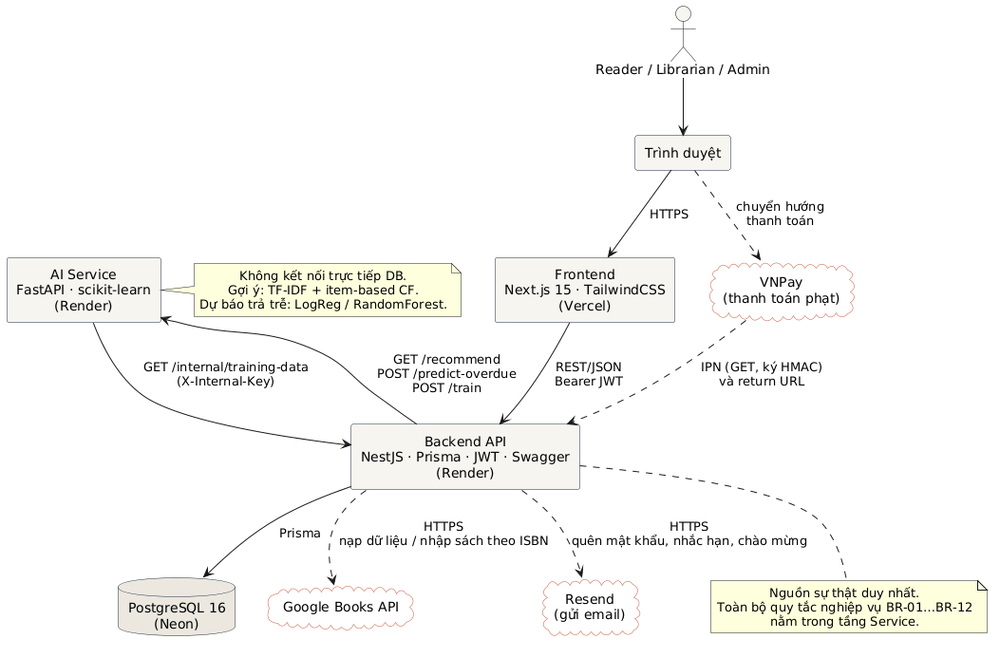
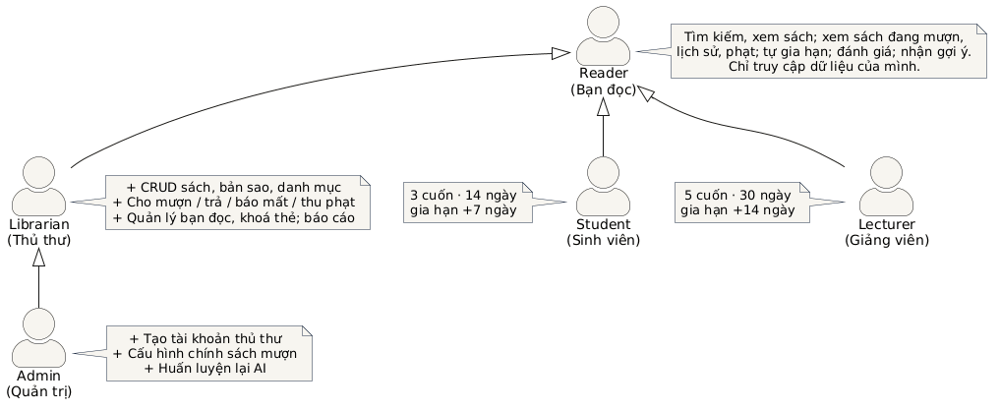

# TÀI LIỆU ĐẶC TẢ YÊU CẦU PHẦN MỀM (SRS)

## Hệ thống Quản lý Thư viện Trường Đại học: University Library System (ULS)

| | |
|---|---|
| Phiên bản | 2.0 |
| Ngày | 17/10/2026 |
| Chuẩn áp dụng | IEEE Std 830-1998 |
| Môn học | Công nghệ Phần mềm, Khoa CNTT, Trường ĐH Xây dựng Miền Trung |
| Giảng viên hướng dẫn | TS. Lê Tỷ Khánh |
| Đề tài | Đề tài 8: Phần mềm Quản lý Thư viện Trường Đại học |
| Nhóm thực hiện | Trần Đình Khôi, 23Q74802012006 (Nhóm trưởng); Nguyễn Như Quỳnh, 21DQ4802011003 |

### Lịch sử phiên bản

| Phiên bản | Ngày | Người sửa | Nội dung |
|---|---|---|---|
| 0.1 | 21/09/2026 | Nhóm | Bản nháp: actor, phạm vi, backlog |
| 1.0 | 22/09/2026 | Nhóm | Hoàn thiện 3 phần chính theo IEEE 830, 20 User Story, NFR đo được |
| 2.0 | 17/10/2026 | Nhóm | Đồng bộ với mã nguồn trên nhánh `main`: thêm F11 đến F16 (đặt trước, thông báo và email nhắc hạn, tài khoản và mật khẩu, thanh toán phạt VNPay, xuất báo cáo và in thẻ, nhập sách từ file), bổ sung NFR về hiệu năng, độ tin cậy, bảo mật, giao diện, triển khai; thêm BR-13 đến BR-26; thêm US21 đến US37; cập nhật ma trận truy vết |

---

# 1. GIỚI THIỆU

## 1.1. Mục đích

Tài liệu này đặc tả đầy đủ các yêu cầu chức năng và phi chức năng của **Hệ thống Quản lý Thư viện Trường Đại học** (viết tắt: ULS). Tài liệu dùng làm cơ sở thống nhất giữa nhóm phát triển, giảng viên hướng dẫn (đóng vai khách hàng) và người kiểm thử; là đầu vào cho các giai đoạn thiết kế (LAB 2), lập trình (LAB 3) và kiểm thử, triển khai (LAB 4). Phiên bản 2.0 mô tả hệ thống đúng như mã nguồn đang chạy sau các đợt mở rộng ngoài MVP.

Đối tượng đọc: giảng viên hướng dẫn, thành viên nhóm phát triển, người kiểm thử và người đánh giá sản phẩm bài tập lớn.

## 1.2. Phạm vi sản phẩm

ULS là ứng dụng web quản lý nghiệp vụ thư viện của một trường đại học, gồm: quản lý kho sách và bản sao vật lý, quản lý bạn đọc, mượn, trả, gia hạn, phạt, **đặt trước sách**, **thông báo trong web và email nhắc hạn**, **quản lý tài khoản và mật khẩu**, **thanh toán phạt trực tuyến qua VNPay**, tìm kiếm, thống kê báo cáo kèm **xuất CSV / Excel**, **in thẻ bạn đọc và nhãn mã vạch**, **nhập sách hàng loạt từ file**, và hai chức năng trí tuệ nhân tạo: **gợi ý sách cá nhân hoá** và **dự báo nguy cơ trả trễ** khi cho mượn.

**Mục tiêu:**

- Số hoá toàn bộ quy trình mượn/trả, thay thế ghi chép thủ công; thao tác cho mượn tại quầy ≤ 30 giây.
- Bạn đọc tự tra cứu, xem tình trạng sách, gia hạn trực tuyến, giảm số lượt đến quầy.
- Tự động tính phạt quá hạn và chặn mượn khi vi phạm, loại bỏ sai sót thủ công.
- Cung cấp số liệu thống kê phục vụ quyết định bổ sung sách.
- Ứng dụng AI để tăng tỉ lệ sách được mượn và giảm tỉ lệ trả trễ.
- Cho bạn đọc xếp hàng chờ sách đang hết bản và được giữ sách khi có người trả, thay cho việc quay lại quầy kiểm tra nhiều lần.
- Nhắc hạn trả chủ động (trong web và qua email), thu phạt trực tuyến, để giảm số phiếu quá hạn và số lượt đến quầy.

**Ngoài phạm vi** (xem mục 2.6): ứng dụng di động native, gửi SMS, tích hợp hệ thống đào tạo, đăng nhập nhiều thiết bị có quản lý phiên, hoàn tiền tự động qua VNPay.

## 1.3. Định nghĩa, từ viết tắt

| Thuật ngữ | Ý nghĩa |
|---|---|
| ULS | University Library System, hệ thống này |
| Reader / Bạn đọc | Người dùng có quyền mượn sách: sinh viên (STUDENT) hoặc giảng viên (LECTURER) |
| Librarian / Thủ thư | Nhân viên thư viện, thao tác nghiệp vụ tại quầy |
| Admin / Quản trị | Người quản trị hệ thống, cấu hình chính sách và tài khoản |
| Book / Đầu sách | Một tựa sách (ISBN, tiêu đề, tác giả…) |
| Copy / Bản sao | Một cuốn sách vật lý cụ thể, có mã vạch riêng |
| Loan / Phiếu mượn | Bản ghi một lần mượn một bản sao |
| Fine / Phạt | Khoản tiền phát sinh do trả trễ hoặc làm mất sách |
| Loan Policy / Chính sách mượn | Bộ tham số: số cuốn tối đa, số ngày mượn, số lần gia hạn, mức phạt, theo loại bạn đọc |
| US | User Story |
| AC | Acceptance Criteria, điều kiện nghiệm thu |
| FR / NFR | Functional / Non-functional Requirement |
| BR | Business Rule, quy tắc nghiệp vụ |
| JWT | JSON Web Token, cơ chế xác thực không trạng thái |
| RBAC | Role-Based Access Control, phân quyền theo vai trò |
| API | Application Programming Interface (REST/JSON) |
| SRS | Software Requirements Specification |
| Reservation / Đặt trước | Lượt xếp hàng của một bạn đọc để mượn một đầu sách đang hết bản trên kệ |
| HELD | Trạng thái bản sao đang được giữ cho bạn đọc đã đặt trước |
| Mật khẩu tạm | Mật khẩu ngẫu nhiên do hệ thống cấp, chỉ hiển thị một lần, buộc đổi ở lần đăng nhập đầu |
| IPN | Instant Payment Notification, lời gọi máy chủ tới máy chủ của VNPay báo kết quả giao dịch |
| VNPay | Cổng thanh toán trực tuyến dùng cho chức năng nộp phạt (môi trường sandbox) |
| Resend | Dịch vụ gửi email qua HTTP API, dùng cho quên mật khẩu, thư chào mừng và nhắc hạn |

## 1.4. Tài liệu tham khảo

1. IEEE Std 830-1998, *IEEE Recommended Practice for Software Requirements Specifications*.
2. TS. Lê Tỷ Khánh, *Hướng dẫn thực hành LAB kèm tài liệu hỗ trợ Bài tập lớn*, môn Công nghệ Phần mềm, 2026.
3. *10 Bài tập nhóm: Kế hoạch Quản lý Dự án*, Đề tài 8, 2026.
4. Bộ dữ liệu goodbooks-10k (CC BY-SA 4.0), https://github.com/zygmuntz/goodbooks-10k.
5. Google Books API, https://developers.google.com/books.
6. Tài liệu NestJS, Next.js, Prisma, FastAPI, scikit-learn (phiên bản hiện hành).
7. Tài liệu tích hợp VNPay Payment Gateway v2.1.0 (sandbox.vnpayment.vn).
8. Tài liệu Resend API, https://resend.com/docs.
9. WCAG 2.1, mức AA, https://www.w3.org/TR/WCAG21/.

## 1.5. Tổng quan tài liệu

- **Phần 2** mô tả tổng quan sản phẩm: bối cảnh, chức năng chính, người dùng, ràng buộc, giả định.
- **Phần 3** đặc tả chi tiết: giao diện ngoài, từng tính năng hệ thống (FR), yêu cầu phi chức năng (NFR), quy tắc nghiệp vụ (BR).
- **Phụ lục A** là Product Backlog gồm 37 User Story có Acceptance Criteria và Story Point.
- **Phụ lục B** là ma trận truy vết giữa User Story, Yêu cầu chức năng và Quy tắc nghiệp vụ.

---

# 2. MÔ TẢ TỔNG QUAN

## 2.1. Bối cảnh sản phẩm

ULS là hệ thống độc lập, xây dựng mới, không kế thừa hệ thống cũ. Kiến trúc gồm ba dịch vụ:

```
[Trình duyệt] ──HTTPS──▶ Frontend (Next.js)
                              │ REST/JSON
                              ▼
                        Backend API (NestJS) ── JWT, RBAC, Swagger
                         │            │
                         │            └──REST──▶ AI Service (FastAPI, scikit-learn)
                         ▼
                   PostgreSQL 16
                         ▲
        Google Books API ─┘ (nạp dữ liệu sách, nhập theo ISBN)

   Backend ──HTTPS──▶ Resend (email)        VNPay ──IPN/return──▶ Backend
```

- **Frontend** chạy trên trình duyệt, gọi Backend qua REST.
- **Backend** là nguồn sự thật duy nhất về dữ liệu, thực thi toàn bộ quy tắc nghiệp vụ, cung cấp dữ liệu huấn luyện cho AI Service.
- **AI Service** tách riêng, không kết nối trực tiếp cơ sở dữ liệu; cung cấp hai năng lực: gợi ý sách và dự báo trả trễ.
- **Google Books API** là tích hợp bên ngoài, dùng khi nạp dữ liệu ban đầu và khi Admin nhập sách hàng loạt theo ISBN (FR-BOOK-05).
- **Resend** là dịch vụ gửi email: liên kết đặt lại mật khẩu, thư chào mừng bạn đọc mới, email nhắc hạn trả. Không có khoá Resend thì Backend bỏ qua việc gửi thư và vẫn chạy bình thường.
- **VNPay** là cổng thanh toán phạt trực tuyến. Trình duyệt bạn đọc được chuyển sang VNPay, kết quả quay về qua `return URL` và qua IPN do VNPay gọi tới Backend. Không đủ cấu hình thì tính năng tự tắt, thu tiền mặt không bị ảnh hưởng.
- **Việc định kỳ** chạy trong tiến trình Backend mỗi 15 phút: huỷ giữ sách quá hạn nhận, nhắc hạn trả, gửi email nhắc hạn, nhả khoản phạt của giao dịch VNPay quá hạn.



## 2.2. Chức năng sản phẩm (tóm tắt)

| # | Nhóm chức năng | Mô tả ngắn |
|---|---|---|
| F1 | Xác thực và phân quyền | Đăng ký, đăng nhập, ba vai trò Reader / Librarian / Admin, từ chối token của tài khoản bị khoá |
| F2 | Quản lý sách | CRUD đầu sách, tác giả, thể loại, bản sao vật lý (mã vạch, trạng thái, vị trí kệ); nhập hàng loạt theo ISBN |
| F3 | Quản lý bạn đọc | Xem hồ sơ, lịch sử mượn, khoá/mở thẻ, tạo tài khoản thủ thư, thủ thư tạo bạn đọc tại quầy |
| F4 | Mượn, trả | Cho mượn tại quầy, trả, gia hạn, báo mất, tính phạt, ghi nhận thu tiền mặt |
| F5 | Tìm kiếm | Tìm theo tiêu đề / tác giả / thể loại / ISBN, lọc còn sách, phân trang |
| F6 | Thống kê, báo cáo | Sách mượn nhiều, bạn đọc quá hạn, lượt mượn theo tháng, tồn kho theo thể loại |
| F7 | Đánh giá sách | Bạn đọc chấm 1 đến 5 sao sách đã mượn |
| F8 | Cấu hình chính sách | Admin sửa tham số mượn theo loại bạn đọc |
| F9 | AI gợi ý sách | Danh sách sách gợi ý cá nhân hoá cho từng bạn đọc |
| F10 | AI dự báo trả trễ | Xác suất trả trễ hiển thị cho thủ thư lúc cho mượn |
| F11 | Đặt trước sách | Bạn đọc xếp hàng chờ sách hết bản, được giữ bản sao 3 ngày khi có người trả, tối đa 3 đặt trước cùng lúc |
| F12 | Thông báo và nhắc hạn | Chuông thông báo trong web, nhắc sắp đến hạn và quá hạn, thông báo đặt trước sẵn sàng hoặc hết hạn, email nhắc hạn có thể tắt |
| F13 | Tài khoản và mật khẩu | Hồ sơ cá nhân, đổi mật khẩu, quên và đặt lại mật khẩu qua email, mật khẩu tạm và buộc đổi, cấp lại mật khẩu |
| F14 | Thanh toán phạt trực tuyến | Nộp phạt qua VNPay, xác nhận bằng IPN và return, chặn thu trùng, đánh dấu cần hoàn tiền |
| F15 | Xuất báo cáo, in thẻ và nhãn | Xuất 7 loại dữ liệu ra CSV hoặc Excel, in thẻ bạn đọc, in nhãn mã vạch bản sao (Code 128, QR) |
| F16 | Nhập sách từ file | Nhập hàng loạt từ CSV hoặc xlsx có xem trước, báo cáo từng dòng lỗi |

## 2.3. Đặc điểm người dùng (Actor)

### Actor chính

| Actor | Mô tả | Quyền hạn | Đặc điểm |
|---|---|---|---|
| **Reader (Bạn đọc)** | Sinh viên (STUDENT) hoặc giảng viên (LECTURER) của trường | Đăng ký, đăng nhập; tìm kiếm, xem sách; xem sách đang mượn, lịch sử, tiền phạt; tự gia hạn; đặt trước sách; nhận thông báo; thanh toán phạt trực tuyến; đánh giá sách; nhận gợi ý; đổi mật khẩu, sửa hồ sơ | Số lượng lớn (hàng nghìn); dùng trên điện thoại và máy tính; kỹ năng tin học cơ bản |
| **Librarian (Thủ thư)** | Nhân viên thư viện làm việc tại quầy | Quyền tra cứu như Reader (các chức năng cá nhân của bạn đọc như mượn, gia hạn, đặt trước, thanh toán, đánh giá chỉ dành cho tài khoản Reader) + CRUD sách/bản sao/tác giả/thể loại; cho mượn, nhận trả, báo mất, ghi nhận thu tiền mặt, huỷ giao dịch chờ; quản lý hàng đợi đặt trước; quản lý bạn đọc, tạo bạn đọc tại quầy, cấp lại mật khẩu tạm cho bạn đọc; xuất báo cáo, in thẻ và nhãn, nhập sách từ file; xem báo cáo | 2 đến 5 người; dùng máy tính tại quầy; cần thao tác nhanh, ít bước |
| **Admin (Quản trị)** | Trưởng thư viện / phòng CNTT | Toàn bộ quyền Librarian + tạo tài khoản Librarian/Admin; cấp lại mật khẩu tạm cho mọi tài khoản; cấu hình chính sách mượn; nhập sách hàng loạt theo ISBN; huấn luyện lại AI | 1 đến 2 người; ít thao tác nhưng có quyền cao |

### Actor phụ (hệ thống ngoài)

| Actor | Vai trò |
|---|---|
| **AI Service** | Nhận yêu cầu từ Backend, trả về danh sách gợi ý / xác suất trả trễ; lấy dữ liệu huấn luyện từ Backend |
| **Google Books API** | Cung cấp thông tin sách theo ISBN khi nạp dữ liệu ban đầu và khi nhập hàng loạt |
| **Resend** | Nhận yêu cầu gửi email từ Backend (đặt lại mật khẩu, chào mừng, nhắc hạn) |
| **VNPay** | Nhận bạn đọc để thanh toán phạt; gọi lại Backend bằng IPN và return URL kèm chữ ký HMAC-SHA512 |




## 2.4. Ràng buộc

- **Công nghệ:** Frontend Next.js 15 + TypeScript + TailwindCSS; Backend NestJS 10 + Prisma + PostgreSQL 16; AI Service FastAPI + scikit-learn. Đóng gói Docker, CI/CD GitHub Actions. Email qua Resend, thanh toán qua VNPay.
- **Triển khai:** hạ tầng miễn phí (Vercel, Render free, Neon free), không có thẻ thanh toán; dịch vụ backend có thể "ngủ" sau 15 phút không dùng, khi đó việc định kỳ 15 phút không chạy và các thao tác mượn, đặt trước tự giải phóng bản sao HELD quá hạn khi được gọi. Render free chặn SMTP nên email gửi qua HTTP API của Resend. Địa chỉ web: https://muce-library.vercel.app.
- **Thời gian:** 8 tuần, theo 4 LAB của môn học.
- **Nhân lực:** nhóm sinh viên 1 đến 2 người làm chính (báo cáo ghi 4 thành viên).
- **Quy ước mã nguồn:** tên file, hàm, biến bằng tiếng Anh; giao diện và tài liệu tiếng Việt.
- **Pháp lý:** dữ liệu sách mẫu từ goodbooks-10k (CC BY-SA 4.0) phải ghi nguồn.
- **Bảo mật:** mật khẩu băm bằng bcrypt; không lưu mật khẩu thô; token có hạn; token đặt lại mật khẩu chỉ lưu dạng băm SHA-256.
- **Thanh toán:** VNPay chỉ ở môi trường sandbox; mỗi giao dịch tối thiểu 5.000 đồng theo yêu cầu của VNPay; hoàn tiền thực hiện thủ công trên cổng VNPay.

## 2.5. Giả định và phụ thuộc

- Mỗi bản sao sách có một mã vạch duy nhất; thủ thư nhập mã bằng tay hoặc máy quét (máy quét hoạt động như bàn phím).
- Bạn đọc là thành viên của trường, có mã sinh viên/giảng viên; hệ thống không xác minh với hệ thống đào tạo.
- Mức phạt và hạn mượn là tham số giả định (bảng 3.4), Admin thay đổi được.
- Google Books API trả về mô tả cho phần lớn ISBN; sách thiếu mô tả vẫn được quản lý bình thường.
- Dữ liệu mượn/trả lịch sử để huấn luyện AI là dữ liệu **mô phỏng** từ goodbooks-10k, không phải dữ liệu thật của thư viện.
- Người dùng dùng trình duyệt hiện đại (Chrome/Edge/Safari/Firefox 2 phiên bản gần nhất).
- Bạn đọc có email dùng được thì mới nhận được liên kết đặt lại mật khẩu và email nhắc hạn; nếu không, thủ thư cấp mật khẩu tạm.
- Thủ thư thu tiền mặt và xử lý hoàn tiền VNPay thủ công; hệ thống không tự hoàn tiền.

## 2.6. Ngoài phạm vi (Out of scope)

- Gửi SMS nhắc hạn (email và thông báo trong web đã có, xem F12).
- Ứng dụng di động native.
- Refresh token / đăng nhập nhiều thiết bị có quản lý phiên (hiện chỉ có thu hồi toàn bộ phiên cũ khi đặt lại mật khẩu).
- Tích hợp với hệ thống đào tạo / cổng sinh viên.
- Hoàn tiền tự động qua VNPay (hệ thống chỉ gắn cờ cần hoàn tiền, thủ thư hoàn thủ công).
- Thanh toán bằng cổng khác ngoài VNPay, thanh toán môi trường thật (production) của VNPay.
- Đặt trước nhiều bản của cùng một đầu sách, hoặc đặt trước theo bản sao cụ thể.

---

# 3. YÊU CẦU CỤ THỂ

## 3.1. Yêu cầu giao diện ngoài

### 3.1.1. Giao diện người dùng

- Ứng dụng web responsive, hoạt động từ chiều rộng 360 px (điện thoại) đến 1920 px; bố cục được kiểm tra ở ba chiều rộng 390, 768 và 1440 px, không cuộn ngang.
- Hệ thiết kế sáng, một màu nhấn chàm, logo trường, phông Be Vietnam Pro; mọi cặp chữ và nền đạt tương phản WCAG AA.
- Ba khu vực giao diện theo vai trò: **Bạn đọc** (tra cứu, sách của tôi, đặt trước, tiền phạt và thanh toán, gợi ý, tài khoản), **Thủ thư** (quầy mượn/trả, kho sách, bạn đọc, đặt trước, phiếu mượn, khoản phạt, báo cáo, in thẻ và nhãn), **Quản trị** (tài khoản nhân viên, chính sách). Khu quản trị có khung riêng với thanh điều hướng theo nhóm chức năng.
- Chuông thông báo trên thanh đầu trang cho mọi người dùng đã đăng nhập, tự làm mới mỗi 60 giây.
- Mọi thao tác nghiệp vụ chính (cho mượn, trả) hoàn tất trong ≤ 3 lần nhấp.
- Thông báo lỗi bằng tiếng Việt, nêu rõ nguyên nhân (ví dụ: "Bạn đọc còn 15.000đ phạt chưa thanh toán").

### 3.1.2. Giao diện phần cứng

- Không yêu cầu phần cứng đặc thù. Máy quét mã vạch (nếu có) hoạt động ở chế độ giả lập bàn phím.

### 3.1.3. Giao diện phần mềm

| Giao diện | Giao thức | Mô tả |
|---|---|---|
| Frontend ↔ Backend | REST/JSON qua HTTPS, xác thực Bearer JWT | Toàn bộ chức năng; đặc tả OpenAPI 3 sinh từ Swagger |
| Backend ↔ AI Service | REST/JSON nội bộ | `GET /recommend`, `POST /predict-overdue`, `POST /train`, `GET /health` |
| AI Service ↔ Backend | REST/JSON, header `X-Internal-Key` | `GET /internal/training-data`, dữ liệu huấn luyện |
| Backend ↔ PostgreSQL | TCP, Prisma ORM | Lưu trữ |
| Backend ↔ Google Books API | HTTPS | Lấy thông tin sách theo ISBN (seed và FR-BOOK-05), tối đa 1.000 yêu cầu/ngày |
| Backend → Resend | HTTPS `POST https://api.resend.com/emails`, Bearer API key, header `Idempotency-Key` | Gửi email đặt lại mật khẩu, chào mừng, nhắc hạn; Resend giới hạn 2 yêu cầu/giây nên Backend nghỉ 600 ms giữa hai thư nhắc hạn. Thiếu `RESEND_API_KEY` thì bỏ qua việc gửi |
| Frontend → VNPay | Chuyển hướng trình duyệt tới `paymentUrl` đã ký HMAC-SHA512 | Bạn đọc nhập thẻ và xác thực OTP trên trang của VNPay |
| VNPay → Backend | HTTPS `GET /api/payments/vnpay/ipn` và `GET /api/payments/vnpay/return`, tham số `vnp_*` kèm `vnp_SecureHash` | IPN là xác nhận chính thức từ máy chủ VNPay; return là trình duyệt quay về, cũng chốt giao dịch khi chữ ký và số tiền hợp lệ |
| Frontend ← Backend (tệp) | HTTPS, `Content-Disposition`, `X-Total-Count`, `X-Export-Truncated` | Tải CSV, xlsx xuất dữ liệu và file mẫu nhập sách |

### 3.1.4. Giao diện truyền thông

- HTTPS trên môi trường triển khai; HTTP trong docker-compose cục bộ qua Nginx gateway cổng 80.
- CORS chỉ cho phép origin của Frontend.

## 3.2. Tính năng hệ thống (Functional Requirements)

Quy ước: mỗi FR có mã `FR-<nhóm>-<số>`, mức ưu tiên **Cao / Trung bình / Thấp**.

### 3.2.1. F1: Xác thực và phân quyền

**Mô tả:** Người dùng đăng ký, đăng nhập và được phân quyền theo vai trò.

| Mã | Yêu cầu | Ưu tiên |
|---|---|---|
| FR-AUTH-01 | Hệ thống cho phép đăng ký tài khoản bạn đọc với: email (duy nhất, không phân biệt hoa thường), mật khẩu (theo BR-18), họ tên, loại bạn đọc (STUDENT/LECTURER), mã SV/GV (duy nhất, không phân biệt hoa thường, 3 đến 30 ký tự chữ, số, dấu gạch ngang). Tài khoản mới luôn có vai trò READER. | Cao |
| FR-AUTH-02 | Hệ thống cho phép đăng nhập bằng email + mật khẩu; thành công trả về JWT có hạn 24 giờ chứa id, vai trò. Sai email hay sai mật khẩu đều trả cùng một lỗi `INVALID_CREDENTIALS` và tốn thời gian như nhau. | Cao |
| FR-AUTH-03 | Mọi API (trừ đăng ký, đăng nhập, tra cứu sách công khai) yêu cầu JWT hợp lệ; API ghi dữ liệu kiểm tra vai trò (RBAC). Truy cập sai quyền trả HTTP 403. | Cao |
| FR-AUTH-04 | Người dùng xem được thông tin tài khoản của mình (`/auth/me`), gồm cờ `mustChangePassword`, `emailReminders` và thời điểm đăng nhập gần nhất, đăng nhập trước đó. | Trung bình |
| FR-AUTH-05 | Tài khoản bị khoá (`is_active = false`) không đăng nhập được, trả lỗi `ACCOUNT_LOCKED`. | Cao |
| FR-AUTH-06 | Ở mọi yêu cầu có JWT, hệ thống đọc lại tài khoản từ cơ sở dữ liệu: tài khoản đã bị khoá hoặc đã xoá bị từ chối (401), vai trò lấy từ cơ sở dữ liệu chứ không từ token nên hạ quyền và khoá thẻ có hiệu lực ngay. | Cao |
| FR-AUTH-07 | JWT được cấp trước thời điểm `sessions_revoked_at` của tài khoản (đặt khi đặt lại mật khẩu hoặc được cấp lại mật khẩu tạm) bị từ chối với 401. | Cao |

### 3.2.2. F2: Quản lý sách và bản sao

| Mã | Yêu cầu | Ưu tiên |
|---|---|---|
| FR-BOOK-01 | Thủ thư thêm đầu sách với: ISBN (duy nhất, tuỳ chọn), tiêu đề (bắt buộc), mô tả, nhà xuất bản, năm xuất bản, giá bìa, ảnh bìa, một thể loại, một hoặc nhiều tác giả. | Cao |
| FR-BOOK-02 | Thủ thư sửa thông tin đầu sách. | Cao |
| FR-BOOK-03 | Thủ thư xoá đầu sách chỉ khi không còn bản sao nào đang được mượn (`BOOK_HAS_ACTIVE_LOANS`) và sách chưa có lịch sử mượn (`BOOK_HAS_LOAN_HISTORY`); khi xoá, các đặt trước, đánh giá và bản sao của sách bị xoá cùng. | Trung bình |
| FR-BOOK-04 | Thủ thư quản lý danh mục tác giả và thể loại (thêm/sửa/xoá); không xoá thể loại đang có sách (`CATEGORY_IN_USE`) hay tác giả đang có sách (`AUTHOR_IN_USE`). | Trung bình |
| FR-BOOK-05 | Admin nhập sách hàng loạt bằng danh sách ISBN: hệ thống gọi Google Books API lấy tiêu đề, tác giả, mô tả, nhà xuất bản, năm, thể loại, ảnh bìa rồi tạo đầu sách; ISBN không tìm thấy hoặc đã tồn tại được báo cáo lại, không làm dừng cả lô. | Thấp |
| FR-COPY-01 | Thủ thư thêm bản sao cho một đầu sách với mã vạch duy nhất và vị trí kệ; bản sao mới có trạng thái AVAILABLE. | Cao |
| FR-COPY-02 | Thủ thư cập nhật trạng thái bản sao; không đổi trạng thái của bản sao đang có phiếu mượn ACTIVE (`COPY_HAS_ACTIVE_LOAN`); BORROWED chỉ được đặt qua phiếu mượn; HELD do hệ thống đặt khi có đặt trước và thủ thư không đặt hay gỡ tay (`COPY_HELD`). | Cao |
| FR-COPY-03 | Hệ thống hiển thị số bản sao còn mượn được (AVAILABLE) của mỗi đầu sách. Bản HELD không tính là còn mượn được. | Cao |

### 3.2.3. F3: Quản lý bạn đọc

| Mã | Yêu cầu | Ưu tiên |
|---|---|---|
| FR-USER-01 | Thủ thư xem danh sách bạn đọc, tìm theo tên / email / mã SV-GV, lọc theo vai trò và trạng thái thẻ. | Cao |
| FR-USER-02 | Thủ thư xem hồ sơ bạn đọc: thông tin, sách đang mượn, lịch sử mượn, tiền phạt chưa trả. | Cao |
| FR-USER-03 | Thủ thư khoá / mở thẻ bạn đọc; thẻ bị khoá không được mượn và không đăng nhập. | Cao |
| FR-USER-04 | Thủ thư sửa loại bạn đọc (STUDENT ↔ LECTURER). | Thấp |
| FR-USER-05 | Admin tạo tài khoản có vai trò LIBRARIAN hoặc ADMIN. | Cao |
| FR-USER-06 | Thủ thư chỉ khoá, mở thẻ và sửa bạn đọc; tài khoản nhân sự (LIBRARIAN, ADMIN) chỉ Admin sửa được (`STAFF_ACCOUNT_PROTECTED`, 403); không ai tự khoá chính mình (`CANNOT_LOCK_SELF`). | Cao |
| FR-USER-07 | Hồ sơ bạn đọc đếm số phiếu quá hạn theo cùng mốc ngày với danh sách phiếu và báo cáo quá hạn (BR-09). | Trung bình |

### 3.2.4. F4: Mượn, trả, gia hạn, phạt

| Mã | Yêu cầu | Ưu tiên |
|---|---|---|
| FR-LOAN-01 | Thủ thư tạo phiếu mượn bằng **mã vạch bản sao + mã bạn đọc**. Hệ thống kiểm tra toàn bộ điều kiện ở BR-01…BR-05; đạt thì tạo phiếu ACTIVE, đặt `due_at = hôm nay + loan_days`, chuyển bản sao sang BORROWED. | Cao |
| FR-LOAN-02 | Khi tạo phiếu mượn, hệ thống gọi AI Service để lấy xác suất trả trễ và trả kèm trong phản hồi; nếu AI không phản hồi trong 2 giây, phiếu mượn vẫn được tạo với `overdueRisk = null`. | Trung bình |
| FR-LOAN-03 | Thủ thư nhận trả sách theo mã vạch: phiếu chuyển sang RETURNED, `returned_at = now`; bản sao chuyển sang AVAILABLE, hoặc sang HELD nếu có bạn đọc đang xếp hàng đặt trước (FR-RES-04); nếu trả trễ, tự tạo khoản phạt OVERDUE theo BR-07. Khoá thẻ không chặn việc nhận trả. | Cao |
| FR-LOAN-04 | Bạn đọc tự gia hạn phiếu mượn của mình theo BR-06; thành công thì `due_at += renew_extra_days`, `renewed_count += 1`. | Cao |
| FR-LOAN-05 | Bạn đọc xem sách đang mượn (kèm ngày hạn, số ngày còn lại / đã trễ) và lịch sử mượn. | Cao |
| FR-LOAN-06 | Thủ thư ghi nhận báo mất theo BR-08: phiếu → LOST, bản sao → LOST, tạo khoản phạt LOST. | Trung bình |
| FR-LOAN-07 | Thủ thư xem danh sách phiếu mượn, lọc theo trạng thái và "quá hạn". | Cao |
| FR-FINE-01 | Bạn đọc xem các khoản phạt của mình và tổng chưa thanh toán. | Cao |
| FR-FINE-02 | Thủ thư xem danh sách khoản phạt (lọc đã thu hoặc chưa thu, theo bạn đọc) và ghi nhận đã thu tiền mặt (`paid_at`, người thu). Khoản phạt đang nằm trong giao dịch VNPay còn hiệu lực không thu tiền mặt được (`FINE_PAYMENT_PENDING`, xem FR-PAY-08). | Cao |
| FR-LOAN-08 | Mọi lỗi nghiệp vụ trả HTTP 400/409 với mã lỗi rõ ràng: `LOAN_LIMIT_REACHED`, `HAS_OVERDUE_LOAN`, `UNPAID_FINE`, `COPY_NOT_AVAILABLE`, `COPY_HELD`, `ACCOUNT_LOCKED`, `RENEW_LIMIT_REACHED`, `LOAN_OVERDUE_CANNOT_RENEW`, `LOAN_NOT_ACTIVE`, `LOAN_CHANGED`, `NOT_A_READER`. Danh sách đầy đủ ở SDD mục 5.10. | Cao |
| FR-LOAN-09 | Bản sao ở trạng thái HELD chỉ cho đúng bạn đọc đã đặt trước mượn; mượn thành công thì đặt trước chuyển sang FULFILLED. Bạn đọc khác nhận `COPY_HELD`. Bản HELD đã quá hạn nhận được giải phóng ngay khi thủ thư thử cho mượn. | Cao |
| FR-LOAN-10 | Các thao tác cho mượn, trả, gia hạn, báo mất, thu phạt chạy đồng thời trên cùng một bản ghi chỉ có một yêu cầu thành công: không có hai phiếu ACTIVE trên một bản sao, không vượt `max_books`, không tạo hai khoản phạt cho một lần trả, không vượt `renew_limit`, không thu một khoản phạt hai lần; yêu cầu thua nhận mã lỗi nghiệp vụ tương ứng. | Cao |

### 3.2.5. F5: Tìm kiếm

| Mã | Yêu cầu | Ưu tiên |
|---|---|---|
| FR-SEARCH-01 | Mọi người dùng (kể cả chưa đăng nhập) tìm sách theo từ khoá khớp một phần tiêu đề, tên tác giả hoặc ISBN (không phân biệt hoa thường; ISBN bỏ qua dấu gạch ngang). Các ký tự `%`, `_`, `\` trong từ khoá được coi là ký tự thường, từ khoá toàn khoảng trắng bị bỏ qua. | Cao |
| FR-SEARCH-02 | Lọc kết quả theo thể loại, tác giả, và "chỉ sách còn bản mượn được". | Cao |
| FR-SEARCH-03 | Phân trang: mặc định 20 kết quả/trang, tối đa 100; trả về tổng số kết quả. | Cao |
| FR-SEARCH-04 | Xem chi tiết đầu sách: thông tin, tác giả, số bản còn, điểm đánh giá trung bình, danh sách bản sao (thủ thư). | Cao |

### 3.2.6. F6: Thống kê, báo cáo

| Mã | Yêu cầu | Ưu tiên |
|---|---|---|
| FR-REPORT-01 | Top N sách (N từ 1 đến 50, mặc định 10) được mượn nhiều nhất trong khoảng thời gian chọn; ngày kết thúc dạng `YYYY-MM-DD` bao trọn cả ngày đó theo giờ thư viện (UTC+7); ngày không có thật bị từ chối (400). | Cao |
| FR-REPORT-02 | Danh sách bạn đọc đang có sách quá hạn kèm số ngày trễ và tiền phạt ước tính. | Cao |
| FR-REPORT-03 | Số lượt mượn theo tháng trong 12 tháng gần nhất (tham số `months` từ 1 đến 36), tháng tính theo giờ thư viện UTC+7, tháng không có lượt nào vẫn hiện với giá trị 0 (biểu đồ cột). | Cao |
| FR-REPORT-04 | Tồn kho theo thể loại: tổng bản sao, đang mượn, còn, đang giữ cho bạn đọc đã đặt trước, mất, bảo trì (biểu đồ). | Trung bình |
| FR-REPORT-05 | Chỉ Librarian và Admin truy cập báo cáo. | Cao |
| FR-REPORT-06 | Báo cáo quá hạn trả tối đa 5.000 dòng (tham số `limit`), xếp quá hạn lâu nhất trước, tổng số phiếu quá hạn nằm ở header `X-Total-Count`. | Trung bình |
| FR-REPORT-07 | Mọi báo cáo được gộp (GROUP BY) trong cơ sở dữ liệu, không kéo toàn bộ phiếu mượn về máy chủ ứng dụng để đếm. | Trung bình |

### 3.2.7. F7: Đánh giá sách

| Mã | Yêu cầu | Ưu tiên |
|---|---|---|
| FR-RATE-01 | Bạn đọc chấm 1 đến 5 sao cho đầu sách **đã từng mượn và trả**; mỗi bạn đọc một điểm/đầu sách, chấm lại thì ghi đè. | Trung bình |
| FR-RATE-02 | Trang chi tiết sách hiển thị điểm trung bình và số lượt đánh giá. | Thấp |

### 3.2.8. F8: Cấu hình chính sách mượn

| Mã | Yêu cầu | Ưu tiên |
|---|---|---|
| FR-POLICY-01 | Admin xem và sửa chính sách mượn theo loại bạn đọc: `max_books`, `loan_days`, `renew_limit`, `renew_extra_days`, `fine_per_day`. Giá trị phải là số nguyên dương. | Trung bình |
| FR-POLICY-02 | Thay đổi chính sách áp dụng cho phiếu mượn tạo **sau** thời điểm sửa; phiếu đang mượn giữ nguyên hạn. | Trung bình |

### 3.2.9. F9: AI gợi ý sách

| Mã | Yêu cầu | Ưu tiên |
|---|---|---|
| FR-AI-01 | Bạn đọc xem danh sách 10 sách gợi ý cá nhân hoá, dựa trên lịch sử mượn, đánh giá của bản thân và nội dung sách (mô hình lai: content-based + collaborative filtering). | Cao |
| FR-AI-02 | Bạn đọc chưa có lịch sử nhận gợi ý là các sách được mượn nhiều nhất. | Trung bình |
| FR-AI-03 | Gợi ý loại trừ sách bạn đọc đã mượn; ưu tiên sách còn bản mượn được. | Trung bình |
| FR-AI-04 | Mô hình được huấn luyện lại qua `POST /train` (Admin) hoặc khi AI Service khởi động. | Trung bình |

### 3.2.10. F10: AI dự báo trả trễ

| Mã | Yêu cầu | Ưu tiên |
|---|---|---|
| FR-AI-05 | Khi thủ thư tạo phiếu mượn, giao diện hiển thị "Nguy cơ trả trễ: X%" với mức màu (thấp < 30%, trung bình 30 đến 60%, cao > 60%). | Cao |
| FR-AI-06 | Dự báo dựa trên: số lần trễ trước đó, tỉ lệ trễ, số sách đang mượn, loại bạn đọc, thể loại sách, số ngày mượn, tháng mượn. | Cao |
| FR-AI-07 | Xác suất dự báo được lưu vào phiếu mượn để sau này đối chiếu độ chính xác thực tế. | Thấp |

### 3.2.11. F11: Đặt trước sách

**Mô tả:** Bạn đọc xếp hàng chờ một đầu sách đang hết bản trên kệ. Khi có bản sao được trả, hệ thống giữ nó cho người đứng đầu hàng đợi trong 3 ngày.

| Mã | Yêu cầu | Ưu tiên |
|---|---|---|
| FR-RES-01 | Bạn đọc (vai trò READER, thẻ còn hoạt động) đặt trước một đầu sách khi sách có ít nhất một bản sao đang lưu hành (AVAILABLE, BORROWED hoặc HELD) và không còn bản AVAILABLE. Sách không có bản nào đang lưu hành trả `NO_COPIES`; sách còn bản trên kệ trả `BOOK_AVAILABLE`. | Cao |
| FR-RES-02 | Hệ thống từ chối đặt trước khi bạn đọc đang mượn chính đầu sách đó (`ALREADY_BORROWING`), đã đặt đầu sách đó (`ALREADY_RESERVED`), đã có 3 đặt trước đang hiệu lực (`RESERVATION_LIMIT`), còn phạt chưa thanh toán (`UNPAID_FINE`), thẻ bị khoá (`ACCOUNT_LOCKED`) hoặc tài khoản không phải READER (`NOT_A_READER`). | Cao |
| FR-RES-03 | Hàng đợi xếp theo thứ tự tạo đặt trước. Bạn đọc xem danh sách đặt trước đang hiệu lực của mình; đặt trước ở trạng thái WAITING kèm vị trí trong hàng đợi (`queuePosition`, bắt đầu từ 1), đặt trước READY có `queuePosition = 0`. | Cao |
| FR-RES-04 | Khi một bản sao được trả về, hệ thống giữ nó cho bạn đọc đứng đầu hàng đợi có thẻ còn hoạt động: bản sao chuyển sang HELD, đặt trước chuyển sang READY với `expires_at = thời điểm trả + 3 ngày`, bạn đọc nhận thông báo `RESERVATION_READY`. Không có ai chờ thì bản sao về AVAILABLE. Trong cùng một giao dịch với việc trả sách. | Cao |
| FR-RES-05 | Chỉ bạn đọc có đặt trước READY gắn với bản sao đó mới mượn được bản HELD; người khác nhận `COPY_HELD`. Mượn thành công chuyển đặt trước sang FULFILLED. | Cao |
| FR-RES-06 | Đặt trước READY quá `expires_at` chuyển sang EXPIRED, bạn đọc nhận thông báo `RESERVATION_EXPIRED`, bản sao được giữ cho người kế tiếp trong hàng đợi hoặc về AVAILABLE. Việc này chạy trong việc định kỳ 15 phút và cũng được gọi khi có người đặt trước, xem danh sách đặt trước hoặc thử cho mượn một bản HELD. | Cao |
| FR-RES-07 | Bạn đọc huỷ đặt trước của mình; thủ thư huỷ đặt trước của bất kỳ ai. Huỷ đặt trước READY thì bản sao được giữ cho người kế tiếp hoặc về AVAILABLE. Huỷ đặt trước đã kết thúc trả `RESERVATION_NOT_ACTIVE`; bạn đọc huỷ đặt trước của người khác nhận 404. | Cao |
| FR-RES-08 | Thủ thư xem hàng đợi đặt trước có phân trang, lọc theo đầu sách và theo trạng thái (mặc định WAITING và READY). | Trung bình |
| FR-RES-09 | Các yêu cầu đặt trước đồng thời của cùng một bạn đọc không tạo trùng một đầu sách và không vượt hạn mức 3; hai bản sao trả về cùng lúc không cùng được giữ cho một người. | Cao |

### 3.2.12. F12: Thông báo và nhắc hạn

**Mô tả:** Hệ thống báo cho bạn đọc trong web (và qua email nếu bật) về sách sắp đến hạn, quá hạn và đặt trước.

| Mã | Yêu cầu | Ưu tiên |
|---|---|---|
| FR-NOTI-01 | Người dùng đã đăng nhập xem tối đa 30 thông báo mới nhất của mình kèm số thông báo chưa đọc; đánh dấu đã đọc một thông báo hoặc tất cả. Đánh dấu thông báo của người khác trả 404. | Cao |
| FR-NOTI-02 | Chuông thông báo trên thanh đầu trang hiện số chưa đọc và tự làm mới mỗi 60 giây. | Trung bình |
| FR-NOTI-03 | Hệ thống tạo thông báo `LOAN_DUE_SOON` cho phiếu ACTIVE có hạn trả trong vòng 2 ngày tới, và `LOAN_OVERDUE` cho phiếu đã sang ngày sau hạn (cùng mốc ngày với BR-09). Mỗi phiếu và mỗi loại chỉ có một thông báo; chỉ nhắc bạn đọc có thẻ còn hoạt động; duyệt toàn bộ phiếu theo lô 500, không bỏ sót khi có hơn 500 phiếu. | Cao |
| FR-NOTI-04 | Hệ thống tạo thông báo `RESERVATION_READY` và `RESERVATION_EXPIRED` theo FR-RES-04 và FR-RES-06, mỗi sự kiện một thông báo. | Cao |
| FR-NOTI-05 | Bạn đọc bật nhắc hạn qua email (mặc định bật) nhận email nhắc cho phiếu sắp đến hạn và quá hạn; các phiếu cùng loại của một bạn đọc gộp thành một thư. Mỗi phiếu và loại chỉ được gửi thành công một lần; gửi lỗi thì thử lại ở lượt sau, tối đa 5 lần. Bạn đọc tắt hoặc bật lại ở trang `/account`. | Cao |
| FR-NOTI-06 | Chưa cấu hình Resend thì mọi việc gửi email bị bỏ qua có ghi log, không phát sinh lỗi, không ghi trạng thái gửi (cấu hình sau là nhắc được ngay). Lỗi gửi email không làm hỏng thông báo trong web. | Cao |
| FR-NOTI-07 | Việc định kỳ chạy mỗi 15 phút (lần đầu 30 giây sau khi khởi động) gồm: huỷ giữ sách quá hạn nhận, nhắc hạn trong web, nhả khoản phạt của giao dịch VNPay quá hạn, gửi email nhắc hạn. Chạy lặp lại không tạo thông báo hay email trùng. | Cao |

### 3.2.13. F13: Tài khoản và mật khẩu

**Mô tả:** Người dùng tự quản lý hồ sơ và mật khẩu; thủ thư tạo bạn đọc tại quầy và cấp lại mật khẩu khi email không dùng được.

| Mã | Yêu cầu | Ưu tiên |
|---|---|---|
| FR-ACC-01 | Mọi vai trò xem và sửa hồ sơ tại `/account`: họ tên (2 đến 100 ký tự) và cờ nhận email nhắc hạn. Email, vai trò, mã thẻ không tự sửa được (gửi các trường đó trả 400). | Trung bình |
| FR-ACC-02 | Đổi mật khẩu cần mật khẩu hiện tại đúng (`WRONG_CURRENT_PASSWORD`, 400); mật khẩu mới theo BR-18 và phải khác mật khẩu hiện tại (`PASSWORD_UNCHANGED`, 400); thành công thì tắt cờ `mustChangePassword`. Tối đa 5 lần/phút. Lỗi trả 400 chứ không 401 để giao diện không hiểu nhầm là hết phiên. | Cao |
| FR-ACC-03 | Quên mật khẩu: người dùng nhập email, hệ thống luôn trả 200 cùng một nội dung dù email có tồn tại hay không. Chỉ khi tài khoản tồn tại, còn hoạt động và đã cấu hình Resend mới gửi thư chứa liên kết `/reset-password?token=...`. Hai yêu cầu của cùng một tài khoản phải cách nhau ít nhất 60 giây; mỗi lần gọi mất tối thiểu 400 ms để thời gian không lộ email có tồn tại. Tối đa 5 lần/phút. | Cao |
| FR-ACC-04 | Đặt lại mật khẩu bằng token: token dùng một lần, hạn 1 giờ; token sai, hết hạn, đã dùng hoặc của tài khoản bị khoá đều trả cùng một lỗi `INVALID_RESET_TOKEN` (400). Thành công thì đổi mật khẩu, tắt `mustChangePassword`, thu hồi mọi phiên đăng nhập cũ (FR-AUTH-07) và vô hiệu mọi token còn lại của tài khoản. Tối đa 10 lần/phút. | Cao |
| FR-ACC-05 | Thủ thư tạo bạn đọc tại quầy với email, họ tên, loại bạn đọc và mã thẻ tuỳ chọn (bỏ trống thì tự sinh dạng `DG` + 2 số cuối của năm + 6 chữ số). Hệ thống sinh mật khẩu tạm 12 ký tự và trả đúng một lần; tài khoản mang cờ `mustChangePassword`. Nếu đã cấu hình Resend, gửi thư chào mừng không chứa mật khẩu. Tối đa 30 lần/phút. | Cao |
| FR-ACC-06 | Cấp lại mật khẩu tạm: thủ thư cho bạn đọc, Admin cho mọi tài khoản. Thủ thư cấp cho nhân sự nhận `STAFF_ACCOUNT_PROTECTED` (403); không ai tự cấp lại cho mình (`CANNOT_RESET_SELF`). Mật khẩu tạm trả đúng một lần, bắt đổi ở lần đăng nhập sau, thu hồi phiên cũ và vô hiệu token đặt lại còn hiệu lực. | Cao |
| FR-ACC-07 | Tài khoản còn cờ `mustChangePassword` chỉ gọi được `GET /auth/me` và `POST /auth/change-password`; mọi API khác trả `PASSWORD_CHANGE_REQUIRED` (403) và giao diện tự chuyển tới `/account`. | Cao |
| FR-ACC-08 | Email được lưu và tra cứu bằng chữ thường, không phân biệt hoa thường khi kiểm trùng ở đăng ký, tạo bạn đọc, tạo tài khoản nhân sự và đăng nhập; tài khoản cũ lưu chữ hoa vẫn đăng nhập được. | Trung bình |

### 3.2.14. F14: Thanh toán phạt trực tuyến (VNPay)

**Mô tả:** Bạn đọc nộp phạt tại `/my/fines` qua cổng VNPay; thu tiền mặt tại quầy vẫn dùng như cũ.

| Mã | Yêu cầu | Ưu tiên |
|---|---|---|
| FR-PAY-01 | Bạn đọc tạo giao dịch thanh toán cho các khoản phạt chưa trả của chính mình (danh sách `fineIds`, bỏ trống là tất cả). Số tiền do máy chủ tính từ cơ sở dữ liệu, không nhận từ client. Phản hồi gồm `paymentUrl` đã ký HMAC-SHA512, `paymentId`, `txnRef`, `amount`. Thiếu cấu hình VNPay trả `PAYMENT_NOT_CONFIGURED` (503); khoản phạt không phải của mình hoặc không tồn tại trả 404. Tối đa 30 lần/phút. | Cao |
| FR-PAY-02 | Số tiền mỗi giao dịch từ 5.000 đến 999.999.999 đồng (`PAYMENT_AMOUNT_TOO_SMALL`, `PAYMENT_AMOUNT_TOO_LARGE`). Không có khoản phạt cần trả trả `NO_UNPAID_FINES`; khoản đã trả trả `FINE_ALREADY_PAID`; khoản đang nằm trong giao dịch chờ trả `FINE_PAYMENT_PENDING`. | Cao |
| FR-PAY-03 | Giao dịch PENDING hết hạn sau 15 phút (cũng là `vnp_ExpireDate`); khoản phạt được nhả khi có thao tác chạm tới và khi việc định kỳ chạy. | Cao |
| FR-PAY-04 | IPN `GET /api/payments/vnpay/ipn`: kiểm tra chữ ký (sai trả `RspCode` 97), tìm giao dịch theo `vnp_TxnRef` (không thấy: 01), so `vnp_Amount` với số tiền đã lưu nhân 100 (sai: 04), giao dịch đã xử lý (02). Thành công (`vnp_ResponseCode = 00`) đặt `fines.paid_at` với `paid_to = NULL` và chuyển giao dịch sang PAID trong một transaction, trả `RspCode` 00. IPN lặp lại không thu hai lần. | Cao |
| FR-PAY-05 | Return `GET /api/payments/vnpay/return`: xác minh chữ ký, chốt giao dịch qua cùng hàm xử lý idempotent với IPN (chỉ khi chữ ký đúng và số tiền khớp), rồi chuyển hướng 302 tới `${APP_PUBLIC_URL}/my/payments/result`; địa chỉ chuyển hướng không bao giờ lấy từ tham số do người dùng gửi. | Cao |
| FR-PAY-06 | Thanh toán thất bại hoặc bạn đọc huỷ trên VNPay (mã 24) chuyển giao dịch sang FAILED hoặc CANCELLED và nhả các khoản phạt để chọn lại hoặc nộp tiền mặt. | Cao |
| FR-PAY-07 | Tiền về muộn (IPN thành công đến sau khi giao dịch đã hết hạn, bị huỷ hoặc ghi hỏng): nếu mọi khoản phạt vẫn trống thì nhận tiền; nếu có khoản đã được thu cách khác thì không thu hai lần, giao dịch giữ nguyên trạng thái và gắn `needsRefund = true` để thủ thư hoàn tiền thủ công trên cổng VNPay. IPN vẫn trả `RspCode` 00 để VNPay ngừng gọi lại. | Cao |
| FR-PAY-08 | Thu tiền mặt một khoản phạt đang nằm trong giao dịch PENDING còn hạn bị chặn (`FINE_PAYMENT_PENDING`). Chủ giao dịch hoặc thủ thư huỷ giao dịch chờ (`POST /payments/:id/cancel`); huỷ giao dịch không còn ở trạng thái chờ trả `PAYMENT_NOT_PENDING`. Một khoản phạt chỉ thuộc tối đa một giao dịch đang chờ hoặc đã trả (ràng buộc duy nhất ở cơ sở dữ liệu). | Cao |
| FR-PAY-09 | Bạn đọc xem lịch sử giao dịch của mình (mới nhất trước, phân trang); chủ giao dịch hoặc thủ thư xem chi tiết một giao dịch. `GET /payments/config` cho giao diện biết cổng thanh toán đã bật chưa, hạn mức và thời hạn giữ chỗ; chưa bật thì giao diện ẩn nút và báo "chưa được bật". | Trung bình |

### 3.2.15. F15: Xuất báo cáo, in thẻ và nhãn

**Mô tả:** Thủ thư (Admin kế thừa) xuất dữ liệu ra tệp và in thẻ bạn đọc, nhãn mã vạch bản sao.

| Mã | Yêu cầu | Ưu tiên |
|---|---|---|
| FR-EXP-01 | Thủ thư xuất 7 bộ dữ liệu ra CSV hoặc Excel (`format=csv\|xlsx`, mặc định csv): phiếu mượn quá hạn, phiếu mượn, sách mượn nhiều nhất, tồn kho theo thể loại, khoản phạt, bạn đọc, danh mục sách. Reader không truy cập được (403). | Cao |
| FR-EXP-02 | Mỗi bộ dữ liệu có bộ lọc riêng (khoảng ngày, trạng thái, quá hạn, đã thu, từ khoá, thể loại, tác giả, thẻ hoạt động, loại bạn đọc...). Ngày dạng `YYYY-MM-DD` theo giờ thư viện UTC+7 và bao trọn ngày cuối. | Trung bình |
| FR-EXP-03 | Tệp được phát trực tiếp theo lô 1.000 dòng, không dựng toàn bộ trong bộ nhớ. Tối đa 100.000 dòng mỗi lần (cấu hình `EXPORT_MAX_ROWS`); vượt trần thì tệp bị cắt và có header `X-Export-Truncated: true`; `X-Total-Count` là số dòng khớp. | Cao |
| FR-EXP-04 | CSV mã hoá UTF-8 có BOM theo RFC 4180; ô văn bản bắt đầu bằng `=`, `+`, `-`, `@`, tab hoặc CR được thêm dấu `'` phía trước để chống formula injection; số tiền và số lượng ghi chữ số trần. Excel dùng kiểu số và ngày thật, tiền định dạng VND, hàng tiêu đề cố định kèm bộ lọc. | Cao |
| FR-EXP-05 | Header `Content-Disposition` có cả `filename` (ASCII) và `filename*=UTF-8''...` (tên tiếng Việt đầy đủ). | Thấp |
| FR-EXP-06 | In thẻ bạn đọc: một thẻ hoặc hàng loạt tối đa 300 thẻ, kích thước 85,6 x 54 mm, 10 thẻ trên một tờ A4 hoặc một thẻ mỗi trang; mã vạch Code 128 và mã QR đều chứa mã thẻ, vẽ bằng SVG ngay trên trình duyệt. | Trung bình |
| FR-EXP-07 | In nhãn mã vạch bản sao dạng `LIB-<id>-<n>` kèm tên sách và vị trí kệ, chọn theo đầu sách hoặc bản sao, tối đa 2.000 bản mỗi lần (`TOO_MANY_LABELS`, 422); các bố cục 3x8, 2x7, 4x10 trên A4 hoặc cuộn nhãn 50 x 25 mm; cho phép bỏ trống N ô đầu để dùng tiếp tờ đã in dở. | Trung bình |

### 3.2.16. F16: Nhập sách hàng loạt từ file

**Mô tả:** Thủ thư nhập nhiều đầu sách và bản sao từ tệp CSV hoặc xlsx, có xem trước. Chức năng nhập theo danh sách ISBN qua Google Books (FR-BOOK-05) vẫn dành cho Admin.

| Mã | Yêu cầu | Ưu tiên |
|---|---|---|
| FR-IMP-01 | Thủ thư tải tệp mẫu (`GET /books/import-template?format=csv\|xlsx`) có dòng ví dụ. Các cột: `title`, `authors` (cách nhau bằng dấu chấm phẩy), `category`, `isbn`, `publisher`, `publishedYear`, `price`, `description`, `coverUrl`, `copies`, `shelfLocation`; tiêu đề cột tiếng Việt cũng được nhận. | Trung bình |
| FR-IMP-02 | Chế độ xem trước (`dryRun=true`) chỉ kiểm tra và trả bản xem trước từng dòng gồm lỗi, cảnh báo, hành động (tạo, cập nhật, bỏ qua) và thể loại sẽ tạo; không ghi gì vào cơ sở dữ liệu. | Cao |
| FR-IMP-03 | Ghi thật theo lô 100 dòng trong giao dịch, kiểm tra lại dưới khoá advisory để hai lần nhập song song không sinh sách hoặc tác giả trùng và mã vạch không đụng nhau. Phản hồi gồm `created`, `updated`, `skipped`, `failed` (kèm số dòng, lý do, dữ liệu gốc), `createdCopies`, `newCategories`; giao diện cho tải các dòng lỗi thành CSV. | Cao |
| FR-IMP-04 | Nhập idempotent theo ISBN (ISBN-10 và ISBN-13 của cùng một sách được nhận là một). Tham số `onDuplicate=skip\|update` quyết định bỏ qua hay cập nhật sách đã có. Cột `copies` là số bản sao tối thiểu cần có: chỉ bổ sung, không bao giờ xoá. Dòng không có ISBN chỉ so trùng theo tiêu đề. | Cao |
| FR-IMP-05 | Kiểm tra tệp: loại tệp xác định bằng nội dung (magic bytes) chứ không theo đuôi hay Content-Type; tối đa 5 MB và 5.000 dòng; từ chối macro (`.xlsm`, `vbaProject.bin`), tệp nén giải ra quá lớn (đếm byte giải nén thật, trần 25 MB mỗi phần), CSV hỏng hoặc không phải UTF-8; công thức trong xlsx không bao giờ được thực thi, chỉ lấy giá trị đã tính; URL ảnh bìa chỉ nhận `http` hoặc `https`. | Cao |
| FR-IMP-06 | Mã lỗi: `IMPORT_NO_FILE` (400), `IMPORT_FILE_TYPE_INVALID` và `IMPORT_MACRO_NOT_ALLOWED` (415), `IMPORT_FILE_TOO_LARGE` (413), `IMPORT_TOO_MANY_ROWS`, `IMPORT_MALFORMED`, `IMPORT_MISSING_COLUMN`, `IMPORT_EMPTY`, `IMPORT_ENCODING` (422). | Trung bình |

## 3.3. Yêu cầu phi chức năng (Non-functional Requirements)

### 3.3.1. Hiệu năng

| Mã | Yêu cầu | Chỉ số đo |
|---|---|---|
| NFR-PERF-01 | Thời gian phản hồi API nghiệp vụ (tạo phiếu mượn, trả, tra cứu) | ≤ 2 giây tại p95 với 1.000 đầu sách, 3.000 bản sao, 2.000 bạn đọc, 20 người dùng đồng thời |
| NFR-PERF-02 | Tìm kiếm sách | ≤ 1 giây tại p95 |
| NFR-PERF-03 | Gợi ý AI | ≤ 3 giây khi model đã nạp; không chặn các chức năng khác |
| NFR-PERF-04 | Tải trang đầu (Frontend) | ≤ 3 giây trên mạng 4G, Lighthouse Performance ≥ 80 |
| NFR-PERF-05 | Chỉ mục cơ sở dữ liệu cho tìm kiếm và tra cứu: GIN pg_trgm trên `books.title`, `books.isbn`, `authors.name`, `users.full_name`, `users.email`, `users.member_code`; btree trên `book_copies(book_id, status)`, `loans(copy_id)`, `loans(status, due_at)`, `loans(borrowed_at)`, `fines(loan_id)`, `ratings(book_id)`, `books(category_id)`, `book_authors(author_id)`. Tìm sách theo chuỗi dùng UNION ba truy vấn, mỗi truy vấn đi một chỉ mục | Đo trên cơ sở dữ liệu tổng hợp 50.000 sách, 100.000 bản sao, 600.000 phiếu mượn, 1.000.000 đánh giá (EXPLAIN ANALYZE và HTTP thật, trước và sau): tìm theo từ khoá hiếm 258 ms xuống 9,6 ms; theo tác giả 254 ms xuống 11 ms; kèm bộ lọc còn sách 471 ms xuống 7 ms; điểm đánh giá trung bình ở chi tiết sách 27 ms xuống 0,45 ms; tìm bạn đọc 157 ms xuống 7 ms |
| NFR-PERF-06 | Báo cáo thống kê gộp bằng SQL (GROUP BY) thay vì tải toàn bộ phiếu mượn về máy chủ ứng dụng; báo cáo quá hạn giới hạn 5.000 dòng | Trước khi giới hạn, báo cáo quá hạn trả 6 MB và mất 1,3 giây với 24.000 phiếu quá hạn |
| NFR-PERF-07 | Xuất dữ liệu phát trực tiếp theo lô 1.000 dòng bằng con trỏ trên `id` (không OFFSET), bộ nhớ không tăng theo số dòng | Trần 100.000 dòng mỗi lần xuất |
| NFR-PERF-08 | Frontend giảm tải trang: biểu đồ (recharts) và hộp thoại nhập file, thẻ, nhãn nạp theo yêu cầu (`next/dynamic`); danh sách dài dùng `content-visibility`; preconnect tới máy chủ ảnh bìa; hoạt ảnh chỉ dùng `transform` và `opacity` | Kích thước JavaScript trang `/admin` từ 255 kB xuống 147 kB, `/reports` từ 263 kB xuống 144 kB nhờ nạp lười biểu đồ |

### 3.3.2. Bảo mật

| Mã | Yêu cầu |
|---|---|
| NFR-SEC-01 | Mật khẩu băm bcrypt (cost ≥ 10); không bao giờ trả mật khẩu/hash qua API. |
| NFR-SEC-02 | JWT ký HS256, hết hạn 24 giờ (cấu hình `JWT_EXPIRES_IN`); khoá bí mật lấy từ biến môi trường, không có trong mã nguồn. Ở mọi yêu cầu, hệ thống đọc lại tài khoản từ cơ sở dữ liệu: từ chối tài khoản đã khoá, đã xoá, hoặc token cấp trước thời điểm thu hồi phiên; vai trò lấy từ cơ sở dữ liệu. |
| NFR-SEC-03 | RBAC trên mọi endpoint ghi dữ liệu; bạn đọc chỉ truy cập dữ liệu của mình (`/loans/me`, `/fines/me`). |
| NFR-SEC-04 | Kiểm tra hợp lệ toàn bộ dữ liệu đầu vào (class-validator); từ chối trường lạ. |
| NFR-SEC-05 | Giới hạn tốc độ theo IP mỗi phút: chung 100 yêu cầu; đăng nhập 10; đổi mật khẩu 5; quên mật khẩu 5; đặt lại mật khẩu 10; thủ thư tạo bạn đọc 30; cấp lại mật khẩu tạm 30; tạo giao dịch thanh toán 30. Vượt giới hạn trả 429 `TOO_MANY_REQUESTS` theo định dạng lỗi chung. IPN và return của VNPay không bị giới hạn (chỉ xác thực bằng chữ ký). |
| NFR-SEC-06 | Chỉ dùng truy vấn tham số hoá (Prisma), chống SQL injection; escape đầu ra, chống XSS. |
| NFR-SEC-07 | HTTPS trên môi trường triển khai; CORS whitelist. |
| NFR-SEC-08 | Endpoint nội bộ `/internal/*` yêu cầu khoá `X-Internal-Key`. |
| NFR-SEC-09 | Token đặt lại mật khẩu là 32 byte ngẫu nhiên, chỉ lưu SHA-256, dùng một lần, hạn 1 giờ; tra token qua chỉ mục duy nhất của cơ sở dữ liệu nên không có phép so sánh chuỗi bí mật để đo thời gian. Quên mật khẩu luôn trả cùng một phản hồi và san phẳng thời gian; đăng nhập chạy bcrypt cả khi email không tồn tại. Phản hồi của các API mật khẩu có `Cache-Control: no-store`. |
| NFR-SEC-10 | Chữ ký VNPay HMAC-SHA512 được tạo cho URL gửi đi và kiểm tra ở IPN và return trước khi xử lý; số tiền luôn tính lại ở máy chủ và đối chiếu với `vnp_Amount`; địa chỉ chuyển hướng sau thanh toán chỉ nằm dưới `APP_PUBLIC_URL`; mã giao dịch `txnRef` ngẫu nhiên khó đoán. |
| NFR-SEC-11 | Chống formula injection khi xuất CSV (thêm dấu `'` trước ô bắt đầu bằng `=`, `+`, `-`, `@`, tab, CR). |
| NFR-SEC-12 | Kiểm tra tệp tải lên: xác định loại bằng magic bytes, giới hạn kích thước và số dòng, từ chối macro và tệp nén bất thường, không thực thi công thức, chỉ nhận URL ảnh `http` hoặc `https`. |
| NFR-SEC-13 | Từ chối ký tự NUL ở mọi body, query, param; mã định danh ngoài miền INT4 bị từ chối thay vì gây lỗi 500; lỗi cơ sở dữ liệu đã biết (trùng khoá, không tìm thấy, vi phạm tham chiếu) được đổi sang 409 hoặc 404 có mã nghiệp vụ; nội dung thư, token, khoá bí mật không ghi vào log. |
| NFR-SEC-14 | Khoá Resend và khoá bí mật VNPay chỉ nằm trong biến môi trường (`RESEND_API_KEY`, `VNPAY_HASH_SECRET`); thiếu khoá thì tính năng tắt chứ không lỗi. Frontend gửi các header `X-Content-Type-Options: nosniff`, `Referrer-Policy: strict-origin-when-cross-origin`, `X-Frame-Options: SAMEORIGIN`. |

### 3.3.3. Độ tin cậy và khả dụng

| Mã | Yêu cầu |
|---|---|
| NFR-AVAIL-01 | Mục tiêu khả dụng 99% trong giờ làm việc của thư viện (7h đến 21h). *Ghi chú: hạ tầng miễn phí (Render free) ngủ sau 15 phút không dùng nên không cam kết 99,9%; đạt 99,9% khi chuyển sang gói trả phí.* |
| NFR-AVAIL-02 | Mọi thao tác ghi liên quan mượn/trả/phạt nằm trong một giao dịch cơ sở dữ liệu (atomic); lỗi giữa chừng thì rollback toàn bộ. |
| NFR-AVAIL-03 | AI Service không khả dụng không làm gián đoạn mượn/trả (fallback theo FR-LOAN-02). |
| NFR-AVAIL-04 | Sao lưu cơ sở dữ liệu hằng ngày (tính năng của Neon); có script seed để dựng lại dữ liệu mẫu. |
| NFR-AVAIL-05 | Các thao tác mượn, trả, gia hạn, báo mất, thu phạt, đặt trước, thanh toán, nhập sách an toàn khi chạy đồng thời: khoá hàng bạn đọc (`FOR UPDATE`) để xếp hàng các yêu cầu của cùng một người, cập nhật có điều kiện (`UPDATE ... WHERE status = ...`) để chốt chuyển trạng thái, `FOR UPDATE SKIP LOCKED` khi chọn người đứng đầu hàng đợi, khoá advisory khi nhập sách hàng loạt, chỉ mục duy nhất từng phần `payment_fines_active_fine_key` cho khoản phạt. Có 12 ca đua trên PostgreSQL thật trong `concurrency.e2e-spec.ts`. |
| NFR-AVAIL-06 | Việc định kỳ 15 phút chạy lặp lại an toàn (khoá chống trùng `dedupe_key`, `INSERT ... ON CONFLICT DO NOTHING`, cập nhật có điều kiện); lỗi của email nhắc hạn không làm hỏng nhắc hạn trong web; Resend không khả dụng không làm gián đoạn nghiệp vụ. |

### 3.3.4. Khả năng sử dụng

| Mã | Yêu cầu |
|---|---|
| NFR-USE-01 | Responsive từ 360 px; không cuộn ngang. Bố cục được kiểm tra ở 390, 768 và 1440 px. |
| NFR-USE-02 | Thao tác cho mượn tại quầy ≤ 3 lần nhấp và ≤ 30 giây (đo bằng kịch bản UAT). |
| NFR-USE-03 | Giao diện tiếng Việt; thông báo lỗi nêu rõ nguyên nhân và cách khắc phục. |
| NFR-USE-04 | Người dùng mới (thủ thư) thực hiện được mượn/trả sau ≤ 15 phút hướng dẫn. |
| NFR-USE-05 | Khả năng tiếp cận mức WCAG AA: mọi cặp màu chữ và nền đạt tỉ lệ tương phản AA (đã đo); viền focus rõ cho bàn phím; hộp thoại giữ focus, Tab quay vòng trong hộp, Esc đóng và trả focus; vùng bấm tối thiểu 40 px; nút trong hàng bảng có tên đầy đủ; hoạt ảnh tắt khi người dùng chọn giảm chuyển động (`prefers-reduced-motion`). |
| NFR-USE-06 | Giao diện dùng chung một hệ thiết kế (nền sáng, màu nhấn chàm, góc bo, phông Be Vietnam Pro); có khung chờ (skeleton) khi tải; khu quản trị có khung riêng; trang công khai (trang chủ, tra cứu, chi tiết sách, quy định) dựng phía máy chủ và có dữ liệu cấu trúc schema.org để hỗ trợ tìm kiếm. |

### 3.3.5. Khả năng bảo trì và kiểm thử

| Mã | Yêu cầu |
|---|---|
| NFR-MAINT-01 | Kiến trúc Controller, Service, Repository; quy tắc nghiệp vụ tập trung trong tầng Service. |
| NFR-MAINT-02 | Độ bao phủ unit test của tầng Service, guard và client (Backend) đạt ngưỡng 80% dòng, câu lệnh, hàm và 75% nhánh, và module AI ≥ 80%. Năm service nặng SQL (thanh toán, xuất dữ liệu, nhập file, email nhắc hạn, đặt lại mật khẩu) được loại khỏi ngưỡng unit vì đã có kiểm thử e2e trên PostgreSQL thật. |
| NFR-MAINT-03 | Mọi thay đổi phải qua Pull Request, CI xanh mới được merge. Pipeline GitHub Actions gồm các job `backend` (lint, build, `prisma db push`, unit có coverage, e2e), `ai-service` (pytest), `frontend` (lint, build), `compose-smoke` (dựng cả năm container và gọi thử qua gateway), `deploy` (chỉ trên `main`, chạy sau khi bốn job trước xanh). |
| NFR-MAINT-06 | Mã chạm cơ sở dữ liệu, tiền hoặc quyền có kiểm thử e2e trên PostgreSQL thật (supertest) bên cạnh unit test dùng mock; mỗi lần sửa lỗi đua có ca tái hiện. |
| NFR-MAINT-04 | Đặc tả API sinh tự động (Swagger/OpenAPI) và luôn khớp mã nguồn. |
| NFR-MAINT-05 | Conventional Commits; mã nguồn đặt tên tiếng Anh; ESLint + Prettier. |

### 3.3.6. Khả năng chuyển đổi và triển khai

| Mã | Yêu cầu |
|---|---|
| NFR-PORT-01 | Toàn bộ hệ thống khởi chạy cục bộ bằng một lệnh `docker compose up`. |
| NFR-PORT-02 | Cấu hình qua biến môi trường; không có giá trị môi trường trong mã nguồn. |
| NFR-PORT-03 | Triển khai tự động lên cloud khi merge vào nhánh `main`: job `deploy` gọi Deploy Hook của Render cho backend và AI service, Vercel tự dựng frontend qua tích hợp GitHub, sau đó CI gọi thử ba địa chỉ live. |
| NFR-PORT-04 | Cấu hình triển khai: frontend trên Vercel (địa chỉ https://muce-library.vercel.app, địa chỉ cũ chuyển hướng sang địa chỉ này), backend và AI service trên Render (Docker, vùng Singapore), cơ sở dữ liệu Neon; Vercel chuyển tiếp `/api/*` và `/ai/*` sang Render nên trình duyệt chỉ làm việc với một origin. |
| NFR-PORT-05 | Biến môi trường tuỳ chọn của backend: `RESEND_API_KEY`, `MAIL_FROM`, `APP_PUBLIC_URL`, `VNPAY_TMN_CODE`, `VNPAY_HASH_SECRET`, `VNPAY_URL`, `VNPAY_RETURN_URL`, `EXPORT_MAX_ROWS`, `LIBRARY_UTC_OFFSET_MINUTES`; thiếu thì tính năng tương ứng tắt, ứng dụng vẫn chạy. Danh sách đầy đủ ở `docs/deploy/DEPLOY.md`. |

## 3.4. Quy tắc nghiệp vụ (Business Rules)

**Chính sách mượn mặc định** (Admin thay đổi được: FR-POLICY-01):

| Loại bạn đọc | Số cuốn tối đa | Hạn mượn | Gia hạn | Mức phạt trễ |
|---|---|---|---|---|
| STUDENT | 3 | 14 ngày | 1 lần, +7 ngày | 5.000 đ/ngày |
| LECTURER | 5 | 30 ngày | 1 lần, +14 ngày | 5.000 đ/ngày |

| Mã | Quy tắc |
|---|---|
| BR-01 | Chỉ tài khoản vai trò READER được mượn sách. |
| BR-02 | Không cho mượn khi bạn đọc đã đạt `max_books` phiếu ACTIVE. |
| BR-03 | Không cho mượn khi bạn đọc đang có ít nhất một phiếu quá hạn (`returned_at IS NULL AND due_at < now`). |
| BR-04 | Không cho mượn khi bạn đọc còn khoản phạt chưa thanh toán. |
| BR-05 | Không cho mượn khi thẻ bị khoá hoặc bản sao không ở trạng thái AVAILABLE. Ngoại lệ: bản sao HELD được mượn bởi đúng bạn đọc đã đặt trước (BR-16). |
| BR-06 | Gia hạn chỉ khi: phiếu ACTIVE, chưa quá hạn, `renewed_count < renew_limit`, không có phạt chưa trả. |
| BR-07 | Phạt trễ = số **ngày lịch** trễ × `fine_per_day`; tạo khi trả sách hoặc báo mất. Trả trong chính ngày hết hạn (dù muộn giờ) không bị phạt; sang ngày hôm sau tính 1 ngày. Ngày lịch theo giờ thư viện (mặc định UTC+7, đổi bằng `LIBRARY_UTC_OFFSET_MINUTES`). |
| BR-08 | Báo mất: phạt mất = giá bìa sách + phạt trễ tính đến ngày báo; phiếu và bản sao chuyển LOST. |
| BR-09 | "Quá hạn" là trạng thái suy ra từ `due_at`, không lưu cứng; báo cáo quá hạn tính tại thời điểm truy vấn. |
| BR-10 | Chính sách mượn được "chụp" vào phiếu tại thời điểm tạo (`due_at` đã tính); đổi chính sách không ảnh hưởng phiếu cũ. |
| BR-11 | Chỉ đánh giá sách đã có phiếu RETURNED; một điểm/bạn đọc/đầu sách. |
| BR-12 | Không xoá đầu sách còn bản sao đang mượn hoặc đã có lịch sử mượn; không xoá thể loại hay tác giả còn sách. |
| BR-13 | Chỉ đặt trước được đầu sách có ít nhất một bản sao đang lưu hành (AVAILABLE, BORROWED, HELD) và không còn bản AVAILABLE. |
| BR-14 | Mỗi bạn đọc có tối đa 3 đặt trước đang hiệu lực (WAITING hoặc READY); không đặt trước đầu sách đang mượn hoặc đã đặt; không đặt trước khi còn phạt chưa trả hoặc thẻ bị khoá. |
| BR-15 | Hàng đợi theo thứ tự tạo đặt trước. Bản sao được trả về chuyển cho người đứng đầu hàng đợi có thẻ còn hoạt động và giữ 3 ngày (`HOLD_DAYS`); quá hạn nhận thì đặt trước EXPIRED và bản sao chuyển cho người kế tiếp hoặc về AVAILABLE. |
| BR-16 | Bản sao HELD chỉ đúng người đặt trước mượn được; thủ thư không đặt hay gỡ trạng thái HELD bằng tay. |
| BR-17 | Nhắc hạn: "sắp đến hạn" khi hạn trả còn trong 2 ngày tới, "quá hạn" khi đã sang ngày sau hạn (cùng mốc BR-09); mỗi phiếu và loại chỉ nhắc một lần trong web, và chỉ gửi email thành công một lần; chỉ nhắc bạn đọc có thẻ còn hoạt động; email chỉ gửi khi bạn đọc còn bật `emailReminders`. |
| BR-18 | Chính sách mật khẩu duy nhất cho đăng ký, đổi và đặt lại: từ 8 ký tự đến 72 byte (giới hạn của bcrypt); mật khẩu mới phải khác mật khẩu hiện tại. |
| BR-19 | Mật khẩu tạm gồm 12 ký tự ngẫu nhiên (có chữ hoa, chữ thường, chữ số, bỏ các ký tự dễ nhầm), chỉ hiển thị một lần; tài khoản mang cờ `mustChangePassword` và chỉ được xem hồ sơ và đổi mật khẩu cho tới khi đổi. |
| BR-20 | Token đặt lại mật khẩu hạn 1 giờ, dùng một lần; yêu cầu mới vô hiệu token cũ; hai yêu cầu của cùng tài khoản cách nhau tối thiểu 60 giây; đặt lại thành công hoặc cấp lại mật khẩu tạm thì mọi phiên đăng nhập cũ bị thu hồi. |
| BR-21 | Thủ thư chỉ sửa và cấp lại mật khẩu cho bạn đọc; tài khoản nhân sự do Admin quản lý; không ai tự khoá hoặc tự cấp lại mật khẩu tạm cho chính mình. |
| BR-22 | Thanh toán trực tuyến: số tiền do máy chủ tính từ các khoản phạt, tối thiểu 5.000 đồng và tối đa 999.999.999 đồng mỗi giao dịch; giao dịch chờ hết hạn sau 15 phút; một khoản phạt chỉ thuộc tối đa một giao dịch đang chờ hoặc đã trả. |
| BR-23 | Khoản phạt đang nằm trong giao dịch chờ còn hạn không thu tiền mặt được; thu tiền mặt có `paid_to` là thủ thư, thu trực tuyến có `paid_to` rỗng. |
| BR-24 | Tiền về muộn cho khoản phạt đã được thu cách khác không được thu lần hai: giao dịch gắn `needsRefund` và thủ thư hoàn tiền thủ công trên cổng VNPay. |
| BR-25 | Xuất dữ liệu tối đa 100.000 dòng mỗi lần; ngày lọc tính theo giờ thư viện UTC+7 và bao trọn ngày cuối; ô CSV bắt đầu bằng ký tự công thức được vô hiệu hoá. |
| BR-26 | Nhập sách từ file idempotent theo ISBN; `copies` là số bản sao tối thiểu, chỉ bổ sung không xoá; tối đa 5 MB và 5.000 dòng mỗi tệp; hai lần nhập đồng thời xếp hàng theo khoá advisory. |

---

# PHỤ LỤC A: PRODUCT BACKLOG (USER STORIES)

Quy ước Story Point theo Fibonacci (1, 2, 3, 5, 8). Ưu tiên: **Must** (bắt buộc MVP), **Should**, **Could**. Tổng: **37 User Story, 155 điểm** (US01 đến US20 là MVP, 77 điểm; US21 đến US37 là các đợt mở rộng sau MVP, 78 điểm, gom vào Sprint 5; điểm của US21 trở đi là ước lượng bổ sung khi cập nhật tài liệu). Backlog quản lý trên GitHub Projects của repo.

| ID | User Story | Acceptance Criteria | Điểm | Ưu tiên | Sprint |
|---|---|---|---|---|---|
| US01 | **As a** Reader, **I want to** đăng ký tài khoản bằng email, mật khẩu, mã SV/GV và loại bạn đọc, **so that** tôi có thể dùng thư viện trực tuyến. | 1. Email và mã SV/GV chưa tồn tại → tạo tài khoản READER, trả 201. 2. Email trùng → 409 `EMAIL_EXISTS`. 3. Mật khẩu < 8 ký tự → 400. 4. Mật khẩu được băm, không trả về trong response. | 3 | Must | 1 |
| US02 | **As a** người dùng, **I want to** đăng nhập bằng email và mật khẩu, **so that** hệ thống nhận diện vai trò của tôi. | 1. Đúng thông tin → trả JWT hạn 24h + thông tin user. 2. Sai mật khẩu → 401, không tiết lộ email có tồn tại hay không. 3. Tài khoản bị khoá → 403 `ACCOUNT_LOCKED`. 4. Gọi API cần quyền với JWT hết hạn → 401. | 2 | Must | 1 |
| US03 | **As a** Librarian, **I want to** thêm, sửa, xoá đầu sách với tác giả và thể loại, **so that** kho sách luôn đúng thực tế. | 1. Thêm sách thiếu tiêu đề → 400. 2. ISBN trùng → 409. 3. Sách gắn được ≥ 1 tác giả và 1 thể loại. 4. Xoá sách còn bản sao đang mượn → 409 `BOOK_HAS_ACTIVE_LOANS`. 5. Reader gọi POST/PATCH/DELETE → 403. | 5 | Must | 1 |
| US04 | **As a** Librarian, **I want to** quản lý bản sao vật lý (mã vạch, trạng thái, vị trí kệ), **so that** biết chính xác cuốn nào đang ở đâu. | 1. Mã vạch duy nhất, trùng → 409. 2. Bản sao mới có trạng thái AVAILABLE. 3. Không đổi sang AVAILABLE khi bản sao có phiếu ACTIVE → 409. 4. Trang chi tiết sách (thủ thư) liệt kê mọi bản sao và trạng thái. | 3 | Must | 1 |
| US05 | **As a** Reader, **I want to** tìm sách theo tiêu đề, tác giả, thể loại hoặc ISBN và lọc sách còn mượn được, **so that** tôi tìm nhanh cuốn cần. | 1. Từ khoá khớp một phần tiêu đề/tác giả/ISBN, không phân biệt hoa thường. 2. Lọc theo thể loại, tác giả, `available=true`. 3. Phân trang 20/trang, trả tổng số. 4. Phản hồi ≤ 1 s với 1.000 sách. 5. Không cần đăng nhập. | 5 | Must | 1 |
| US06 | **As a** Reader, **I want to** xem chi tiết một đầu sách và số bản còn, **so that** tôi biết có thể mượn ngay không. | 1. Hiển thị đủ thông tin, tác giả, thể loại, ảnh bìa. 2. Hiển thị "Còn X/Y bản". 3. Hiển thị điểm đánh giá trung bình. 4. Sách không tồn tại → 404. | 2 | Must | 1 |
| US07 | **As a** Librarian, **I want to** tạo phiếu mượn bằng mã vạch bản sao và mã bạn đọc, **so that** cho mượn tại quầy nhanh và đúng quy định. | 1. Đủ điều kiện → phiếu ACTIVE, `due_at` = hôm nay + `loan_days` theo loại bạn đọc, bản sao → BORROWED. 2. Đã đủ `max_books` → 409 `LOAN_LIMIT_REACHED`. 3. Đang có sách quá hạn → 409 `HAS_OVERDUE_LOAN`. 4. Còn phạt chưa trả → 409 `UNPAID_FINE`. 5. Bản sao không AVAILABLE → 409 `COPY_NOT_AVAILABLE`. 6. Thẻ khoá → 409 `ACCOUNT_LOCKED`. 7. Toàn bộ thao tác trong 1 transaction. 8. Hoàn tất ≤ 3 click. | 8 | Must | 2 |
| US08 | **As a** Librarian, **I want to** nhận trả sách theo mã vạch và hệ thống tự tính phạt, **so that** không phải tính tay và không bỏ sót. | 1. Phiếu → RETURNED, bản sao → AVAILABLE. 2. Trả đúng hạn → không có phạt. 3. Trả trễ N ngày → tạo phạt OVERDUE = N × `fine_per_day`, hiển thị số tiền ngay. 4. Bản sao không có phiếu ACTIVE → 409. | 5 | Must | 2 |
| US09 | **As a** Reader, **I want to** tự gia hạn sách đang mượn, **so that** không phải đến quầy. | 1. Đủ điều kiện → `due_at` += `renew_extra_days`, `renewed_count` += 1. 2. Đã gia hạn đủ số lần → 409 `RENEW_LIMIT_REACHED`. 3. Đã quá hạn → 409 `LOAN_OVERDUE_CANNOT_RENEW`. 4. Còn phạt chưa trả → 409 `UNPAID_FINE`. 5. Gia hạn phiếu của người khác → 403. | 3 | Must | 2 |
| US10 | **As a** Reader, **I want to** xem sách đang mượn, ngày hạn và lịch sử mượn, **so that** tôi trả đúng hạn. | 1. Danh sách phiếu ACTIVE với số ngày còn lại; quá hạn tô đỏ kèm số ngày trễ. 2. Lịch sử phiếu RETURNED/LOST phân trang. 3. Chỉ thấy phiếu của mình. | 3 | Must | 2 |
| US11 | **As a** Librarian, **I want to** ghi nhận sách bị mất, **so that** kho và công nợ bạn đọc được cập nhật đúng. | 1. Phiếu → LOST, bản sao → LOST. 2. Tạo phạt LOST = giá bìa + phạt trễ đến ngày báo. 3. Bản sao LOST không xuất hiện trong số "còn mượn được". | 3 | Should | 2 |
| US12 | **As a** Reader, **I want to** xem tiền phạt của mình; **as a** Librarian, **I want to** ghi nhận đã thu tiền, **so that** công nợ minh bạch. | 1. Reader thấy từng khoản (loại, số tiền, phiếu liên quan) và tổng chưa trả. 2. Librarian lọc khoản chưa trả, bấm "Đã thu" → `paid_at`, người thu. 3. Khoản đã trả không thu lại được → 409. 4. Sau khi trả hết, bạn đọc mượn lại được. | 3 | Must | 2 |
| US13 | **As a** Librarian, **I want to** tra cứu bạn đọc, xem hồ sơ và khoá/mở thẻ, **so that** xử lý được vi phạm. | 1. Tìm theo tên/email/mã, lọc theo trạng thái thẻ. 2. Hồ sơ: sách đang mượn, lịch sử, phạt chưa trả. 3. Khoá thẻ → không mượn, không đăng nhập; mở lại được. 4. Reader không truy cập được trang này → 403. | 5 | Must | 1 |
| US14 | **As an** Admin, **I want to** tạo tài khoản thủ thư, **so that** nhân viên mới có thể làm việc. | 1. Tạo user với vai trò LIBRARIAN hoặc ADMIN. 2. Librarian gọi endpoint này → 403. 3. Email trùng → 409. | 2 | Must | 1 |
| US15 | **As an** Admin, **I want to** cấu hình số cuốn tối đa, hạn mượn, số lần gia hạn và mức phạt theo loại bạn đọc, **so that** thư viện đổi quy định không cần sửa code. | 1. Xem bảng chính sách STUDENT/LECTURER. 2. Sửa với giá trị nguyên dương; giá trị ≤ 0 → 400. 3. Phiếu tạo sau đó dùng chính sách mới; phiếu cũ giữ nguyên hạn. 4. Librarian sửa → 403. | 3 | Should | 2 |
| US16 | **As a** Librarian, **I want to** xem dashboard thống kê (sách mượn nhiều, bạn đọc quá hạn, lượt mượn theo tháng, tồn kho theo thể loại), **so that** đề xuất mua sách và nhắc bạn đọc. | 1. Top 10 sách mượn nhiều theo khoảng thời gian chọn. 2. Danh sách quá hạn kèm số ngày trễ, phạt ước tính. 3. Biểu đồ cột lượt mượn 12 tháng. 4. Biểu đồ tồn kho theo thể loại. 5. Reader truy cập → 403. 6. Mỗi báo cáo ≤ 2 s. | 5 | Must | 2 |
| US17 | **As a** Reader, **I want to** chấm điểm 1 đến 5 sao cho sách đã mượn, **so that** gợi ý cho tôi chính xác hơn. | 1. Chỉ chấm được sách có phiếu RETURNED của mình; chưa mượn → 403 `NOT_BORROWED`. 2. Điểm ngoài 1 đến 5 → 400. 3. Chấm lại → ghi đè, không tạo bản ghi mới. 4. Điểm trung bình trên trang sách cập nhật. | 2 | Should | 2 |
| US18 | **As a** Reader, **I want to** nhận danh sách sách gợi ý theo sở thích, **so that** tôi khám phá sách phù hợp. | 1. Trả 10 sách, không gồm sách đã mượn. 2. Bạn đọc có lịch sử → kết quả từ mô hình lai; không có → sách mượn nhiều nhất. 3. Precision@5 trên tập kiểm tra ≥ 0,15 (báo cáo kèm số đo). 4. AI Service lỗi → trang hiển thị "chưa có gợi ý", không lỗi trang. 5. ≤ 3 s. | 8 | Must | 3 |
| US19 | **As a** Librarian, **I want to** thấy nguy cơ trả trễ của bạn đọc ngay khi tạo phiếu mượn, **so that** tôi nhắc nhở người có nguy cơ cao. | 1. Phản hồi tạo phiếu kèm `overdueRisk` 0 đến 1; UI hiện % và màu (xanh < 30, vàng 30 đến 60, đỏ > 60). 2. AI không phản hồi trong 2 s → phiếu vẫn tạo, `overdueRisk = null`, UI hiện "không có dự báo". 3. Mô hình đạt ROC-AUC ≥ 0,70 trên tập kiểm tra (báo cáo kèm bảng so sánh Logistic Regression vs Random Forest). 4. Giá trị dự báo lưu vào phiếu. | 5 | Must | 3 |
| US20 | **As a** Librarian, **I want to** quản lý danh mục tác giả và thể loại, **so that** nhập sách nhất quán. | 1. CRUD tác giả, thể loại. 2. Xoá thể loại còn sách → 409 `CATEGORY_IN_USE`. 3. Tên thể loại duy nhất. | 2 | Should | 1 |
| US21 | **As a** Reader, **I want to** đặt trước một cuốn sách đang hết bản, **so that** tôi được giữ sách khi có người trả. | 1. Sách không còn bản AVAILABLE nhưng còn bản đang lưu hành → 201, đặt trước WAITING. 2. Sách còn bản trên kệ → 409 `BOOK_AVAILABLE`; sách không có bản nào → 409 `NO_COPIES`. 3. Đã đặt cuốn đó → 409 `ALREADY_RESERVED`; đang mượn cuốn đó → 409 `ALREADY_BORROWING`. 4. Đã có 3 đặt trước → 409 `RESERVATION_LIMIT`; còn phạt chưa trả → 409 `UNPAID_FINE`. 5. Bắn 4 yêu cầu đặt cùng một cuốn đồng thời chỉ tạo 1 đặt trước; 5 cuốn đồng thời không vượt 3. | 5 | Must | 5 |
| US22 | **As a** Reader, **I want to** xem vị trí trong hàng đợi và huỷ đặt trước, **so that** tôi biết còn phải chờ bao lâu và nhả lượt khi không cần. | 1. Danh sách đặt trước của tôi hiện `queuePosition` (WAITING từ 1, READY là 0) và hạn nhận sách của đặt trước READY. 2. Huỷ đặt trước của mình → CANCELLED. 3. Huỷ đặt trước đã kết thúc → 409 `RESERVATION_NOT_ACTIVE`. 4. Huỷ đặt trước của người khác → 404. 5. Huỷ đặt trước READY thì bản sao được giữ cho người kế tiếp hoặc về AVAILABLE. | 2 | Must | 5 |
| US23 | **As a** Librarian, **I want to** xem hàng đợi đặt trước và huỷ khi cần, **so that** xử lý được trường hợp bạn đọc không đến nhận. | 1. Danh sách có phân trang, lọc theo đầu sách và trạng thái, mặc định WAITING và READY. 2. Huỷ được đặt trước của bất kỳ bạn đọc nào. 3. Reader gọi danh sách này → 403. | 2 | Should | 5 |
| US24 | **As a** Reader, **I want to** được giữ sách trong 3 ngày khi có người trả, **so that** tôi đến quầy là mượn được. | 1. Khi bản sao được trả, người đứng đầu hàng đợi có thẻ hoạt động nhận bản sao HELD, đặt trước READY, `expires_at` = +3 ngày, thông báo `RESERVATION_READY`. 2. Người khác mượn bản HELD → 409 `COPY_HELD`; đúng người đặt mượn được và đặt trước thành FULFILLED. 3. Quá hạn nhận → EXPIRED, thông báo `RESERVATION_EXPIRED`, bản sao chuyển cho người kế tiếp hoặc AVAILABLE. 4. Hai bản sao trả cùng lúc khi chỉ có một người chờ: một bản HELD, một bản về AVAILABLE. 5. Thủ thư không đặt hay gỡ HELD bằng tay → 409 `COPY_HELD`. | 5 | Must | 5 |
| US25 | **As a** Reader, **I want to** nhận thông báo trong web về sách sắp đến hạn, quá hạn và đặt trước, **so that** tôi không quên trả sách. | 1. Chuông hiện số chưa đọc, làm mới mỗi 60 giây. 2. Phiếu có hạn trong 2 ngày tới sinh một thông báo `LOAN_DUE_SOON`; phiếu sang ngày sau hạn sinh một `LOAN_OVERDUE`; mỗi phiếu và loại chỉ một lần dù việc định kỳ chạy lại. 3. Đánh dấu đã đọc một hoặc tất cả; không đánh dấu được thông báo của người khác → 404. 4. Có hơn 500 phiếu cần nhắc vẫn nhắc đủ. | 3 | Should | 5 |
| US26 | **As a** Reader, **I want to** nhận email nhắc hạn và tắt được khi không muốn, **so that** tôi được nhắc cả khi không mở web. | 1. Bạn đọc bật nhắc hạn nhận một email gộp các phiếu cùng loại. 2. Mỗi phiếu và loại chỉ gửi thành công một lần; lỗi gửi thử lại tối đa 5 lần. 3. Tắt tại `/account` thì không nhận thêm. 4. Chưa cấu hình Resend thì bỏ qua, không lỗi. | 5 | Should | 5 |
| US27 | **As a** người dùng, **I want to** đổi mật khẩu và sửa hồ sơ, **so that** tôi tự quản lý tài khoản. | 1. Đổi mật khẩu cần mật khẩu hiện tại đúng, sai → 400 `WRONG_CURRENT_PASSWORD`. 2. Mật khẩu mới trùng mật khẩu cũ → 400 `PASSWORD_UNCHANGED`; ngắn hơn 8 ký tự hoặc quá 72 byte → 400. 3. Sửa họ tên và cờ email nhắc hạn; gửi email, vai trò, mã thẻ → 400. 4. Gọi đổi mật khẩu quá 5 lần/phút → 429. | 3 | Must | 5 |
| US28 | **As a** người dùng, **I want to** đặt lại mật khẩu qua email khi quên, **so that** tôi vào lại được mà không cần đến quầy. | 1. Quên mật khẩu luôn trả 200 cùng nội dung dù email có tồn tại hay không. 2. Email thật nhận liên kết có token hạn 1 giờ, dùng một lần; hai yêu cầu cách nhau dưới 60 giây thì không gửi thư thứ hai. 3. Token sai, hết hạn hoặc đã dùng → 400 `INVALID_RESET_TOKEN`. 4. Đặt lại thành công thì token cũ và mọi JWT cũ đều bị từ chối (401). 5. Tài khoản bị khoá không nhận thư. | 5 | Must | 5 |
| US29 | **As a** Librarian, **I want to** tạo tài khoản bạn đọc tại quầy và cấp lại mật khẩu tạm, **so that** bạn đọc không có email vẫn dùng được hệ thống. | 1. Tạo bạn đọc với email, họ tên, loại bạn đọc; mã thẻ bỏ trống thì tự sinh `DGyy` + 6 số. 2. Phản hồi có mật khẩu tạm 12 ký tự, chỉ một lần. 3. Bạn đọc đăng nhập bằng mật khẩu tạm chỉ gọi được `/auth/me` và đổi mật khẩu, các API khác → 403 `PASSWORD_CHANGE_REQUIRED`. 4. Cấp lại mật khẩu cho nhân sự bằng tài khoản thủ thư → 403 `STAFF_ACCOUNT_PROTECTED`; tự cấp cho mình → 409 `CANNOT_RESET_SELF`. 5. Email hoặc mã thẻ trùng → 409. | 5 | Must | 5 |
| US30 | **As a** Reader, **I want to** thanh toán tiền phạt trực tuyến qua VNPay, **so that** tôi không phải đến quầy nộp tiền mặt. | 1. Chọn khoản phạt (hoặc tất cả) → nhận `paymentUrl` ký HMAC-SHA512; số tiền do máy chủ tính. 2. Dưới 5.000 đồng → 409 `PAYMENT_AMOUNT_TOO_SMALL`; không có khoản phạt → 409 `NO_UNPAID_FINES`. 3. IPN thành công đặt `paid_at` và giao dịch PAID; IPN gửi lại không thu hai lần (`RspCode` 02); sai chữ ký → 97; sai số tiền → 04. 4. Return quay về trang `/my/payments/result` hiện kết quả. 5. Giao dịch quá 15 phút chưa trả → EXPIRED và nhả khoản phạt. 6. Chưa cấu hình VNPay → 503 `PAYMENT_NOT_CONFIGURED`, giao diện ẩn nút. | 8 | Must | 5 |
| US31 | **As a** Librarian, **I want to** huỷ giao dịch chờ và nhận biết giao dịch cần hoàn tiền, **so that** không thu trùng và xử lý được tiền về muộn. | 1. Thu tiền mặt khoản phạt đang nằm trong giao dịch chờ còn hạn → 409 `FINE_PAYMENT_PENDING`. 2. Huỷ giao dịch chờ → CANCELLED, sau đó thu tiền mặt được. 3. IPN thành công đến sau khi khoản phạt đã được thu tiền mặt → không thu lần hai, giao dịch `needsRefund = true`, IPN vẫn trả 00. 4. Huỷ giao dịch không còn chờ → 409 `PAYMENT_NOT_PENDING`. | 3 | Must | 5 |
| US32 | **As a** Librarian, **I want to** xuất báo cáo ra CSV hoặc Excel, **so that** tôi lưu, lọc và gửi số liệu cho lãnh đạo. | 1. Xuất được 7 bộ dữ liệu (quá hạn, phiếu mượn, sách mượn nhiều, tồn kho, khoản phạt, bạn đọc, danh mục sách) ở cả hai định dạng. 2. CSV mở trong Excel hiển thị đúng tiếng Việt (UTF-8 có BOM); ô bắt đầu bằng `=`, `+`, `-`, `@` được thêm dấu `'`. 3. Quá 100.000 dòng → tệp bị cắt, header `X-Export-Truncated: true`. 4. Reader gọi → 403. | 5 | Should | 5 |
| US33 | **As a** Librarian, **I want to** in thẻ bạn đọc có mã vạch và mã QR, **so that** bạn đọc dùng thẻ vật lý tại quầy. | 1. In một thẻ hoặc hàng loạt tối đa 300 thẻ. 2. Thẻ 85,6 x 54 mm, 10 thẻ trên một tờ A4. 3. Mã Code 128 và QR đều chứa mã thẻ và giải mã ngược được. | 3 | Could | 5 |
| US34 | **As a** Librarian, **I want to** in nhãn mã vạch cho bản sao, **so that** dán lên sách và quét khi cho mượn, trả. | 1. Chọn theo đầu sách hoặc bản sao, tối đa 2.000 nhãn, vượt → 422 `TOO_MANY_LABELS`. 2. Có các bố cục 3x8, 2x7, 4x10 và cuộn 50 x 25 mm. 3. Bỏ trống N ô đầu để dùng tiếp tờ in dở. | 3 | Could | 5 |
| US35 | **As a** Librarian, **I want to** nhập hàng loạt sách và bản sao từ tệp CSV hoặc xlsx có xem trước, **so that** nhập kho nhanh và ít sai. | 1. Tải tệp mẫu. 2. `dryRun=true` trả xem trước từng dòng và không ghi gì. 3. Ghi thật trả `created`, `updated`, `skipped`, `failed`; tải được các dòng lỗi. 4. Nhập lại cùng tệp không tạo sách trùng (theo ISBN); `copies` chỉ bổ sung. 5. Tệp có macro → 415; quá 5 MB → 413; quá 5.000 dòng → 422; thiếu cột bắt buộc → 422. 6. Hai lần nhập đồng thời không sinh sách trùng hay mã vạch đụng nhau. | 8 | Should | 5 |
| US36 | **As a** Librarian, **I want to** thao tác mượn, trả, thu phạt đúng ngay cả khi nhiều quầy cùng làm, **so that** dữ liệu không bị sai lệch. | 1. Năm bạn đọc mượn cùng một bản sao đồng thời: đúng một phiếu. 2. Một bạn đọc mượn nhiều bản đồng thời: không vượt `max_books`. 3. Trả cùng một phiếu 4 lần đồng thời: một lần 200, một khoản phạt. 4. Gia hạn 5 lần đồng thời chỉ dùng một lượt gia hạn. 5. Thu một khoản phạt từ 3 yêu cầu: một lần 200, còn lại 409 `FINE_ALREADY_PAID`. 6. Tài khoản bị khoá không dùng được JWT đã cấp (401). | 5 | Must | 5 |
| US37 | **As a** Reader, **I want to** dùng giao diện rõ ràng, nhanh và đọc được trên điện thoại, **so that** tôi tra cứu và thao tác thuận tiện. | 1. Không cuộn ngang ở 390, 768, 1440 px. 2. Mọi cặp chữ và nền đạt tương phản WCAG AA. 3. Hộp thoại giữ focus, Esc đóng, trả focus; có viền focus cho bàn phím. 4. Hoạt ảnh chỉ dùng `transform` và `opacity`, tắt khi chọn giảm chuyển động. 5. Biểu đồ nạp theo yêu cầu. 6. Khu quản trị có khung riêng. | 8 | Should | 5 |

**Tổng điểm theo sprint:** Sprint 1 = 29, Sprint 2 = 35, Sprint 3 = 13, Sprint 5 = 78. (Sprint 0 là dựng khung, Sprint 4 là triển khai, không tính story. Sprint 5 gom các đợt mở rộng sau MVP: đặt trước và thông báo, tài khoản, thanh toán VNPay, xuất, in và nhập, kiểm toán hiệu năng và độ tin cậy, giao diện thiết kế lại.)

# PHỤ LỤC B: MA TRẬN TRUY VẾT

| User Story | Yêu cầu chức năng | Quy tắc nghiệp vụ |
|---|---|---|
| US01 | FR-AUTH-01 | BR-18 |
| US02 | FR-AUTH-02, FR-AUTH-03, FR-AUTH-04, FR-AUTH-05, FR-AUTH-06 | BR-18 |
| US03 | FR-BOOK-01, FR-BOOK-02, FR-BOOK-03, FR-BOOK-05 | BR-12 |
| US04 | FR-COPY-01, FR-COPY-02, FR-COPY-03 | không có |
| US05 | FR-SEARCH-01, FR-SEARCH-02, FR-SEARCH-03 | không có |
| US06 | FR-SEARCH-04, FR-COPY-03 | không có |
| US07 | FR-LOAN-01, FR-LOAN-02, FR-LOAN-08 | BR-01…BR-05, BR-10 |
| US08 | FR-LOAN-03 | BR-07, BR-09 |
| US09 | FR-LOAN-04, FR-LOAN-08 | BR-06 |
| US10 | FR-LOAN-05 | BR-09 |
| US11 | FR-LOAN-06 | BR-08 |
| US12 | FR-FINE-01, FR-FINE-02 | BR-04, BR-23 |
| US13 | FR-USER-01, FR-USER-02, FR-USER-03, FR-USER-04 | BR-05 |
| US14 | FR-USER-05, FR-USER-06 | BR-21 |
| US15 | FR-POLICY-01, FR-POLICY-02 | BR-10 |
| US16 | FR-REPORT-01…05 | BR-09 |
| US17 | FR-RATE-01, FR-RATE-02 | BR-11 |
| US18 | FR-AI-01…04 | không có |
| US19 | FR-AI-05, FR-AI-06, FR-AI-07, FR-LOAN-02 | không có |
| US20 | FR-BOOK-04 | BR-12 |
| US21 | FR-RES-01, FR-RES-02, FR-RES-09 | BR-13, BR-14 |
| US22 | FR-RES-03, FR-RES-07 | BR-14 |
| US23 | FR-RES-07, FR-RES-08 | BR-14 |
| US24 | FR-RES-04, FR-RES-05, FR-RES-06, FR-LOAN-09, FR-LOAN-03, FR-COPY-02 | BR-05, BR-15, BR-16 |
| US25 | FR-NOTI-01, FR-NOTI-02, FR-NOTI-03, FR-NOTI-04, FR-NOTI-07 | BR-09, BR-17 |
| US26 | FR-NOTI-05, FR-NOTI-06, FR-ACC-01 | BR-17 |
| US27 | FR-ACC-01, FR-ACC-02, FR-AUTH-04 | BR-18 |
| US28 | FR-ACC-03, FR-ACC-04, FR-AUTH-07, FR-ACC-08 | BR-18, BR-20 |
| US29 | FR-ACC-05, FR-ACC-06, FR-ACC-07, FR-USER-06 | BR-19, BR-21 |
| US30 | FR-PAY-01, FR-PAY-02, FR-PAY-03, FR-PAY-04, FR-PAY-05, FR-PAY-06, FR-PAY-09 | BR-22 |
| US31 | FR-PAY-07, FR-PAY-08, FR-FINE-02 | BR-23, BR-24 |
| US32 | FR-EXP-01, FR-EXP-02, FR-EXP-03, FR-EXP-04, FR-EXP-05, FR-REPORT-06, FR-REPORT-07 | BR-25 |
| US33 | FR-EXP-06 | không có |
| US34 | FR-EXP-07 | không có |
| US35 | FR-IMP-01, FR-IMP-02, FR-IMP-03, FR-IMP-04, FR-IMP-05, FR-IMP-06 | BR-26 |
| US36 | FR-LOAN-10, FR-AUTH-06, FR-RES-09 | BR-02, BR-10 |
| US37 | không có (yêu cầu phi chức năng NFR-USE-01, NFR-USE-05, NFR-USE-06, NFR-PERF-08) | không có |
